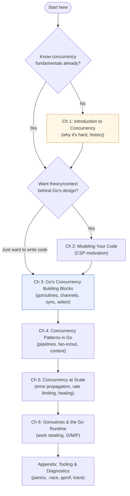
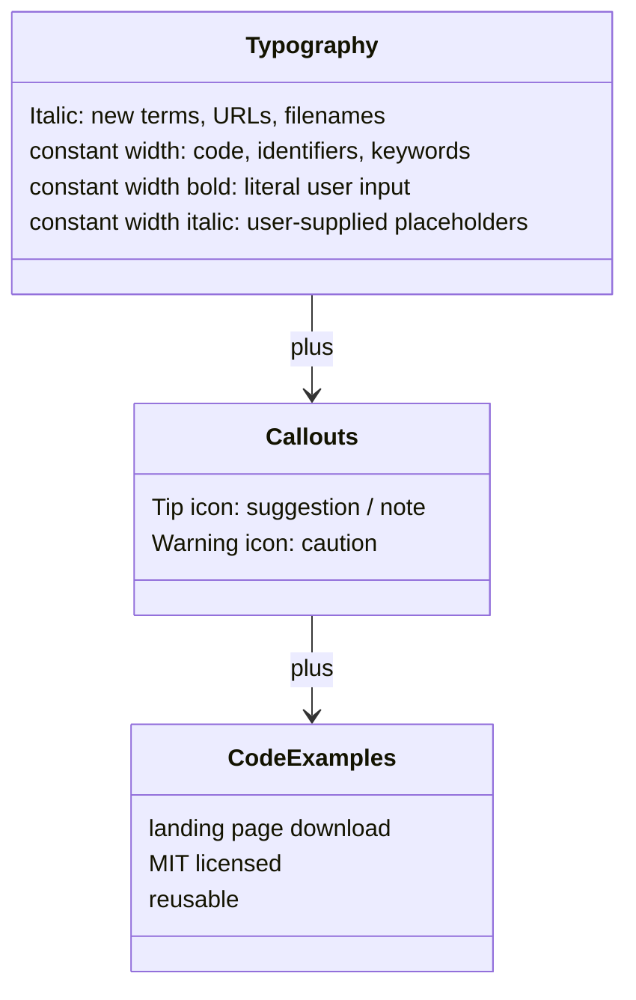

# Preface — About This Book

> Book: *Concurrency in Go* (Katherine Cox-Buday, O'Reilly 2017) · Preface · Pages ~vii–xii
> ⬅️ Prev: [Book index](../README.md) · ➡️ Next: [Chapter 1 — An Introduction to Concurrency](../ch01-introduction-to-concurrency/README.md) · 🏠 [Book index](../README.md)

## 🎯 In One Paragraph

The preface sets expectations: *Concurrency in Go* is for developers who already know basic Go syntax — it teaches concurrency, not the language. By the end it covers the **entire stack of Go concurrency concerns**: common pitfalls, the motivation behind Go's concurrency design (CSP), the syntax of the primitives, everyday patterns, "patterns of patterns" for larger systems, and the tooling to debug it all. Because that breadth serves different readers, the preface provides a **navigation roadmap** — e.g., experienced-with-concurrency readers can skip Chapter 1; newcomers wanting to write code immediately should start at Chapter 3. It lists **online resources** (golang.org, the Playground, golang-nuts, the Go wiki), the book's **typographical conventions** (italic, constant width, and the tip/warning icons), and notes the code is MIT-licensed and downloadable. These study notes preserve that structure as the on-ramp to the rest of the vault.

## 🧠 Key Concepts & Vocabulary

- **Target reader**: A developer with some Go experience. The book does **not** explain basic syntax; prior exposure to concurrency in other languages helps but isn't required.
- **The full stack of concurrency concerns**: pitfalls → motivation/design (CSP) → primitive syntax → patterns → patterns-of-patterns → tooling. Each chapter is a layer.
- **Navigation roadmap**: Explicit guidance on which chapters to read or skip based on your background and goals.
- **CSP (Communicating Sequential Processes)**: The theoretical model (Chapter 2) behind Go's "share memory by communicating" philosophy — context the preface promises.
- **Conventions**: *Italic* (new terms, URLs, filenames), `constant width` (code, identifiers, keywords), **`constant width bold`** (literal user input), and `constant width italic` (user-supplied placeholders), plus a **tip** icon and a **warning** icon.
- **Code availability**: All examples live on the book's landing page, released under the **MIT license**.

## 📚 Deep Dive

### Who should read this book

The book assumes working Go knowledge and focuses entirely on concurrency. Knowing how other languages expose concurrency (threads, locks, futures, actors) is a nice-to-have that helps you appreciate Go's choices, but it's optional. Because the topics span from beginner pitfalls to distributed-system patterns, different readers will use the book differently — which is exactly what the navigation section addresses.

### The roadmap (and who should read what)

Chapter-by-chapter, as the preface describes:

| Chapter | What it gives you | Can you skip it? |
|---------|-------------------|------------------|
| 1 — Introduction to Concurrency | Historical perspective on *why* concurrency matters and the fundamental problems that make it hard; how Go eases them. | Yes, if you already know concurrency fundamentals. |
| 2 — Modeling Your Code (CSP) | The motivations behind Go's design; context for community conversations and *why* Go works the way it does. | Optional, but valuable for understanding. |
| 3 — Go's Concurrency Building Blocks | The syntax of the primitives and the `sync` package (memory-access synchronization). Best starting point for hands-on newcomers. | No — this is the core. |
| 4 — Concurrency Patterns in Go | Composing primitives into reusable patterns that solve problems and avoid pitfalls. | Useful even for existing Go concurrency writers. |
| 5 — Concurrency at Scale | Composing patterns into larger patterns for services and distributed systems. | No, for larger systems. |
| 6 — Goroutines and the Go Runtime | How the runtime schedules goroutines (for readers who want the internals). | Optional deep dive. |
| Appendix — Tooling | Tools/commands for writing and debugging concurrent programs. | Reference as needed. |

### Online resources the preface recommends

- `https://golang.org/` — the language home (now `go.dev`).
- `https://golang.org/play` — the Go Playground (now `go.dev/play`).
- `https://go.googlesource.com/go` — the Go source repository.
- `https://groups.google.com/group/golang-nuts` — the golang-nuts mailing list.
- `https://github.com/golang/go/wiki` — the community wiki (now `go.dev/wiki`).

### Conventions used in the book

> 🆕 **Modern Go note:** the preface's `golang.org` links now redirect to **`go.dev`** (`go.dev`, `go.dev/play`, `go.dev/wiki`), and `godoc.org` has been superseded by **`pkg.go.dev`**. The book's official code sample repository is maintained at [`kat-co/concurrency-in-go-src`](https://github.com/kat-co/concurrency-in-go-src).

### How these study notes map to the book

These notes keep one Markdown file per mini-chapter under a folder per book chapter, cross-linked by Prev/Next. This Preface is the entry on-ramp; follow ➡️ **Next** into Chapter 1, or jump straight to Chapter 3 if you want to start coding immediately, exactly as the preface suggests.

## ⚠️ Pitfalls & Gotchas

- **Don't expect a Go tutorial.** If you don't know basic Go syntax, learn that first (A Tour of Go / Effective Go) — this book starts above that line.
- **The old `golang.org` URLs still work but redirect.** Bookmark `go.dev` and `pkg.go.dev` instead of the 2017 links.
- **Skipping Chapter 2 (CSP) is tempting but costly.** The *why* behind channels ("share memory by communicating") prevents a lot of later confusion; skim it even if you're in a hurry.
- **Chapter 6 is optional for daily work** — you can be productive with goroutines without it — but it explains *why* the patterns in Chapters 3–5 behave as they do.

## 🆕 Modern Go Notes

> 🆕 **Links moved to `go.dev`.** `golang.org` → `go.dev`; `golang.org/play` → `go.dev/play`; the wiki lives at `go.dev/wiki`; package docs at `pkg.go.dev`.

> 🆕 **The ecosystem has grown since 2017.** Several patterns the book implements by hand now have standard or quasi-standard equivalents: `golang.org/x/sync/errgroup`, `context.WithCancelCause` (1.20), `sync.OnceFunc/OnceValue` (1.21), `sync.WaitGroup.Go` (1.25), `testing/synctest` (1.25). These are flagged in the relevant chapters' notes.

## 🧪 Try It Yourself

1. Open `go.dev/play` and run `go func(){ println("hi") }(); ` wrapped in a `main` with a `time.Sleep` — confirm your environment runs goroutines before diving into Chapter 3.
2. Clone [`kat-co/concurrency-in-go-src`](https://github.com/kat-co/concurrency-in-go-src) so you can run the book's original examples alongside these paraphrased notes.
3. Decide your own path through the roadmap flowchart above based on your background, then jump to that chapter's README.

## 🔑 Key Takeaways

- The book targets developers who **already know basic Go**; it teaches **concurrency**, layer by layer: pitfalls → CSP → primitives → patterns → patterns-at-scale → runtime → tooling.
- The preface's **navigation roadmap** lets you skip Chapter 1 (if you know concurrency) or jump to Chapter 3 (to start coding).
- Conventions: *italic* / `constant width` / **bold** / *placeholder italic*, plus tip & warning icons; all code is **MIT-licensed** and downloadable.
- Old `golang.org` links now live at **`go.dev`** / **`pkg.go.dev`**; the official code is at **`kat-co/concurrency-in-go-src`**.

## 🔗 References & Further Reading

### 📝 Blogs / articles / talks
- [Share Memory By Communicating (go.dev blog)](https://go.dev/blog/codelab-share) — the Go team's articulation of the CSP philosophy the preface promises to explain in Chapter 2.
- [Concurrency is not Parallelism — Rob Pike (talk)](https://go.dev/blog/waza-talk) — foundational framing for everything in the book; great before Chapter 1.
- [Understanding Go's concurrency model (Bitfield Consulting)](https://bitfieldconsulting.com/posts/goroutines) — an accessible on-ramp for readers new to goroutines.

### 💻 GitHub
- [kat-co/concurrency-in-go-src](https://github.com/kat-co/concurrency-in-go-src) — the book's official, MIT-licensed source code for every example.
- [golang/go](https://github.com/golang/go) — the Go language source (the preface's `go.googlesource.com/go` mirror).

### 📖 Official docs / specs
- [go.dev — the Go language home](https://go.dev/) — successor to the preface's `golang.org`.
- [The Go Playground (go.dev/play)](https://go.dev/play) — run snippets in the browser, as recommended.
- [Effective Go](https://go.dev/doc/effective_go) and [A Tour of Go](https://go.dev/tour/) — prerequisite basics the book assumes you already have.
