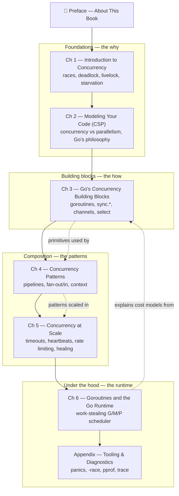
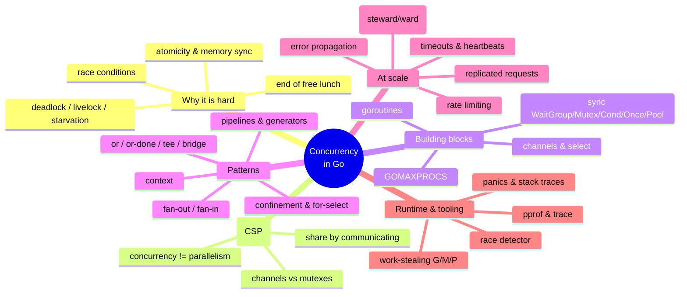

# 🐹 Concurrency in Go — Study Notes

Comprehensive, self-contained study notes for **_Concurrency in Go: Tools and Techniques for Developers_** by **Katherine Cox-Buday** (O'Reilly, 2017). One deep-dive Markdown file per **mini-chapter** — written as **original paraphrased notes** (not a reproduction of the book), packed with Mermaid diagrams (including sequence diagrams of goroutines as participants), complete *runnable* Go programs, pitfalls, modern-Go callouts, self-check questions, and real web-searched references.

> These notes are a transformative study companion meant to help you *learn* the concepts — they are not a substitute for owning a legal copy. If the book is useful to you, [buy it from O'Reilly](https://www.oreilly.com/library/view/concurrency-in-go/9781491941294/). All code examples here are our own, written to illustrate the same ideas; every complete program was verified with `go vet` + `go build`/`go run` on **Go 1.27**.

---

## 🧭 Learning Path



- **Full journey:** Preface → Ch 1 → … → Ch 6 → Appendix (the book's intended order).
- **"I already know the theory" fast path:** Ch 3 (building blocks) → Ch 4 (patterns) → Ch 5 (scale).
- **Interview / review crunch:** Ch 1 (races, deadlock, Coffman conditions), Ch 3 (channels + select + sync), Ch 4 (pipelines, fan-out/in, context).
- **Runtime / performance focus:** Ch 3.2 (M:N scheduler, cost), Ch 3.11 (GOMAXPROCS), Ch 6 (work stealing), Appendix (pprof + trace).

### Big-picture theme map



---

## 🗂️ Chapters & Mini-Chapters

### 📖 Preface
| # | Mini-chapter | Notes |
|---|--------------|-------|
| 0 | Preface — About This Book | [01-about-this-book.md](00-preface/01-about-this-book.md) |

### Chapter 1 — Introduction to Concurrency
> Why concurrency is hard: the end of the free lunch, and the classic hazards. · [Chapter README](ch01-introduction-to-concurrency/README.md)

| # | Mini-chapter | Notes |
|---|--------------|-------|
| 1.1 | Moore's Law, Web Scale, and the Mess We're In | [01-moores-law-web-scale-and-the-mess.md](ch01-introduction-to-concurrency/01-moores-law-web-scale-and-the-mess.md) |
| 1.2 | Race Conditions | [02-race-conditions.md](ch01-introduction-to-concurrency/02-race-conditions.md) |
| 1.3 | Atomicity | [03-atomicity.md](ch01-introduction-to-concurrency/03-atomicity.md) |
| 1.4 | Memory Access Synchronization | [04-memory-access-synchronization.md](ch01-introduction-to-concurrency/04-memory-access-synchronization.md) |
| 1.5 | Deadlocks and the Coffman Conditions | [05-deadlocks-and-coffman-conditions.md](ch01-introduction-to-concurrency/05-deadlocks-and-coffman-conditions.md) |
| 1.6 | Livelocks | [06-livelocks.md](ch01-introduction-to-concurrency/06-livelocks.md) |
| 1.7 | Starvation | [07-starvation.md](ch01-introduction-to-concurrency/07-starvation.md) |
| 1.8 | Determining Concurrency Safety | [08-determining-concurrency-safety.md](ch01-introduction-to-concurrency/08-determining-concurrency-safety.md) |
| 1.9 | Simplicity in the Face of Complexity | [09-simplicity-in-the-face-of-complexity.md](ch01-introduction-to-concurrency/09-simplicity-in-the-face-of-complexity.md) |

### Chapter 2 — Modeling Your Code: Communicating Sequential Processes
> The mental model: CSP, and why Go leans on channels. · [Chapter README](ch02-modeling-your-code-csp/README.md)

| # | Mini-chapter | Notes |
|---|--------------|-------|
| 2.1 | The Difference Between Concurrency and Parallelism | [01-concurrency-vs-parallelism.md](ch02-modeling-your-code-csp/01-concurrency-vs-parallelism.md) |
| 2.2 | What Is CSP? | [02-what-is-csp.md](ch02-modeling-your-code-csp/02-what-is-csp.md) |
| 2.3 | How This Helps You | [03-how-this-helps-you.md](ch02-modeling-your-code-csp/03-how-this-helps-you.md) |
| 2.4 | Go's Philosophy on Concurrency | [04-gos-philosophy-on-concurrency.md](ch02-modeling-your-code-csp/04-gos-philosophy-on-concurrency.md) |

### Chapter 3 — Go's Concurrency Building Blocks
> The primitives: goroutines, the `sync` package, channels, and `select`. · [Chapter README](ch03-go-concurrency-building-blocks/README.md)

| # | Mini-chapter | Notes |
|---|--------------|-------|
| 3.1 | Goroutines: Basics & Closures | [01-goroutines-basics-and-closures.md](ch03-go-concurrency-building-blocks/01-goroutines-basics-and-closures.md) |
| 3.2 | Goroutines Under the Hood: M:N Scheduler, Fork-Join, Cost | [02-goroutines-under-the-hood-mn-scheduler-fork-join-cost.md](ch03-go-concurrency-building-blocks/02-goroutines-under-the-hood-mn-scheduler-fork-join-cost.md) |
| 3.3 | sync.WaitGroup | [03-sync-waitgroup.md](ch03-go-concurrency-building-blocks/03-sync-waitgroup.md) |
| 3.4 | Mutex and RWMutex | [04-mutex-and-rwmutex.md](ch03-go-concurrency-building-blocks/04-mutex-and-rwmutex.md) |
| 3.5 | sync.Cond | [05-cond.md](ch03-go-concurrency-building-blocks/05-cond.md) |
| 3.6 | sync.Once | [06-once.md](ch03-go-concurrency-building-blocks/06-once.md) |
| 3.7 | sync.Pool | [07-pool.md](ch03-go-concurrency-building-blocks/07-pool.md) |
| 3.8 | Channels: Basics | [08-channels-basics.md](ch03-go-concurrency-building-blocks/08-channels-basics.md) |
| 3.9 | Buffered Channels, nil Channels, and Channel Ownership | [09-buffered-nil-channels-and-ownership.md](ch03-go-concurrency-building-blocks/09-buffered-nil-channels-and-ownership.md) |
| 3.10 | The select Statement | [10-select-statement.md](ch03-go-concurrency-building-blocks/10-select-statement.md) |
| 3.11 | The GOMAXPROCS Lever | [11-gomaxprocs-lever.md](ch03-go-concurrency-building-blocks/11-gomaxprocs-lever.md) |

### Chapter 4 — Concurrency Patterns in Go
> Composing the primitives into reusable patterns. · [Chapter README](ch04-concurrency-patterns-in-go/README.md)

| # | Mini-chapter | Notes |
|---|--------------|-------|
| 4.1 | Confinement | [01-confinement.md](ch04-concurrency-patterns-in-go/01-confinement.md) |
| 4.2 | The for-select Loop | [02-for-select-loop.md](ch04-concurrency-patterns-in-go/02-for-select-loop.md) |
| 4.3 | Preventing Goroutine Leaks | [03-preventing-goroutine-leaks.md](ch04-concurrency-patterns-in-go/03-preventing-goroutine-leaks.md) |
| 4.4 | The or-channel | [04-or-channel.md](ch04-concurrency-patterns-in-go/04-or-channel.md) |
| 4.5 | Error Handling | [05-error-handling.md](ch04-concurrency-patterns-in-go/05-error-handling.md) |
| 4.6 | Pipelines (Introduction) | [06-pipelines-intro.md](ch04-concurrency-patterns-in-go/06-pipelines-intro.md) |
| 4.7 | Best Practices for Constructing Pipelines | [07-pipeline-best-practices.md](ch04-concurrency-patterns-in-go/07-pipeline-best-practices.md) |
| 4.8 | Some Handy Generators | [08-handy-generators.md](ch04-concurrency-patterns-in-go/08-handy-generators.md) |
| 4.9 | Fan-Out, Fan-In | [09-fan-out-fan-in.md](ch04-concurrency-patterns-in-go/09-fan-out-fan-in.md) |
| 4.10 | The or-done-channel | [10-or-done-channel.md](ch04-concurrency-patterns-in-go/10-or-done-channel.md) |
| 4.11 | The tee-channel | [11-tee-channel.md](ch04-concurrency-patterns-in-go/11-tee-channel.md) |
| 4.12 | The bridge-channel | [12-bridge-channel.md](ch04-concurrency-patterns-in-go/12-bridge-channel.md) |
| 4.13 | Queuing (Little's Law) | [13-queuing.md](ch04-concurrency-patterns-in-go/13-queuing.md) |
| 4.14 | The context Package: Cancellation & Deadlines | [14-context-cancellation-and-deadlines.md](ch04-concurrency-patterns-in-go/14-context-cancellation-and-deadlines.md) |
| 4.15 | The context Package: Values & Best Practices | [15-context-values-and-best-practices.md](ch04-concurrency-patterns-in-go/15-context-values-and-best-practices.md) |

### Chapter 5 — Concurrency at Scale
> Taking patterns to production: resilience, limits, and self-healing. · [Chapter README](ch05-concurrency-at-scale/README.md)

| # | Mini-chapter | Notes |
|---|--------------|-------|
| 5.1 | Error Propagation | [01-error-propagation.md](ch05-concurrency-at-scale/01-error-propagation.md) |
| 5.2 | Timeouts and Cancellation | [02-timeouts-and-cancellation.md](ch05-concurrency-at-scale/02-timeouts-and-cancellation.md) |
| 5.3 | Heartbeats | [03-heartbeats.md](ch05-concurrency-at-scale/03-heartbeats.md) |
| 5.4 | Replicated Requests | [04-replicated-requests.md](ch05-concurrency-at-scale/04-replicated-requests.md) |
| 5.5 | Rate Limiting (the Token Bucket) | [05-rate-limiting-token-bucket.md](ch05-concurrency-at-scale/05-rate-limiting-token-bucket.md) |
| 5.6 | Multi-Tier Rate Limiting | [06-multi-tier-rate-limiting.md](ch05-concurrency-at-scale/06-multi-tier-rate-limiting.md) |
| 5.7 | Healing Unhealthy Goroutines | [07-healing-unhealthy-goroutines.md](ch05-concurrency-at-scale/07-healing-unhealthy-goroutines.md) |

### Chapter 6 — Goroutines and the Go Runtime
> How the `go` keyword actually works: the work-stealing scheduler. · [Chapter README](ch06-goroutines-and-the-go-runtime/README.md)

| # | Mini-chapter | Notes |
|---|--------------|-------|
| 6.1 | Work Stealing | [01-work-stealing.md](ch06-goroutines-and-the-go-runtime/01-work-stealing.md) |
| 6.2 | Stealing Tasks or Continuations? (the G/M/P model) | [02-stealing-tasks-or-continuations.md](ch06-goroutines-and-the-go-runtime/02-stealing-tasks-or-continuations.md) |
| 6.3 | Presenting All of This to the Developer | [03-presenting-to-the-developer.md](ch06-goroutines-and-the-go-runtime/03-presenting-to-the-developer.md) |

### Appendix — Tooling and Diagnostics
> The practical toolbox for writing, verifying, and debugging concurrent Go. · [Appendix README](appendix-tooling-and-diagnostics/README.md)

| # | Mini-chapter | Notes |
|---|--------------|-------|
| A.1 | Anatomy of a Goroutine Error | [01-anatomy-of-a-goroutine-error.md](appendix-tooling-and-diagnostics/01-anatomy-of-a-goroutine-error.md) |
| A.2 | Race Detection | [02-race-detection.md](appendix-tooling-and-diagnostics/02-race-detection.md) |
| A.3 | pprof and Tracing | [03-pprof-and-tracing.md](appendix-tooling-and-diagnostics/03-pprof-and-tracing.md) |

---

## 🎓 How to Study

Every mini-chapter file follows the same structure, so you can study actively:

1. **🎯 In One Paragraph** — read this first for the big picture.
2. **🧠 Key Concepts & Vocabulary** — the terms you must be able to define.
3. **📚 Deep Dive** — the full walkthrough with Mermaid diagrams and worked, runnable code.
4. **⚠️ Pitfalls & Gotchas** — the mistakes that bite in production.
5. **🆕 Modern Go Notes** — what changed since the 2017 book (loop-var semantics in 1.22, `errgroup`, `sync.OnceFunc`/`OnceValue` in 1.21, `context.WithCancelCause` in 1.20, `atomic.Int64` types in 1.19, `context.AfterFunc` in 1.21, `sync.WaitGroup.Go` and `testing/synctest` in 1.25, container-aware `GOMAXPROCS` in 1.25).
6. **🧪 Try It Yourself** — small exercises; actually run them.
7. **✅ Self-Check Questions** — answer *before* expanding the `<details>`.
8. **🔑 Key Takeaways** and **🔗 References** for review and going deeper.

**Recommended loop:** read In-One-Paragraph → skim diagrams → copy each complete program into a scratch dir and run it → read Pitfalls → answer the Self-Check from memory. Because concurrency bugs are timing-dependent, *run the programs multiple times* and, where you have a C compiler, run race-sensitive examples with `go run -race`.

> 🧪 **On verification in these notes.** Every complete `package main` program was extracted and checked with `go vet` + `go build` (and run where feasible) on Go 1.27. The `-race` detector requires cgo and a C compiler; in the environment these notes were produced that toolchain was unavailable, so race-specific examples are verified race-free by construction and documented inline — run them under `-race` locally to see the detector in action.

---

## 💻 Get the Book's Source Code

```bash
# the author's official companion source for every listing in the book
git clone https://github.com/kat-co/concurrency-in-go-src
```

---

## 🔗 Global References & Further Reading

**📖 Official Go docs & specs**
- [The Go Memory Model](https://go.dev/ref/mem) — the formal happens-before rules every chapter implicitly relies on.
- [The Go Programming Language Specification](https://go.dev/ref/spec) — channels, `select`, `go` statements, close semantics.
- [Effective Go — Concurrency](https://go.dev/doc/effective_go#concurrency) — "share memory by communicating" and the idiomatic patterns.
- [pkg.go.dev: sync](https://pkg.go.dev/sync), [sync/atomic](https://pkg.go.dev/sync/atomic), [context](https://pkg.go.dev/context), [golang.org/x/time/rate](https://pkg.go.dev/golang.org/x/time/rate), [golang.org/x/sync/errgroup](https://pkg.go.dev/golang.org/x/sync/errgroup).

**📝 Canonical blogs, talks & articles**
- [Go Concurrency Patterns: Pipelines and cancellation (go.dev blog)](https://go.dev/blog/pipelines) — the foundation for Chapter 4.
- [Go Concurrency Patterns: Context (go.dev blog)](https://go.dev/blog/context) — the `context` rationale behind Ch 4.14–4.15 and Ch 5.
- [Introducing the Go Race Detector (go.dev blog)](https://go.dev/blog/race-detector) and the [Data Race Detector guide](https://go.dev/doc/articles/race_detector.html) — Appendix A.2.
- [Rob Pike — Concurrency Is Not Parallelism (talk)](https://go.dev/blog/waza-talk) — the distinction at the heart of Chapter 2.
- [Dave Cheney — Curious Channels](https://dave.cheney.net/2013/04/30/curious-channels) and [Stack traces and the errors package](https://dave.cheney.net/2016/06/12/stack-traces-and-the-errors-package).
- [Ardan Labs — Scheduling In Go (Bill Kennedy)](https://www.ardanlabs.com/blog/2018/08/scheduling-in-go-part1.html) — deep dive matching Chapter 6.

**💻 GitHub — real implementations**
- [kat-co/concurrency-in-go-src](https://github.com/kat-co/concurrency-in-go-src) — the book's official code.
- [golang/go — src/runtime/proc.go](https://github.com/golang/go/blob/master/src/runtime/proc.go) & [src/sync/mutex.go](https://github.com/golang/go/blob/master/src/sync/mutex.go) — the scheduler and mutex themselves.
- [golang/sync — errgroup](https://github.com/golang/sync) and [golang/time — rate](https://github.com/golang/time) — the modern analogues to the book's hand-rolled helpers.
- [uber-go/goleak](https://github.com/uber-go/goleak) (leak detection), [uber-go/automaxprocs](https://github.com/uber-go/automaxprocs) (container GOMAXPROCS), [thejerf/suture](https://github.com/thejerf/suture) & [oklog/run](https://github.com/oklog/run) (steward/lifecycle), [sourcegraph/conc](https://github.com/sourcegraph/conc) (structured concurrency).

---

> 📚 Part of my [Learning/books](../) notes collection.
