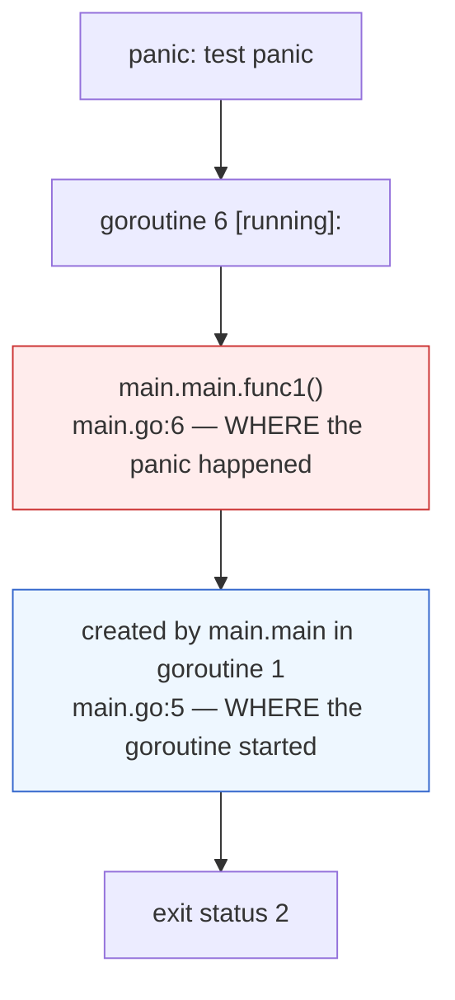
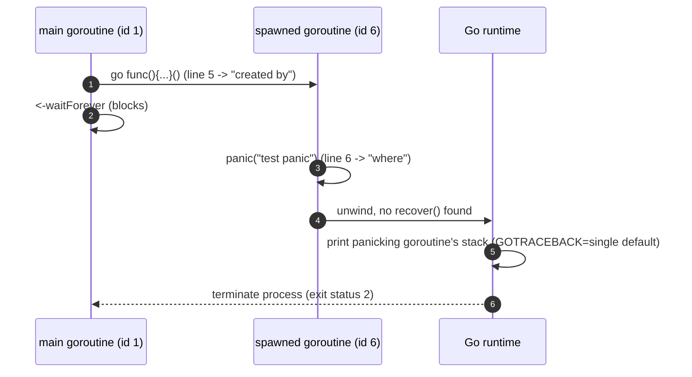
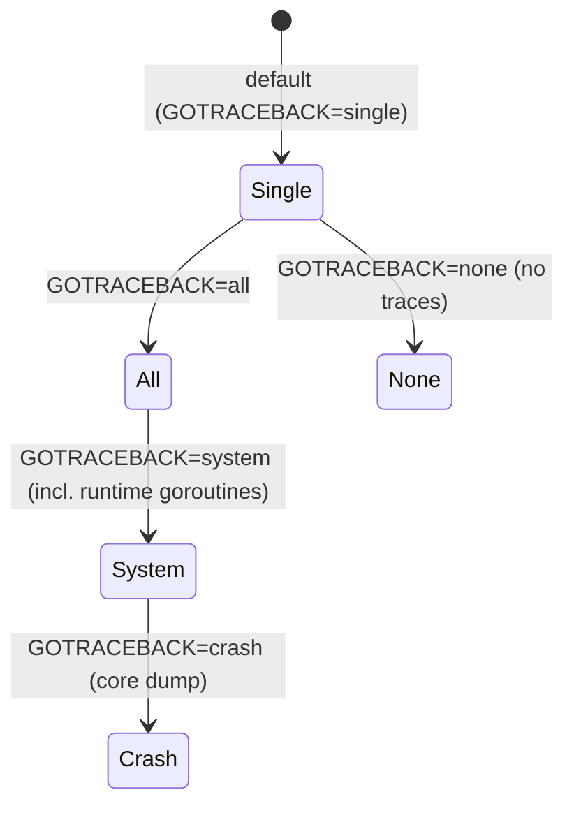

# App A.1 — Anatomy of a Goroutine Error

> Book: *Concurrency in Go* (Katherine Cox-Buday, O'Reilly 2017) · Appendix · Pages ~213–214
> ⬅️ Prev: [Chapter 6 — Goroutines and the Go Runtime](../ch06-goroutines-and-the-go-runtime/README.md) · ➡️ Next: [Race Detection](02-race-detection.md) · 🏠 [Book index](../README.md)

## 🎯 In One Paragraph

Sooner or later a goroutine panics, and the first time you see the resulting stack trace it can be confusing. This mini-chapter decodes the anatomy of a goroutine panic. Historically (pre-Go 1.6) a panic dumped the stack traces of **every** running goroutine, making it hard to find the culprit. Go 1.6+ simplified this to print only the **panicking goroutine's** stack trace by default. The trace tells you three things: **where the panic occurred**, **where the panicking goroutine was started** (`created by ...`), and **the name of the function** running as the goroutine (anonymous functions get an auto-generated `funcN` identifier). If you want the old firehose-of-all-goroutines behavior back — invaluable for deadlock debugging — set the `GOTRACEBACK` environment variable to `all` (or `crash`/`system` for even more).

## 🧠 Key Concepts & Vocabulary

- **Panic**: Go's mechanism for an unrecoverable runtime error. An unrecovered panic in *any* goroutine crashes the whole program with exit status 2.
- **Stack trace**: The call-stack dump printed when the program crashes, showing the chain of function calls and their source locations.
- **Panicking goroutine**: The single goroutine whose panic went unrecovered. Since Go 1.6 its trace is printed by default.
- **`created by ...`**: The line in the trace indicating *where* (which function and source line) the goroutine was launched with `go`.
- **`main.main.func1`**: The compiler-generated name for an anonymous function (closure) launched as a goroutine. The `funcN` suffix is a unique, automatic identifier.
- **`GOTRACEBACK`**: Environment variable controlling how much detail a crash prints — `none`, `single` (default), `all`, `system`, `crash`.
- **`[running]` / `[chan receive]` etc.**: The bracketed goroutine *state* shown in the trace header.

## 📚 Deep Dive

### A minimal panicking program

```go
package main

func main() {
	waitForever := make(chan any) // nil-safe: this channel is never sent to
	go func() {
		panic("test panic")
	}()
	<-waitForever // block so the goroutine gets a chance to run and panic
}
```

> 🆕 **Modern Go note:** the book writes `make(chan interface{})`. Since Go 1.18, `any` is a built-in alias for `interface{}`, so `make(chan any)` is the modern spelling.

### Reading the stack trace

Running the program crashes it. Verified output on Go 1.27.2 (paths reflect the scratch dir):

```text
panic: test panic

goroutine 6 [running]:
main.main.func1()
	/tmp/cig/verify/ch6/panic/main.go:6 +0x25
created by main.main in goroutine 1
	/tmp/cig/verify/ch6/panic/main.go:5 +0x2d
exit status 2
```

Decoding each part:

| Line | Meaning |
|------|---------|
| `panic: test panic` | The panic value / message. |
| `goroutine 6 [running]:` | The panicking goroutine's internal ID (6) and its state (`running`). |
| `main.main.func1()` + file:line | **Where the panic occurred** — the anonymous goroutine body at line 6. |
| `created by main.main in goroutine 1` + file:line | **Where the goroutine was started** (the `go` statement at line 5, launched from the main goroutine, id 1). |
| `main.main.func1` (the name) | **The function running as the goroutine.** Because it's anonymous, the compiler assigned the unique id `func1`. |
| `exit status 2` | The process exit code for an unrecovered panic. |

> 🆕 **Modern Go note:** Go 1.21+ added `in goroutine N` to the `created by` line (shown above), telling you *which* goroutine spawned the panicking one. The 2017 book's trace just said `created by main.main`. The `+0x25` / `+0x2d` are instruction offsets within each frame.



### The lifecycle that produces the trace



### Pre-1.6 vs 1.6+ behavior, and GOTRACEBACK

- **Before Go 1.6:** a panic printed stack traces for **all** currently executing goroutines — thorough but noisy and time-consuming to read.
- **Go 1.6 and later:** by default it prints **only the panicking goroutine's** trace.
- To restore the all-goroutines dump, set `GOTRACEBACK=all`. This is genuinely useful for diagnosing **deadlocks** and leaks, where the interesting goroutine is a *different* one that's stuck.



`GOTRACEBACK` values, least-to-most verbose: `none` → `single` (default) → `all` → `system` → `crash` (also triggers an OS core dump).

### A complete, verifiable GOTRACEBACK demo

```go
package main

import (
	"fmt"
	"os"
)

// Run with: GOTRACEBACK=all go run .
// vs default: go run .
func main() {
	fmt.Fprintf(os.Stderr, "GOTRACEBACK=%q\n", os.Getenv("GOTRACEBACK"))

	// A couple of "innocent bystander" goroutines that will appear in the
	// trace only when GOTRACEBACK=all.
	blocker := make(chan struct{})
	for i := 0; i < 2; i++ {
		go func() { <-blocker }()
	}

	done := make(chan struct{})
	go func() {
		defer close(done)
		panic("boom from a goroutine")
	}()
	<-done // ensure the panicking goroutine runs first
}
```

Run `go run .` (default) to see only the panicking goroutine; run `GOTRACEBACK=all go run .` to additionally see the two blocked bystanders. Both crash with `exit status 2`.

## ⚠️ Pitfalls & Gotchas

- **An unrecovered panic in *any* goroutine kills the whole program.** You cannot `recover()` a panic from a *different* goroutine — `recover` only works in a deferred function **within the same goroutine** that panicked. A classic surprise for newcomers.
- **Anonymous-goroutine names are opaque.** `main.main.func1` tells you it's the first anonymous function in `main`; if you have many, give them real names or log context to disambiguate.
- **Default trace hides deadlocked goroutines.** If your program hangs rather than panics, the default single-goroutine trace won't help; use `GOTRACEBACK=all` or send `SIGQUIT` (Ctrl-\\ on Unix) to dump all goroutine stacks.
- **Don't swallow panics silently.** A bare `recover()` with no logging turns a loud crash into a silent, unexplained goroutine death — harder to debug than the original panic.

## 🆕 Modern Go Notes

> 🆕 **`any` (Go 1.18)** replaces `interface{}` in the book's example.

> 🆕 **`created by ... in goroutine N` (Go 1.21).** Traces now name the *parent* goroutine, making it far easier to trace a leaked/panicking goroutine back to its launch site.

> 🆕 **`errors.Join` / wrapped panics.** When recovering and re-reporting, modern Go lets you wrap context with `fmt.Errorf("...: %w", err)` and combine with `errors.Join` (Go 1.20) so the eventual report keeps the causal chain. Consider converting panics at goroutine boundaries into errors delivered over a channel instead of crashing.

> 🆕 **`panic` prints the parent chain better, and `debug.SetTraceback`** (runtime/debug) lets you set the traceback level programmatically, equivalent to `GOTRACEBACK`.

## 🧪 Try It Yourself

1. Run the minimal panic program with `GOTRACEBACK=all` and `GOTRACEBACK=none`; compare the output volume.
2. Add a `defer func(){ recover() }()` **inside** the panicking goroutine and confirm the program no longer crashes. Then move the `recover` to `main` and confirm it does **not** stop the crash — proving `recover` is per-goroutine.
3. Launch three differently-named named functions as goroutines (one panics) and verify the trace shows the real function name instead of `func1`.

## ✅ Self-Check Questions

<details><summary>Since Go 1.6, whose stack trace is printed by default when a goroutine panics?</summary>
Only the panicking goroutine's stack trace. Pre-1.6, all running goroutines' traces were printed.
</details>

<details><summary>What do the "where the panic occurred" and "created by" lines tell you?</summary>
The first (`main.main.func1()` + file:line) shows where the panic happened; the `created by ...` line shows where the goroutine was started with `go` (and, since Go 1.21, which parent goroutine started it).
</details>

<details><summary>What does the identifier `func1` in `main.main.func1` signify?</summary>
It's a compiler-generated unique name for an anonymous function (closure) launched as a goroutine — there was no user-given name, so the runtime assigned one.
</details>

<details><summary>How do you restore the pre-1.6 behavior of printing all goroutines' stacks?</summary>
Set the environment variable `GOTRACEBACK=all` (or `system`/`crash` for even more). Programmatically, `debug.SetTraceback("all")`.
</details>

<details><summary>Can you recover a panic that happens in a different goroutine?</summary>
No. `recover()` only works in a deferred function within the *same* goroutine that panicked. An unrecovered panic in any goroutine crashes the entire program (exit status 2).
</details>

<details><summary>Your program hangs instead of panicking. Which trace setting helps, and why?</summary>
`GOTRACEBACK=all` (or sending SIGQUIT), because the default single-goroutine trace won't show the *other* goroutines that are deadlocked/blocked — which is where the problem lives.
</details>

## 🔑 Key Takeaways

- Go 1.6+ prints only the **panicking goroutine's** trace by default; `GOTRACEBACK=all` restores the all-goroutines dump.
- A goroutine panic trace shows **where the panic happened**, **where the goroutine was started** (`created by`), and **the function name** (`funcN` for anonymous).
- An unrecovered panic in **any** goroutine crashes the whole process (exit status 2); `recover` is **per-goroutine**.
- For hangs/deadlocks use `GOTRACEBACK=all` or SIGQUIT to see every goroutine.
- Modern Go improves traces with parent-goroutine attribution (1.21) and `any` (1.18).

## 🔗 References & Further Reading

### 📝 Blogs / articles / talks
- [Defer, Panic, and Recover (go.dev blog)](https://go.dev/blog/defer-panic-and-recover) — the canonical explanation of panic/recover semantics (including why recover is per-goroutine).
- [Go, the complete guide to panic & recover (dev.to / community deep dives)](https://dev.to/) — pattern for converting goroutine panics into channel-delivered errors. *(search "golang recover goroutine panic channel")*
- [Why your goroutine's panic crashes the whole program (Bitfield / community)](https://bitfieldconsulting.com/posts/goroutines) — framing goroutines and their failure modes.

### 💻 GitHub
- [golang/go src/runtime/panic.go](https://github.com/golang/go/blob/master/src/runtime/panic.go) — the runtime's panic/recover and traceback machinery.
- [golang/go src/runtime/traceback.go](https://github.com/golang/go/blob/master/src/runtime/traceback.go) — how stack traces (including `created by`) are formatted.

### 📖 Official docs / specs
- [`GOTRACEBACK` — runtime package docs](https://pkg.go.dev/runtime#hdr-Environment_Variables) — the authoritative list of `GOTRACEBACK` values and their meanings.
- [`runtime/debug.SetTraceback`](https://pkg.go.dev/runtime/debug#SetTraceback) — programmatic control of traceback verbosity.
- [The Go spec — Handling panics](https://go.dev/ref/spec#Handling_panics) — normative definition of `panic` and `recover`.
