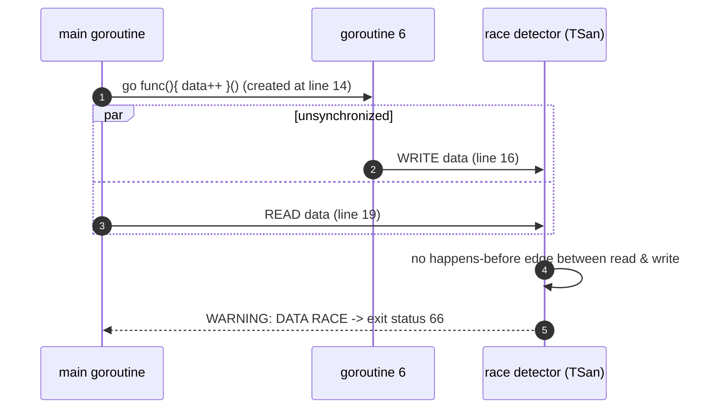
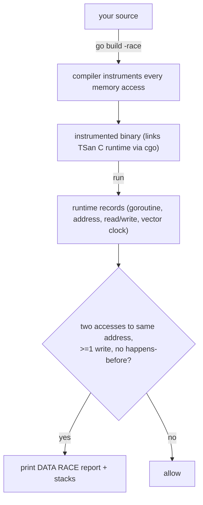
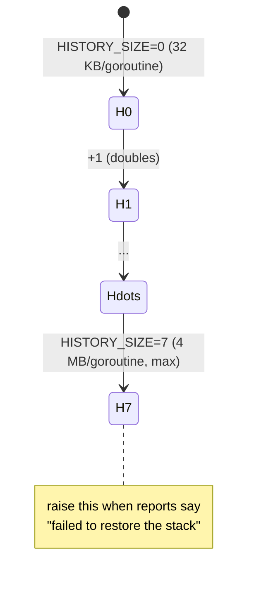

# App A.2 — Race Detection

> Book: *Concurrency in Go* (Katherine Cox-Buday, O'Reilly 2017) · Appendix · Pages ~214–215
> ⬅️ Prev: [Anatomy of a Goroutine Error](01-anatomy-of-a-goroutine-error.md) · ➡️ Next: [pprof and Tracing](03-pprof-and-tracing.md) · 🏠 [Book index](../README.md)

## 🎯 In One Paragraph

Go 1.1 added a `-race` flag to most `go` commands (`test`, `run`, `build`, `install`). When set, the compiler instruments every memory access and the runtime watches for **unsynchronized** concurrent accesses where at least one is a write — a **data race**. For most developers, "add `-race`" is all you need to know. The crucial caveat: the detector is **dynamic**, so it only finds races in code that actually *executes* during the run. The Go team therefore recommends running a `-race` build under **real-world load** (and in CI) to exercise more code paths and raise the odds of triggering a race. A few environment variables tune behavior — `GORACE` options like `LOG_PATH`, `STRIP_PATH_PREFIX`, and `HISTORY_SIZE` — though defaults are usually fine. The detector's report pinpoints the conflicting write and read, each with a goroutine stack and the line where the racing goroutine was created.

## 🧠 Key Concepts & Vocabulary

- **Data race**: Two goroutines access the same memory location concurrently, and **at least one access is a write**, with no synchronization (happens-before) ordering between them. Undefined behavior per the Go memory model.
- **Race detector (`-race`)**: A dynamic analysis tool built into the Go toolchain; compile-time instrumentation + runtime watcher. Backed by Google's **ThreadSanitizer (TSan)**.
- **Dynamic analysis**: Finds bugs only in code paths actually executed — it cannot prove the absence of races, only report ones it observes.
- **Instrumentation**: Compiler-inserted bookkeeping around every memory access recording *when* and *how* memory was accessed.
- **Happens-before**: The ordering relation (established by channels, mutexes, `sync` primitives) that makes concurrent accesses *not* a race.
- **`GORACE`**: Environment variable carrying detector options (space-separated `key=value`), e.g. `GORACE="halt_on_error=1 log_path=race"`.
- **`LOG_PATH`**: Write reports to `LOG_PATH.pid`; special values `stdout`/`stderr` (default `stderr`).
- **`STRIP_PATH_PREFIX`**: Trim the start of file paths in reports for brevity.
- **`HISTORY_SIZE`**: Per-goroutine memory-access history size, range `[0,7]`. 0 → 32 KB per goroutine, doubling to a max of 4 MB at 7. Raise it when reports say "failed to restore the stack" (costs memory).

## 📚 Deep Dive

### The flag

```bash
go test  -race mypkg      # test the package with the race detector
go run   -race mysrc.go   # compile and run with the race detector
go build -race mycmd      # build the command instrumented
go install -race mypkg    # install the package instrumented
```

That's the whole interface for everyday use.

> ⚠️ **Environment note for these notes:** `go run -race` requires **cgo** (the detector links the ThreadSanitizer C runtime), which needs a C compiler (gcc/clang). The sandbox used to verify these notes has **no C compiler**, so `-race` reports `-race requires cgo; enable cgo by setting CGO_ENABLED=1` and then `C compiler "gcc" not found`. The racy program below is therefore shown with the **expected** detector output (matching the book and the documented report format), plus a verified *non-instrumented* run demonstrating the nondeterministic, silent corruption a race causes.

### A program with an intentional data race

```go
package main

import (
	"fmt"
	"sync"
)

// INTENTIONAL DATA RACE: one goroutine writes `data` while main reads it with
// no synchronization. Run with `go run -race .` to see the detector fire.
func main() {
	var data int
	var wg sync.WaitGroup
	wg.Add(1)
	go func() {
		defer wg.Done()
		data++ // unsynchronized WRITE
	}()
	if data == 0 { // unsynchronized READ (races with the write above)
		fmt.Printf("the value is %v.\n", data)
	}
	wg.Wait()
}
```

**Verified non-instrumented run** (no `-race`, Go 1.27.2) — the program compiles and runs, printing whatever it happened to read; this *silent* behavior is exactly why races are dangerous:

```text
the value is 0.
```

**Expected `-race` report** (format per the book and the official docs; this is what you would see with a C compiler present):

```text
==================
WARNING: DATA RACE
Write by goroutine 6:
  main.main.func1()
      /path/main.go:16 +0x44

Previous read by main goroutine:
  main.main()
      /path/main.go:19 +0x8e

Goroutine 6 (running) created at:
  main.main()
      /path/main.go:14 +0x80
==================
Found 1 data race(s)
exit status 66
```

Decoding the report:

| Section | Meaning |
|---------|---------|
| `Write by goroutine 6` | A goroutine attempting an **unsynchronized write**, with its stack. |
| `Previous read by main goroutine` | Another goroutine (here `main`) **reading the same memory**, with its stack. |
| `Goroutine 6 ... created at` | Where the racing goroutine was **launched**. |
| `exit status 66` | The detector's crash exit code when a race is found (with default `halt_on_error`). |



### How the detector works (conceptually)



The detector uses ThreadSanitizer, combining a **happens-before** algorithm with **lock-set** tracking. It never produces **false positives** — a reported race is a real one — but being dynamic it has **false negatives** (misses races in unexecuted code).

### The `GORACE` tuning knobs

Pass options via the `GORACE` environment variable (the book lists the underlying names):

```bash
GORACE="log_path=./race history_size=4 strip_path_prefix=/home/me/proj/" go test -race ./...
```

- **`LOG_PATH`** — write each report to `LOG_PATH.pid`; `stdout`/`stderr` accepted (default `stderr`).
- **`STRIP_PATH_PREFIX`** — strip leading path to shorten report file paths.
- **`HISTORY_SIZE`** — `[0,7]`; 0 = 32 KB/goroutine, doubling to 4 MB at 7. Increase when you see **"failed to restore the stack"**, at the cost of memory.
- (Modern extras) `halt_on_error=1` stops at the first race; `atexit_sleep_ms` controls shutdown delay.



### Cost and where to run it

Instrumentation adds roughly **2–20× CPU** and **5–10× memory** overhead, so you don't ship `-race` binaries to production as the default. Instead:
- Run `-race` in **CI** on your test suite.
- Run a `-race` build under **real-world load** in staging/canary to exercise rare paths.

## ⚠️ Pitfalls & Gotchas

- **The detector only finds races that execute.** Green `-race` tests do **not** prove your code is race-free — only that no race fired on the exercised paths. Increase coverage and load.
- **`-race` needs cgo / a C compiler.** On minimal images (and this sandbox), `CGO_ENABLED=0` or a missing gcc/clang makes `-race` fail to build. Install a C toolchain and set `CGO_ENABLED=1`.
- **Overhead is real.** 2–20× slower, several× more memory. Don't default production binaries to `-race`; use it in CI and under load tests.
- **A race is undefined behavior, not "sometimes wrong."** The non-instrumented run above happened to print `0`, but the memory model gives *no* guarantees — the compiler may reorder or tear the access. Never reason about a racy program's "likely" output.
- **"Found 0 races" ≠ "correct."** Logic races and higher-level races (e.g., check-then-act on a map guarded inconsistently) may still exist even when no *data* race is reported.

## 🆕 Modern Go Notes

> 🆕 **`GORACE` is the documented spelling.** The book lists bare `LOG_PATH`/`HISTORY_SIZE`; the modern, documented way is to put them in the `GORACE` env var (e.g. `GORACE="log_path=race history_size=7"`).

> 🆕 **`testing/synctest` (Go 1.25).** For concurrency *tests*, the new `testing/synctest` package runs goroutines in a synthetic "bubble" with a fake clock, making timing-dependent tests deterministic — complementary to `-race` for catching ordering bugs without flakiness.

> 🆕 **`go.dev/doc/articles/race_detector`** remains the canonical reference and now documents additional `GORACE` options (`halt_on_error`, `atexit_sleep_ms`) and platform support. The detector supports linux/amd64, linux/arm64, and more.

> 🆕 **`uber-go/goleak`** complements the race detector by catching **goroutine leaks** in tests (a different failure class), often wired into `TestMain`.

## 🧪 Try It Yourself

1. On a machine with gcc/clang: `CGO_ENABLED=1 go run -race .` on the racy program and read the full report; then add a `sync.Mutex` around `data` and confirm the race disappears.
2. Fix the race three different ways — `sync.Mutex`, `sync/atomic` (`atomic.Int64`), and a channel — and verify each is clean under `-race`.
3. Set `GORACE="history_size=7"` and observe memory usage climb; intentionally shrink it to 0 and look for "failed to restore the stack" on a deeply nested racy call.

## ✅ Self-Check Questions

<details><summary>Precisely, what is a data race?</summary>
Two goroutines access the same memory location concurrently, at least one access is a write, and there is no synchronization (happens-before ordering) between them.
</details>

<details><summary>Which go commands accept `-race`, and since which version?</summary>
`go test`, `go run`, `go build`, and `go install`, since Go 1.1.
</details>

<details><summary>Why can green `-race` runs still hide races?</summary>
The detector is dynamic: it only observes races on code paths that actually execute. Unexercised paths can still contain races, which is why the Go team recommends running `-race` under real-world load and in CI.
</details>

<details><summary>What does `HISTORY_SIZE` control, and when do you increase it?</summary>
The per-goroutine count of remembered memory accesses (range 0–7; 32 KB at 0 doubling to 4 MB at 7). Increase it when reports say "failed to restore the stack," at the cost of more memory.
</details>

<details><summary>Why can't you simply ship every production binary with `-race`?</summary>
Instrumentation adds large overhead (~2–20× CPU, several× memory) and requires cgo. It's meant for CI and load testing, not as a default production build.
</details>

<details><summary>Does the race detector produce false positives?</summary>
No — a reported race is real. It does have false negatives (misses races in unexecuted code).
</details>

## 🔑 Key Takeaways

- `-race` (since Go 1.1) instruments memory accesses and reports **unsynchronized concurrent read/write** data races via ThreadSanitizer.
- It's **dynamic**: no false positives, but it only catches races that **execute** — run under real load and in CI.
- Reports show the **write**, the **read**, and **where the racing goroutine was created**, exiting with status 66.
- Tune via **`GORACE`** (`LOG_PATH`, `STRIP_PATH_PREFIX`, `HISTORY_SIZE`); raise `HISTORY_SIZE` on "failed to restore the stack."
- `-race` needs **cgo/a C compiler** (unavailable in this sandbox, so the report above is the documented expected format); overhead means it's not a default production build.

## 🔗 References & Further Reading

### 📝 Blogs / articles / talks
- [Introducing the Go Race Detector (go.dev blog)](https://go.dev/blog/race-detector) — the original announcement explaining instrumentation + runtime watching.
- [Dynamic Data Race Detection in Go Code (Uber Engineering)](https://www.uber.com/jp/en/blog/dynamic-data-race-detection-in-go-code/) — how Uber runs TSan-based detection at scale (lock-set + happens-before).
- [Go's Race Detector: The Bugs It Misses and Why You Should Care (dev.to)](https://dev.to/shrsv/gos-race-detector-the-bugs-it-misses-and-why-you-should-care-55jl) — the false-negative limitation in depth.

### 💻 GitHub
- [golang/go src/runtime/race.go](https://github.com/golang/go/blob/master/src/runtime/race.go) — the runtime glue between Go and ThreadSanitizer.
- [uber-go/goleak](https://github.com/uber-go/goleak) — goroutine-leak detector that complements `-race` for a different bug class.

### 📖 Official docs / specs
- [Data Race Detector (go.dev/doc/articles/race_detector)](https://go.dev/doc/articles/race_detector.html) — the authoritative usage guide, `GORACE` options, and platform support.
- [The Go Memory Model](https://go.dev/ref/mem) — defines happens-before and what makes concurrent accesses a race.
- [`testing/synctest` (Go 1.25)](https://pkg.go.dev/testing/synctest) — deterministic concurrency testing that complements `-race`.
