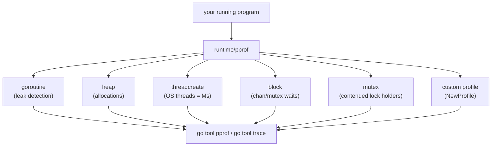
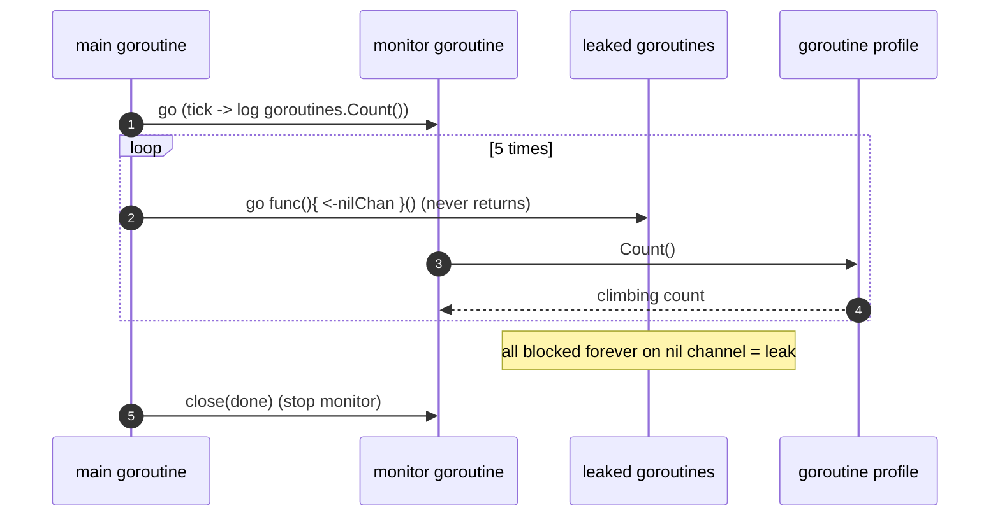
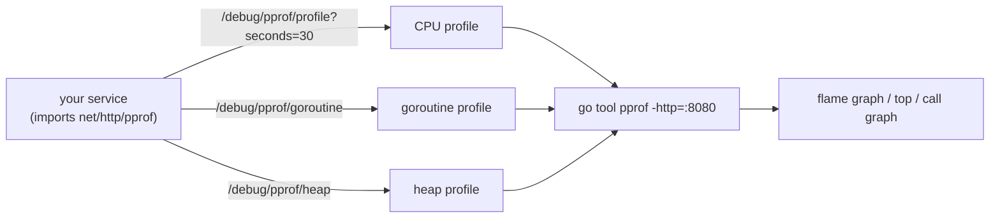
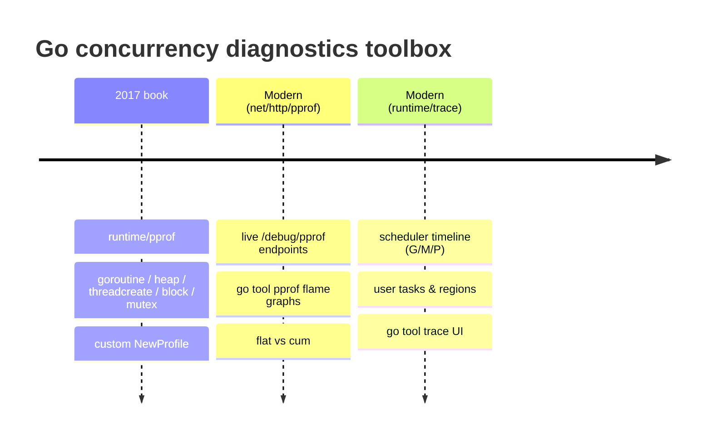

# App A.3 — pprof and Tracing

> Book: *Concurrency in Go* (Katherine Cox-Buday, O'Reilly 2017) · Appendix · Pages ~216–217
> ⬅️ Prev: [Race Detection](02-race-detection.md) · ➡️ Next: [Book index](../README.md) · 🏠 [Book index](../README.md)

## 🎯 In One Paragraph

In a large codebase it's hard to answer runtime questions: *How many goroutines are running? Are CPUs fully utilized? How's memory?* **Profiling** answers these, and Go ships `pprof` in the standard library (`runtime/pprof`, plus `net/http/pprof` for live servers). The `runtime/pprof` package exposes predefined profiles you can hook into and display: **goroutine**, **heap**, **threadcreate**, **block**, and **mutex** — several of which are directly about concurrency. A tiny `pprof.Lookup("goroutine").Count()` loop can surface **goroutine leaks** by watching the live count climb. You can also register **custom profiles** with `pprof.NewProfile`. This mini-chapter covers those book basics and then extends into the modern toolkit the 2017 text predates: `net/http/pprof` endpoints, `go tool pprof` flame graphs, and especially **`runtime/trace`** + `go tool trace`, which visualizes the G/M/P scheduler timeline from Chapter 6.

## 🧠 Key Concepts & Vocabulary

- **Profiling**: Measuring where a running program spends resources (CPU, memory, goroutines, blocking time).
- **pprof**: A profiling tool originally from Google; Go's `runtime/pprof` package produces profiles; `go tool pprof` analyzes them.
- **Predefined profiles**: `goroutine` (all current goroutine stacks), `heap` (sampled heap allocations), `threadcreate` (stacks that created OS threads), `block` (stacks blocked on sync primitives), `mutex` (stacks holding contended mutexes).
- **`pprof.Lookup(name)`**: Fetch a profile by name; `.Count()` returns the number of records (e.g., live goroutines).
- **Custom profile**: `pprof.NewProfile("name")` registers your own profile namespace with `Add`/`Remove`.
- **`net/http/pprof`**: Side-effect import that registers `/debug/pprof/...` HTTP handlers for live profiling of servers.
- **`go tool pprof`**: CLI/web UI to inspect profiles — top functions, call graphs, **flame graphs**; distinguishes **flat** (self) vs **cum** (cumulative) time.
- **Execution trace (`runtime/trace`)**: A fine-grained timeline of goroutine scheduling, GC, syscalls, and P/M activity, viewed with `go tool trace`.
- **Goroutine leak**: Goroutines that block forever and never exit; detectable via a climbing `goroutine` profile count.

## 📚 Deep Dive

### The predefined profiles

```text
goroutine    - stack traces of all current goroutines
heap         - a sampling of all heap allocations
threadcreate - stack traces that led to the creation of new OS threads
block        - stack traces that led to blocking on synchronization primitives
mutex        - stack traces of holders of contended mutexes
```

For concurrency, `goroutine`, `block`, and `mutex` are the most revealing: they tell you *how many* goroutines exist, *where* they block, and *who* holds contended locks.



### Detecting a goroutine leak with the `goroutine` profile

```go
package main

import (
	"log"
	"os"
	"runtime/pprof"
	"time"
)

// Watches the live goroutine count climb as we leak goroutines that block
// forever on a nil channel.
func main() {
	log.SetFlags(log.Ltime | log.LUTC)
	log.SetOutput(os.Stdout)

	goroutines := pprof.Lookup("goroutine")

	done := make(chan struct{})
	go func() {
		ticker := time.NewTicker(300 * time.Millisecond)
		defer ticker.Stop()
		for {
			select {
			case <-ticker.C:
				log.Printf("goroutine count: %d", goroutines.Count())
			case <-done:
				return
			}
		}
	}()

	var blockForever chan struct{} // nil channel: receive blocks forever
	for i := 0; i < 5; i++ {
		go func() { <-blockForever }() // leaked on purpose
		time.Sleep(300 * time.Millisecond)
	}

	log.Printf("final goroutine count: %d", goroutines.Count())
	close(done)
	time.Sleep(50 * time.Millisecond)
}
```

> 🆕 **Modern Go note:** the book uses `for range time.Tick(1*time.Second)`. `time.Tick` leaks its underlying ticker (it can never be stopped), so modern code uses `time.NewTicker` + `defer ticker.Stop()`, as above.

Verified output (Go 1.27.2) — the count climbs by one per leaked goroutine:

```text
20:25:36 goroutine count: 3
20:25:37 goroutine count: 4
20:25:37 goroutine count: 5
20:25:37 goroutine count: 6
20:25:38 goroutine count: 7
20:25:38 final goroutine count: 7
```



### Custom profiles

```go
func newProfIfNotDef(name string) *pprof.Profile {
	prof := pprof.Lookup(name)
	if prof == nil {
		prof = pprof.NewProfile(name)
	}
	return prof
}

prof := newProfIfNotDef("my_package_namespace")
// prof.Add(obj, skip)   // start tracking an object
// prof.Remove(obj)      // stop tracking it
// prof.Count()          // how many objects currently tracked
```

Custom profiles let you track domain objects (open connections, in-flight requests) the same way the built-ins track goroutines.

### 🆕 Live profiling with `net/http/pprof`

The 2017 appendix sticks to `runtime/pprof`. In practice you expose profiles over HTTP:

```go
package main

import (
	"log"
	"net/http"
	_ "net/http/pprof" // registers /debug/pprof/... handlers as a side effect
)

func main() {
	// Never expose this on a public port in production without auth!
	log.Println("pprof on http://localhost:6060/debug/pprof/")
	log.Fatal(http.ListenAndServe("localhost:6060", nil))
}
```

Then analyze live:

```bash
go tool pprof   http://localhost:6060/debug/pprof/goroutine   # goroutine profile
go tool pprof   http://localhost:6060/debug/pprof/heap        # heap
go tool pprof -http=:8080 http://localhost:6060/debug/pprof/profile?seconds=30  # 30s CPU, web UI + flame graph
```

In the `pprof` UI, **flat** time is spent *in* a function; **cum** (cumulative) includes its callees. Flame graphs make hotspots obvious.



### 🆕 Execution tracing with `runtime/trace`

`runtime/trace` captures a **timeline** of the scheduler itself — exactly the G/M/P activity from Chapter 6: when goroutines run, block, get preempted, do syscalls, and when GC runs.

```go
package main

import (
	"context"
	"fmt"
	"os"
	"runtime/trace"
	"sync"
)

func main() {
	f, err := os.Create("trace.out")
	if err != nil {
		panic(err)
	}
	defer f.Close()

	if err := trace.Start(f); err != nil {
		panic(err)
	}
	defer trace.Stop()

	ctx, task := trace.NewTask(context.Background(), "compute-sums")
	defer task.End()

	var wg sync.WaitGroup
	results := make([]int, 4)
	for i := 0; i < 4; i++ {
		wg.Add(1)
		go func(i int) {
			defer wg.Done()
			trace.WithRegion(ctx, fmt.Sprintf("worker-%d", i), func() {
				sum := 0
				for n := 0; n < 1_000_000; n++ {
					sum += n
				}
				results[i] = sum
			})
		}(i)
	}
	wg.Wait()
	fmt.Printf("results: %v\n", results)
	fmt.Println("wrote trace.out (open with: go tool trace trace.out)")
}
```

Verified output (Go 1.27.2); it writes a `trace.out` (~4.5 KB) you open with `go tool trace trace.out`:

```text
results: [499999500000 499999500000 499999500000 499999500000]
wrote trace.out (open with: go tool trace trace.out)
```

`go tool trace trace.out` opens a browser UI with: the per-P goroutine timeline, goroutine analysis, network/sync/syscall blocking profiles, and the **user-defined tasks & regions** (`compute-sums` / `worker-N`) added above (`trace.NewTask`/`WithRegion`, Go 1.11+).



## ⚠️ Pitfalls & Gotchas

- **`time.Tick` leaks.** The book's example uses `time.Tick`, which can never be stopped and leaks its ticker — ironic in a leak-detection example. Use `time.NewTicker` + `Stop()`.
- **Never expose `net/http/pprof` publicly.** The side-effect import registers handlers on the **default** mux; if your service uses `http.DefaultServeMux`, you may unintentionally publish `/debug/pprof/` to the internet. Bind it to localhost or a separate authenticated admin port.
- **`block` and `mutex` profiles are off by default.** You must call `runtime.SetBlockProfileRate` and `runtime.SetMutexProfileFraction` to collect them, or they report nothing.
- **Profiles are samples (except goroutine).** `heap` and CPU profiles are *sampled*; don't treat a single sampled number as exact.
- **Tracing is heavier than profiling.** `runtime/trace` records a lot; keep trace windows short (seconds) in production.
- **Leak count can be noisy.** Runtime/background goroutines (GC, the monitor itself) are counted too — the book's example counts the monitor and `main`, hence the "3" baseline above.

## 🆕 Modern Go Notes

> 🆕 **`net/http/pprof`** is the standard way to profile live servers — not covered in the 2017 appendix.

> 🆕 **`go tool pprof -http=:8080`** launches an interactive web UI with flame graphs (needs no external graphviz for the flame view; graphviz is only needed for the classic call graph).

> 🆕 **`runtime/trace` + user regions/tasks (Go 1.11)** and continuous **flight recording / `trace.Log`** improvements make scheduler-level debugging practical. Recent Go releases improved trace parsing (`golang.org/x/exp/trace`) and reduced trace overhead.

> 🆕 **`uber-go/goleak`** turns the manual goroutine-count technique into an automated test assertion (`goleak.VerifyTestMain`).

> 🆕 **`runtime.SetBlockProfileRate` / `SetMutexProfileFraction`** must be enabled to populate the `block`/`mutex` profiles the book lists.

## 🧪 Try It Yourself

1. Run the leak example, then *fix* it by closing `blockForever` in a `defer` and confirm the count returns to baseline.
2. Add `_ "net/http/pprof"` and a localhost HTTP server to a worker-pool program; hit `go tool pprof http://localhost:6060/debug/pprof/goroutine` and list the top goroutine stacks.
3. Run the `runtime/trace` program, then `go tool trace trace.out`, and find your `worker-0..3` regions under "User-defined tasks."
4. Enable `runtime.SetMutexProfileFraction(1)` in a lock-contended program and inspect the `mutex` profile.

## ✅ Self-Check Questions

<details><summary>Name the five predefined `runtime/pprof` profiles and which are most useful for concurrency.</summary>
`goroutine`, `heap`, `threadcreate`, `block`, `mutex`. For concurrency, `goroutine` (counts/leaks), `block` (where goroutines block), and `mutex` (contended lock holders) are most revealing.
</details>

<details><summary>How can `pprof.Lookup("goroutine").Count()` reveal a leak?</summary>
By logging the count over time: if goroutines are leaking (blocking forever and never exiting), the count rises steadily and never falls back to baseline.
</details>

<details><summary>Why is the book's use of `time.Tick` a (small) bug?</summary>
`time.Tick` returns a channel whose underlying ticker can never be stopped, so it leaks — mildly ironic in a leak-detection example. `time.NewTicker` + `defer ticker.Stop()` is the fix.
</details>

<details><summary>What must you do before the `block` and `mutex` profiles report anything?</summary>
Enable them: `runtime.SetBlockProfileRate(n)` for blocking and `runtime.SetMutexProfileFraction(n)` for mutex contention. They are disabled by default.
</details>

<details><summary>What does `runtime/trace` show that `pprof` does not?</summary>
A fine-grained *timeline* of the scheduler: when each goroutine runs, blocks, is preempted, does syscalls, and when GC runs — i.e., the G/M/P activity over time, viewed with `go tool trace`.
</details>

<details><summary>In a pprof report, what's the difference between "flat" and "cum"?</summary>
Flat is time spent *in* a function itself; cum (cumulative) includes time spent in the functions it calls.
</details>

## 🔑 Key Takeaways

- `runtime/pprof` exposes five predefined profiles — **goroutine, heap, threadcreate, block, mutex** — plus custom profiles via `NewProfile`.
- A simple `goroutine` count loop surfaces **goroutine leaks**; verified climbing from baseline 3 to 7 as five goroutines leaked.
- Modern Go adds **`net/http/pprof`** (live endpoints), **`go tool pprof -http`** flame graphs, and **`runtime/trace`** + `go tool trace` for scheduler timelines.
- Enable **block/mutex** profiles explicitly; keep **traces short**; never expose `/debug/pprof/` publicly.
- Prefer **`time.NewTicker`** over leaky `time.Tick`, and consider **`uber-go/goleak`** to automate leak detection in tests.

## 🔗 References & Further Reading

### 📝 Blogs / articles / talks
- [Profiling Go Programs (go.dev blog)](https://go.dev/blog/pprof) — the foundational pprof walkthrough from the Go team.
- [Profiling Go Services with pprof (iximiuz Labs)](https://labs.iximiuz.com/tutorials/go-pprof-tutorial-79c6591d) — hands-on CPU/heap/goroutine profiling, block/mutex, and when to switch to tracing.
- [Go Performance Optimization: pprof, Flame Graphs & Hotspot Profiling (dev.to)](https://dev.to/jamesli/go-performance-optimization-pprof-flame-graphs-hotspot-profiling-38co) — reading flame graphs, flat vs cum.

### 💻 GitHub
- [google/pprof](https://github.com/google/pprof) — the pprof tool itself (the engine behind `go tool pprof`).
- [uber-go/goleak](https://github.com/uber-go/goleak) — automated goroutine-leak detection for tests, built on the `goroutine` profile idea.

### 📖 Official docs / specs
- [`runtime/pprof` package docs](https://pkg.go.dev/runtime/pprof) — predefined profiles, `Lookup`, `NewProfile`, `WriteHeapProfile`.
- [`net/http/pprof` package docs](https://pkg.go.dev/net/http/pprof) — the `/debug/pprof/` HTTP endpoints for live services.
- [`runtime/trace` package docs](https://pkg.go.dev/runtime/trace) and [Go Wiki: Diagnostics](https://go.dev/doc/diagnostics) — execution tracing, user tasks/regions, and the full diagnostics overview.
