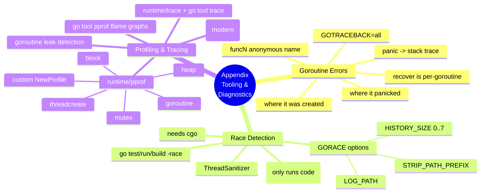
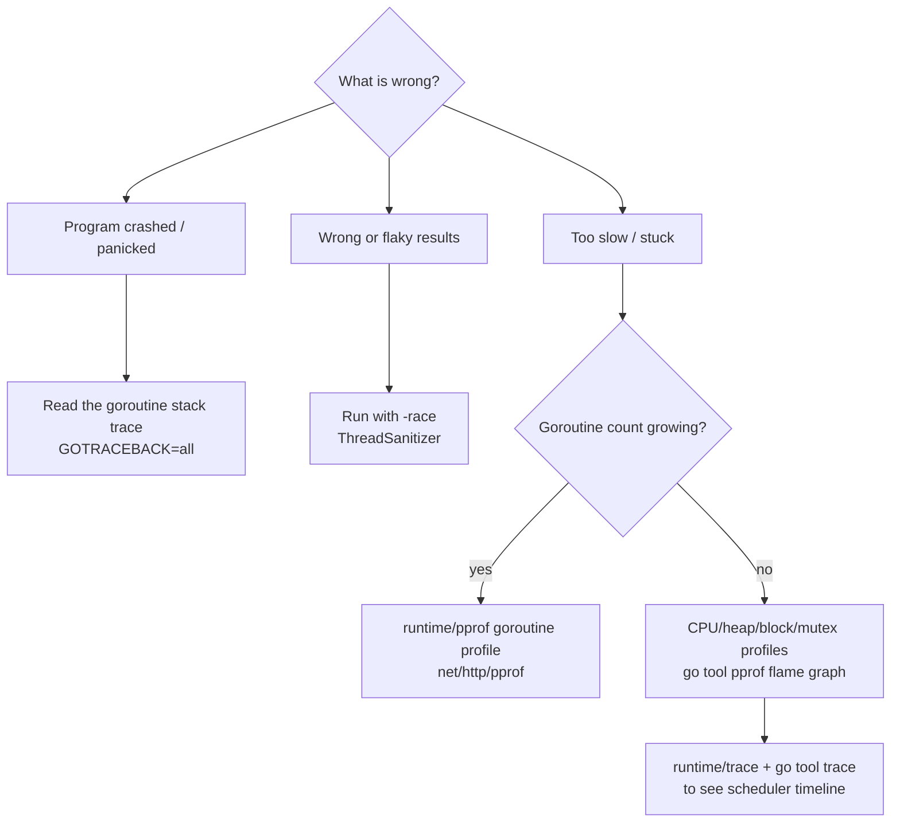

# Appendix — Tooling and Diagnostics

> Book: *Concurrency in Go* (Katherine Cox-Buday, O'Reilly 2017) · Appendix · Pages ~213–217
> ⬅️ Prev chapter: [Chapter 6 — Goroutines and the Go Runtime](../ch06-goroutines-and-the-go-runtime/README.md) · ➡️ Next: [Book index](../README.md) · 🏠 [Book index](../README.md)

## Overview

The appendix is a practical toolbox for *writing, verifying, and debugging* concurrent Go. It stays narrowly focused on concurrency and walks through three things. First, how to **read a goroutine panic** — the sometimes-confusing stack trace that tells you where a goroutine panicked, where it was launched, and (since Go 1.6) shows only the panicking goroutine by default, with `GOTRACEBACK=all` restoring the full dump. Second, the **race detector** (`-race`, since Go 1.1): compiler instrumentation plus a runtime watcher (ThreadSanitizer) that flags unsynchronized concurrent read/write access — a dynamic tool that only catches races that actually execute, so run it under real load and in CI. Third, **profiling and tracing**: `runtime/pprof`'s predefined profiles (goroutine, heap, threadcreate, block, mutex) for answering "how many goroutines? where do they block? who holds the lock?", extended here with the modern `net/http/pprof`, `go tool pprof` flame graphs, and `runtime/trace` + `go tool trace` for visualizing the Chapter 6 scheduler.

## Appendix mind map

## Which tool for which symptom?

## Mini-chapters

| # | File | One-line summary |
|---|------|------------------|
| A.1 | [01-anatomy-of-a-goroutine-error.md](01-anatomy-of-a-goroutine-error.md) | Decoding a goroutine panic trace (where it panicked / where it started / `funcN`), Go 1.6's single-goroutine default, and `GOTRACEBACK`. |
| A.2 | [02-race-detection.md](02-race-detection.md) | The `-race` flag, how ThreadSanitizer finds unsynchronized read/write races, reading the report, `GORACE` tuning, and why it only catches executed races. |
| A.3 | [03-pprof-and-tracing.md](03-pprof-and-tracing.md) | `runtime/pprof` predefined & custom profiles, goroutine-leak detection, plus modern `net/http/pprof`, flame graphs, and `runtime/trace`. |

## Verified programs

Written to `/tmp/cig/verify/ch6/` and run with Go 1.27.2:

- `panic/` — goroutine panic trace (crashes with `exit status 2`, trace captured verbatim) ✅
- `race/` — intentional data race; verified it compiles & runs *silently* without `-race` ✅; `-race` itself **could not run** (no C compiler / cgo in this sandbox), so the documented detector report is shown as the expected output ⚠️
- `pprof/` — goroutine-leak count climbing from 3 → 7 ✅
- `trace/` — `runtime/trace` producing a ~4.5 KB `trace.out` for `go tool trace` ✅
