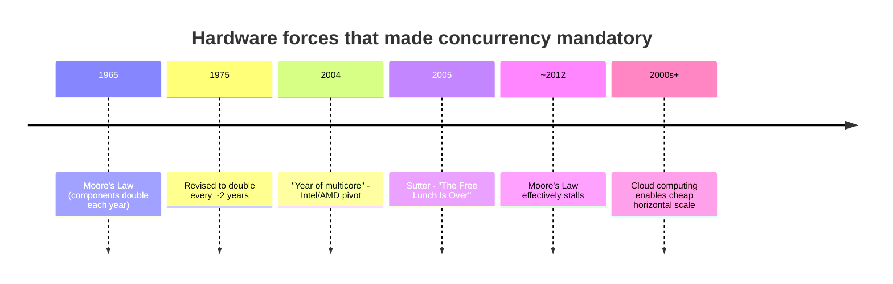
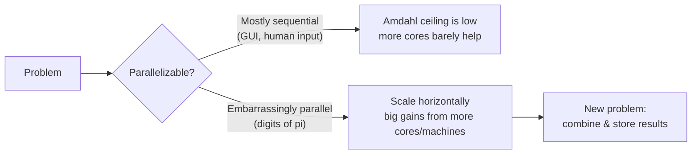
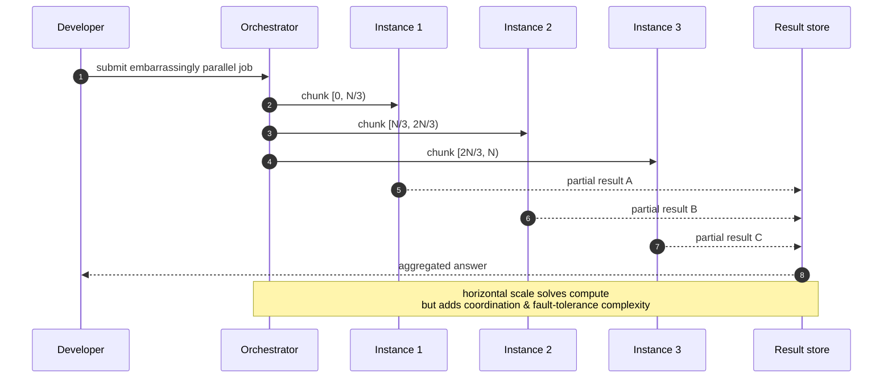

# Ch 1.1 — Moore's Law, Web Scale, and the Mess We're In

> Book: *Concurrency in Go* (Katherine Cox-Buday, O'Reilly 2017) · Chapter 1: An Introduction to Concurrency · Pages ~1–4
> ⬅️ Prev: [Book index](../README.md) · ➡️ Next: [Race Conditions](02-race-conditions.md) · 🏠 [Book index](../README.md)

## 🎯 In One Paragraph

Concurrency means different things to different people — "asynchronous," "parallel," "threaded" are often used interchangeably. For now the book adopts a practical definition: a process is *concurrent* when it occurs simultaneously with one or more other processes that are all making progress at about the same time (think of billions of people living their lives while you read this sentence). Concurrency became unavoidable because of a historical collision of forces: **Moore's Law** (component counts doubling, first yearly then every two years) held until roughly 2012, pushing chipmakers toward **multicore** processors; multicore immediately ran into **Amdahl's Law**, which caps the speedup of a program by the fraction that must remain sequential; **cloud computing** and **horizontal scaling** then made it cheap to throw many machines at **embarrassingly parallel** problems, birthing **web scale** software (and a new mountain of complexity). In 2005 Herb Sutter captured the moment with "The Free Lunch Is Over" — CPUs stopped getting faster per core, so developers now *must* write concurrent code to keep improving performance. The chapter's thesis: concurrency is genuinely hard, but Go's primitives make it clearer and faster.

## 🧠 Key Concepts & Vocabulary

- **Concurrency**: multiple processes making progress at about the same time within overlapping time windows. A property of how code is *structured/dealt with*.
- **Parallelism**: processes literally executing at the same instant on multiple execution units. A property of how code *runs* (hardware-dependent). (The deep distinction is Chapter 2's job; here they are used loosely.)
- **Moore's Law**: Gordon Moore's 1965 observation (revised 1975) that the number of components on an integrated circuit doubles roughly every two years. Held until ~2012.
- **Multicore processor**: multiple independent CPU cores on one chip — the industry's answer to the slowing of single-core clock gains.
- **Amdahl's Law** (Gene Amdahl): the maximum speedup from parallelizing a program is bounded by the fraction that remains strictly sequential. Even infinite cores can't beat the serial part.
- **Embarrassingly parallel**: a problem that divides trivially into independent parallel tasks (e.g., computing digits of π via *spigot algorithms*). Despite the name, it is a real technical term.
- **Sequential bottleneck**: a portion that can't be parallelized (e.g., human interaction in a GUI). It dominates the achievable speedup.
- **Horizontal scaling (scale out)**: add more instances/CPUs/machines to improve throughput. The natural fit for embarrassingly parallel work.
- **Cloud computing**: on-demand access to vast pools of ephemeral, purpose-provisioned machines (took root in the early 2000s). Made horizontal scaling cheap and routine.
- **Web scale**: software expected to handle hundreds of thousands+ of simultaneous workloads by adding instances; enables rolling upgrades, elastic scaling, geographic distribution — at the cost of comprehension and fault-tolerance complexity.
- **"The Free Lunch Is Over"**: Herb Sutter's 2005 Dr. Dobb's article arguing the industry needs higher-level concurrency models because CPUs stopped getting faster per core.

## 📚 Deep Dive

### From one fast core to many slower ones

For decades, "make it faster" meant "wait for the next CPU" — single-core clock speeds and instruction throughput climbed on their own. That is the "free lunch." Around the mid-2000s physics (heat, power, leakage) ended it. Chipmakers pivoted to packing *more cores* onto a die rather than making one core faster.



### Amdahl's Law: the serial part is the ceiling

Adding cores only helps the *parallelizable* portion. If a fraction `s` of your program must run sequentially, the speedup with `N` processors is bounded by `1 / (s + (1-s)/N)`. As `N → ∞`, the ceiling is `1/s`. So a program that is 10% serial can never exceed a 10× speedup, no matter how many cores you add.



Two contrasting examples from the text:

- **GUI program**: bounded by human interaction — a huge sequential segment. Throwing cores at it does nothing; the user clicks at human speed.
- **Computing digits of π**: embarrassingly parallel via spigot algorithms. More cores → big gains; the *new* problem becomes combining and storing partial results.

### Cloud computing and web scale

The early-2000s cloud turned machines from carefully curated, long-lived servers into **ephemeral, on-demand resources** provisioned to fit a workload. That made it trivial to send chunks of an embarrassingly parallel problem to many instances. Software that could absorb hundreds of thousands of simultaneous workloads just by adding instances earned the "web scale" brand — bringing rolling upgrades, elasticity, and geo-distribution, but also new hard problems: provisioning, inter-machine communication, result aggregation, fault tolerance, and above all **how to model code concurrently** when pieces run on different machines.



### The developer's predicament

The result: the modern developer is handed multicore hardware, a cloud that bills per instance, and web-scale expectations, yet many problems are only *partly* parallelizable. The "buck has been passed" — squeezing more performance now requires writing correct concurrent code, which is exactly where the difficulty lives. Sutter's line is the summary: *"We desperately need a higher-level programming model for concurrency than languages offer today."* Go is one answer to that plea.

### Verified example — observing Amdahl's ceiling empirically

The program below splits a numeric workload into a sequential setup phase plus a parallelizable compute phase, then runs the parallel phase on 1, 2, 4, and 8 workers so you can watch the speedup flatten (Amdahl's Law in miniature).

```go
package main

import (
	"fmt"
	"sync"
	"time"
)

// busy simulates CPU work proportional to n.
func busy(n int) uint64 {
	var acc uint64
	for i := 0; i < n; i++ {
		acc += uint64(i*i) ^ uint64(i)
	}
	return acc
}

func runParallel(totalWork, workers int) time.Duration {
	start := time.Now()
	per := totalWork / workers
	var wg sync.WaitGroup
	for w := 0; w < workers; w++ {
		wg.Add(1)
		go func() {
			defer wg.Done()
			busy(per)
		}()
	}
	wg.Wait()
	return time.Since(start)
}

func main() {
	const totalWork = 60_000_000
	// A fixed "sequential" segment that no amount of cores can shrink.
	seqStart := time.Now()
	busy(10_000_000)
	seq := time.Since(seqStart)

	base := runParallel(totalWork, 1)
	fmt.Printf("sequential segment: %v\n", seq.Round(time.Millisecond))
	for _, w := range []int{1, 2, 4, 8} {
		par := runParallel(totalWork, w)
		wall := seq + par
		speedup := float64(seq+base) / float64(wall)
		fmt.Printf("workers=%d  parallel=%-8v  wall=%-8v  speedup≈%.2fx\n",
			w, par.Round(time.Millisecond), wall.Round(time.Millisecond), speedup)
	}
}
```

Run output varies by machine, but the shape is always the same: doubling workers does **not** double the speedup, because the fixed sequential segment never shrinks. That flattening curve *is* Amdahl's Law.

## ⚠️ Pitfalls & Gotchas

- **Assuming more cores = proportional speedup.** The serial fraction caps you. Profile to find what is actually parallelizable before scaling out.
- **Confusing concurrency with parallelism.** Here they're used loosely, but they are not the same thing — Chapter 2 formalizes the difference. Concurrency can exist on a single core (interleaving); parallelism needs multiple execution units.
- **Treating "web scale" as free.** Horizontal scaling trades compute cost for coordination, consistency, and fault-tolerance complexity.
- **Believing Moore's Law will bail you out.** It effectively stalled around 2012; software-side concurrency is now the lever.

## 🆕 Modern Go Notes

> [!note] 🆕 Modern Go note — `for range int` (Go 1.22)
> The verified program uses classic `for i := 0; i < n; i++` loops. Since Go 1.22 you can also write `for range n` to iterate `n` times, and the **loop variable is now per-iteration** (Go 1.22 changed loop-variable semantics), which eliminates a whole class of goroutine-capture bugs that plagued 2017-era code. We revisit this in later chapters.

> [!note] 🆕 Modern Go note — `GOMAXPROCS`
> Go maps goroutines onto OS threads automatically; `runtime.GOMAXPROCS` controls how many run in parallel. Since Go 1.5 it defaults to the number of CPUs, so the parallel speedup in the demo is available out of the box — no thread-pool wiring, which is precisely the "higher-level model" Sutter wanted.

## 🧪 Try It Yourself

1. Change `totalWork` and the sequential segment size in the demo. Make the sequential segment huge — watch the speedup collapse toward 1×. This is `1/s`.
2. Add a `workers=16` and `workers=32` row. Beyond your core count the speedup should stop improving (and may regress from scheduling overhead).
3. Classify three programs you've written as "mostly sequential" vs "embarrassingly parallel." Which would benefit from horizontal scaling?

## ✅ Self-Check Questions

<details><summary>1. What practical definition of "concurrent" does the book adopt?</summary>
Processes that occur simultaneously with one or more other processes and are all making progress at about the same time.</details>

<details><summary>2. What does Amdahl's Law say about adding cores?</summary>
Speedup is bounded by the sequential fraction of the program. If fraction <code>s</code> is serial, the maximum speedup is <code>1/s</code> regardless of core count.</details>

<details><summary>3. Why is "computing digits of π" embarrassingly parallel but a GUI app is not?</summary>
Spigot algorithms let π's digits be computed independently in parallel chunks, so more cores help a lot. A GUI is bounded by sequential human interaction, so cores barely help.</details>

<details><summary>4. What new problems did cloud computing / web scale introduce even as they made horizontal scaling cheap?</summary>
Provisioning resources, inter-machine communication, aggregating/storing results, fault tolerance, and especially how to model code concurrently across machines.</details>

<details><summary>5. What was Herb Sutter's core 2005 argument, and why does it motivate Go?</summary>
That the "free lunch" of ever-faster single cores was over, so software must become concurrent, and languages need a higher-level concurrency model. Go's goroutines/channels are an attempt to provide exactly that.</details>

## 🔑 Key Takeaways

- Single-core performance stopped scaling ~2005–2012; multicore and cloud became the path forward.
- Amdahl's Law caps parallel speedup by the serial fraction — more cores are not a silver bullet.
- Embarrassingly parallel problems scale horizontally beautifully; sequential-bound problems do not.
- Cloud + web scale made horizontal scaling cheap but multiplied coordination and fault-tolerance complexity.
- Writing correct concurrent code is now a core skill, not a niche one — and Go is designed to make it tractable.

## 🔗 References & Further Reading

### 📝 Blogs / articles
- [The Free Lunch Is Over: A Fundamental Turn Toward Concurrency in Software (Herb Sutter, 2005 PDF)](http://www.gotw.ca/publications/concurrency-ddj.htm) — the seminal article the chapter quotes; why multicore forces concurrency.
- [Software and the Concurrency Revolution (ACM Queue, Sutter & Larus)](http://queue.acm.org/detail.cfm?id=1095421) — follow-up arguing for higher-level concurrency models.
- [Is the Free Lunch Over? Revisiting Herb Sutter's Prediction (CppDepend)](https://www.cppdepend.com/blog/is-the-free-lunch-over-revisiting-herb-sutter-prediction/) — a modern retrospective on whether the prediction held.

### 💻 GitHub
- [kat-co/concurrency-in-go-src](https://github.com/kat-co/concurrency-in-go-src) — the book's official source code, including Chapter 1 examples.
- [golang/go — runtime/proc.go](https://github.com/golang/go/blob/master/src/runtime/proc.go) — the scheduler that multiplexes goroutines onto OS threads, realizing cheap horizontal/parallel execution.

### 📖 Official docs / specs
- [Effective Go — Concurrency](https://go.dev/doc/effective_go#concurrency) — Go's official stance: "share memory by communicating."
- [runtime.GOMAXPROCS](https://pkg.go.dev/runtime#GOMAXPROCS) — how Go exposes parallelism across cores.
- [Amdahl's Law (overview)](https://en.wikipedia.org/wiki/Amdahl%27s_law) — the math behind the parallel-speedup ceiling.
