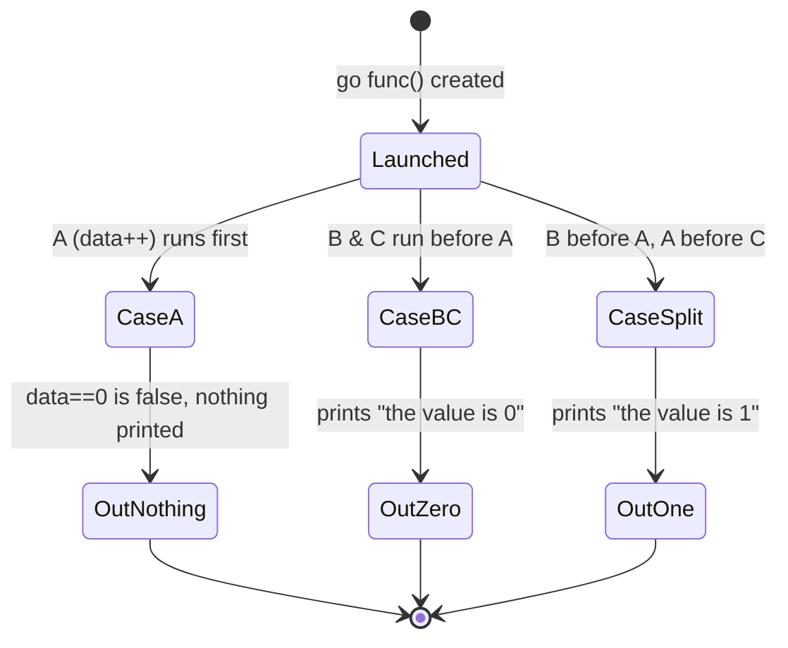
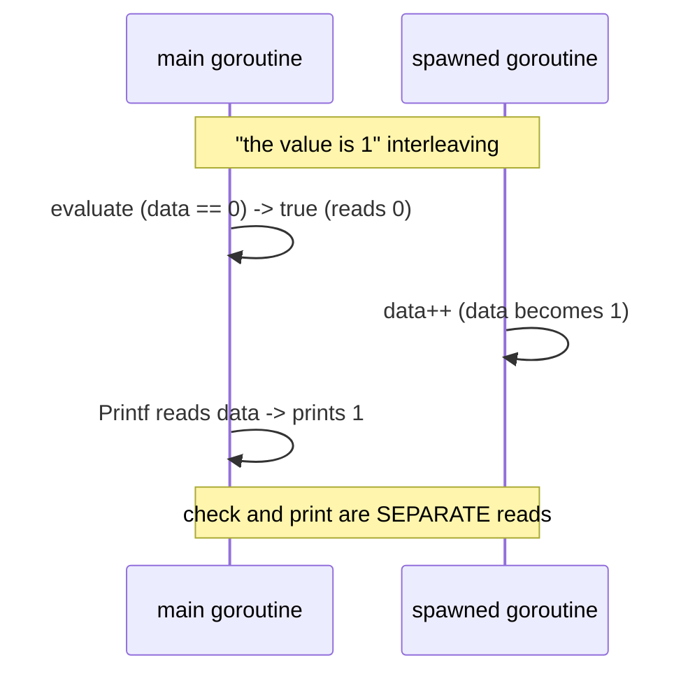

# Ch 1.2 — Race Conditions

> Book: *Concurrency in Go* (Katherine Cox-Buday, O'Reilly 2017) · Chapter 1: An Introduction to Concurrency · Pages ~4–6
> ⬅️ Prev: [Moore's Law, Web Scale, and the Mess](01-moores-law-web-scale-and-the-mess.md) · ➡️ Next: [Atomicity](03-atomicity.md) · 🏠 [Book index](../README.md)

## 🎯 In One Paragraph

A **race condition** happens when two or more operations must execute in a particular order for correctness, but the program never guarantees that order. The most common form is a **data race**: one concurrent operation reads a variable while another, at an undetermined time, writes it. The book's canonical tiny example launches a goroutine that does `data++` and then checks `if data == 0` in `main` — producing three distinct possible outcomes depending on scheduling (nothing printed, `the value is 0`, or `the value is 1`). The root cause is almost always **sequential thinking**: assuming that because a line appears first in the source it runs first in time. A tempting but wrong "fix" is sprinkling `time.Sleep` calls to make the race less likely — this only *asymptotically approaches* correctness without ever reaching it, and it adds latency. The correct mindset is to always target **logical correctness** with real synchronization, and to imagine arbitrarily large time gaps between operations when reasoning about scheduling.

## 🧠 Key Concepts & Vocabulary

- **Race condition**: operations require a specific execution order for correctness, but that order is not guaranteed by the program.
- **Data race**: a specific race where concurrent operations access the *same* memory and at least one is a write, with no synchronization. Outcome is nondeterministic.
- **Goroutine**: a function launched with the `go` keyword to run concurrently. Discussed in depth in Chapter 3.
- **Sequential thinking (the trap)**: assuming source order equals execution order across goroutines. The primary cause of data races.
- **Logical correctness**: the program produces the right answer for *every* possible interleaving, not just the likely ones.
- **Sleep anti-pattern**: using `time.Sleep` to "wait for" a goroutine. Reduces the *probability* of a bad interleaving but never eliminates it, and wastes time.
- **Go race detector** (`-race`): tooling that instruments memory accesses to flag data races at runtime. (Not in the 2017 text's snippets, but the standard modern way to catch these.)

## 📚 Deep Dive

### The canonical three-outcome example

```go
var data int
go func() {
    data++        // (A) write — happens at some unknown time
}()
if data == 0 {    // (B) read
    fmt.Printf("the value is %v.\n", data) // (C) read again
}
```

There is no ordering guarantee between the goroutine's write (A) and main's reads (B)/(C). Three outcomes are all legal:

| Interleaving | Observable outcome |
|---|---|
| A runs before B | **nothing printed** (`data` is 1, so `== 0` is false) |
| B and C run before A | prints **"the value is 0"** |
| B before A, A before C | prints **"the value is 1"** (checked 0, incremented, then read 1) |



Note the subtlety of outcome three: `data == 0` is evaluated as **true** against an old value, then `data++` runs, then the `Printf` reads the *new* value `1`. The check and the print are two separate reads — the variable can change between them.



### Why sequential thinking causes this

Developers read top-to-bottom and subconsciously assume the goroutine "above" is scheduled and finishes before the `if` executes. The runtime makes no such promise. The book's reasoning aid: **imagine an hour (or a day) elapsing between any two operations.** If the goroutine might not run for an hour, how does the rest of the program behave? To the CPU the absolute scale differs, but the *relative* uncertainty is identical.

### The sleep anti-pattern

```go
var data int
go func() { data++ }()
time.Sleep(1 * time.Second) // This is BAD
if data == 0 {
    fmt.Printf("the value is %v.\n", data)
}
```

All three outcomes are still possible — just increasingly *unlikely* as the sleep grows. Correctness here is asymptotic: it approaches but never reaches logical correctness. Worse, you have now paid a full second of latency for a non-guarantee, when proper synchronization might cost microseconds or nothing. Sleeps are fine as a *debugging probe* ("does widening the window change behavior?") but never as a *solution*.

### Verified example — the race, and catching it

Complete runnable program (a `sync.WaitGroup` is added only so `main` doesn't exit before the goroutine — the read/write race itself is intact):

```go
package main

import (
	"fmt"
	"sync"
)

func main() {
	var data int
	var wg sync.WaitGroup
	wg.Add(1)
	go func() {
		defer wg.Done()
		data++ // write
	}()
	if data == 0 { // read, unsynchronized
		fmt.Printf("the value is %v.\n", data)
	}
	wg.Wait()
	fmt.Println("done, final:", data)
}
```

Verified with `go run`: on this machine it printed `the value is 0.` then `done, final: 1`. That is only *one* of the possible outcomes — a different run or machine may print nothing before `done`.

> [!warning] Race detector in this environment
> The canonical way to *prove* a data race exists is `go run -race`, which reports a `DATA RACE` with both stacks. In the sandbox used to verify these notes, `-race` requires cgo and a C compiler that were unavailable, so the program was verified with plain `go run`. On any normal toolchain, run `go run -race ./main.go` and you will see a `WARNING: DATA RACE` naming the write at `data++` and the read at `if data == 0`.

## ⚠️ Pitfalls & Gotchas

- **"It works on my machine."** Races often favor one interleaving overwhelmingly, so bugs hide for years until timing shifts (more load, slower disk, more users) exposes them.
- **Sleeping to "fix" races.** Never eliminates the race; adds latency; masks the real bug.
- **Assuming a single statement is one step.** Even `data++` is three steps (see [Atomicity](03-atomicity.md)).
- **Forgetting the read happens twice.** In the example, `if data == 0` and `Printf(... data)` are independent reads; the value can change between them.
- **Not running `-race` in CI.** A race not exercised by your test timing is still a latent bug.

## 🆕 Modern Go Notes

> [!note] 🆕 Modern Go note — always wire `-race` into CI
> Since the book was written, running tests with `go test -race ./...` has become standard practice. It uses Google's ThreadSanitizer to catch read/write and write/write races at runtime. It has overhead (~5–10× CPU, more memory) so it is used in tests/CI, not production binaries.

> [!note] 🆕 Modern Go note — prefer a real sync primitive
> Instead of a sleep, express the *actual* dependency: a `chan struct{}` to signal completion, `sync.WaitGroup` to wait, or (Go 1.25) `wg.Go(fn)` which adds and launches in one call. These make the ordering guarantee explicit and free of timing guesswork.

## 🧪 Try It Yourself

1. Remove the `WaitGroup` from the verified program and run it many times in a loop (`for i in $(seq 1 100); do go run ./main.go; done`). Count how often each of the three outcomes appears.
2. Add `time.Sleep(10 * time.Millisecond)` before the `if`. Does the distribution of outcomes shift? Did any outcome become *impossible*? (No.)
3. On a toolchain with cgo, run `go run -race ./main.go` and read the two conflicting stack traces.

## ✅ Self-Check Questions

<details><summary>1. Define a race condition vs a data race.</summary>
A race condition: operations need a specific order for correctness but the program doesn't guarantee it. A data race: a specific race where two operations touch the same memory, at least one writes, and there is no synchronization.</details>

<details><summary>2. List the three possible outcomes of the <code>data++</code>/<code>if data==0</code> example.</summary>
(1) Nothing printed (increment ran first). (2) "the value is 0" (both reads ran before the increment). (3) "the value is 1" (check read 0, then increment ran, then the print read 1).</details>

<details><summary>3. Why doesn't <code>time.Sleep</code> fix a race?</summary>
It only lowers the probability of a bad interleaving; all outcomes remain possible. Correctness is asymptotic, never guaranteed, and you pay latency for nothing.</details>

<details><summary>4. What mental trick does the author suggest for reasoning about scheduling?</summary>
Imagine an arbitrarily large time gap (an hour, a day) between any two operations and ask how the program behaves. Relative timing uncertainty is the same regardless of absolute scale.</details>

<details><summary>5. What is the single most common root cause of data races?</summary>
Sequential thinking — assuming source-code order equals execution order across goroutines.</details>

## 🔑 Key Takeaways

- A race condition is a missing ordering guarantee; a data race is its common unsynchronized read/write form.
- The three-outcome example shows how a couple of lines create large nondeterminism.
- Sleeps reduce probability, never guarantee correctness — always target logical correctness.
- Reason about every interleaving; imagine huge time gaps between operations.
- Use `go test -race` / `go run -race` to detect races; use real primitives (channels, WaitGroup) to fix them.

## 🔗 References & Further Reading

### 📝 Blogs / articles
- [Ice cream makers and data races (Dave Cheney)](https://dave.cheney.net/2014/06/27/ice-cream-makers-and-data-races) — a surprising real data race via interface values.
- [Dynamic Data Race Detection in Go Code (Uber Engineering)](https://www.uber.com/en/blog/dynamic-data-race-detection-in-go-code/) — how Uber ran the race detector at scale and what it found.
- [Catching Race Conditions in Go (dev.to)](https://dev.to/frosnerd/catching-race-conditions-in-go-307l) — practical guide to using `-race` with examples.

### 💻 GitHub
- [kat-co/concurrency-in-go-src](https://github.com/kat-co/concurrency-in-go-src) — the book's official Chapter 1 race examples.
- [golang/go — runtime/race](https://github.com/golang/go/tree/master/src/runtime/race) — the race detector's runtime integration (ThreadSanitizer).

### 📖 Official docs / specs
- [Introducing the Go Race Detector (go.dev/blog)](https://go.dev/blog/race-detector) — the canonical introduction to `-race`.
- [Data Race Detector (go.dev/doc)](https://go.dev/doc/articles/race_detector) — official usage, options, and limitations.
- [The Go Memory Model](https://go.dev/ref/mem) — defines exactly when one goroutine's write is guaranteed visible to another.
