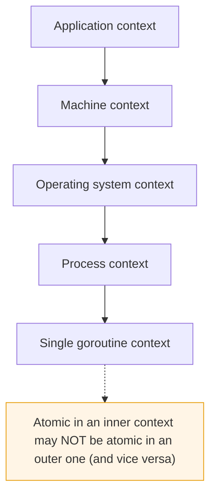
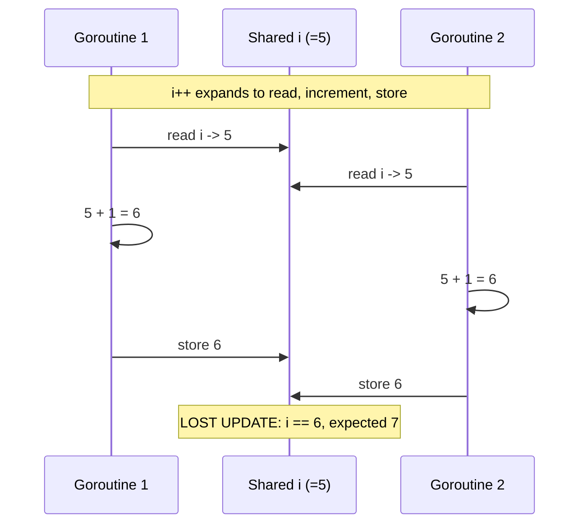

# Ch 1.3 — Atomicity

> Book: *Concurrency in Go* (Katherine Cox-Buday, O'Reilly 2017) · Chapter 1: An Introduction to Concurrency · Pages ~6–7
> ⬅️ Prev: [Race Conditions](02-race-conditions.md) · ➡️ Next: [Memory Access Synchronization](04-memory-access-synchronization.md) · 🏠 [Book index](../README.md)

## 🎯 In One Paragraph

Something is **atomic** when, within a defined **context**, it is **indivisible** and **uninterruptible** — it happens entirely, with nothing else in that context happening simultaneously. The single most important word is *context*: an operation atomic at the level of your process may not be atomic at the OS level, which may not be atomic at the machine level, and so on. The deceptively simple statement `i++` illustrates this: it looks like one step but is really three (read `i`, increment, store `i`), and while each step may be atomic, their *combination* need not be — **combining atomic operations does not necessarily produce a larger atomic operation**. Atomicity matters because anything atomic is implicitly safe in a concurrent context, which lets us compose logically correct (and sometimes faster) programs. The practical art is deciding *which* parts of your code must be atomic and at *what granularity*, then forcing atomicity there with the right technique.

## 🧠 Key Concepts & Vocabulary

- **Atomic / atomicity**: indivisible and uninterruptible *within a defined context* — it completes wholly with nothing else happening in that context at the same time.
- **Context (scope)**: the boundary within which atomicity is claimed (goroutine, process, OS, machine, application). Atomicity is always relative to a context.
- **Indivisible**: cannot be split into observable sub-steps from the viewpoint of that context.
- **Uninterruptible**: nothing in that context can interleave in the middle of the operation.
- **Composition caveat**: a sequence of individually atomic operations is *not* automatically one atomic operation.
- **Forcing atomicity**: using `sync/atomic`, mutexes, channels, or confinement to make a region behave atomically within a chosen context.
- **Implicit concurrency safety**: if an operation is atomic in the relevant context, no other concurrent operation can observe it half-done, so it needs no extra guarding.

## 📚 Deep Dive

### Context is everything

The same operation can be atomic or not depending on the scope you care about.



> [!tip] Fun fact from the book — Glider vs. Warden
> Blizzard's *World of Warcraft* anti-cheat "Warden" scanned host memory, treating the scan as atomic within the **process** context. The "Glider" bot exploited **hardware interrupts** to hide itself before the scan ran — the scan was atomic within the process but *not* within the **operating system** context. Blizzard won a $6M judgment against MDY Industries in 2006. The lesson: atomicity can work *for* you or *against* you depending on scope.

### `i++` is not one operation



`i++` decomposes into:
1. Retrieve the value of `i`.
2. Increment it.
3. Store the result back.

Each step is atomic, but the trio is not — so two goroutines can both read `5`, both compute `6`, and both store `6`, losing an increment. Whether `i++` is "atomic" depends entirely on context:
- **No concurrency at all** → atomic within that program.
- **A goroutine that never exposes `i`** → atomic (confinement).
- **`i` shared by multiple goroutines** → *not* atomic; you must force it.

### Why we care

If something is atomic in the relevant context, it is **implicitly safe** under concurrency — nobody can see it half-finished. That is the foundation for composing logically correct programs and can even be a performance *optimization* (lock-free atomics are cheaper than mutexes for simple counters). But since most statements, functions, and programs are *not* atomic, we must deliberately force atomicity where needed, choosing the right granularity (too coarse → contention/starvation; too fine → complexity and subtle bugs — see [Memory Access Synchronization](04-memory-access-synchronization.md) and [Starvation](07-starvation.md)).

### Verified example — lost updates vs. forced atomicity

This complete program runs 100 goroutines × 1000 increments two ways: a plain `i++` counter (non-atomic combination) and a `sync/atomic` counter. The plain counter loses updates; the atomic one is always exact.

```go
package main

import (
	"fmt"
	"sync"
	"sync/atomic"
)

func main() {
	const workers = 100
	const iters = 1000

	// Non-atomic: read-modify-write, subject to lost updates.
	var unsafe int
	var wg sync.WaitGroup
	wg.Add(workers)
	for range workers {
		go func() {
			defer wg.Done()
			for range iters {
				unsafe++
			}
		}()
	}
	wg.Wait()

	// Atomic (Go 1.19+ typed atomics): the RMW is forced atomic.
	var safe atomic.Int64
	wg.Add(workers)
	for range workers {
		go func() {
			defer wg.Done()
			for range iters {
				safe.Add(1)
			}
		}()
	}
	wg.Wait()

	fmt.Printf("expected      = %d\n", workers*iters)
	fmt.Printf("unsafe (i++)  = %d (often < expected)\n", unsafe)
	fmt.Printf("safe (atomic) = %d\n", safe.Load())
}
```

Verified with `go run`. Actual output on the test machine:

```
expected      = 100000
unsafe (i++)  = 84475 (often < expected)
safe (atomic) = 100000
```

The `unsafe` counter lost **15,525** increments purely because `i++` is not atomic across goroutines — demonstrating the "combining atomic steps isn't atomic" principle directly, no race detector required. The `atomic.Int64` counter is always exactly `100000`.

> [!note] Race detector note
> `go run -race` would additionally flag the `unsafe++` line as a DATA RACE. In the verification sandbox `-race` needed cgo/a C compiler that weren't present, so this was verified with plain `go run`; the lost-update count already proves the non-atomicity.

## ⚠️ Pitfalls & Gotchas

- **Assuming single statements are atomic.** `i++`, `x = x + 1`, slice appends, map writes — none are atomic across goroutines.
- **Forgetting context when you reason about safety.** "Is this atomic?" is meaningless without naming the scope.
- **Composing atomics and expecting atomicity.** Two atomic loads/stores don't make a check-then-act atomic; you need CAS, a lock, or a channel.
- **Mixing atomic and non-atomic access to the same variable.** If one goroutine uses `atomic.Add` and another uses plain `x++`, it's still a race. All access must go through atomics.
- **Reaching for atomics when a mutex is clearer.** Lock-free code is easy to get subtly wrong; use atomics for simple counters/flags, mutexes/channels for anything structured.

## 🆕 Modern Go Notes

> [!note] 🆕 Modern Go note — typed atomics (Go 1.19)
> The book predates `atomic.Int32/Int64/Uint64/Bool/Pointer[T]/Value`. These types replace the old free functions (`atomic.AddInt64(&x, 1)`) with methods (`x.Add(1)`), prevent accidental non-atomic access to the same variable, and guarantee correct alignment on 32-bit platforms. Prefer them in new code.

> [!note] 🆕 Modern Go note — `sync.OnceFunc` / `OnceValue` (Go 1.21)
> For "do exactly once" atomic initialization, Go 1.21 added `sync.OnceFunc` and `sync.OnceValue`, a cleaner wrapper over `sync.Once` for forcing one-time atomic setup.

## 🧪 Try It Yourself

1. Change `safe.Add(1)` to a plain `safe2++` on a shared `int` and confirm the count drops below 100000 again.
2. Replace the atomic counter with a `sync.Mutex`-guarded `int`. Does it also produce exactly 100000? (Yes — a different way to force atomicity.)
3. Add a `atomic.Bool` flag set once by one goroutine and read by others; observe that reads never see a torn value.

## ✅ Self-Check Questions

<details><summary>1. Define atomicity in one sentence, including the key qualifier.</summary>
Within a defined context, an atomic operation is indivisible and uninterruptible — it completes entirely with nothing else in that context happening simultaneously.</details>

<details><summary>2. Why is <code>i++</code> not atomic?</summary>
It expands to three steps — read, increment, store — and the combination can be interrupted, so two goroutines can read the same value and lose an update.</details>

<details><summary>3. Does combining atomic operations yield a larger atomic operation?</summary>
No. A sequence of individually atomic steps is not automatically atomic as a whole.</details>

<details><summary>4. How did Glider exploit atomic context against Warden?</summary>
Warden's memory scan was atomic within the process context but not within the OS context; Glider used hardware interrupts to hide before the scan, exploiting that gap.</details>

<details><summary>5. Why does atomicity imply concurrency safety?</summary>
If an operation is atomic in the relevant context, no other concurrent operation can observe it half-complete, so it needs no additional guarding in that context.</details>

## 🔑 Key Takeaways

- Atomicity is always relative to a **context**; name the scope before reasoning.
- Atomic = indivisible + uninterruptible within that context.
- `i++` is three steps; combining atomic steps does not create a bigger atomic step.
- Atomic operations are implicitly concurrency-safe — the basis for correct composition.
- Force atomicity deliberately with `sync/atomic`, mutexes, channels, or confinement, at the right granularity.

## 🔗 References & Further Reading

### 📝 Blogs / articles
- [If aligned memory writes are atomic, why do we need the sync/atomic package? (Dave Cheney)](https://dave.cheney.net/2018/01/06/if-aligned-memory-writes-are-atomic-why-do-we-need-the-sync-atomic-package) — clears up the "writes are atomic" misconception.
- [Atomic Operations in Go: When a Mutex Is Still Clearer (ByteSizeGo)](https://www.bytesizego.com/blog/atomic-operations-in-go-when-a-mutex-is-still-clearer) — when to prefer atomics vs mutexes.
- [Ice Cream Makers and Data Races Part II (Ardan Labs / Bill Kennedy)](https://www.ardanlabs.com/blog/2014/06/ice-cream-makers-and-data-races-part-ii.html) — why interface writes (two-word headers) aren't atomic.

### 💻 GitHub
- [golang/go — src/sync/atomic/type.go](https://github.com/golang/go/blob/master/src/sync/atomic/type.go) — implementation of the modern typed atomics.
- [golang/go — add typed atomic values · Issue #50860](https://github.com/golang/go/issues/50860) — the proposal that introduced `atomic.Int64` et al. in Go 1.19.

### 📖 Official docs / specs
- [pkg.go.dev — sync/atomic](https://pkg.go.dev/sync/atomic) — the atomic primitives and their memory-model guarantees.
- [The Go Memory Model — atomics](https://go.dev/ref/mem#atomic) — how atomic ops "synchronize before" one another.
- [Effective Go — Share by communicating](https://go.dev/doc/effective_go#sharing) — the idiom atomics sit beneath.
