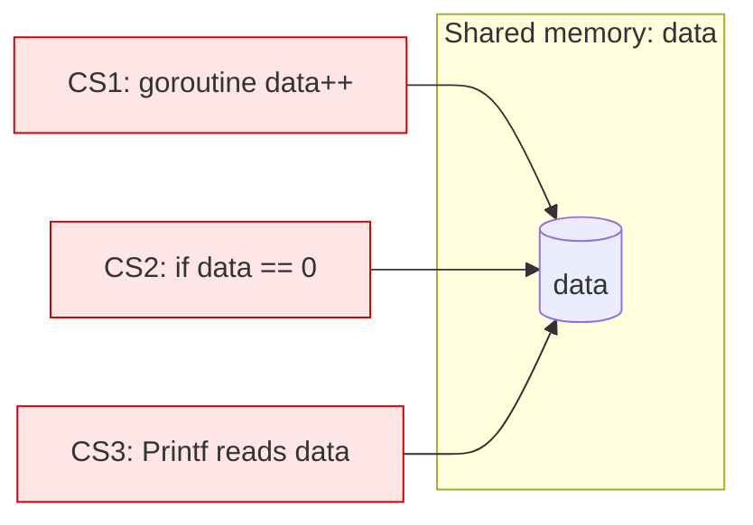
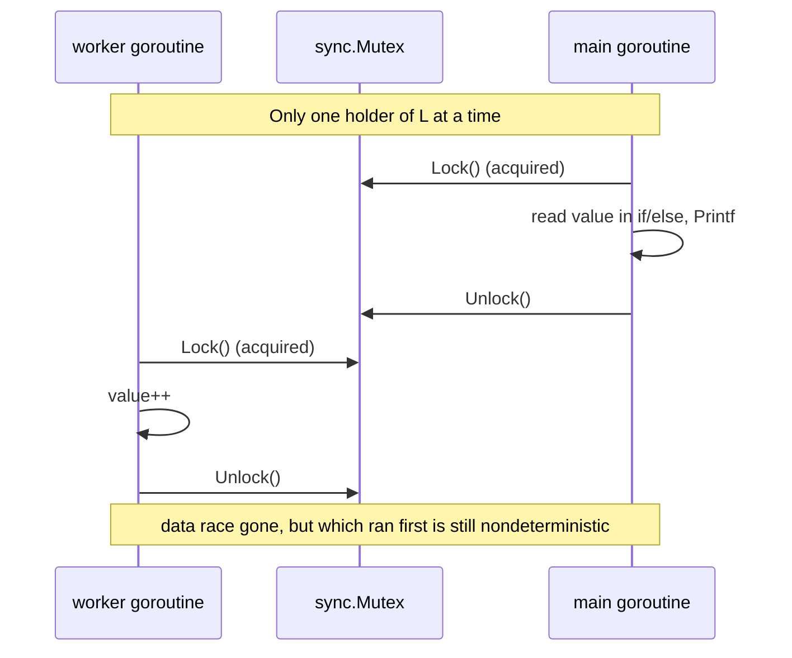
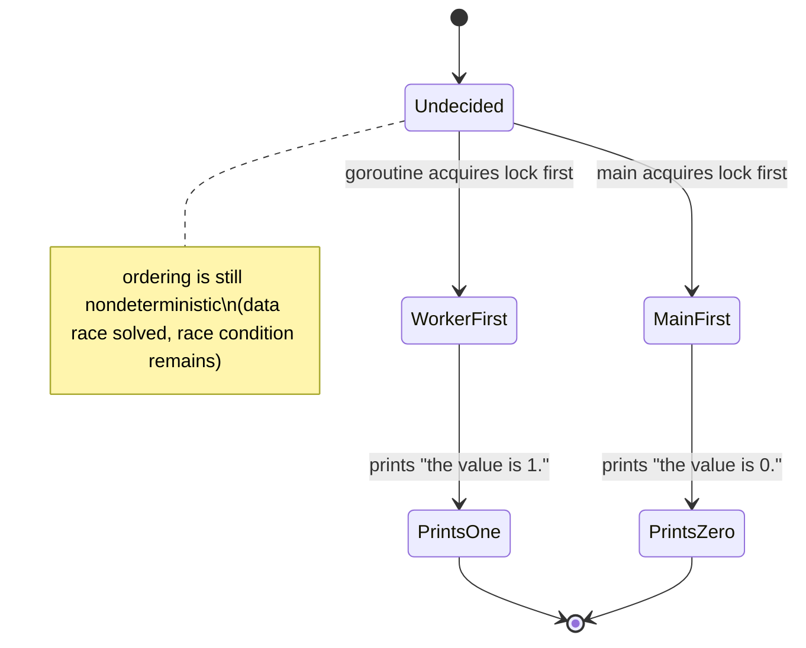

# Ch 1.4 — Memory Access Synchronization

> Book: *Concurrency in Go* (Katherine Cox-Buday, O'Reilly 2017) · Chapter 1: An Introduction to Concurrency · Pages ~8–10
> ⬅️ Prev: [Atomicity](03-atomicity.md) · ➡️ Next: [Deadlocks & the Coffman Conditions](05-deadlocks-and-coffman-conditions.md) · 🏠 [Book index](../README.md)

## 🎯 In One Paragraph

When two concurrent processes access the same memory non-atomically, you have a data race. A **critical section** is any part of a program that needs *exclusive* access to a shared resource. One way to guard critical sections is **memory access synchronization**: establish a convention (e.g., a `sync.Mutex`) so that only one goroutine touches the shared memory at a time. The book shows a deliberately non-idiomatic mutex example to make the mechanics obvious — `Lock()` before touching `value`, `Unlock()` when done. Crucially, this fixes the **data race** but **not** the **race condition**: the *order* of operations is still nondeterministic — we have merely narrowed the window of nondeterminism. Synchronization is not free: it relies on *every* developer following the convention (conventions are easy to ignore), and each `Lock` pauses the program, raising two hard questions — *are critical sections entered/exited repeatedly?* and *how big should each critical section be?* Answering those well is an art, and it sets up the tension between performance and fairness explored later.

## 🧠 Key Concepts & Vocabulary

- **Critical section**: a region of code that requires exclusive access to a shared resource.
- **Memory access synchronization**: coordinating goroutines so only one is inside a critical section at a time (commonly via a mutex).
- **`sync.Mutex`**: a mutual-exclusion lock; `Lock()` acquires exclusive access, `Unlock()` releases it. Detailed in Chapter 3.
- **Convention-based safety**: correctness depends on all code voluntarily locking before access. Not enforced by the compiler — easy to violate.
- **Data race vs race condition (recap)**: synchronization removes the *data race* (unsynchronized concurrent access) but can leave the *race condition* (unspecified ordering) intact.
- **Granularity of a critical section**: how much code/time a lock covers. Coarse = fewer lock ops but more contention; fine = more fairness but more overhead and complexity.
- **Lock overhead**: every `Lock`/`Unlock` pauses the program briefly; frequent locking can dominate runtime.

## 📚 Deep Dive

### Identifying critical sections

Take the data-race example with an added `else` so there's always output:

```go
var data int
go func() { data++ }()
if data == 0 {
    fmt.Println("the value is 0.")
} else {
    fmt.Printf("the value is %v.\n", data)
}
```

There are **three critical sections**, each needing exclusive access to `data`:
1. The goroutine incrementing `data`.
2. The `if` that reads `data` to compare with `0`.
3. The `Printf` that reads `data` for output.



### Guarding with a mutex (non-idiomatic, for illustration)



The convention: *before* reading or writing `value`, call `Lock`; *after*, call `Unlock`. Code between the two can assume exclusive access. The complete verified version is below.

### What synchronization does and does *not* solve

- ✅ **Removes the data race.** No two goroutines touch `value` simultaneously, so no torn/half-updated reads.
- ❌ **Does not remove the race condition.** Either the goroutine runs first, or the `if`/`else` block runs first — we still don't know which per execution. We only *narrowed* the nondeterminism (now it's "which whole critical section goes first" instead of "which individual read/write interleaves").



### The costs: convention fragility and performance

- **Convention fragility**: nothing forces future developers to lock before access. One forgotten `Lock` reintroduces the race. (Later chapters cover *confinement* — making it structurally impossible to access shared memory unsafely.)
- **Performance**: every `Lock`/`Unlock` pauses execution. This raises two design questions:
  - *Are my critical sections entered and exited repeatedly?* (lots of tiny lock/unlock cycles add overhead)
  - *What size should my critical sections be?* (too big blocks others needlessly; too small means constant re-locking)

Answering these in context is an art, and it directly foreshadows the coarse-vs-fine-grained tradeoff in [Starvation](07-starvation.md).

### Verified example

Complete runnable program mirroring the book's non-idiomatic illustration (a `WaitGroup` is added so `main` waits for the worker):

```go
package main

import (
	"fmt"
	"sync"
)

func main() {
	var memoryAccess sync.Mutex
	var value int
	var wg sync.WaitGroup

	wg.Add(1)
	go func() {
		defer wg.Done()
		memoryAccess.Lock()
		value++
		memoryAccess.Unlock()
	}()

	memoryAccess.Lock()
	if value == 0 {
		fmt.Printf("the value is %v.\n", value)
	} else {
		fmt.Printf("the value is %v.\n", value)
	}
	memoryAccess.Unlock()

	wg.Wait()
}
```

Verified with `go run`: printed `the value is 0.` on this run. Running it repeatedly can also print `the value is 1.` — proving the race condition (ordering) survives even though the data race is gone. This program is also clean under `go run -race` (no DATA RACE), unlike the unguarded version in [Race Conditions](02-race-conditions.md).

## ⚠️ Pitfalls & Gotchas

- **Thinking a mutex fixes ordering.** It only serializes access; it does not decide *who goes first*. For ordering you need signaling (channels, `WaitGroup`, `sync.Cond`).
- **Forgetting `Unlock` on an error path.** Use `defer memoryAccess.Unlock()` right after `Lock()` so every return path releases.
- **Copying a `sync.Mutex`.** Mutexes must not be copied after first use; pass by pointer. `go vet` catches many such cases.
- **Over-broad critical sections.** Holding a lock across slow work (I/O, sleeps) starves everyone else — see the greedy-worker demo in [Starvation](07-starvation.md).
- **Relying purely on convention.** A single caller who forgets to lock reintroduces the race; prefer confinement or encapsulating the lock inside the type.

## 🆕 Modern Go Notes

> [!note] 🆕 Modern Go note — `defer` + encapsulation is the idiom
> Idiomatic Go embeds the mutex in the struct that owns the data and always pairs `Lock()` with `defer Unlock()`, so callers can't forget. For read-heavy data, `sync.RWMutex` allows many concurrent readers. Go 1.18+ also offers `sync.Map` for specific concurrent-map patterns.

> [!note] 🆕 Modern Go note — "Don't communicate by sharing memory; share memory by communicating"
> The book itself flags this mutex style as non-idiomatic. Go's preferred approach is often a **channel** that owns the data, so only one goroutine ever touches it — making the critical section structural rather than conventional.

## 🧪 Try It Yourself

1. Remove the goroutine's `Lock`/`Unlock` (but keep main's). Run `go run -race` on a cgo-enabled toolchain — it should report a DATA RACE again.
2. Replace the mutex with a buffered channel of capacity 1 used as a lock (`ch <- struct{}{}` / `<-ch`). Observe it provides the same mutual exclusion.
3. Move `value++` *before* taking the lock in main by using a `chan struct{}` to force the worker to finish first. Now the ordering is deterministic — you solved the race *condition*, not just the data race.

## ✅ Self-Check Questions

<details><summary>1. What is a critical section?</summary>
A region of code that requires exclusive access to a shared resource.</details>

<details><summary>2. How many critical sections are in the <code>data++</code> / if-else example, and what are they?</summary>
Three: the goroutine incrementing <code>data</code>, the <code>if</code> reading <code>data</code>, and the <code>Printf</code> reading <code>data</code>.</details>

<details><summary>3. Does adding a mutex solve the data race, the race condition, or both?</summary>
Only the data race. The ordering (race condition) remains nondeterministic; the mutex just narrows the window.</details>

<details><summary>4. What two questions does lock-based synchronization force you to answer?</summary>
Are critical sections entered and exited repeatedly? And what size should each critical section be?</details>

<details><summary>5. Why is convention-based synchronization fragile?</summary>
Nothing enforces that every developer locks before accessing shared memory; one forgotten lock reintroduces the race.</details>

## 🔑 Key Takeaways

- A critical section needs exclusive access; synchronize it to prevent data races.
- A mutex removes the data race but not the race condition — ordering stays nondeterministic.
- Synchronization relies on convention (fragile) and has real performance cost per lock.
- Critical-section granularity is a tradeoff: coarse = contention, fine = overhead/complexity.
- Prefer idiomatic patterns: encapsulate the lock, `defer Unlock()`, or use channels/confinement.

## 🔗 References & Further Reading

### 📝 Blogs / articles
- [If aligned memory writes are atomic, why do we need sync/atomic? (Dave Cheney)](https://dave.cheney.net/2018/01/06/if-aligned-memory-writes-are-atomic-why-do-we-need-the-sync-atomic-package) — why "looks atomic" isn't enough and why memory-access synchronization primitives exist.
- [Atomic Operations in Go: When a Mutex Is Still Clearer (ByteSizeGo)](https://www.bytesizego.com/blog/atomic-operations-in-go-when-a-mutex-is-still-clearer) — picking mutex vs atomic for a critical section.
- [The Linux Code — Keeping Concurrency Fair](https://thelinuxcode.com/starvation-and-livelock-keeping-concurrency-fair-in-2026/) — how critical-section size affects fairness and throughput.

### 💻 GitHub
- [golang/go — src/sync/mutex.go](https://github.com/golang/go/blob/master/src/sync/mutex.go) — the actual `sync.Mutex` implementation (including the fairness/starvation mode).
- [uber-go/goleak](https://github.com/uber-go/goleak) — detects goroutines left blocked on locks/channels in tests.

### 📖 Official docs / specs
- [pkg.go.dev — sync (Mutex, RWMutex)](https://pkg.go.dev/sync) — official API for mutual exclusion.
- [The Go Memory Model — locks](https://go.dev/ref/mem#locks) — the happens-before guarantees `Lock`/`Unlock` provide.
- [Effective Go — Concurrency](https://go.dev/doc/effective_go#concurrency) — "share memory by communicating."
