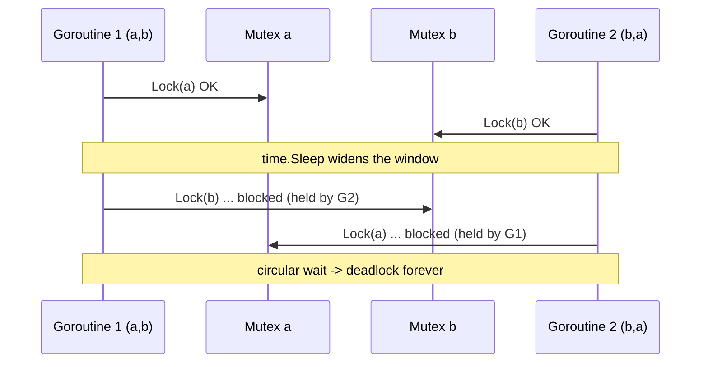
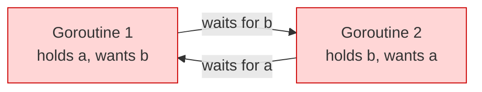
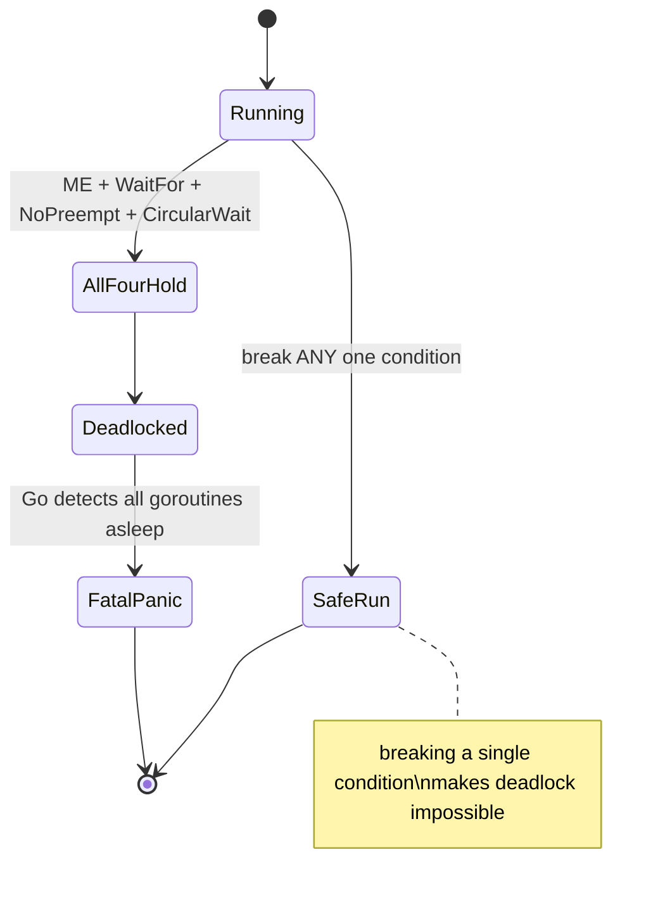

# Ch 1.5 — Deadlocks and the Coffman Conditions

> Book: *Concurrency in Go* (Katherine Cox-Buday, O'Reilly 2017) · Chapter 1: An Introduction to Concurrency · Pages ~10–13
> ⬅️ Prev: [Memory Access Synchronization](04-memory-access-synchronization.md) · ➡️ Next: [Livelocks](06-livelocks.md) · 🏠 [Book index](../README.md)

## 🎯 In One Paragraph

The previous sections were about *correctness* (never give a wrong answer). Deadlocks, livelocks, and starvation are a different class: they're about *liveness* — ensuring the program always has something useful to do. A **deadlock** is a state where all concurrent processes are waiting on one another, so the program never recovers without outside intervention. Go's runtime detects *some* deadlocks (when **all** goroutines are blocked) and panics with `fatal error: all goroutines are asleep - deadlock!`, but it cannot prevent them, and partial deadlocks go undetected. The classic example is two goroutines that lock resources `a` and `b` in opposite orders and then each wait for the other's lock — two gears that can never turn. In 1971 **Edgar Coffman** enumerated the four conditions that must *all* hold for a deadlock to be possible — **Mutual Exclusion, Wait-For (hold-and-wait), No Preemption, and Circular Wait**. Because all four are necessary, breaking *any one* prevents deadlock — which is the basis for every deadlock prevention technique (most commonly, enforcing a consistent **lock ordering** to break circular wait).

## 🧠 Key Concepts & Vocabulary

- **Deadlock**: all involved concurrent processes are blocked waiting on each other; no progress is possible without external intervention.
- **Go runtime deadlock detection**: detects only *total* deadlocks (every goroutine blocked) → `fatal error: all goroutines are asleep - deadlock!`. Partial deadlocks are not detected (open proposal [golang/go#13759](https://github.com/golang/go/issues/13759)).
- **Coffman Conditions** (Edgar Coffman, 1971): four conditions that must *simultaneously* hold for a deadlock.
  - **Mutual Exclusion**: a process holds exclusive rights to a resource at a time.
  - **Wait-For (hold and wait)**: a process holds a resource while waiting to acquire another.
  - **No Preemption**: a held resource can only be released voluntarily by the holder.
  - **Circular Wait**: a cycle of processes each waiting on the next (P1→P2→…→P1).
- **Lock ordering (lock hierarchy)**: acquire multiple locks in a single, globally consistent order to break Circular Wait.
- **Prevention via condition-breaking**: since all four conditions are required, falsifying any one makes deadlock impossible.

## 📚 Deep Dive

### The classic two-lock deadlock

```go
type value struct {
    mu  sync.Mutex
    val int
}
// printSum locks v1, sleeps, then locks v2.
// Called once as (a, b) and once as (b, a) -> opposite acquisition orders.
```

Goroutine 1 calls `printSum(&a, &b)`: locks `a`, then wants `b`.
Goroutine 2 calls `printSum(&b, &a)`: locks `b`, then wants `a`.
Each holds what the other needs → infinite wait.



The "two gears that cannot turn together" image: a wait-for cycle between the two calls.



> [!warning] The book's "Irony" sidebar
> The example uses `time.Sleep` to *trigger* the deadlock reliably — which itself introduces a **race condition**! There is no guarantee of goroutine start order; it's (unlikely but) possible one goroutine grabs and releases *both* locks before the other starts, avoiding the deadlock entirely. A "perfect" deadlock would need real synchronization to force the interleaving.

### The Coffman Conditions, applied

| Condition | Meaning | Present in the example? |
|---|---|---|
| **Mutual Exclusion** | exclusive resource access | ✅ `printSum` needs exclusive `a` and `b` |
| **Wait-For** | hold one, wait for another | ✅ holds `a` or `b`, waits on the other |
| **No Preemption** | only the holder can release | ✅ nothing can forcibly take a goroutine's lock |
| **Circular Wait** | cycle of waiters | ✅ call 1 waits on call 2 and vice versa |

All four hold → guaranteed deadlock (modulo the start-order race).



### Prevention: break one condition

Because all four are *necessary*, prevention = ensure at least one never holds:
- **Break Circular Wait** (most practical): impose a global lock ordering. If every goroutine always locks `a` before `b`, no cycle can form. In the example, make *both* calls lock in the same order (always the lower address / a fixed ID first).
- **Break Wait-For**: acquire all needed locks at once (all-or-nothing), or release held locks before requesting more.
- **Break No Preemption**: use `TryLock` (Go 1.18+) and back off/release if the second lock isn't available.
- **Break Mutual Exclusion**: use lock-free/immutable data or confinement so no exclusive lock is needed.

In practice these are hard to reason about — the web is full of "why does my code deadlock?" questions, and the answer is usually obvious only once someone else points it out (see [Determining Concurrency Safety](08-determining-concurrency-safety.md)).

### Verified example — a real deadlock and its fix

The deadlocking program (verified to panic):

```go
package main

import (
	"fmt"
	"sync"
	"time"
)

type value struct {
	mu  sync.Mutex
	val int
}

func main() {
	var wg sync.WaitGroup
	printSum := func(v1, v2 *value) {
		defer wg.Done()
		v1.mu.Lock()
		defer v1.mu.Unlock()
		time.Sleep(2 * time.Second) // widen the window
		v2.mu.Lock()
		defer v2.mu.Unlock()
		fmt.Printf("sum=%v\n", v1.val+v2.val)
	}
	var a, b value
	wg.Add(2)
	go printSum(&a, &b) // locks a then b
	go printSum(&b, &a) // locks b then a
	wg.Wait()
}
```

Verified with `go run` — it reliably printed:

```
fatal error: all goroutines are asleep - deadlock!
```

followed by goroutine stack traces, and exited non-zero (the Go runtime's total-deadlock detector firing). **This program is *supposed* to deadlock** — that panic is the expected demonstration output.

**The fix** is to break Circular Wait with a consistent lock order (acquire the lower-addressed value first), so both calls lock in the same global order:

```go
package main

import (
	"fmt"
	"sync"
	"time"
	"unsafe"
)

type value struct {
	mu  sync.Mutex
	val int
}

func main() {
	var wg sync.WaitGroup
	// Always lock in a fixed global order -> breaks Circular Wait.
	printSum := func(v1, v2 *value) {
		defer wg.Done()
		first, second := v1, v2
		if uintptr(unsafe.Pointer(v2)) < uintptr(unsafe.Pointer(v1)) {
			first, second = v2, v1
		}
		first.mu.Lock()
		defer first.mu.Unlock()
		time.Sleep(50 * time.Millisecond)
		second.mu.Lock()
		defer second.mu.Unlock()
		fmt.Printf("sum=%v\n", v1.val+v2.val)
	}
	var a, b value
	a.val, b.val = 3, 4
	wg.Add(2)
	go printSum(&a, &b)
	go printSum(&b, &a)
	wg.Wait()
}
```

Verified with `go run` — prints `sum=7` twice and exits cleanly. Ordering the locks consistently eliminates the cycle.

## ⚠️ Pitfalls & Gotchas

- **Relying on Go's detector.** It only fires when *all* goroutines are blocked; a subset deadlocked while others spin is invisible to it.
- **Using `time.Sleep` to force timing.** As the book notes, this itself adds a race; prefer real synchronization in tests that must reproduce a deadlock.
- **Inconsistent lock order across functions.** The most common real-world cause. Document and enforce a lock hierarchy.
- **Locking across callbacks / channel sends.** Holding a lock while sending on a channel (whose receiver also needs the lock) is a classic hidden cycle.
- **Nested locks in different modules.** Hard to see the cycle when the two `Lock` calls live in different packages.

## 🆕 Modern Go Notes

> [!note] 🆕 Modern Go note — `sync.Mutex.TryLock` (Go 1.18)
> `TryLock` lets you *break No Preemption*: attempt the second lock, and if it fails, release the first and retry. Use sparingly (the docs warn it's rarely the right tool), but it's a legitimate way to avoid a known cycle.

> [!note] 🆕 Modern Go note — partial-deadlock detection is still open
> The footnote's proposal ([#13759](https://github.com/golang/go/issues/13759)) to detect *partial* deadlocks remains unimplemented as of Go 1.27. Tools like `uber-go/goleak` help catch goroutines stuck forever in tests.

> [!note] 🆕 Modern Go note — `context` for cancellation
> Many "deadlocks" in real services are goroutines blocked on a channel/lock with no timeout. Propagating a `context.Context` with a deadline (and `context.WithTimeout`) gives blocked work an escape hatch, turning a hang into a clean error.

## 🧪 Try It Yourself

1. Run the deadlocking program and read the stack traces — identify which goroutine holds which lock.
2. Apply the lock-ordering fix and confirm `sum=7` prints twice. Then deliberately reverse the order in only *one* call and watch it deadlock again.
3. Replace the lock-ordering fix with a `TryLock`+backoff version that breaks No Preemption instead. Compare clarity.

## ✅ Self-Check Questions

<details><summary>1. Define a deadlock.</summary>
A state where all involved concurrent processes are blocked waiting on one another, so no progress is possible without outside intervention.</details>

<details><summary>2. Name the four Coffman Conditions.</summary>
Mutual Exclusion, Wait-For (hold and wait), No Preemption, and Circular Wait.</details>

<details><summary>3. Why does breaking just one Coffman condition prevent deadlock?</summary>
Because all four are necessary simultaneously; if any one cannot hold, the deadlock state is impossible.</details>

<details><summary>4. What does Go's runtime do about deadlocks, and what's its limitation?</summary>
It panics with "all goroutines are asleep - deadlock!" but only when *every* goroutine is blocked; partial deadlocks are not detected and it can't prevent them.</details>

<details><summary>5. What is the most common practical prevention technique and which condition does it break?</summary>
A consistent global lock ordering (lock hierarchy), which breaks Circular Wait.</details>

## 🔑 Key Takeaways

- Deadlock = everyone waiting on everyone; needs external intervention to recover.
- Go detects only *total* deadlocks (fatal panic); it cannot prevent them.
- The four Coffman Conditions must all hold for a deadlock to be possible.
- Break any one condition to prevent deadlock — consistent lock ordering (breaking Circular Wait) is the usual choice.
- Beware forcing timing with `time.Sleep`; it introduces its own race.

## 🔗 References & Further Reading

### 📝 Blogs / articles
- [Deadlock, Livelock and Starvation (Baeldung CS)](https://www.baeldung.com/cs/deadlock-livelock-starvation) — clear comparison of all three liveness problems.
- [Avoid deadlock by locking in a predefined order (SEI CERT CON53-CPP)](https://wiki.sei.cmu.edu/confluence/display/cplusplus/CON53-CPP.+Avoid+deadlock+by+locking+in+a+predefined+order) — the lock-hierarchy technique, condition-by-condition.
- [Using Locking Hierarchies (Oracle Multithreaded Programming Guide)](https://docs.oracle.com/cd/E19455-01/806-5257/sync-ex-3/index.html) — classic treatment of ordering locks to avoid deadlock.

### 💻 GitHub
- [golang/go — runtime: detect partial deadlocks · Issue #13759](https://github.com/golang/go/issues/13759) — the proposal referenced in the book's footnote.
- [uber-go/goleak](https://github.com/uber-go/goleak) — find goroutines stuck forever (often a sign of a partial deadlock) in tests.

### 📖 Official docs / specs
- [pkg.go.dev — sync.Mutex (incl. TryLock)](https://pkg.go.dev/sync#Mutex.TryLock) — the lock API and the No-Preemption-breaking `TryLock`.
- [pkg.go.dev — context](https://pkg.go.dev/context) — deadlines/cancellation to stop goroutines from blocking forever.
- [Edward G. Coffman — System Deadlocks (1971)](https://dl.acm.org/doi/10.1145/356586.356588) — the original paper enumerating the conditions.
