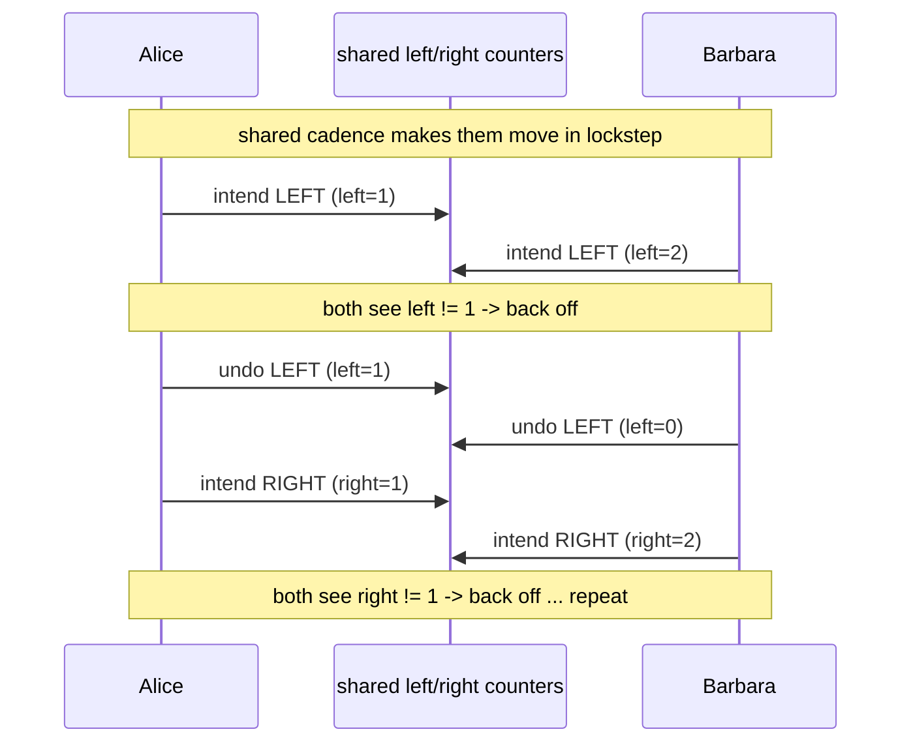
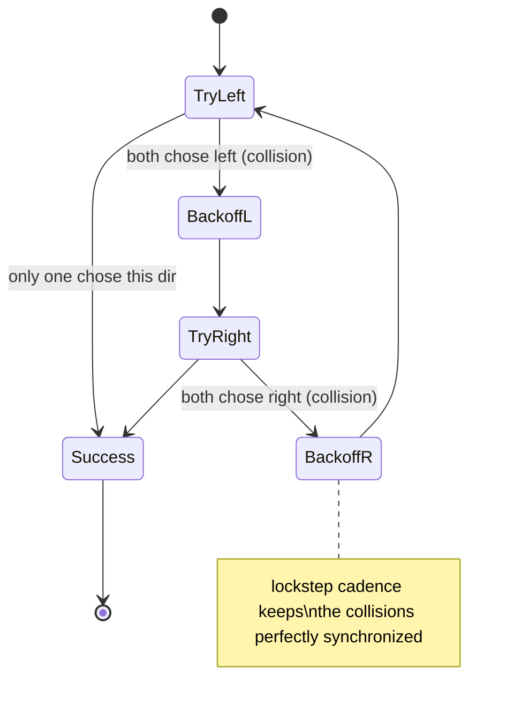
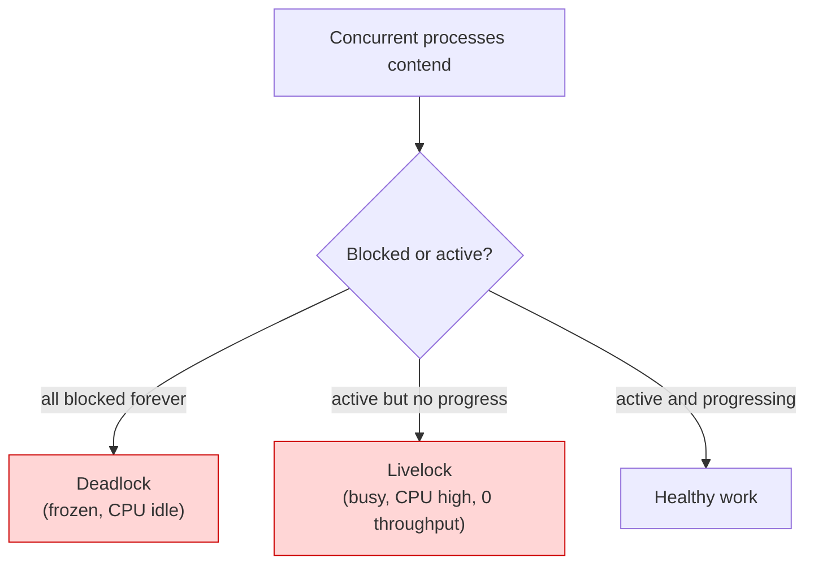

# Ch 1.6 — Livelocks

> Book: *Concurrency in Go* (Katherine Cox-Buday, O'Reilly 2017) · Chapter 1: An Introduction to Concurrency · Pages ~13–15
> ⬅️ Prev: [Deadlocks & the Coffman Conditions](05-deadlocks-and-coffman-conditions.md) · ➡️ Next: [Starvation](07-starvation.md) · 🏠 [Book index](../README.md)

## 🎯 In One Paragraph

A **livelock** is a program that is *actively* performing concurrent operations, but those operations do nothing to move the program's state forward. The intuition is the hallway shuffle: you step aside to let someone pass, they step the same way, you both switch sides, and you repeat forever — busy, polite, and going nowhere. Unlike a deadlock (everything frozen), a livelock *looks alive*: CPU is burning, logs may scroll, monitoring thinks the system is working — which makes livelocks **harder to spot than deadlocks**. The book's demo has Alice and Barbara repeatedly try to step `left` then `right` in lockstep cadence, each detecting the other's move and backing off, until an artificial attempt limit makes them give up. The deeper lesson: livelocks are a very common result of **two or more processes trying to prevent a deadlock without coordination** — their uncoordinated politeness becomes the trap. Livelocks are a subset of the broader category of **starvation**.

## 🧠 Key Concepts & Vocabulary

- **Livelock**: processes are active (not blocked) but make no forward progress; state keeps changing without advancing.
- **Hallway shuffle**: the canonical metaphor — two people repeatedly mirroring each other's sidestep.
- **Cadence**: a shared rhythm forcing all parties to act at the same rate (in the demo, a `sync.Cond` broadcasting every 1 ms via `time.Tick`).
- **Uncoordinated deadlock avoidance**: the usual *cause* — each process independently backs off to avoid blocking, and their backoffs stay synchronized.
- **Liveness problem**: like deadlock and starvation, a livelock violates liveness (always having something useful to do) rather than safety/correctness.
- **Why it's sneaky**: high CPU utilization and active signals can fool you into thinking real work is happening.

## 📚 Deep Dive

### The hallway, in code

The demo's moving parts (follow the callouts, don't sweat the `sync.Cond`/`atomic` details — covered later):

- `cadence` — a `sync.NewCond` whose `Broadcast` fires every millisecond; `takeStep()` blocks on `cadence.Wait()` so **everyone moves at the same rate**. This lockstep is what keeps the two people perfectly mirrored.
- `tryDir(dirName, dir, out)` — declares intent to move a direction by `atomic.AddInt32(dir, 1)`, takes a step, and if exactly one person chose that direction (`dir == 1`) it's a success; otherwise it backs off with `atomic.AddInt32(dir, -1)` and returns false.
- `tryLeft` / `tryRight` — try left, then right.
- `walk(...)` — loops up to 5 attempts of `tryLeft() || tryRight()`; if none succeed, the person "tosses their hands up."



Each round, both pick the same direction, both detect a collision, both undo, both try the other direction — in perfect sync. Everyone is *busy*; nobody *progresses*.



### Deadlock vs livelock vs "working"



A deadlock is easy to notice — the process hangs and (in Go) often panics. A livelock keeps the CPU hot and may even emit signals (logs, metrics ticking) that *look* like progress. You could glance at CPU utilization, conclude "it's doing something," and miss that throughput is zero.

### Root cause and the cure

The demo illustrates the most common reason livelocks get written: **two or more processes trying to avoid a deadlock without coordinating**. Their individual "be polite and back off" strategies stay in phase. The fix is **coordination**: if Alice and Barbara had agreed that *only one* person moves, one stands still, the other steps aside, and both walk on. In systems terms: add asymmetry/randomness (randomized backoff, priorities, a tie-breaker, a leader) so the processes don't keep making identical choices.

### Verified example

Complete runnable program (the book's example, made self-contained). The artificial 5-attempt limit exists only so the program terminates — a real livelock may have no such limit, which is exactly what makes it dangerous.

```go
package main

import (
	"bytes"
	"fmt"
	"sync"
	"sync/atomic"
	"time"
)

func main() {
	cadence := sync.NewCond(&sync.Mutex{})
	go func() {
		for range time.Tick(1 * time.Millisecond) {
			cadence.Broadcast()
		}
	}()

	takeStep := func() {
		cadence.L.Lock()
		cadence.Wait()
		cadence.L.Unlock()
	}

	tryDir := func(dirName string, dir *int32, out *bytes.Buffer) bool {
		fmt.Fprintf(out, " %v", dirName)
		atomic.AddInt32(dir, 1)
		takeStep()
		if atomic.LoadInt32(dir) == 1 {
			fmt.Fprint(out, ". Success!")
			return true
		}
		takeStep()
		atomic.AddInt32(dir, -1)
		return false
	}

	var left, right int32
	tryLeft := func(out *bytes.Buffer) bool { return tryDir("left", &left, out) }
	tryRight := func(out *bytes.Buffer) bool { return tryDir("right", &right, out) }

	walk := func(walking *sync.WaitGroup, name string) {
		var out bytes.Buffer
		defer func() { fmt.Println(out.String()) }()
		defer walking.Done()
		fmt.Fprintf(&out, "%v is trying to scoot:", name)
		for i := 0; i < 5; i++ {
			if tryLeft(&out) || tryRight(&out) {
				return
			}
		}
		fmt.Fprintf(&out, "\n%v tosses their hands up in exasperation!", name)
	}

	var peopleInHallway sync.WaitGroup
	peopleInHallway.Add(2)
	go walk(&peopleInHallway, "Alice")
	go walk(&peopleInHallway, "Barbara")
	peopleInHallway.Wait()
}
```

Verified with `go run`. Actual output on the test machine:

```
Barbara is trying to scoot: left right left right left right left right left right
Barbara tosses their hands up in exasperation!
Alice is trying to scoot: left right left right left right left right left right
Alice tosses their hands up in exasperation!
```

Both kept mirroring `left right left right …` and never passed — a textbook livelock that only ended because of the 5-attempt cap.

## ⚠️ Pitfalls & Gotchas

- **Mistaking busy for productive.** High CPU / scrolling logs can mask a livelock. Measure *throughput*, not just activity (ties into [Starvation](07-starvation.md)'s metric advice).
- **Uncoordinated retry/backoff.** If every client retries on the same fixed schedule after a conflict, they can livelock in sync. Use randomized/exponential backoff with jitter.
- **Symmetric peers.** Identical agents making identical decisions stay in phase. Introduce asymmetry (IDs, priorities, a leader).
- **"Polite" deadlock avoidance.** Backing off to avoid a deadlock *without coordination* is the classic way to create a livelock instead.
- **No progress metric.** Without a counter/heartbeat of *completed work*, livelocks hide for a long time.

## 🆕 Modern Go Notes

> [!note] 🆕 Modern Go note — add jitter to backoff
> The real-world antidote to livelock-by-retry is randomized/exponential backoff with jitter (e.g., `golang.org/x/time/rate`, or AWS's "Full Jitter" algorithm). Jitter breaks the lockstep that keeps peers colliding.

> [!note] 🆕 Modern Go note — `testing/synctest` (Go 1.25)
> Cadence-driven examples like this are hard to test deterministically. Go 1.25's experimental `testing/synctest` gives a fake clock and bubble so time-based concurrency can be tested without flaky real sleeps/ticks.

## 🧪 Try It Yourself

1. Add a random initial `time.Sleep(time.Duration(rand.Intn(5)) * time.Millisecond)` to each `walk`. Break the lockstep and watch one of them succeed quickly.
2. Give Alice priority (she always tries left first, Barbara always right first). Does the livelock disappear? Why?
3. Add a shared `atomic.Int64` counter of *successful passes* and print it. In the livelock it stays 0 — that's your progress metric.

## ✅ Self-Check Questions

<details><summary>1. What distinguishes a livelock from a deadlock?</summary>
In a deadlock all processes are blocked (frozen, CPU idle). In a livelock processes are active and keep changing state but make no forward progress (CPU busy, zero throughput).</details>

<details><summary>2. Why are livelocks harder to spot than deadlocks?</summary>
Because the program looks alive — CPU is high and it may emit signals that resemble real work, fooling monitoring.</details>

<details><summary>3. What is the most common cause of livelocks per the book?</summary>
Two or more processes trying to prevent a deadlock without coordinating; their uncoordinated backoffs stay synchronized.</details>

<details><summary>4. What role does the shared cadence play in the demo?</summary>
It forces both people to move at exactly the same rate, keeping their collision-and-backoff cycles perfectly in phase so the livelock persists.</details>

<details><summary>5. What is the general cure for a livelock?</summary>
Coordination/asymmetry: agree that only one party moves, or add priorities, a leader, or randomized backoff with jitter so peers stop making identical choices.</details>

## 🔑 Key Takeaways

- A livelock is active but unproductive — the hallway shuffle.
- It's sneakier than a deadlock because it looks busy; measure throughput, not activity.
- The usual cause is uncoordinated deadlock avoidance (synchronized politeness).
- Fix it with coordination/asymmetry: leader, priorities, or randomized backoff + jitter.
- Livelock is a special case of starvation where *all* parties are starved equally.

## 🔗 References & Further Reading

### 📝 Blogs / articles
- [Starvation and Livelock (Oracle Java Tutorials)](https://docs.oracle.com/javase/tutorial/essential/concurrency/starvelive.html) — the classic definition: threads "too busy responding to each other to resume work."
- [Deadlock, Livelock and Starvation (Baeldung CS)](https://www.baeldung.com/cs/deadlock-livelock-starvation) — side-by-side comparison with diagrams.
- [Starvation and Livelock: Keeping Concurrency Fair (TheLinuxCode)](https://thelinuxcode.com/starvation-and-livelock-keeping-concurrency-fair-in-2026/) — fairness spectrum: deadlock vs starvation vs livelock.

### 💻 GitHub
- [kat-co/concurrency-in-go-src](https://github.com/kat-co/concurrency-in-go-src) — the book's official hallway-shuffle livelock example.
- [golang/go — src/sync/cond.go](https://github.com/golang/go/blob/master/src/sync/cond.go) — the `sync.Cond` the demo uses to enforce cadence.

### 📖 Official docs / specs
- [pkg.go.dev — sync.Cond](https://pkg.go.dev/sync#Cond) — `Wait`/`Broadcast`/`Signal`, the cadence mechanism.
- [pkg.go.dev — golang.org/x/time/rate](https://pkg.go.dev/golang.org/x/time/rate) — rate limiting / backoff to avoid retry livelocks.
- [pkg.go.dev — time.Tick](https://pkg.go.dev/time#Tick) — the periodic broadcast source driving the cadence.
