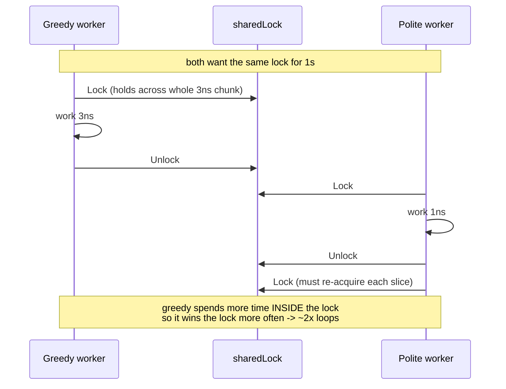
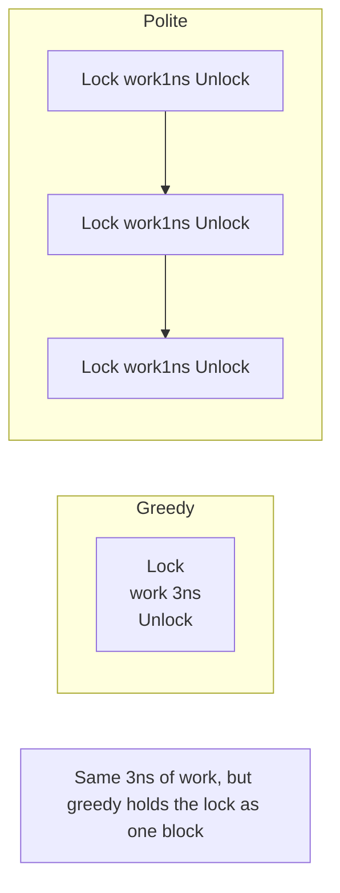

# Ch 1.7 — Starvation

> Book: *Concurrency in Go* (Katherine Cox-Buday, O'Reilly 2017) · Chapter 1: An Introduction to Concurrency · Pages ~16–18
> ⬅️ Prev: [Livelocks](06-livelocks.md) · ➡️ Next: [Determining Concurrency Safety](08-determining-concurrency-safety.md) · 🏠 [Book index](../README.md)

## 🎯 In One Paragraph

**Starvation** is any situation where a concurrent process cannot get all the resources it needs to do work. Livelock is a *special case* where every process is starved **equally** (of a shared lock) and nothing gets done; starvation more broadly implies one or more **greedy** processes **unfairly** preventing others from working efficiently — or at all. The book's demo pits a **greedy worker** (holds a shared lock across its *entire* work loop) against a **polite worker** (locks only around each tiny critical section). Both do the same amount of simulated work, yet the greedy worker completes nearly **twice** as many loops because it hogs the lock beyond its critical section. The detection technique is a **metric**: log/sample how much work each party accomplishes and compare it to expectations — a rate far below expected flags starvation. Starvation ties directly back to lock granularity: **coarse-grained** locking is faster but risks starving others; **fine-grained** locking is fairer but costs more. And starvation isn't only internal — CPU, memory, file handles, and DB connections can all be starved, including by processes *outside* the Go program.

## 🧠 Key Concepts & Vocabulary

- **Starvation**: a concurrent process can't acquire all resources it needs to make progress (efficiently or at all).
- **Greedy process**: holds a shared resource longer than its critical section actually requires, crowding out others.
- **Polite process**: acquires a resource only for the minimal critical section, releasing promptly.
- **Equal starvation (= livelock)**: all processes starved the same amount, zero net work (see [Livelocks](06-livelocks.md)).
- **Unequal/unfair starvation**: greedy parties get disproportionate throughput; polite parties lag or stall.
- **Metric-based detection**: record and sample work completed; compare to expected rate to detect starvation.
- **Coarse- vs fine-grained synchronization**: coarse locks (held broadly) favor performance but risk unfairness; fine locks (held narrowly) favor fairness but add overhead.
- **External starvation**: shortage of CPU, memory, file handles, DB connections, etc., possibly caused by other processes on the machine.

## 📚 Deep Dive

### Greedy vs polite workers

Both workers loop for one second, each doing the same simulated work (sleeping 3 ns total per loop):

- **Greedy**: `Lock()` → `Sleep(3ns)` → `Unlock()` — holds the lock for the whole chunk.
- **Polite**: three separate `Lock()`/`Sleep(1ns)`/`Unlock()` cycles — locks only for each 1 ns slice.



Because the greedy worker occupies the lock for a longer *continuous* stretch, it tends to re-win contention and complete far more loops. The polite worker releases three times per loop, giving the greedy worker repeated chances to barge in.



### What the numbers mean

The book's run:

```
Polite worker was able to execute 289777 work loops.
Greedy worker was able to execute 471287 work loops
```

The naive (wrong) conclusion would be "the greedy algorithm is more efficient" or "Lock/Unlock is slow." The correct conclusion: with **equal critical sections**, the greedy worker has **unnecessarily expanded its lock hold beyond its critical section** and is *starving* the polite worker. The lock calls themselves aren't the bottleneck — the hold *duration* is.

> [!tip] The detection technique is a metric
> Starvation is a strong argument for recording/sampling metrics. Log when work is accomplished, then check whether the rate matches expectations. A worker whose completed-work rate is far below expected is a starvation signal. (This also catches livelocks, whose rate is zero.)

### The balance: coarse vs fine granularity

```mermaid
stateDiagram-v2
    [*] --> Choose
    Choose --> Coarse: lock beyond critical section
    Choose --> Fine: lock only the critical section
    Coarse --> FastButUnfair: fewer lock ops, higher throughput, risk starving others
    Fine --> FairButCostly: more lock ops/overhead, better fairness
    FastButUnfair --> [*]
    FairButCostly --> [*]
    note right of Choose: start FINE; broaden only if\nsynchronization is a proven bottleneck
```



> [!note] "Finding a Balance" (book sidebar)
> Synchronizing memory is expensive, so broadening a lock beyond the critical section can *improve performance* — but it risks starving others (as the greedy worker shows). The recommended rule of thumb: **start by constraining synchronization to the critical sections only**; if synchronization later becomes a measured performance problem, *then* broaden the scope. Going coarse→fine after the fact is much harder than fine→coarse.

### Beyond the lock

Starvation applies to any shared resource, and the starver can live *outside* your Go process:
- **CPU**: a hot neighbor process steals cycles.
- **Memory**: another process exhausts RAM, forcing swapping.
- **File handles / sockets**: hitting ulimit starves new connections.
- **DB connections**: a pool drained by one caller starves the rest.

So "is my program being starved?" sometimes means "is something else on this box being greedy?"

### Verified example

Complete runnable program (the book's greedy-vs-polite demo, self-contained):

```go
package main

import (
	"fmt"
	"sync"
	"time"
)

func main() {
	var wg sync.WaitGroup
	var sharedLock sync.Mutex
	const runtime = 1 * time.Second

	greedyWorker := func() {
		defer wg.Done()
		var count int
		for begin := time.Now(); time.Since(begin) <= runtime; {
			sharedLock.Lock()
			time.Sleep(3 * time.Nanosecond)
			sharedLock.Unlock()
			count++
		}
		fmt.Printf("Greedy worker was able to execute %v work loops\n", count)
	}

	politeWorker := func() {
		defer wg.Done()
		var count int
		for begin := time.Now(); time.Since(begin) <= runtime; {
			sharedLock.Lock()
			time.Sleep(1 * time.Nanosecond)
			sharedLock.Unlock()

			sharedLock.Lock()
			time.Sleep(1 * time.Nanosecond)
			sharedLock.Unlock()

			sharedLock.Lock()
			time.Sleep(1 * time.Nanosecond)
			sharedLock.Unlock()

			count++
		}
		fmt.Printf("Polite worker was able to execute %v work loops.\n", count)
	}

	wg.Add(2)
	go greedyWorker()
	go politeWorker()
	wg.Wait()
}
```

Verified with `go run`. Actual output on the test machine:

```
Polite worker was able to execute 441284 work loops.
Greedy worker was able to execute 985464 work loops
```

The greedy worker got ~2.2× the polite worker's loops despite doing identical work — the lock hold beyond its critical section starved the polite worker. (Exact numbers vary per run/machine; the >~2× ratio is the point.)

## ⚠️ Pitfalls & Gotchas

- **Concluding greedy = efficient.** Equal work + more throughput usually means one party is hogging a shared resource, not that it's "better."
- **Over-broadening locks for speed.** It helps throughput but can starve peers; only broaden after measuring.
- **No work metric.** Without sampling completed work, starvation (and livelock) hide indefinitely.
- **Ignoring external resources.** CPU/memory/handles/DB pools can be starved by other processes outside your control.
- **Assuming `sync.Mutex` is strictly fair.** It isn't a FIFO lock in the fast path; it has a starvation-avoidance mode but doesn't guarantee perfect fairness.

## 🆕 Modern Go Notes

> [!note] 🆕 Modern Go note — `sync.Mutex` starvation mode
> Since Go 1.9, `sync.Mutex` has a *starvation mode*: if a waiter fails to acquire for >1 ms, the mutex switches to FIFO handoff so long-waiting goroutines eventually win. It mitigates — but doesn't eliminate — unfairness like the greedy-worker scenario.

> [!note] 🆕 Modern Go note — measure with real metrics
> The book's "use a metric" advice maps to modern observability: expose counters/histograms (Prometheus, OpenTelemetry) of work completed per goroutine/endpoint and alert when a rate drops. For rate control, `golang.org/x/time/rate` and `uber-go/ratelimit` enforce fairness explicitly.

> [!note] 🆕 Modern Go note — `sync.RWMutex` for read-heavy sharing
> If starvation stems from readers blocking on a writer lock, `sync.RWMutex` lets readers proceed concurrently — but beware writer starvation under a constant read load.

## 🧪 Try It Yourself

1. Make the polite worker lock once per loop (like the greedy one). Do their loop counts converge? That shows the imbalance came from hold *duration*, not the algorithm.
2. Increase the greedy worker's `Sleep` to 10 ns. Does the polite worker's count drop further? Plot the ratio vs greedy hold time.
3. Add a third "fair" worker using `golang.org/x/time/rate` to cap its lock rate; compare throughput and fairness.

## ✅ Self-Check Questions

<details><summary>1. Define starvation.</summary>
Any situation where a concurrent process cannot get all the resources it needs to perform work.</details>

<details><summary>2. How is livelock related to starvation?</summary>
Livelock is a special case where all processes are starved equally (of a shared lock) and no work is done; general starvation involves unequal, unfair resource deprivation.</details>

<details><summary>3. Why does the greedy worker finish ~2x more loops despite equal work?</summary>
It holds the shared lock across its whole loop (beyond its critical section), so it keeps re-winning contention and starves the polite worker, which releases the lock multiple times per loop.</details>

<details><summary>4. What technique does the book recommend for detecting starvation?</summary>
A metric: record and sample work accomplished, then compare the rate to what you expect.</details>

<details><summary>5. What is the recommended default for critical-section granularity, and why?</summary>
Start fine-grained — lock only the critical sections — then broaden only if synchronization becomes a measured bottleneck, because going coarse→fine later is much harder than fine→coarse.</details>

## 🔑 Key Takeaways

- Starvation = can't get the resources needed to make progress; often caused by a greedy peer.
- Greedy (coarse) locking boosts one party's throughput at others' expense; it's not "more efficient."
- Detect starvation with a work-rate metric; a below-expected rate is the signal.
- Prefer fine-grained locking by default; broaden only after measuring.
- Starvation extends to CPU, memory, handles, and DB pools — including pressure from outside the process.

## 🔗 References & Further Reading

### 📝 Blogs / articles
- [Starvation and Livelock (Oracle Java Tutorials)](https://docs.oracle.com/javase/tutorial/essential/concurrency/starvelive.html) — foundational definition of starvation vs livelock.
- [Deadlock, Livelock and Starvation (Baeldung CS)](https://www.baeldung.com/cs/deadlock-livelock-starvation) — how greedy holders cause unfairness.
- [Starvation and Livelock in Concurrent Systems: What I Watch, Measure, and Fix (TheLinuxCode)](https://thelinuxcode.com/starvation-and-livelock-in-concurrent-systems-what-i-watch-measure-and-fix/) — the metric-driven detection approach in practice.

### 💻 GitHub
- [uber-go/ratelimit](https://github.com/uber-go/ratelimit) — a leaky-bucket rate limiter to enforce fairness among competing workers.
- [golang/go — src/sync/mutex.go](https://github.com/golang/go/blob/master/src/sync/mutex.go) — see the `starving`/`starvationThresholdNs` logic that mitigates lock starvation.

### 📖 Official docs / specs
- [pkg.go.dev — sync.Mutex (fairness notes)](https://pkg.go.dev/sync#Mutex) — the mutex contract and its starvation-avoidance behavior.
- [pkg.go.dev — golang.org/x/time/rate](https://pkg.go.dev/golang.org/x/time/rate) — token-bucket rate limiting for fair resource sharing.
- [Go blog — Go 1.9 release notes (sync.Mutex fairness)](https://go.dev/doc/go1.9) — where the mutex starvation mode was introduced.
