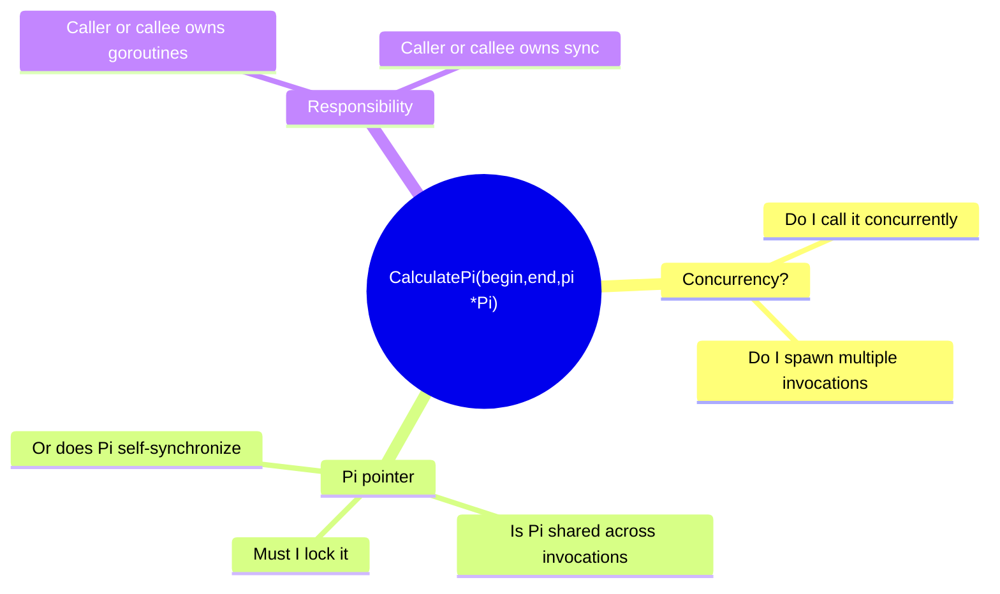
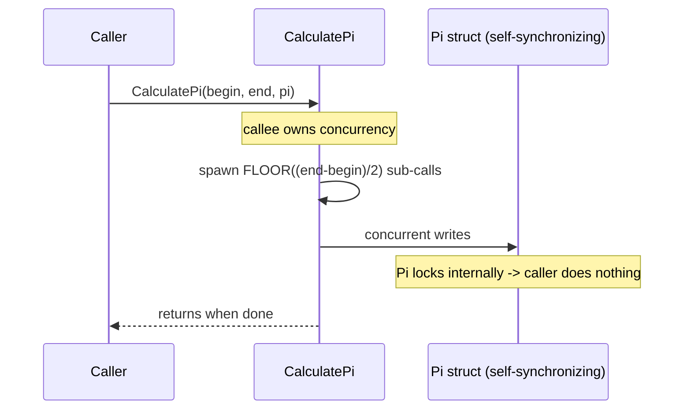
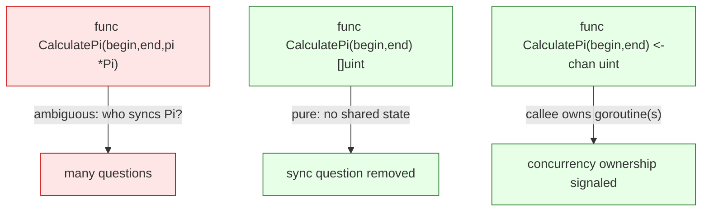

# Ch 1.8 — Determining Concurrency Safety

> Book: *Concurrency in Go* (Katherine Cox-Buday, O'Reilly 2017) · Chapter 1: An Introduction to Concurrency · Pages ~18–20
> ⬅️ Prev: [Starvation](07-starvation.md) · ➡️ Next: [Simplicity in the Face of Complexity](09-simplicity-in-the-face-of-complexity.md) · 🏠 [Book index](../README.md)

## 🎯 In One Paragraph

Underneath every technical concurrency problem is the hardest factor of all: **people**. Whether you're adding features, fixing bugs, modeling a fresh problem space, or consuming someone else's API, the central difficulty is *communicating* how concurrency is used. The book dissects the signature `func CalculatePi(begin, end int64, pi *Pi)` and shows it raises a cascade of unanswerable questions: Do I call it concurrently? Am I responsible for spawning instances? Must I synchronize access to `*Pi`, or does `Pi` do it? Two remedies are offered. First, **verbose comments** that explicitly answer three questions: *who owns the concurrency, how is the problem mapped onto concurrency primitives, and who owns synchronization*. Second — and often better — **change the design/signature** so the ambiguity disappears: a pure `func CalculatePi(begin, end int64) []uint` removes synchronization questions, and `func CalculatePi(begin, end int64) <-chan uint` additionally signals "I manage my own goroutine(s); just read the channel." These choices have performance ramifications, bringing back the perennial tension between **clarity and performance**. Now scale this communication problem to a whole team, and "wow, this is a problem."

## 🧠 Key Concepts & Vocabulary

- **Concurrency safety**: whether (and how) a piece of code may be used from multiple goroutines without introducing races or incorrect behavior.
- **The human factor**: the deepest source of concurrency difficulty — conveying intent and responsibility to other developers (and future you).
- **Three questions to answer** (for any concurrent API):
  1. **Who is responsible for the concurrency?** (caller spawns goroutines, or callee?)
  2. **How is the problem space mapped onto concurrency primitives?** (goroutines, channels, mutexes?)
  3. **Who is responsible for synchronization?** (caller guards shared state, or does the type?)
- **Verbose comments**: documentation that explicitly answers the three questions, so callers "do the right thing."
- **Signature as a signal**: the function's type can communicate concurrency ownership better than prose — a pointer arg implies shared mutable state; a returned value implies purity; a returned `<-chan` implies the callee owns goroutines.
- **Pure / side-effect-free function**: no shared mutable state → no synchronization questions.
- **Clarity vs performance**: clearer concurrency contracts sometimes cost performance (copies instead of shared pointers, channel overhead); the two are not mutually exclusive but are hard to mix.

## 📚 Deep Dive

### The ambiguous signature

```go
// CalculatePi calculates digits of Pi between the begin and end place.
func CalculatePi(begin, end int64, pi *Pi)
```

One line, many questions:



A `*Pi` pointer screams "shared mutable state," but gives no hint about *who* must protect it.

### Remedy 1 — answer the three questions in a comment

```go
// CalculatePi calculates digits of Pi between the begin and end place.
//
// Internally, CalculatePi will create FLOOR((end-begin)/2) concurrent
// processes which recursively call CalculatePi. Synchronization of
// writes to pi are handled internally by the Pi struct.
func CalculatePi(begin, end int64, pi *Pi)
```

Now the contract is explicit — call it plainly, don't spawn your own goroutines, and don't synchronize `pi` yourself. The comment covers **who owns concurrency** (the function), **how it's mapped** (recursive concurrent sub-calls), and **who owns synchronization** (the `Pi` struct). The book's advice: *err on the side of verbose comments* for any API touching concurrency.



### Remedy 2 — let the signature carry the contract

Comments can rot and be ignored; types can't. Reshape the API so the ambiguity is structurally impossible.

- **Pure function** — removes all synchronization questions (no shared pointer):
  ```go
  func CalculatePi(begin, end int64) []uint
  ```
  The caller owns the result; there's nothing shared to guard. But it's silent on whether concurrency is used internally.

- **Channel-returning** — additionally signals the callee owns goroutine(s):
  ```go
  func CalculatePi(begin, end int64) <-chan uint
  ```
  A receive-only channel strongly implies "I (the callee) will run at least one goroutine to produce these; you just range over the channel — don't start your own." (Channels are Chapter 3's topic.)



### The tradeoff, and scaling to teams

Each clarifying change has a cost: returning `[]uint` may copy a large slice instead of writing in place; returning a channel adds goroutine/channel overhead. So you're back to balancing **clarity** (make it likely future developers do the right thing) against **performance** (for obvious reasons). They aren't mutually exclusive, but they're hard to mix. And every one of these communication challenges multiplies across a team — which is why concurrency safety is ultimately a *people* problem. The good news (set up for the next section): Go's design favors readability and simplicity, nudging code toward correctness, composability, and scalability.

### Verified example — a channel-returning API in action

Complete runnable program showing how `<-chan uint` conveys "callee owns the goroutine; caller just ranges":

```go
package main

import "fmt"

// Returning <-chan tells the caller: "I own the goroutine(s); just read."
func CalculatePi(begin, end int64) <-chan uint {
	out := make(chan uint)
	go func() {
		defer close(out)
		for i := begin; i < end; i++ {
			out <- uint(i % 10) // placeholder for the i-th digit
		}
	}()
	return out
}

func main() {
	for digit := range CalculatePi(0, 8) {
		fmt.Printf("%d", digit)
	}
	fmt.Println()
}
```

Verified with `go run` — prints `01234567`. The caller never spawns a goroutine or touches a lock; the signature made the contract self-evident and the `close(out)` lets `range` terminate cleanly.

## ⚠️ Pitfalls & Gotchas

- **Trusting comments alone.** Comments are easy to ignore or let rot; prefer a signature that makes misuse impossible.
- **Leaking shared pointers.** A `*T` argument implies shared mutable state — always document who synchronizes it, or redesign to avoid sharing.
- **Ambiguous "may or may not be concurrent" APIs.** If callers can't tell whether to add their own goroutines, you'll get both double-spawning and under-utilization bugs.
- **Forgetting to `close` a returned channel.** A channel-returning API that never closes leaves `range` callers blocked forever (a goroutine leak).
- **Over-optimizing before clarity.** Reaching for a shared pointer "for performance" before the contract is clear invites races; measure first.

## 🆕 Modern Go Notes

> [!note] 🆕 Modern Go note — `context.Context` as the first parameter
> Modern concurrent APIs take `ctx context.Context` as the first argument to communicate cancellation/deadlines — another way the *signature* encodes concurrency semantics. The channel-returning `CalculatePi` would become `func CalculatePi(ctx context.Context, begin, end int64) <-chan uint` so callers can cancel.

> [!note] 🆕 Modern Go note — document safety explicitly
> The standard-library convention is to state concurrency safety in the doc comment (e.g., "A Mutex must not be copied after first use," or "The methods of T are safe for concurrent use"). `go vet` and the `-race` detector are the automated backstops behind the prose.

> [!note] 🆕 Modern Go note — structured concurrency helpers
> `golang.org/x/sync/errgroup` and `sourcegraph/conc` let a callee own and bound a group of goroutines with clear lifetimes, making "who owns the concurrency" answerable by *construction* rather than by comment.

## 🧪 Try It Yourself

1. Add a `context.Context` parameter to `CalculatePi` and make the producer goroutine stop early when `ctx` is cancelled (`select { case out <- v: case <-ctx.Done(): return }`).
2. Rewrite `CalculatePi` as the pure `[]uint` version. Note what you *lose* (streaming, early use of results) and gain (no goroutine to manage).
3. For a function you wrote recently, add a doc comment that answers all three questions (who owns concurrency, how it's mapped, who synchronizes).

## ✅ Self-Check Questions

<details><summary>1. According to the book, what is the deepest source of concurrency difficulty?</summary>
People — the challenge of communicating how concurrency and synchronization are used to other developers and your future self.</details>

<details><summary>2. What three questions should a concurrent API's documentation answer?</summary>
Who is responsible for the concurrency? How is the problem space mapped onto concurrency primitives? Who is responsible for synchronization?</details>

<details><summary>3. Why is <code>func CalculatePi(begin, end int64) []uint</code> clearer than the <code>*Pi</code> version?</summary>
It's pure — there's no shared mutable state, so all synchronization questions disappear (though it's still silent on internal concurrency).</details>

<details><summary>4. What does returning <code>&lt;-chan uint</code> signal to the caller?</summary>
That the callee will run at least one goroutine to produce the values and the caller should just read from the channel rather than spawning its own goroutines.</details>

<details><summary>5. Why prefer encoding the contract in the signature over a comment?</summary>
Comments are easy to ignore and can rot; a type/signature makes the intended usage structural and harder to misuse.</details>

## 🔑 Key Takeaways

- Concurrency safety is ultimately a communication (people) problem.
- Always convey: who owns concurrency, how it maps to primitives, and who owns synchronization.
- Verbose comments help, but a well-chosen signature communicates better and can't be ignored.
- Pure functions remove synchronization questions; channel-returning functions signal callee-owned goroutines.
- Clarifying contracts can cost performance — balance clarity and performance deliberately.

## 🔗 References & Further Reading

### 📝 Blogs / articles
- [Go Concurrency Patterns: Pipelines and cancellation (go.dev/blog)](https://go.dev/blog/pipelines) — how channel-returning functions communicate ownership and lifetime.
- [Context and structured concurrency (Dave Cheney)](https://dave.cheney.net/tag/concurrency) — collected posts on designing clear concurrent APIs.
- [Rethinking Classical Concurrency Patterns (Bryan Mills, GopherCon)](https://www.youtube.com/watch?v=5zXAHh5tJqQ) — guidance on API shapes that make concurrency obvious and safe.

### 💻 GitHub
- [golang.org/x/sync/errgroup](https://github.com/golang/sync/tree/master/errgroup) — a callee-owns-the-goroutines group with clear lifetimes and error propagation.
- [sourcegraph/conc](https://github.com/sourcegraph/conc) — "better structured concurrency for Go": pools and groups that make ownership explicit by construction.

### 📖 Official docs / specs
- [pkg.go.dev — context](https://pkg.go.dev/context) — encoding cancellation/deadlines into signatures.
- [Effective Go — Channels](https://go.dev/doc/effective_go#channels) — the semantics behind a `<-chan` return value.
- [Go Code Review Comments — Synchronisation & doc comments](https://go.dev/wiki/CodeReviewComments) — conventions for documenting concurrency safety.
