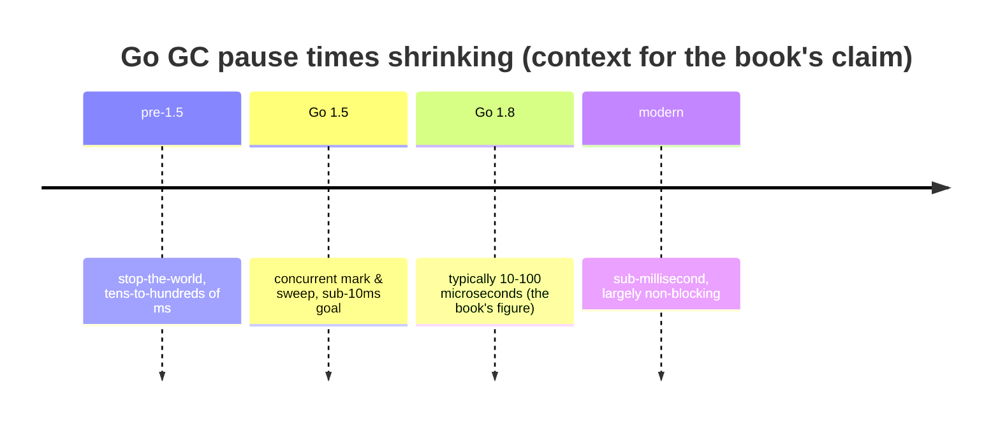
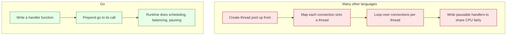
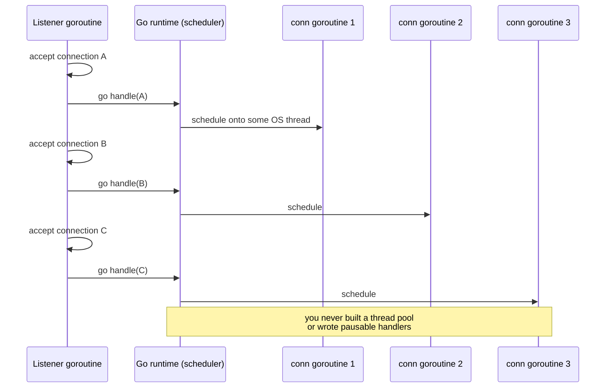

# Ch 1.9 — Simplicity in the Face of Complexity

> Book: *Concurrency in Go* (Katherine Cox-Buday, O'Reilly 2017) · Chapter 1: An Introduction to Concurrency · Pages ~20–21
> ⬅️ Prev: [Determining Concurrency Safety](08-determining-concurrency-safety.md) · ➡️ Next: [Ch 2 — Modeling Your Code: CSP](../ch02-modeling-your-code-csp/README.md) · 🏠 [Book index](../README.md)

## 🎯 In One Paragraph

After a chapter of grim warnings, the author leaves us with hope: these problems are **not intractable**, and Go's concurrency primitives let you express concurrent algorithms more safely and clearly. Go doesn't *solve* the runtime and communication difficulties, but it makes them **significantly easier**. Three runtime gifts do the heavy lifting. First, a **concurrent, low-latency garbage collector** — as of Go 1.8, GC pauses are typically **10–100 microseconds** — so the vast majority of developers never have to hand-manage memory, let alone across concurrent processes. Second, the runtime **automatically multiplexes goroutines onto OS threads**, so you map concurrent *problems* directly onto concurrent *constructs* instead of building thread pools and hand-scheduling work. The book's web-server contrast is the punchline: in many languages you'd pre-create a thread pool, map connections onto threads, loop over connections per thread, and write pausable handlers; in Go you write a function and prepend `go`. Third, **channels** provide a composable, concurrency-safe way for processes to communicate, making larger problems easier to assemble. The net effect: Go *invites* you to reach for concurrency, and makes the result more likely to be correct.

## 🧠 Key Concepts & Vocabulary

- **Go runtime**: the machinery (scheduler, GC, memory allocator) that provides Go's concurrency "niceties" and does the heavy lifting.
- **Concurrent, low-latency garbage collector**: GC that runs mostly alongside your program; as of Go 1.8, pauses are ~10–100 µs, removing manual memory management from most workloads.
- **Multiplexing goroutines onto OS threads**: the runtime schedules many goroutines across a small number of OS threads (M:N scheduling), so you don't manage threads yourself.
- **Thread pool (the thing you *don't* write in Go)**: the manual, pre-created set of OS threads plus connection-to-thread mapping and pausable handlers required in many other languages.
- **`go` keyword**: prepend it to a function call to run it concurrently as a goroutine — the runtime handles the rest.
- **Channel**: a composable, concurrency-safe conduit for communicating between goroutines; the basis for composing larger concurrent programs.
- **Clarity + performance together**: Go's model aims to make the clear way *also* a performant and correct way.

## 📚 Deep Dive

### Gift 1 — a GC you can mostly ignore

Memory management is hard; combined with concurrency it's *extraordinarily* hard. Go's concurrent, low-latency GC (pauses of ~10–100 µs since Go 1.8) means the majority of developers never manage memory manually — a huge reduction in the surface area for concurrency bugs. (Detractors note GC is unsuitable for hard-real-time/deterministic-latency domains; Go's improvements shrank that audience dramatically.)



### Gift 2 — the runtime schedules threads for you

The runtime automatically multiplexes concurrent operations onto OS threads. Practically, this lets you map a concurrent *problem* straight onto concurrent *constructs* without the minutiae of starting/managing threads and balancing logic across them.

The web-server contrast makes it concrete.





The rhetorical question the book poses: under which model are you *more likely to reach for concurrency*, and which is *more likely to turn out correct*? The `go`-keyword model wins on both counts.

### Gift 3 — channels compose

Channels give a composable, concurrency-safe way to communicate between goroutines, so you can build larger concurrent programs by wiring small stages together (pipelines, fan-out/fan-in) — the subject of later chapters. "Share memory by communicating" instead of guarding shared memory by convention.

### Verified example — "just prepend `go`"

Complete, self-contained program: a TCP server that handles every connection concurrently with a single `go handle(conn)` — no thread pool, no manual scheduling. It starts a listener on an ephemeral port, dials three clients, and shuts down cleanly.

```go
package main

import (
	"fmt"
	"net"
	"sync"
	"time"
)

func handle(conn net.Conn, wg *sync.WaitGroup) {
	defer wg.Done()
	defer conn.Close()
	fmt.Fprintf(conn, "handled by a goroutine\n")
}

func main() {
	ln, err := net.Listen("tcp", "127.0.0.1:0")
	if err != nil {
		panic(err)
	}
	defer ln.Close()

	var serverWG sync.WaitGroup
	done := make(chan struct{})
	go func() {
		for {
			conn, err := ln.Accept()
			if err != nil {
				select {
				case <-done:
					return
				default:
					return
				}
			}
			serverWG.Add(1)
			go handle(conn, &serverWG) // one goroutine per connection
		}
	}()

	addr := ln.Addr().String()
	var clientWG sync.WaitGroup
	for i := 0; i < 3; i++ {
		clientWG.Add(1)
		go func(n int) {
			defer clientWG.Done()
			c, err := net.Dial("tcp", addr)
			if err != nil {
				return
			}
			defer c.Close()
			buf := make([]byte, 64)
			c.SetReadDeadline(time.Now().Add(time.Second))
			nread, _ := c.Read(buf)
			fmt.Printf("client %d read: %s", n, string(buf[:nread]))
		}(i)
	}
	clientWG.Wait()
	close(done)
	ln.Close()
	serverWG.Wait()
	fmt.Println("server shut down cleanly")
}
```

Verified with `go run`. Actual output on the test machine (client order varies by scheduling):

```
client 2 read: handled by a goroutine
client 1 read: handled by a goroutine
client 0 read: handled by a goroutine
server shut down cleanly
```

Each connection ran in its own goroutine via a single `go handle(...)`; the runtime multiplexed them onto OS threads with no pool and no hand-scheduling — exactly the book's point.

## ⚠️ Pitfalls & Gotchas

- **"Cheap goroutines" ≠ "free goroutines."** They start ~2 KB and grow, but unbounded spawning still exhausts memory. Bound concurrency (worker pools, semaphores) for untrusted/large workloads.
- **GC isn't zero.** For hard-real-time/deterministic-latency niches, even µs pauses matter; Go shrank — didn't eliminate — that concern.
- **Goroutines leak.** The runtime does *not* garbage-collect blocked goroutines; a goroutine stuck on a channel/lock lives forever. Give every goroutine a clear exit (closed channel, `context` cancellation).
- **`go f()` hides errors.** A goroutine's panic crashes the whole program, and its return value/err is lost unless you wire a channel/`errgroup`.
- **Simplicity can mask over-concurrency.** Because `go` is so easy, it's tempting to spawn goroutines where plain sequential code is clearer and faster.

## 🆕 Modern Go Notes

> [!note] 🆕 Modern Go note — GC is far better than the book's 2017 figure
> The book cites 10–100 µs pauses as of Go 1.8. Since then the GC has improved further (sub-millisecond, largely non-blocking), and Go 1.19 added a *soft memory limit* (`GOMEMLIMIT`) for finer control in containers. The "mostly ignore GC" claim is even truer today.

> [!note] 🆕 Modern Go note — `net/http` already does the `go` for you
> The verified example spawns goroutines manually to show the mechanism, but `net/http.Server` already runs each request in its own goroutine. Writing a concurrent web server in modern Go is literally `http.ListenAndServe(addr, handler)`.

> [!note] 🆕 Modern Go note — bound concurrency with modern helpers
> To keep "just prepend `go`" safe at scale, use `golang.org/x/sync/errgroup` (with `SetLimit`), `golang.org/x/sync/semaphore`, or Go 1.25's `sync.WaitGroup.Go(fn)` to add-and-launch in one call while capping fan-out.

## 🧪 Try It Yourself

1. Rewrite the verified server using `net/http` and a handler, then hit it with several concurrent clients — confirm you never manage threads.
2. Add a bounded worker pool (buffered channel semaphore) that limits concurrent `handle` calls to 2; observe serialization under load.
3. Introduce a goroutine leak (a handler that blocks on an unbuffered channel no one reads), then detect it with `uber-go/goleak` in a test.

## ✅ Self-Check Questions

<details><summary>1. What three runtime features does the book credit for making Go concurrency easier?</summary>
A concurrent low-latency garbage collector, automatic multiplexing of goroutines onto OS threads, and composable concurrency-safe channels.</details>

<details><summary>2. What GC pause figure does the book cite (as of Go 1.8)?</summary>
Roughly 10 to 100 microseconds.</details>

<details><summary>3. In the web-server contrast, what must you do in "other languages" that Go handles for you?</summary>
Create a thread pool up front, map incoming connections onto threads, loop over connections per thread for CPU time, and write pausable connection handlers. In Go you just write a function and prepend <code>go</code>.</details>

<details><summary>4. Does Go claim to *solve* concurrency's runtime and communication difficulties?</summary>
No — it makes them significantly easier, not solved. The author is explicit about this.</details>

<details><summary>5. Why does the easy <code>go</code> keyword make correct concurrency *more* likely, per the book?</summary>
Because the clear, low-friction model encourages you to reach for concurrency and to map problems directly onto constructs, reducing the hand-written scheduling/thread-management code where bugs hide.</details>

## 🔑 Key Takeaways

- Concurrency is hard but *tractable*; Go's primitives make it clearer and safer.
- The low-latency concurrent GC frees most developers from manual memory management.
- The runtime multiplexes goroutines onto OS threads — no thread pools, no hand-scheduling.
- Channels provide composable, concurrency-safe communication for building larger systems.
- Go makes the *clear* path also the *correct* and *performant* path — but cheap goroutines still need bounding and clean exits.

## 🔗 References & Further Reading

### 📝 Blogs / articles
- [Getting to Go: The Journey of Go's Garbage Collector (go.dev/blog)](https://go.dev/blog/ismmkeynote) — Rick Hudson's deep dive into the low-latency concurrent GC the chapter praises.
- [Go Concurrency Patterns: Pipelines and cancellation (go.dev/blog)](https://go.dev/blog/pipelines) — how channels compose into larger concurrent programs.
- [Inside the Go Scheduler: How the GMP Model Powers Millions of Goroutines (dev.to)](https://dev.to/debianbaker/inside-the-go-scheduler-how-gmp-model-powers-millions-of-goroutines-940) — how goroutines are multiplexed onto OS threads.

### 💻 GitHub
- [golang/go — src/runtime/proc.go](https://github.com/golang/go/blob/master/src/runtime/proc.go) — the scheduler that multiplexes goroutines onto OS threads.
- [golang.org/x/sync/errgroup](https://github.com/golang/sync/tree/master/errgroup) — bound and coordinate the goroutines you so cheaply spawn.

### 📖 Official docs / specs
- [The Go Memory Model](https://go.dev/ref/mem) — the guarantees that make channel communication safe.
- [pkg.go.dev — net/http (Server)](https://pkg.go.dev/net/http#Server) — the standard server that runs each request in its own goroutine.
- [A Guide to the Go Garbage Collector](https://go.dev/doc/gc-guide) — official, current GC behavior and `GOMEMLIMIT`.
