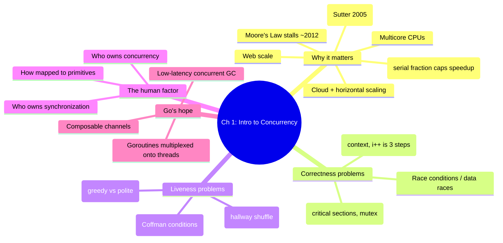
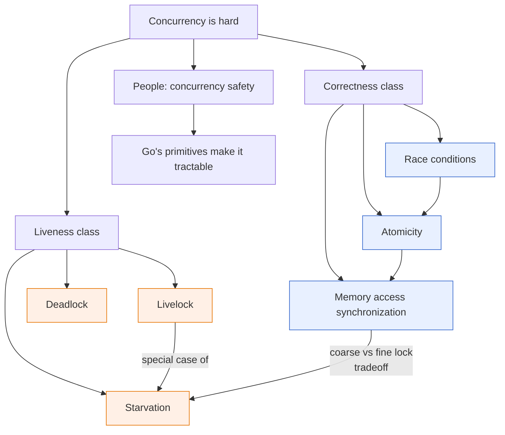

# Chapter 1 — An Introduction to Concurrency

> Book: *Concurrency in Go* (Katherine Cox-Buday, O'Reilly 2017) · Chapter 1
> 🏠 [Book index](../README.md) · ➡️ Next chapter: [Ch 2 — Modeling Your Code: CSP](../ch02-modeling-your-code-csp/README.md)

## Overview

Chapter 1 answers three questions: *why* did concurrency become unavoidable, *why* is it so hard to get right, and *why* does Go make it better anyway. The historical arc runs from **Moore's Law** stalling (~2012) → **multicore** CPUs → **Amdahl's Law** capping parallel gains → **cloud computing** making **horizontal scaling** cheap → **web scale** software and its new complexity, with Herb Sutter's 2005 "The Free Lunch Is Over" as the turning point. The chapter then catalogs the canonical ways concurrent code goes wrong, split into two classes. **Correctness problems** (never give a wrong answer): **race conditions / data races**, **atomicity**, and **memory access synchronization** (critical sections guarded by mutexes). **Liveness problems** (always have useful work to do): **deadlock** (and the four **Coffman Conditions**), **livelock** (the busy-but-stuck hallway shuffle), and **starvation** (greedy vs polite workers). Beneath all of them is the hardest factor — **people**: communicating who owns concurrency and synchronization, via verbose comments or (better) signatures. The chapter closes on hope: Go's **low-latency concurrent GC**, **automatic goroutine-to-thread multiplexing**, and **composable channels** make the clear path also the correct and performant one — you write a function and prepend `go`.

## Chapter mind map

## How the problems relate

## Mini-chapters

| # | Mini-chapter | One-line summary |
|---|---|---|
| 1 | [Moore's Law, Web Scale, and the Mess](01-moores-law-web-scale-and-the-mess.md) | Why multicore + Amdahl's Law + cloud/web scale made concurrency mandatory (Sutter's "free lunch is over"). |
| 2 | [Race Conditions](02-race-conditions.md) | Missing ordering guarantees → data races; why `time.Sleep` never fixes them; target logical correctness. |
| 3 | [Atomicity](03-atomicity.md) | Atomic = indivisible + uninterruptible *within a context*; `i++` is three steps; combining atomics isn't atomic. |
| 4 | [Memory Access Synchronization](04-memory-access-synchronization.md) | Critical sections and mutexes remove data races but not race conditions; granularity and convention costs. |
| 5 | [Deadlocks & the Coffman Conditions](05-deadlocks-and-coffman-conditions.md) | All processes wait forever; the four Coffman Conditions; break one (lock ordering) to prevent it. |
| 6 | [Livelocks](06-livelocks.md) | Busy but stuck — the hallway shuffle; caused by uncoordinated deadlock avoidance; cure with coordination/jitter. |
| 7 | [Starvation](07-starvation.md) | Can't get needed resources; greedy vs polite workers; detect with a work-rate metric; fine vs coarse locking. |
| 8 | [Determining Concurrency Safety](08-determining-concurrency-safety.md) | The people problem: communicate who owns concurrency/sync via verbose comments or clearer signatures. |
| 9 | [Simplicity in the Face of Complexity](09-simplicity-in-the-face-of-complexity.md) | Go's GC, goroutine-to-thread multiplexing, and channels make the clear path correct and fast — just prepend `go`. |

## Verified Go programs

All programs for this chapter were written to `/tmp/cig/verify/ch1/` and run with `go run` (Go 1.27). The race detector (`-race`) requires cgo and a C compiler that were unavailable in the verification sandbox, so race-demonstrating programs were verified with plain `go run`; where a program *intentionally* races or deadlocks, that is stated in the notes.

| Program | Demonstrates | Result |
|---|---|---|
| `amdahl/` | Amdahl's Law speedup ceiling | speedup flattens/regresses past core count ✅ |
| `race/` | unsynchronized data race | runs; one of three legal outcomes printed ✅ |
| `atomic/` | lost updates vs `atomic.Int64` | unsafe=84475 vs expected/atomic=100000 ✅ |
| `memsync/` | mutex-guarded critical sections | runs clean; ordering still nondeterministic ✅ |
| `deadlock/` | classic lock-order deadlock | `fatal error: all goroutines are asleep - deadlock!` (expected) ✅ |
| `deadlockfix/` | breaking Circular Wait via lock ordering | prints `sum=7` twice ✅ |
| `livelock/` | hallway-shuffle livelock | both "toss their hands up" — no progress ✅ |
| `starvation/` | greedy vs polite workers | greedy ≈2.2× polite loops ✅ |
| `safety/` | channel-returning API contract | prints `01234567` ✅ |
| `simplicity/` | one goroutine per connection | all clients handled; clean shutdown ✅ |
