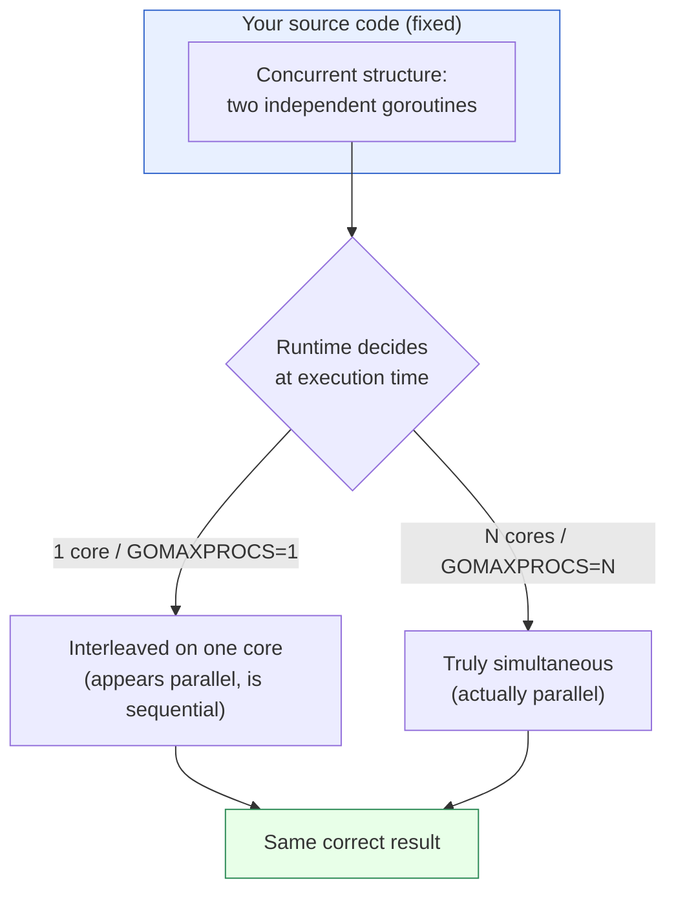
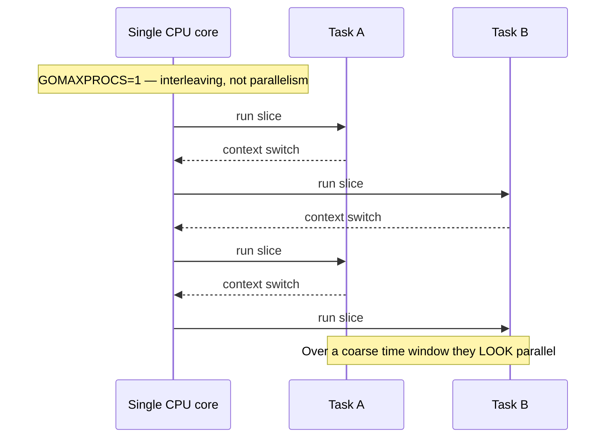
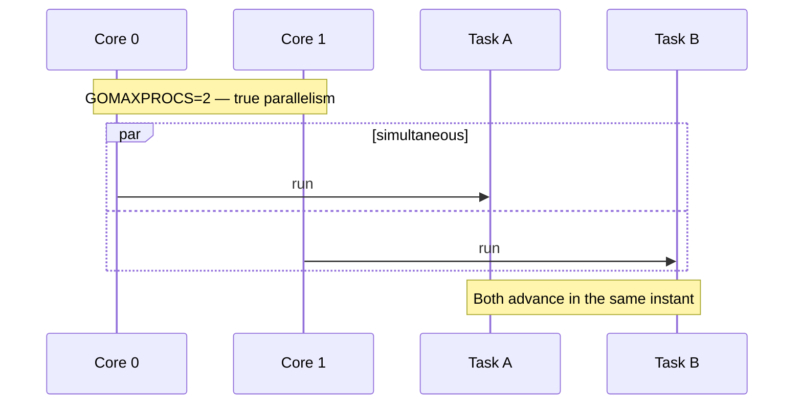
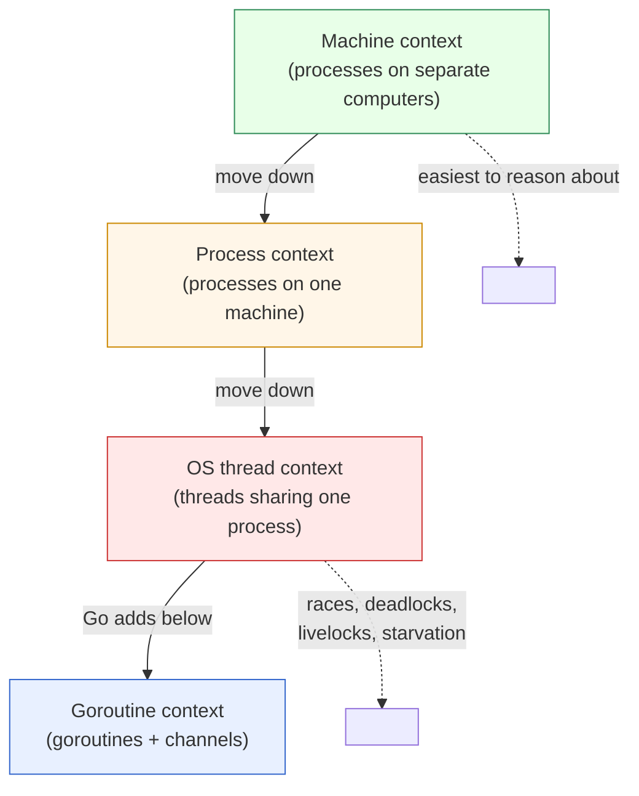

# Ch 2.1 — The Difference Between Concurrency and Parallelism

> Book: *Concurrency in Go* (Katherine Cox-Buday, O'Reilly 2017) · Chapter 2: Modeling Your Code: Communicating Sequential Processes · Pages ~23–26
> ⬅️ Prev: [Chapter 1 — Introduction to Concurrency](../ch01-introduction-to-concurrency/README.md) · ➡️ Next: [What Is CSP?](02-what-is-csp.md) · 🏠 [Book index](../README.md)

## 🎯 In One Paragraph

Developers routinely use *concurrency* and *parallelism* as synonyms, but conflating them hides the single most powerful idea in Go's design. The book's crisp distinction is: **concurrency is a property of the code; parallelism is a property of the running program.** You never truly *write* parallel code — you write *concurrent* code and merely *hope* the runtime executes parts of it simultaneously. Whether that actually happens depends on the machine (one core versus many), the OS scheduler, the runtime, and even virtualization layers beneath you. Because of that, it can be *desirable to be ignorant* of whether your concurrent code is literally running in parallel; the layers of abstraction beneath your program handle that. Parallelism is also *relative to a context* — the bound within which two operations count as "simultaneous" — which can be a slice of time, a process, an OS thread, or a whole machine. The lower you push that context down the abstraction stack (machine → process → OS thread), the harder concurrency becomes to reason about, and the more you need composable primitives. Go's contribution is to add a *new* link below the OS thread — the **goroutine** — plus **channels** borrowed from Hoare's CSP, which *supplant* threads rather than stacking yet another layer on top of them.

## 🧠 Key Concepts & Vocabulary

- **Concurrency**: A property of how code is *structured* — independently executing pieces of logic that *may* overlap in time. You decide this when you write the program.
- **Parallelism**: A property of the *runtime* — two or more operations literally executing at the same instant on different execution units (cores). You cannot guarantee it from source alone.
- **"We do not write parallel code, only concurrent code that we hope will be run in parallel."** — the book's core slogan.
- **Context switching**: The CPU rapidly swapping between tasks so that, over a coarse enough span of time, interleaved tasks *appear* simultaneous even on a single core.
- **Context (of parallelism)**: The bound within which operations are considered parallel. Earlier the book used "context" to bound *atomicity*; here it bounds *simultaneity*. It can be a time slice, a process, an OS thread, or a machine.
- **Correctness is relative to context**: Just as an operation is atomic only within a chosen context, concurrent operations are *correct* only within a chosen context (e.g., two calculator processes on separate machines are trivially isolated).
- **Abstraction stack**: concurrency primitives → runtime → operating system → platform (hypervisor/container/VM) → CPUs. These layers let us separate "concurrent" from "parallel."
- **OS thread**: Historically the lowest-level unit most languages exposed for concurrency; heavy enough that you resort to **thread pools** and multiplexing.
- **Thread pool / multiplexing**: Reusing a fixed set of OS threads to run many logical tasks because threads are expensive to create.
- **Goroutine**: Go's new, lightweight unit of concurrency placed *below* the OS thread in the abstraction chain — not another layer on top of threads, but a replacement you reason about instead of threads.
- **Supplanting threads**: Goroutines don't add difficulty the way a new abstraction layer normally would; they *replace* day-to-day thread reasoning, which makes concurrency easier, not harder.

## 📚 Deep Dive

### The distinction, stated plainly

The whole mini-chapter pivots on one sentence from the book:

> "Concurrency is a property of the code; parallelism is a property of the running program." — Cox-Buday

Ask yourself: *if I write two chunks intending them to run in parallel, am I guaranteed they will?* No. On a single-core machine they interleave via context switching and only *look* parallel because the switching is faster than you can perceive. On a two-core machine the same binary *might* actually run them simultaneously. The source text did not change — only the runtime did. Therefore parallelism is a runtime property.



The key insight the diagram encodes: **one concurrent program, two possible runtime behaviors, identical correctness.** The code commits to *concurrency*; the runtime grants or withholds *parallelism*.

### One core vs. many cores, over time

Think of the CPU timeline. With a single core and two tasks A and B, the core slices time between them:



With two cores, the two tasks can genuinely overlap:



### Context is not just time

The book stresses that *context* — the bound for "simultaneous" — need not be time. It can be a process, an OS thread, or a machine. This matters because **the context you choose is what lets you assert correctness.**

- **Machine context**: You and I each run a calculator on our own computers. Barring a shared distributed system, my arithmetic cannot corrupt yours. Correctness is trivial here.
- **Process context (same machine)**: Still fairly easy. Two users each run a calculator *process*; the OS and the process boundary keep them logically isolated. But cracks appear — process A might overwrite files process B reads, and on an insecure OS, A might even corrupt B's memory (how many exploits work).
- **OS-thread context**: Now *all* the hard problems from Chapter 1 — race conditions, deadlocks, livelocks, starvation — come to bear. If a *single* calculator process served every user via shared memory and threads, you'd have to synchronize memory access and route the right result to the right user.



The trend: **as you descend the abstraction stack, modeling concurrency gets harder and more important — so composable primitives get more valuable.** The industry historically bottomed out at OS threads, the *hardest* useful level. Go pushes one level deeper to the goroutine, and paradoxically that makes things *easier*, because goroutines + channels replace thread-and-mutex reasoning rather than piling on top of it.

> ℹ️ Sidebar — *"Is this really a silly example?"* The book notes personal computers weren't always ubiquitous. Until the late 1970s, mainframes were the norm and the usual concurrency context was a program's **process**. With distributed systems today the pendulum swings back: we now reason in terms of hypervisors, containers, and VMs as our concurrent contexts.

### Seeing it run: same code, different parallelism

This complete program runs identical concurrent code under `GOMAXPROCS=1` and `GOMAXPROCS=NumCPU`. The result is always correct; only timing differs. (On small workloads the single-core run can even be *faster*, because spreading tiny tasks across cores adds synchronization and scheduling overhead — a concrete reminder that parallelism is not automatically "faster.")

```go
// Demonstrates that concurrency (how we structure code) is independent of
// parallelism (whether the runtime actually runs things simultaneously).
// The SAME concurrent code runs correctly whether GOMAXPROCS=1 (interleaved
// on one core) or GOMAXPROCS=N (potentially simultaneous on many cores).
package main

import (
	"fmt"
	"runtime"
	"sync"
	"sync/atomic"
	"time"
)

func main() {
	fmt.Println("NumCPU:", runtime.NumCPU())

	for _, procs := range []int{1, runtime.NumCPU()} {
		runtime.GOMAXPROCS(procs)

		var counter atomic.Int64 // Go 1.19+ typed atomic
		var wg sync.WaitGroup
		const workers = 8
		const perWorker = 100_000

		start := time.Now()
		for i := 0; i < workers; i++ {
			wg.Add(1)
			go func() { // concurrent structure: one goroutine per unit of work
				defer wg.Done()
				for j := 0; j < perWorker; j++ {
					counter.Add(1)
				}
			}()
		}
		wg.Wait()

		fmt.Printf("GOMAXPROCS=%-2d  counter=%d (expected %d)  took=%v\n",
			procs, counter.Load(), workers*perWorker, time.Since(start))
	}
}
```

**Verified output** (16-core machine; your numbers will differ):

```
NumCPU: 16
GOMAXPROCS=1   counter=800000 (expected 800000)  took=3.837983ms
GOMAXPROCS=16  counter=800000 (expected 800000)  took=19.553195ms
```

Both runs produce the correct `800000`. Notice the single-core run was *faster* here: the per-op work is tiny, so cross-core cache contention on the shared atomic dominates. This is exactly the book's point — parallelism is a separate, runtime-level concern from the concurrency you expressed, and more of it is not inherently better.

> 🆕 **Modern Go note.** The book predates typed atomics. `sync/atomic.Int64` (Go 1.19) is used above instead of `atomic.AddInt64(&n, 1)` on a bare `int64`, giving a cleaner, misuse-resistant API. The concurrency/parallelism distinction itself is unchanged. Also note: since **Go 1.22** the loop variable `i`/`j` is per-iteration, so capturing it in a closure is safe — pre-1.22 you'd have had to shadow it.

## ⚠️ Pitfalls & Gotchas

- **Saying "parallel" when you mean "concurrent."** If you're talking about how your *code* is organized, the word is almost always *concurrent*. Reserve *parallel* for what the *running program* does on real hardware.
- **Assuming concurrency implies speedup.** Parallelism may make a program faster, but for tiny tasks the scheduling/synchronization overhead can make the parallel run *slower* (seen above). Measure.
- **Assuming your code runs in parallel.** On one core (or `GOMAXPROCS=1`, or a throttled container) it does not — it interleaves. Correct concurrent code must not depend on actual simultaneity.
- **Forgetting that correctness is context-relative.** "It worked on my machine" can mean you implicitly chose a forgiving context (e.g., a single process). Pin down the context in which you claim correctness.
- **Treating goroutines as a layer *on top of* threads.** They *supplant* thread-level reasoning; don't port thread-pool mental models wholesale (more on this in [2.4](04-gos-philosophy-on-concurrency.md)).

## 🆕 Modern Go Notes

- Prefer `sync/atomic` typed values (`atomic.Int64`, `atomic.Bool`, `atomic.Pointer[T]`) over the free functions on bare integers (Go 1.19+).
- Loop-variable capture in goroutines is safe as of **Go 1.22**; older code needed `i := i` shadowing.
- `runtime.GOMAXPROCS` still controls the number of OS threads that may execute Go code simultaneously, i.e., the *ceiling on parallelism*, not on concurrency.

## 🧪 Try It Yourself

1. Change `perWorker` in the program to `50_000_000` and compare timings for `GOMAXPROCS=1` vs `NumCPU`. With enough real work per goroutine, does the multi-core run finally win?
2. Replace `atomic.Int64` with a plain `int` and a `sync.Mutex`. Does the result stay correct? Which version is faster for this workload?
3. Set the environment variable `GOMAXPROCS=1` before running (instead of calling `runtime.GOMAXPROCS`) and confirm both loop iterations behave the same way.
4. Write two goroutines that each print 1..5 with a tiny `time.Sleep`. Run repeatedly and observe that the interleaving order is non-deterministic even on one core.

## ✅ Self-Check Questions

<details><summary>1. In one sentence, what is the difference between concurrency and parallelism?</summary>

Concurrency is a property of how the *code* is structured (independent pieces that may overlap); parallelism is a property of the *running program* (pieces literally executing at the same instant on hardware).
</details>

<details><summary>2. Why can you never guarantee parallelism from source code alone?</summary>

Because whether two concurrent pieces actually run simultaneously depends on runtime factors you don't control from source: number of cores, `GOMAXPROCS`, the OS scheduler, the Go runtime, and virtualization. On one core they merely interleave.
</details>

<details><summary>3. What does "context" mean in this section, and how does it relate to the earlier use of the word?</summary>

Here, context is the bound within which two or more operations are considered *parallel* (a time slice, process, OS thread, or machine). Earlier it was the bound within which an operation is considered *atomic*. In both cases, the chosen context is what lets you assert correctness.
</details>

<details><summary>4. Why does modeling concurrency get harder as you descend the abstraction stack?</summary>

At higher levels (separate machines, separate processes) the OS and hardware isolate operations for you. As you descend to shared OS threads, you confront races, deadlocks, livelocks, and starvation directly, so you need composable primitives to manage them.
</details>

<details><summary>5. Did Go add a layer *on top of* OS threads? Explain.</summary>

No. Go added the goroutine *below* the OS thread and *supplanted* thread-level reasoning. You model problems in goroutines and channels (occasionally shared memory) and rarely think in OS threads, which makes concurrency easier rather than harder.
</details>

<details><summary>6. You run a concurrent program and it's slower than the single-threaded version. Is that a bug?</summary>

Not necessarily. For small per-task work, the overhead of scheduling and synchronizing across cores can exceed the benefit. Parallelism is not automatically faster; profile before concluding.
</details>

## 🔑 Key Takeaways

- Concurrency = code structure (you write it); parallelism = runtime behavior (you hope for it).
- You write concurrent code, *not* parallel code; the runtime, OS, and hardware decide actual simultaneity.
- Parallelism (and correctness) is relative to a chosen **context**: time slice, process, OS thread, or machine.
- Descending the abstraction stack (machine → process → thread) makes concurrency harder and composable primitives more valuable.
- Go adds the **goroutine** below the OS thread and *supplants* thread reasoning — the setup for CSP, channels, and `select`.

## 🔗 References & Further Reading

📝 Blogs/articles
- [Concurrency is not parallelism (go.dev/blog)](https://blog.golang.org/2013/01/concurrency-is-not-parallelism.html) — Rob Pike's canonical post framing the exact distinction this section makes.
- [Concurrency Is Not Parallelism — And Go Knows the Difference (dev.to)](https://dev.to/kubabuilds/concurrency-is-not-parallelism-and-go-knows-the-difference-31jp) — modern, example-driven walkthrough of the same idea.
- [Concurrency vs Parallelism: The Difference That Actually Matters (geonode)](https://geonode.com/blog/concurrency-vs-parallelism) — explains why adding threads speeds up one program and slows another.

💻 GitHub
- [kat-co/concurrency-in-go-src](https://github.com/kat-co/concurrency-in-go-src) — the book's official source listings, including Chapter 2.
- [golang/go — runtime/proc.go](https://github.com/golang/go/blob/master/src/runtime/proc.go) — the scheduler that multiplexes goroutines onto OS threads, the mechanism behind "parallelism is a runtime property."

📖 Official docs/specs
- [runtime.GOMAXPROCS — pkg.go.dev](https://pkg.go.dev/runtime#GOMAXPROCS) — controls the ceiling on simultaneous execution (parallelism), not concurrency.
- [sync/atomic — pkg.go.dev](https://pkg.go.dev/sync/atomic) — typed atomics (`Int64`, etc.) used in the verified program.
