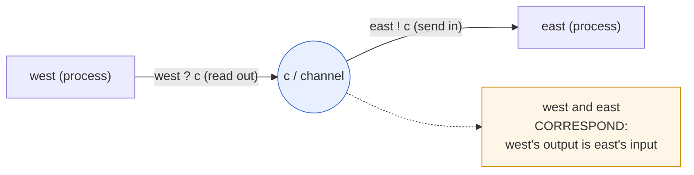
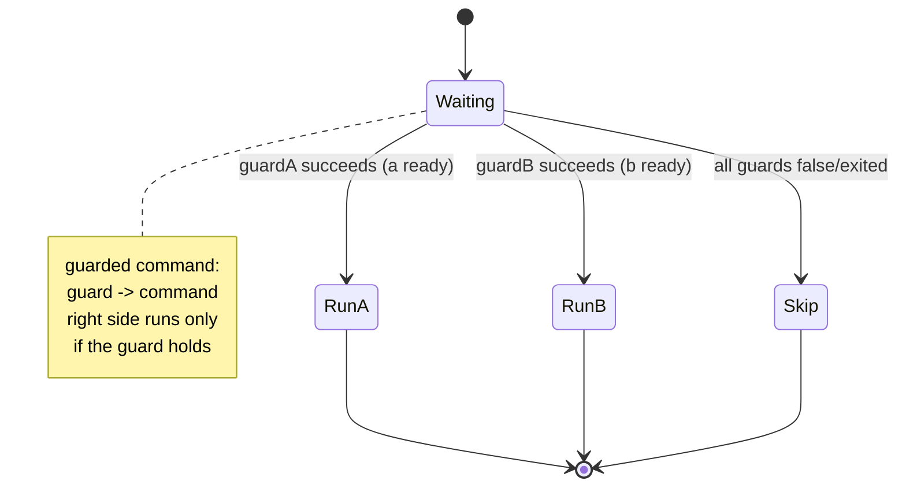
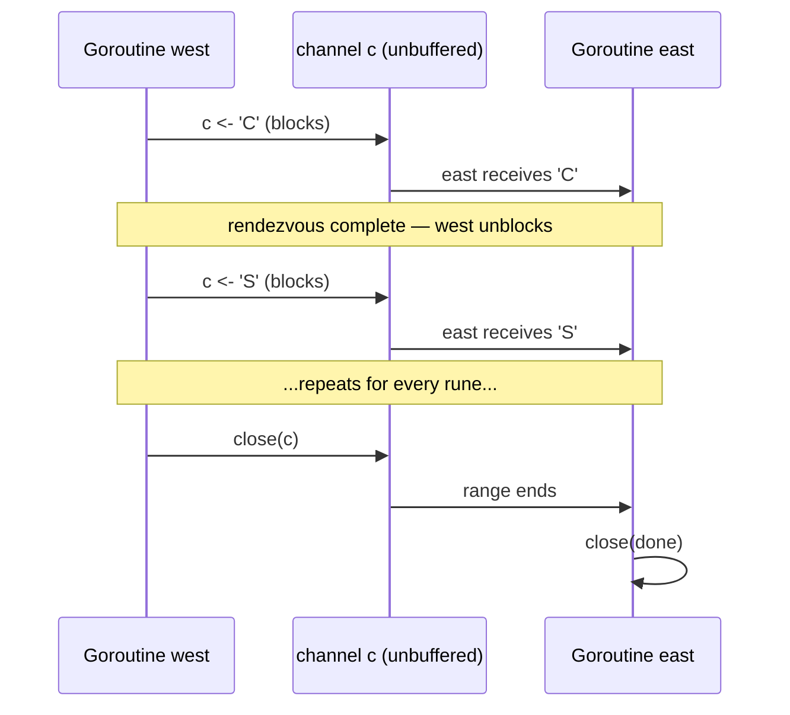

# Ch 2.2 — What Is CSP?

> Book: *Concurrency in Go* (Katherine Cox-Buday, O'Reilly 2017) · Chapter 2: Modeling Your Code: Communicating Sequential Processes · Pages ~26–29
> ⬅️ Prev: [Concurrency vs Parallelism](01-concurrency-vs-parallelism.md) · ➡️ Next: [How This Helps You](03-how-this-helps-you.md) · 🏠 [Book index](../README.md)

## 🎯 In One Paragraph

**CSP** stands for **Communicating Sequential Processes**, both a *technique* and the title of the 1978 ACM paper by **Charles Antony Richard (Tony) Hoare** that inspired Go's concurrency model. Hoare's thesis was that **input and output are overlooked primitives of programming**, especially for concurrent code — at a time when research focused on structuring *sequential* programs (the `goto` debate, early object orientation). To prove the point he invented a small language where *processes* (any encapsulated chunk of logic that takes input and produces output) communicate through explicit I/O commands: `!` to send into a process and `?` to read out of one. When one process's output flows directly into another's input, the two are said to **correspond** — exactly the relationship Go's channels encode. Hoare combined these I/O commands with Dijkstra's **guarded commands** (a `guard → statement` form where the right side runs only if the left guard holds). Hoare himself cautioned the notation was *not* meant to be a real programming language; over the next six years CSP was refined into **process calculus**, a mathematical framework for reasoning about concurrent-system correctness. History vindicated Hoare, yet before Go very few mainstream languages adopted I/O as a first-class concurrency primitive — most favored **sharing and synchronizing access to memory** instead. Go is among the first to bring CSP's *message-passing* style to the masses, which is a large part of why its concurrency is considered easy to read, write, and reason about. Crucially, the book is careful: memory-access synchronization isn't *bad*, and Go still supports it — CSP just makes the common case easier.

## 🧠 Key Concepts & Vocabulary

- **CSP (Communicating Sequential Processes)**: Both a programming technique and Hoare's 1978 ACM paper. Processes run sequentially internally but coordinate purely by passing messages.
- **Tony Hoare (C.A.R. Hoare)**: Author of the CSP paper (and of quicksort, the null-reference "billion-dollar mistake," and Hoare logic).
- **ACM / CACM**: Association for Computing Machinery; the paper appeared in *Communications of the ACM*, August 1978.
- **Input/output as primitives**: Hoare's central claim — communication (I/O) deserves to be a first-class language construct for concurrent programs, not an afterthought.
- **Process (Hoare's sense)**: *Any* encapsulated portion of logic requiring input to run and producing output for others to consume. (He'd have said "function" if that word weren't loaded by the structured-programming debates of the day.)
- **`!` (output/send command)**: Sends a value *into* a destination process. Example: `lineprinter!lineimage`.
- **`?` (input/receive command)**: Reads a value *out of* a named source process. Example: `cardreader?cardimage`.
- **Correspondence**: When one process's output is sent to the same variable another process receives from, the two processes *correspond* — output flows directly into input.
- **Named sources/destinations**: In the first CSP paper, processes could only communicate via *named* endpoints. Hoare noted this hurts library reuse (callers must know the names) and floated **"port names"** — essentially named parameters / named return values.
- **Guarded command (Dijkstra, 1974)**: A statement of the form `guard → command`; the right side executes only if the left side (a boolean/command) is true or has succeeded. False/exited guard ⇒ right side never runs.
- **Process calculus**: The later (post-1978) formalization of CSP: a mathematical model of concurrent systems with algebraic laws to transform and analyze them for efficiency and correctness. (Beyond this book's scope.)
- **Message passing vs. shared memory**: CSP's model (pass data between processes) contrasted with the mainstream model (share memory and synchronize access to it).
- **Channel**: Go's realization of CSP correspondence — a typed conduit over which goroutines send/receive values.

## 📚 Deep Dive

### The claim: I/O is a first-class primitive

In 1978 the field was busy structuring *sequential* code (should we ban `goto`? how should objects work?). Hoare argued that **communication between concurrent processes** had been neglected and deserved to be a language *primitive*. His CSP language existed to demonstrate this — he explicitly disclaimed it as a production language:

> "Thus the concepts and notations introduced in this paper should … not be regarded as suitable for use as a programming language." — Hoare, 1978

He worried his notation did nothing to *prove* program correctness and might not perform in a real language. That concern drove the six-year refinement into **process calculus**.

### The `!` / `?` notation and "correspondence"

Hoare introduced two commands. Each names the other endpoint:

| Operation | Meaning |
|---|---|
| `cardreader?cardimage` | From process `cardreader`, read a card; assign the char array to `cardimage`. |
| `lineprinter!lineimage` | To process `lineprinter`, send `lineimage` for printing. |
| `X?(x, y)` | From process `X`, input a *pair* and assign to `x` and `y`. |
| `DIV!(3*a+b, 13)` | To process `DIV`, output the two specified values. |
| `*[c:character; west?c → east!c]` | Repeatedly read a char from `west` into `c`, then send `c` to `east`; terminates when `west` terminates. |

That last line is the heart of it. A single variable `c` receives `west`'s output and feeds `east`'s input — so `west` and `east` **correspond**. This is *exactly* a Go channel: one goroutine sends, another receives, and the value moves from one to the other.



### Guarded commands: the ancestor of `select`

Hoare borrowed Dijkstra's 1974 **guarded command**: `guard → command`. The guard is a conditional; if it's false (or, as a command, returns false or has exited), the right side never runs. Combined with `!`/`?`, guards let a process *wait on multiple possible communications* and proceed with whichever is ready — the direct conceptual ancestor of Go's `select`.



### Mapping CSP to Go

| Hoare's CSP (1978) | Go |
|---|---|
| process | goroutine |
| `!` (send into) | `ch <- v` |
| `?` (read out) | `v := <-ch` |
| correspondence | a shared channel connecting two goroutines |
| named source/destination | typed channel value passed as an argument |
| "port names" idea | function parameters / named return values |
| guarded command | `select` with `case`s |
| `*[ … ]` repetition | `for v := range ch { … }` |

### Runnable: Hoare's `west → c → east` in Go

This complete program reproduces `*[c:character; west?c → east!c]`: read every value `west` produces and pass each, one at a time, to `east`, terminating when `west` closes the channel (its way of "terminating").

```go
// Mirrors Hoare's CSP example *[c:character; west?c -> east!c]:
// read every character produced by "west" and pass each, one by one, to
// "east". The two processes correspond: west's output is east's input.
// The loop terminates when west terminates (closes the channel).
package main

import (
	"fmt"
	"sync"
)

// west is a "process": it produces output and nothing else.
func west(out chan<- rune) {
	defer close(out) // closing signals termination, like west terminating
	for _, c := range "CSP->Go" {
		out <- c // west ! c  (send)
	}
}

// east is a "process": it consumes input and prints it.
func east(in <-chan rune, done chan<- struct{}) {
	defer close(done)
	for c := range in { // east ? c  (receive until channel closed)
		fmt.Printf("%c", c)
	}
	fmt.Println()
}

func main() {
	c := make(chan rune) // the unbuffered "named channel" connecting the two
	done := make(chan struct{})

	var wg sync.WaitGroup
	wg.Add(1)
	go func() { defer wg.Done(); west(c) }()
	go east(c, done)

	<-done // wait for east to drain everything
	wg.Wait()
	fmt.Println("pipeline finished")
}
```

**Verified output:**

```
CSP->Go
pipeline finished
```

Notes tying code to CSP:
- The unbuffered `c` is Hoare's *named channel* — the point of correspondence. Because it's unbuffered, a send blocks until a receiver takes the value, giving the synchronous rendezvous CSP describes.
- `chan<- rune` and `<-chan rune` directional types encode *who sends and who receives*, a stronger, compiler-checked version of Hoare's named endpoints.
- Closing `c` models `west` terminating; `range` on `east` ends exactly then — the `*[ … ]` repetition's termination rule.

The sequence below shows the synchronous rendezvous for each value (unbuffered send blocks until receive):



### Why CSP matters historically

Hoare used these primitives to solve several problems with "extraordinarily clear" solutions — terse by modern taste, but strikingly readable. Go's equivalents are a bit longer yet retain that clarity. History judged Hoare right, but **before Go, almost no widely adopted language made I/O a first-class concurrency primitive**; the mainstream chose **shared memory + synchronization**. Go brought CSP's message passing to a mass audience, prompting other languages to add similar primitives.

The book is explicit that this is not a holy war:

> Memory access synchronization isn't inherently bad; sometimes sharing memory is appropriate, even in Go.

CSP simply makes the *common* case easier to read, write, and reason about — the deeper "when to use which" guidance lands in [2.4 — Go's Philosophy on Concurrency](04-gos-philosophy-on-concurrency.md).

## ⚠️ Pitfalls & Gotchas

- **Thinking CSP is a silver bullet.** The book pushes back directly: CSP makes programs easier and more robust, but it "is unfortunately not a miracle." Concurrency is still hard.
- **Conflating Hoare's "process" with an OS process.** In CSP a *process* is just encapsulated input→output logic — closer to a goroutine/function than to an OS process.
- **Assuming CSP replaces shared memory entirely.** It does not; Go keeps `sync` primitives on purpose. Message passing is the default, not a prohibition.
- **Expecting process calculus in your day job.** The algebraic/mathematical CSP (process calculus) is for reasoning about correctness formally; it's out of scope for everyday Go and for this book.
- **Forgetting the termination rule.** `west?c → east!c` loops *until west terminates*. In Go you model that with `close(ch)` and `range`; forgetting to close leaves the consumer blocked (a common deadlock).

## 🆕 Modern Go Notes

- Directional channel types (`chan<- T`, `<-chan T`) are the modern, compiler-enforced expression of Hoare's named send/receive endpoints — use them in function signatures to document intent and catch misuse.
- `for v := range ch` is the idiomatic encoding of the `*[ … ]` repetition that ends when the sender closes the channel.
- Nothing about CSP's core has changed in modern Go; later additions (`context` for cancellation, `select` with `default`) extend the guarded-command idea rather than replace it.

## 🧪 Try It Yourself

1. Make `c` a *buffered* channel (`make(chan rune, 4)`). Does output change? What happens to the synchronous rendezvous described above?
2. Add a third "process," `middle`, that uppercases each rune between `west` and `east`. You've now built a CSP pipeline of three corresponding processes.
3. Remove `close(c)` from `west`. Run it and observe the deadlock; explain it in terms of the `*[ … ]` termination rule.
4. Rewrite `east` to use a bare `select` with a `case c := <-in` and a `case <-done`. Relate this to Dijkstra's guarded commands.

## ✅ Self-Check Questions

<details><summary>1. What does CSP stand for, and who/when introduced it?</summary>

Communicating Sequential Processes — a technique and a paper by Tony Hoare (C.A.R. Hoare), published in the Communications of the ACM in 1978.
</details>

<details><summary>2. What was Hoare's central claim about programming primitives?</summary>

That input and output (communication) are overlooked primitives and should be first-class language constructs, especially for concurrent programs — rather than being bolted on after the fact.
</details>

<details><summary>3. What does it mean for two processes to "correspond"?</summary>

One process's output is sent to the same variable the other process receives from, so output flows directly into input. In Go, two goroutines sharing a channel correspond.
</details>

<details><summary>4. What is a guarded command, and what Go construct descends from it?</summary>

A `guard → command` statement (Dijkstra, 1974) whose right side executes only if the left guard holds. Go's `select` statement is its conceptual descendant.
</details>

<details><summary>5. Did most pre-Go mainstream languages adopt CSP-style message passing? What did they use instead?</summary>

No. Most favored sharing memory and synchronizing access to it. Go was among the first widely adopted languages to make CSP-style channels a core feature.
</details>

<details><summary>6. Is memory-access synchronization "bad" according to the book?</summary>

No. The book explicitly says it isn't inherently bad and that sharing memory is sometimes appropriate even in Go. CSP just makes the common case easier to reason about.
</details>

## 🔑 Key Takeaways

- CSP = Hoare's 1978 technique/paper arguing **I/O is a first-class concurrency primitive**.
- Processes communicate via `!` (send) and `?` (receive); when output feeds input directly, they **correspond** — Go channels in essence.
- **Guarded commands** (Dijkstra) + I/O commands → the foundation that became Go's `select`.
- CSP later became **process calculus** for formally reasoning about correctness (out of scope here).
- Go popularized CSP's **message passing**, but keeps shared-memory synchronization too — CSP isn't a miracle, just a clearer default.

## 🔗 References & Further Reading

📝 Blogs/articles
- [The 1978 Paper Behind Go's Concurrency Model (dev.to)](https://dev.to/amirsefati/the-1978-paper-behind-gos-concurrency-model-4n55) — why shared-memory concurrency hurts and how Go turned CSP theory into practice.
- [Bell Labs and CSP Threads — Russ Cox (swtch.com)](https://swtch.com/~rsc/thread/) — a Go author traces the CSP lineage through Newsqueak/Alef/Limbo into Go's channels.
- [Communicating sequential processes (Wikiwand/Wikipedia)](https://www.wikiwand.com/en/articles/Communicating_Sequential_Processes) — concise history of the 1978 language vs. the later process calculus.

💻 GitHub
- [kat-co/concurrency-in-go-src](https://github.com/kat-co/concurrency-in-go-src) — the book's official Chapter 2 code, including the CSP-style examples.
- [golang/go — src/runtime/chan.go](https://github.com/golang/go/blob/master/src/runtime/chan.go) — the actual implementation of Go channels, the modern embodiment of CSP correspondence.

📖 Official docs/specs
- [The Go Programming Language Specification — Channel types & operators](https://go.dev/ref/spec#Channel_types) — defines send/receive, the direct realization of Hoare's `!`/`?`.
- [Hoare, "Communicating Sequential Processes," CACM 1978 (summary, Stanford)](http://www-cs-students.stanford.edu/~dbfaria/quals/summaries/Hoare-1978.txt) — a faithful summary of the original paper's primitives (`!`, `?`, guarded/parallel commands).
