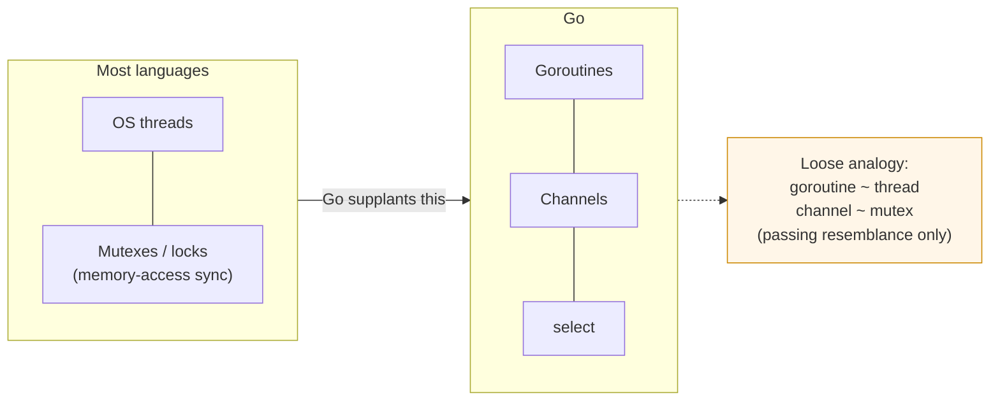
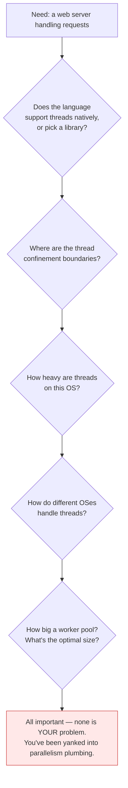
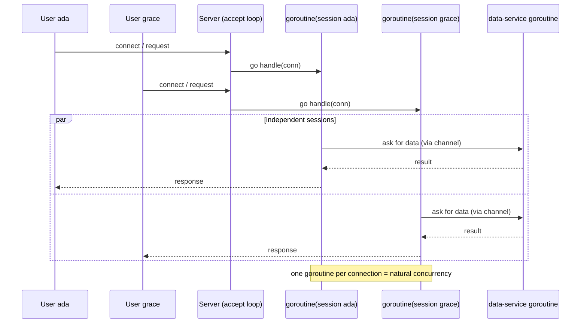
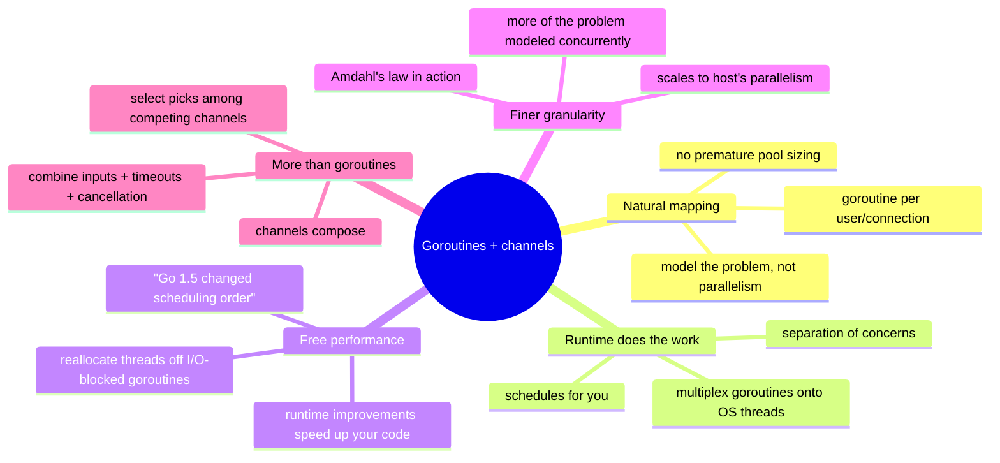

# Ch 2.3 — How This Helps You

> Book: *Concurrency in Go* (Katherine Cox-Buday, O'Reilly 2017) · Chapter 2: Modeling Your Code: Communicating Sequential Processes · Pages ~29–31
> ⬅️ Prev: [What Is CSP?](02-what-is-csp.md) · ➡️ Next: [Go's Philosophy on Concurrency](04-gos-philosophy-on-concurrency.md) · 🏠 [Book index](../README.md)

## 🎯 In One Paragraph

This section answers the pragmatic question: *so what?* Most languages end their concurrency abstraction chain at **OS threads + memory-access synchronization**; Go supplants that with **goroutines and channels**. A loose analogy: a goroutine is "like" a thread and a channel is "like" a mutex — but only loosely, and the real payoff is that goroutines let you **model problems at their natural level of concurrency** instead of being "yanked down" into parallelism plumbing. The running example is a web server: in a thread-only language you'd agonize over thread libraries, confinement boundaries, thread weight, cross-OS differences, and worker-pool sizing — *none of which is your actual problem*. In Go you say what's naturally true — "each user opens a session; field the request, maybe talk to other goroutines, return" — and spin up **one goroutine per connection**. This works because Go *promises goroutines are lightweight*, so you normally don't worry about creating them (worrying upfront is premature optimization). The benefits cascade: the runtime **multiplexes goroutines onto OS threads and schedules them for you**, so scheduler improvements speed up your program *for free*; the runtime can **reallocate threads away from I/O-blocked goroutines** to runnable ones; and because the mapping is natural you end up modeling *more* of the problem concurrently at a *finer granularity*, which lets the program **scale dynamically to whatever parallelism the host offers** — "Amdahl's law in action." And goroutines are only one piece: **channels compose** (combine inputs, timeouts, cancellations trivially — coordinating mutexes is far harder), and **`select`** is the complement that waits on competing channels, picks uniformly at random, and can proceed when nothing is ready.

## 🧠 Key Concepts & Vocabulary

- **Abstraction chain (other languages)**: typically ends at **OS thread** + **memory-access synchronization** (locks).
- **Abstraction chain (Go)**: supplants that with **goroutines** + **channels** (+ `select`).
- **Loose analogy**: goroutine ≈ thread, channel ≈ mutex — "only a passing resemblance," a bearings-getter, not an equivalence.
- **Natural level of concurrency**: modeling the problem as the concurrent things it actually is (one session per user) rather than as parallelism mechanics (threads, pools).
- **"Yanked down into technicalities"**: the thread-first mindset forces premature decisions (library, pool size, thread weight) unrelated to the real problem.
- **Lightweight goroutines (Go's promise)**: creating a goroutine is cheap, so you normally don't plan their count upfront. Doing so early is **premature optimization**.
- **Runtime multiplexing & scheduling**: Go's runtime maps many goroutines onto a smaller number of OS threads and schedules them — a classic **separation of concerns**.
- **Free performance**: because scheduling is decoupled from your model, runtime improvements (e.g., "Go 1.5 changed goroutine scheduling order") speed up unchanged code.
- **I/O-aware rescheduling**: the runtime detects goroutines blocked on I/O and reassigns OS threads to runnable goroutines, improving throughput.
- **Finer granularity of concurrency**: natural mapping ⇒ you model *more* of the problem concurrently (a goroutine per user, not connections multiplexed onto a pool).
- **Amdahl's law (in action)**: finer-grained concurrency lets the program exploit however much parallelism the host provides, scaling dynamically at runtime.
- **Channel composability**: channels combine with other channels, timeouts, cancellations, and cross-subsystem messages far more easily than coordinating locks.
- **`select` statement**: the complement to channels — wait efficiently for events, pick among competing ready channels *uniformly at random*, optionally proceed if none are ready.

## 📚 Deep Dive

### Two ways to abstract concurrent code



Goroutines "free us from having to think about our problem space in terms of parallelism and instead allow us to model problems closer to their natural level of concurrency."

### The web-server example: thread-first vs. Go

In a thread-only language, before touching the actual feature you must answer a pile of mechanical questions:



The *natural* statement of the problem is simple: a user connects and opens a **session**; the session fields the request and returns a response. Go lets you encode that almost verbatim — **a goroutine per incoming connection**, field the request (perhaps talking to other goroutines for data/services), then return from the goroutine's function. The mental model maps directly onto the code.



This is only possible because of **Go's promise**: goroutines are lightweight, so you "normally won't have to worry about creating one." There *are* times to count goroutines, but doing so upfront is "soundly a premature optimization." Contrast threads, where you'd be wise to plan their number in advance.

The book adds a sharp point about frameworks: even if a framework hides parallelism for you, the complexity isn't gone — *someone* wrote the framework and your code sits atop whatever they had to wrangle, and "complexity breeds bugs." Because Go was *designed around* concurrency, the language and its concurrency primitives aren't incongruent — **less friction, fewer bugs**.

### Runnable: one goroutine per connection

`net/http` already follows this model — it starts a new goroutine per connection internally. The program below stands up a real server with `httptest`, then hits it with many concurrent "users," each served by its own server-side goroutine, and each handler fans out to a data-service goroutine via a channel.

```go
// "How This Helps You": the natural-concurrency mapping. Each incoming
// connection is modeled as its own goroutine instead of being multiplexed
// onto a hand-tuned thread pool. net/http already does this for us: the
// server starts a new goroutine per connection under the hood.
package main

import (
	"fmt"
	"io"
	"net/http"
	"net/http/httptest"
	"sync"
)

// handler models the "session" per the book: field the request, optionally
// talk to other goroutines for data, then return.
func handler(w http.ResponseWriter, r *http.Request) {
	// Fan out to a "data service" goroutine via a channel, then return.
	result := make(chan string, 1)
	go func() { result <- "hello " + r.URL.Query().Get("user") }()
	fmt.Fprintln(w, <-result)
}

func main() {
	// httptest spins up a real server on a random port so this is self-contained.
	srv := httptest.NewServer(http.HandlerFunc(handler))
	defer srv.Close()

	// Simulate many concurrent users; each gets its own goroutine server-side.
	var wg sync.WaitGroup
	for _, u := range []string{"ada", "alan", "grace", "edsger"} {
		wg.Add(1)
		go func(user string) {
			defer wg.Done()
			resp, err := http.Get(srv.URL + "/?user=" + user)
			if err != nil {
				fmt.Println("error:", err)
				return
			}
			defer resp.Body.Close()
			body, _ := io.ReadAll(resp.Body)
			fmt.Print(string(body))
		}(u)
	}
	wg.Wait()
	fmt.Println("all sessions served")
}
```

**Verified output** (order varies — concurrency makes it non-deterministic):

```
hello edsger
hello alan
hello grace
hello ada
all sessions served
```

The non-deterministic ordering is the point: four independent sessions run concurrently and complete in whatever order the scheduler chooses. You wrote *zero* lines about thread pools, thread weight, or OS differences.

### The cascade of benefits



1. **Separation of concerns / free performance.** The runtime multiplexes goroutines onto OS threads and schedules them. Because your *model* is decoupled from scheduling, runtime optimizations improve your program without code changes. The book cites a release note: *"In Go 1.5, the order in which goroutines are scheduled has been changed."*
2. **I/O-aware rescheduling.** The runtime can see goroutines blocked on I/O and hand their OS threads to runnable goroutines — more throughput, for free. (Chapter 6 details this.)
3. **Finer granularity ⇒ dynamic scaling.** Because the mapping is natural, you model more of the inherently-concurrent problem concurrently and at finer grain (a goroutine per user, not connections stuffed onto a pool). At runtime the program scales to whatever parallelism the host supports — **Amdahl's law in action**.
4. **Channels compose; `select` conducts.** Channels combine with other channels, timeouts, cancellations, and messages to other subsystems, making large systems simpler to coordinate — *"Coordinating mutexes is a much more difficult proposition."* `select` is the complement: it waits efficiently for events, chooses among competing ready channels **uniformly at random**, and can continue when nothing is waiting.

> 🆕 **Modern Go note.** The composition the book praises is now standardized. `context.Context` is the idiomatic carrier for cancellation and deadlines across goroutines (wire it into `http.Request` with `r.Context()`), and `golang.org/x/sync/errgroup` composes a group of goroutines with shared cancellation and error propagation. These didn't exist (or weren't idiomatic) in 2017 but are the direct modern expression of "combine inputs with timeouts, cancellations, or messages." Goroutines also start at ~2 KB stacks (since Go 1.3) that grow on demand — the concrete basis for the "lightweight" promise.

## ⚠️ Pitfalls & Gotchas

- **Premature goroutine budgeting.** Deciding "I'll use exactly N workers" before measuring is premature optimization in Go. Model naturally first; add bounding only when profiling shows a need.
- **Assuming "lightweight" means "free of all cost."** Goroutines are cheap, not zero-cost: each still has a (growable) stack and scheduling overhead; leaked goroutines blocked forever are a real memory/throughput problem.
- **Porting thread-pool habits wholesale.** Patterns tuned for heavy OS threads (fixed pools, elaborate confinement) are usually unnecessary in Go. (The next section makes this a rule of thumb.)
- **Believing a framework erased the complexity.** It only *hid* it. The complexity still exists in the framework's code and can still produce bugs that reach you.
- **Expecting deterministic ordering.** As the verified output shows, concurrent sessions complete in scheduler-chosen order. Don't rely on ordering without explicit synchronization.
- **Thinking goroutines alone are the win.** Channels and `select` are what make composition and coordination tractable; goroutines without them just reinvent threads.

## 🆕 Modern Go Notes

- Use `context.Context` (and `r.Context()` in HTTP handlers) for cancellation/deadlines — the modern form of "combine channels with timeouts and cancellations."
- `golang.org/x/sync/errgroup` composes groups of goroutines with first-error cancellation; `sync.WaitGroup.Go` (Go 1.25) streamlines the launch-and-wait pattern used in the example.
- Goroutine stacks start small (~2 KB) and grow/shrink dynamically, which is what makes "spin up one per connection" realistic at scale.

## 🧪 Try It Yourself

1. Bump the user list to 10,000 names. Does the program still run comfortably? Approximately how much memory per goroutine does that imply?
2. Add `w.(http.Flusher)` streaming or a `time.Sleep` inside `handler` to simulate slow I/O, then observe (via timestamps) that slow sessions don't block fast ones.
3. Replace the per-handler `go func` + channel with a shared, pre-sized worker pool. Does the code get simpler or more complicated? Relate your answer to the book's "yanked down" argument.
4. Wrap the client requests in an `errgroup.Group` and make one request fail; confirm the group cancels the rest.

## ✅ Self-Check Questions

<details><summary>1. Where do most languages end their concurrency abstraction chain, and what does Go use instead?</summary>

Most end at OS threads plus memory-access synchronization (locks). Go supplants that with goroutines and channels (plus `select`).
</details>

<details><summary>2. What does "modeling at the natural level of concurrency" mean in the web-server example?</summary>

Representing the real structure of the problem — one session per user — directly as one goroutine per connection, instead of expressing the solution in terms of thread pools and parallelism mechanics.
</details>

<details><summary>3. Why is deciding the number of goroutines upfront usually a mistake in Go?</summary>

Because goroutines are lightweight (Go's promise), so you normally don't need to budget them. Planning their count before profiling is premature optimization; you're far more likely to restructure than to hit a hardware ceiling.
</details>

<details><summary>4. Give two ways the runtime gives you "free" performance.</summary>

(1) It multiplexes/schedules goroutines onto OS threads, so runtime scheduler improvements speed up unchanged code. (2) It detects goroutines blocked on I/O and reallocates OS threads to runnable goroutines, raising throughput.
</details>

<details><summary>5. How does finer-grained concurrency connect to Amdahl's law?</summary>

Natural mapping leads you to model more of the problem concurrently at finer granularity (a goroutine per user). At runtime the program can then exploit whatever parallelism the host offers, scaling dynamically — the practical payoff Amdahl's law describes.
</details>

<details><summary>6. Why does the book say channels are easier to coordinate than mutexes?</summary>

Channels are inherently composable: you can merge multiple channel inputs and combine them with timeouts, cancellations, and cross-subsystem messages, orchestrated by `select`. Coordinating many mutexes across an object graph is far harder.
</details>

## 🔑 Key Takeaways

- Go **supplants** thread+mutex abstraction with **goroutines + channels (+ `select`)**, letting you model problems at their natural concurrency.
- The thread-first mindset drags you into plumbing (libraries, pool sizing, thread weight) unrelated to your actual problem; Go lets you write "one goroutine per connection."
- **Goroutines are lightweight by promise** — don't budget them upfront; that's premature optimization.
- The runtime **multiplexes and schedules** goroutines and reschedules around I/O blocks, so you get **free performance** and **dynamic scaling** (Amdahl's law in action).
- **Channels compose** and **`select` conducts** — the real source of easy coordination, which mutexes can't match.

## 🔗 References & Further Reading

📝 Blogs/articles
- [Go Concurrency Patterns — Rob Pike, Google I/O 2012 (slides PDF)](https://wiki-1251140025.cos.ap-shanghai.myqcloud.com/files/archives/2020/12/Go%20Concurrency%20Patterns%20-%20Google%20IO%202012.pdf) — the talk that popularized modeling problems as goroutines + channels + `select`.
- [Goroutine Scheduling: From Zero to Hero (dev.to)](https://dev.to/jones_charles_ad50858dbc0/goroutine-scheduling-from-zero-to-hero-in-go-concurrency-3bl5) — why goroutines are lightweight (~2 KB stacks) and how the runtime schedules them.
- [From Parallel to Concurrent — Rob Pike (Microsoft Lang.NEXT 2014)](https://learn.microsoft.com/en-us/shows/lang-next-2014/from-parallel-to-concurrent) — contrasts parallel-first vs. concurrency-first language design (Sawzall vs. Go).

💻 GitHub
- [kat-co/concurrency-in-go-src](https://github.com/kat-co/concurrency-in-go-src) — the book's official Chapter 2 code.
- [golang/go — src/net/http/server.go](https://github.com/golang/go/blob/master/src/net/http/server.go) — see `Serve`/`conn.serve` starting a goroutine per connection, exactly the natural mapping described.

📖 Official docs/specs
- [net/http — pkg.go.dev](https://pkg.go.dev/net/http) — documents that the server handles each request in its own goroutine.
- [The Go Memory Model](https://go.dev/ref/mem) — the rules that make goroutine/channel coordination well-defined, underpinning "channels compose."
