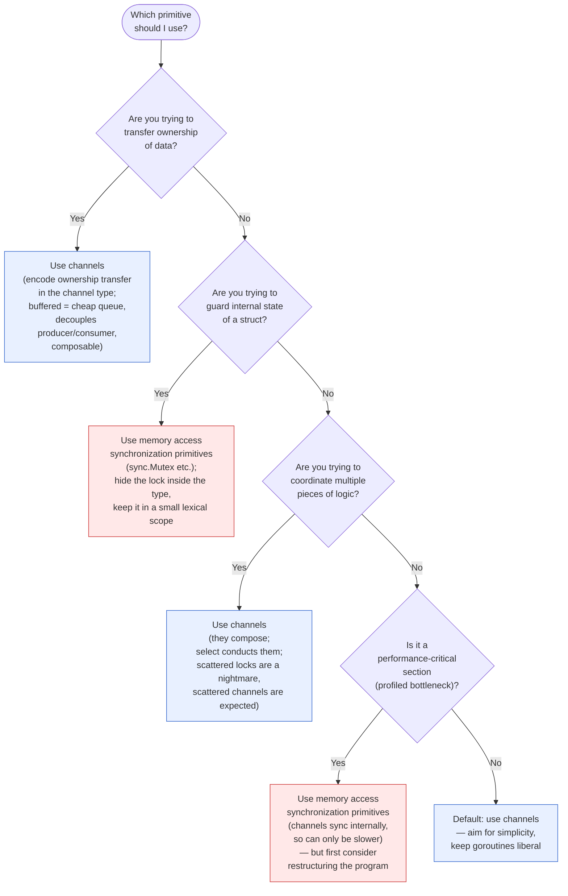
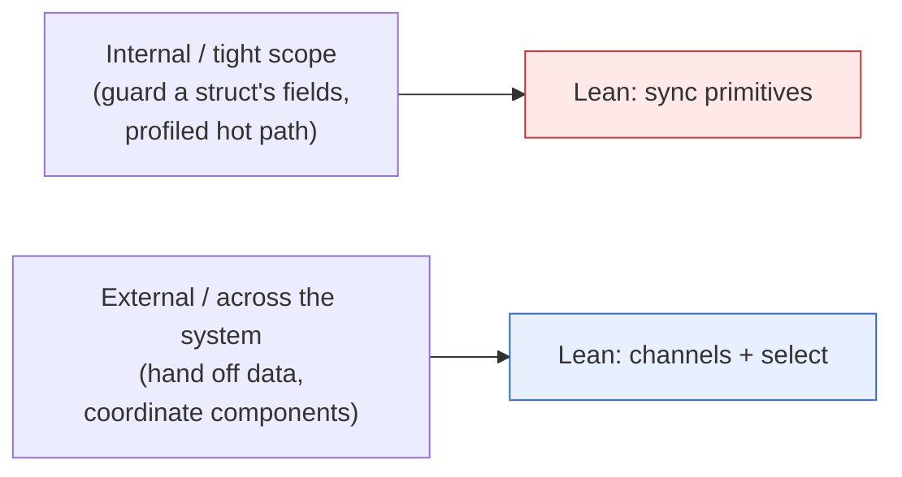
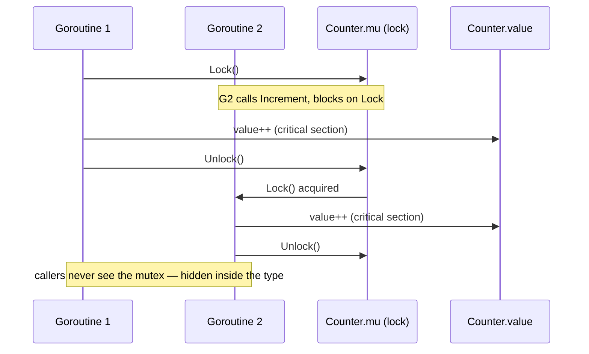
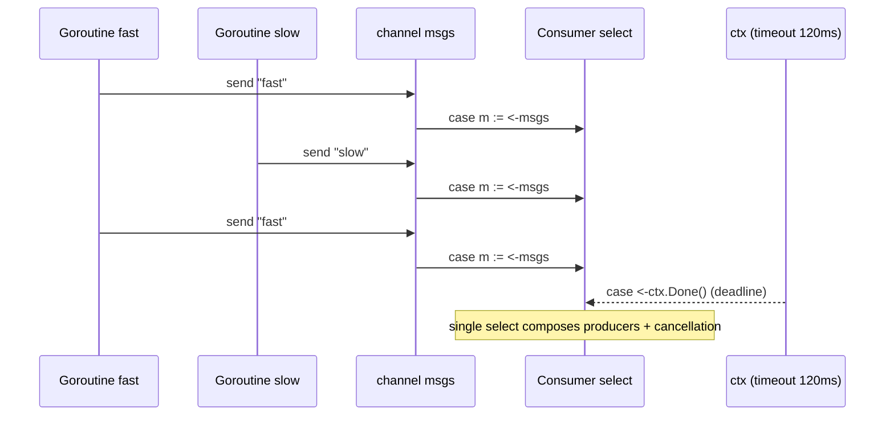
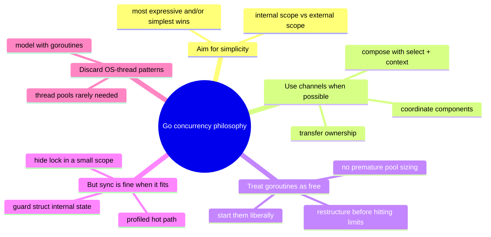

# Ch 2.4 — Go's Philosophy on Concurrency

> Book: *Concurrency in Go* (Katherine Cox-Buday, O'Reilly 2017) · Chapter 2: Modeling Your Code: Communicating Sequential Processes · Pages ~31–35
> ⬅️ Prev: [How This Helps You](03-how-this-helps-you.md) · ➡️ Next: [Chapter 3 — Go's Concurrency Building Blocks](../ch03-go-concurrency-building-blocks/README.md) · 🏠 [Book index](../README.md)

## 🎯 In One Paragraph

Go was *designed around* CSP, but it deliberately **also** ships traditional memory-access synchronization in `sync` and friends (locks, resource pools, goroutine preemption, etc.). That choice is a gift — you pick the style that best fits the problem — but it confuses newcomers, who often believe CSP/channels are the *one true way*. The confusion is understandable: the `sync` docs say higher-level synchronization is "better done via channels and communication," the FAQ urges "do not communicate by sharing memory; instead, share memory by communicating," and core-team members have publicly favored channels over `sync.Mutex`. Yet you *also* see locks everywhere in real code and hear team members say locks are fine. The Go Wiki's own advice — *"Use whichever is most expressive and/or most simple"* — is correct but vague. The section's real contribution is a **decision tree** (Figure 2-1) that turns that vague advice into concrete guideposts, organized around **where you manage concurrency: internally to a tight scope, or externally across the system.** Walking it: **transferring ownership of data → channels** (and buffered channels give you a cheap queue that decouples producer/consumer and makes code composable); **guarding the internal state of a struct → `sync` primitives** (hide the lock behind the type, keep it in a small lexical scope); **coordinating multiple pieces of logic → channels** (they compose; scattered locks are a nightmare, scattered channels are expected); **a profiled, genuinely performance-critical section → maybe `sync`** (channels use memory-access synchronization internally, so they can only be slower — but first consider restructuring). Finally, discard OS-thread-era patterns (like thread pools) as the default: model your problem with goroutines, use them liberally, and expect to restructure long before you hit a goroutine ceiling. The philosophy, in one line: **aim for simplicity, use channels when possible, and treat goroutines like a free resource.**

## 🧠 Key Concepts & Vocabulary

- **Two valid styles in Go**: **CSP primitives** (goroutines/channels/`select`) *and* **memory-access synchronization** (`sync.Mutex`, `sync.RWMutex`, `sync.WaitGroup`, `sync.Once`, pools, etc.).
- **"Share memory by communicating, don't communicate by sharing memory"**: Go's motto — prefer passing data over channels to parking it in shared memory behind a lock.
- **`sync` docs guidance**: most `sync` types (other than `Once` and `WaitGroup`) are "intended for use by low-level library routines"; higher-level synchronization is "better done via channels and communication."
- **FAQ guidance**: the `sync` package implements mutexes, but Go style encourages higher-level techniques — ideally, structure the program so **only one goroutine at a time is responsible for a particular piece of data**.
- **Go Wiki guidance**: "Most locking issues can be solved using either channels or traditional locks… Use whichever is most expressive and/or most simple."
- **Internal vs. external concurrency management**: the organizing axis of the decision tree — manage within a tight scope (lean to locks) vs. across the system (lean to channels).
- **Transfer ownership of data**: hand a result from producer to consumer so exactly one concurrent context owns the data at a time → **channels** (encode the intent in the channel's type).
- **Buffered channel as a cheap in-memory queue**: decouples producer from consumer and makes code composable.
- **Guard internal state of a struct**: protect a critical section inside a type; hide the locking detail from callers → **`sync` primitives**, kept in a **small lexical scope**. Exposing locks beyond the type is a **red flag**.
- **Scope of atomicity**: wrapping a critical section in a lock *defines the context* in which the operation is atomic (e.g., `Counter.Increment`).
- **Coordinate multiple pieces of logic**: orchestrate several concurrent components → **channels**, because they compose and `select` conducts them; struggling to understand a deadlock/race while using primitives is a hint to switch to channels.
- **Performance-critical section**: a *profiled* bottleneck orders of magnitude slower than the rest → `sync` *may* help, because **channels use memory-access synchronization internally and can only be slower**. But a hot section often signals the need to **restructure**.
- **Discard OS-thread patterns (rule of thumb)**: thread pools and similar are tuned for heavy OS threads; in Go their use cases are much narrower. Model with goroutines and start them liberally.
- **The summary philosophy**: *aim for simplicity, use channels when possible, and treat goroutines like a free resource.*

## 📚 Deep Dive

### Why Go exposes *both* styles

CSP is central to Go, but the language "also supports more traditional means of writing concurrent code through memory access synchronization." The `sync` (and related) packages let you lock, build resource pools, preempt goroutines, and more. Offering both gives you control — and causes confusion, because so much official messaging leans toward channels:

> "Other than the Once and WaitGroup types, most are intended for use by low-level library routines. Higher-level synchronization is better done via channels and communication." — `sync` package docs

> "Do not communicate by sharing memory. Instead, share memory by communicating." — Go FAQ

> "Use whichever is most expressive and/or most simple." — Go Wiki

The Wiki advice is right but vague. The section's job is to make it concrete.

### The decision tree (Figure 2-1) as a Mermaid flowchart

This is the book's Figure 2-1, "channels vs. memory access synchronization," reproduced as a flowchart. Work top to bottom; the first "yes" wins.



The organizing intuition: **channels lean toward managing concurrency *externally* across the system; locks lean toward managing it *internally* within a tight scope.**



### Decision point 1 — transferring ownership of data → channels

If one piece of code produces a result and wants to share it with another, you're really **transferring ownership**. As in manual-memory languages, a safe concurrent program ensures only one context owns data at a time. Channels encode that intent *in the channel's type*. Bonus: a **buffered channel** is a cheap in-memory queue that **decouples producer from consumer**, and using channels makes your code **implicitly composable** with other concurrent code.

```go
// "Transfer ownership of data" branch of the decision tree.
// A buffered channel is a cheap in-memory queue that decouples producer
// from consumer; ownership of each slice moves with the send, so only one
// goroutine ever touches a given slice at a time. Run with: go run -race .
package main

import "fmt"

// produce owns each buffer until it hands it off through the channel.
func produce(out chan<- []int) {
	defer close(out)
	for i := 0; i < 3; i++ {
		buf := make([]int, 3)
		for j := range buf {
			buf[j] = i*10 + j
		}
		out <- buf // ownership transferred; producer must not touch buf now
	}
}

func main() {
	ch := make(chan []int, 2) // buffered: a small decoupling queue
	go produce(ch)

	for buf := range ch { // consumer becomes the sole owner of each buf
		sum := 0
		for _, v := range buf {
			sum += v
		}
		fmt.Printf("received %v sum=%d\n", buf, sum)
	}
	fmt.Println("done")
}
```

**Verified output:**

```
received [0 1 2] sum=3
received [10 11 12] sum=33
received [20 21 22] sum=63
done
```

> ⚠️ Race-detector note: the race detector (`go run -race`) requires cgo and a C compiler, which were **not available** in the verification environment (`go: -race requires cgo` / `gcc not found`). The program is **race-free by construction** — ownership of each slice moves with the send and the producer never touches a buffer after sending it — and it runs cleanly (`go run` and `go vet` both pass). Run `go run -race .` on a machine with a C toolchain to confirm.

### Decision point 2 — guarding internal state of a struct → `sync`

This is the strong indicator that you should *not* use channels. Memory-access synchronization lets you **hide the locking detail from callers**. The book's canonical example is a thread-safe counter whose mutex is an unexported field — keep the lock in a **small lexical scope**; if you find yourself exposing locks beyond a type, that's a **red flag**.

Wrapping the critical section defines the **scope of atomicity** for the type: calls to `Increment` become atomic.

```go
// "Guard internal state of a struct" branch of the decision tree.
// The lock is an unexported implementation detail; callers never see it.
// Run with:  go run -race .
package main

import (
	"fmt"
	"sync"
)

type Counter struct {
	mu    sync.Mutex // internal: constrained to a small lexical scope
	value int
}

func (c *Counter) Increment() {
	c.mu.Lock()
	defer c.mu.Unlock()
	c.value++ // the critical section; atomic from the caller's point of view
}

func (c *Counter) Value() int {
	c.mu.Lock()
	defer c.mu.Unlock()
	return c.value
}

func main() {
	var c Counter
	var wg sync.WaitGroup
	for i := 0; i < 100; i++ {
		wg.Add(1)
		go func() { defer wg.Done(); c.Increment() }()
	}
	wg.Wait()
	fmt.Println("value:", c.Value()) // always 100, race-free
}
```

**Verified output:**

```
value: 100
```

> ⚠️ Race-detector note: same environment limitation as above — `-race` needs cgo/gcc, unavailable here. The counter is race-free because every read and write of `value` happens under `mu`. The program runs cleanly and `go vet` is clean. The book's own `Counter` omits the `Value()` accessor and exposes only `Increment`; reading `value` must *also* be done under the lock, so this version adds a locked accessor to stay correct.

The caller sees a clean API; the complexity is hidden:



### Decision point 3 — coordinating multiple pieces of logic → channels

Channels are "inherently more composable than memory access synchronization primitives." Locks scattered through an object graph are a nightmare; channels scattered everywhere are "expected and encouraged." You can compose channels (and `select` over them) but you can't easily compose locks or value-returning methods. A practical tell: if you're using primitives and struggling to understand *why* a deadlock or race occurs, that's a good signal to switch to channels.

```go
// "Coordinate multiple pieces of logic" branch: channels compose with
// select, timeouts, and cancellation in a way locks cannot. Here two
// producers feed one consumer, with a context-based cancellation and a
// timeout all merged into a single select.
package main

import (
	"context"
	"fmt"
	"time"
)

func producer(ctx context.Context, name string, out chan<- string, every time.Duration) {
	t := time.NewTicker(every)
	defer t.Stop()
	for {
		select {
		case <-ctx.Done():
			return
		case <-t.C:
			select {
			case out <- name:
			case <-ctx.Done():
				return
			}
		}
	}
}

func main() {
	ctx, cancel := context.WithTimeout(context.Background(), 120*time.Millisecond)
	defer cancel()

	msgs := make(chan string)
	go producer(ctx, "fast", msgs, 20*time.Millisecond)
	go producer(ctx, "slow", msgs, 35*time.Millisecond)

	count := 0
	for {
		select {
		case m := <-msgs: // competing channels selected uniformly at random
			count++
			fmt.Printf("got %-4s (#%d)\n", m, count)
		case <-ctx.Done(): // single composition point for cancellation/timeout
			fmt.Printf("stopped: %v (received %d messages)\n", ctx.Err(), count)
			return
		}
	}
}
```

**Verified output** (counts/ordering vary with scheduling and timing):

```
got fast (#1)
got slow (#2)
got fast (#3)
got fast (#4)
got slow (#5)
got fast (#6)
got fast (#7)
got slow (#8)
got fast (#9)
stopped: context deadline exceeded (received 9 messages)
```

One `select` composes two competing producers *and* a timeout/cancellation — try writing the equivalent with mutexes and you'll feel the book's point.



### Decision point 4 — performance-critical section → maybe `sync`

This does **not** mean "I want speed, so I'll use mutexes everywhere." It means: if you have **profiled** a section and found a bottleneck **orders of magnitude** slower than the rest, memory-access synchronization *may* help it perform under load — because **channels themselves use memory-access synchronization internally, so they can only be slower** than the lock they're built on. But before even that, a hot section may be hinting that you should **restructure the program**.

### Discard OS-thread patterns; the summary

Many patterns (thread pools, etc.) target the strengths/weaknesses of heavy OS threads. A good Go rule of thumb: **discard these as defaults**. Their use cases exist but are "much more constrained." Instead: model the problem space with goroutines, use them to represent the concurrent parts of your workflow, and "don't be afraid to be liberal when starting them" — you're far more likely to need to *restructure* than to hit the ceiling on how many goroutines your hardware supports.

The whole philosophy distilled:

> "Aim for simplicity, use channels when possible, and treat goroutines like a free resource." — Cox-Buday



> 🆕 **Modern Go note.** The decision tree is unchanged in spirit, but the toolbox grew. For ownership transfer and coordination, `context.Context` (standard since Go 1.7) is now the idiomatic cancellation/deadline carrier — used in the coordination example above. For guarding state, `sync.Once` has typed helpers `sync.OnceFunc`/`sync.OnceValue` (Go 1.21), typed atomics (`atomic.Int64`, Go 1.19) cover simple counters without a mutex, and `context.WithCancelCause` (Go 1.20) propagates a *reason* for cancellation. `golang.org/x/sync/errgroup` composes coordinating goroutines with shared cancellation. None of these overturn the tree; they refine the "which primitive" answer within each branch.

## ⚠️ Pitfalls & Gotchas

- **"Channels are the only Go way."** The book explicitly debunks this. `sync` exists on purpose; guarding a struct's internal state is a legitimate, preferred use of a mutex.
- **"Mutexes are faster, so I'll default to them."** Decision point 4 warns against this. Only reach for locks on a *profiled* bottleneck — and consider restructuring first.
- **Exposing a lock beyond its type.** A red flag. Keep locks in a small lexical scope, hidden behind the type's methods.
- **Reading a mutex-guarded field without the lock.** The book's `Counter` shows `Increment` under lock; reads of `value` must *also* hold the lock, or you have a data race (why this version adds a locked `Value()`).
- **Porting thread pools by reflex.** Usually unnecessary in Go. Model with goroutines first; add bounding only when measurements demand it.
- **Composing locks like channels.** You can't easily compose locks or value-returning methods; trying to coordinate many pieces of logic with scattered locks invites deadlocks. That difficulty is itself a signal to switch to channels.

## 🆕 Modern Go Notes

- `context.Context` is the idiomatic way to carry cancellation/deadlines across coordinating goroutines (shown above); `context.WithCancelCause` (1.20) and `context.AfterFunc` (1.21) extend it.
- Typed atomics (`atomic.Int64`, `atomic.Bool`, `atomic.Pointer[T]`, Go 1.19) can replace a mutex for simple shared counters/flags.
- `sync.OnceFunc`/`sync.OnceValue` (Go 1.21) and `sync.WaitGroup.Go` (Go 1.25) modernize common `sync` patterns.
- `golang.org/x/sync/errgroup` composes a group of coordinating goroutines with first-error cancellation — a channel-friendly way to "coordinate multiple pieces of logic."

## 🧪 Try It Yourself

1. Take the `Counter` and intentionally remove the lock from `Increment`. Run many goroutines and print the result repeatedly — do you see values below 100? (If you have a C compiler, confirm with `go run -race`.)
2. Rewrite `Counter` using `atomic.Int64` instead of a mutex. Which is simpler? Which branch of the decision tree does each fit?
3. In the coordination example, add a third producer and a `case <-time.After(10 * time.Millisecond): default` to make the consumer "continue on if there are no messages." Observe how `select` composes effortlessly.
4. Try to implement the two-producers-plus-timeout coordination using only mutexes and shared variables. Note how much harder composition becomes — this is the book's central argument made tangible.

## ✅ Self-Check Questions

<details><summary>1. Why does Go expose memory-access synchronization at all if it favors channels?</summary>

Because both styles are valid and sometimes sharing memory is appropriate (e.g., guarding a struct's internal state, or a profiled hot path). Offering both gives you control to pick the most expressive/simplest tool for the situation.
</details>

<details><summary>2. State the four decision points of Figure 2-1 and the recommended primitive for each.</summary>

(1) Transfer ownership of data → channels. (2) Guard internal state of a struct → `sync` primitives. (3) Coordinate multiple pieces of logic → channels. (4) Performance-critical (profiled) section → maybe `sync`, but consider restructuring first.
</details>

<details><summary>3. What organizing idea separates the "channels" branches from the "locks" branches?</summary>

Where you manage concurrency: externally across the system (hand off data, coordinate components) leans to channels; internally within a tight scope (guard a struct, a profiled hot path) leans to locks.
</details>

<details><summary>4. Why can a channel "only be slower" than a mutex in a hot path?</summary>

Because channels are implemented using memory-access synchronization internally. They add layers on top of the lower-level synchronization, so in a pure-throughput critical section the underlying primitive can only be at least as fast.
</details>

<details><summary>5. What is the "red flag" the book warns about with locks?</summary>

Exposing locks beyond the type that owns them. Locks should stay in a small lexical scope, hidden behind the type's methods; leaking them across an object graph leads to hard-to-reason-about code.
</details>

<details><summary>6. Summarize Go's concurrency philosophy in one sentence.</summary>

Aim for simplicity, use channels when possible, and treat goroutines like a free resource.
</details>

<details><summary>7. Should you default to thread pools in Go? Why or why not?</summary>

No. Thread pools target the weaknesses of heavy OS threads; in Go goroutines are lightweight, so model the problem with goroutines and start them liberally. You'll likely restructure before hitting a goroutine ceiling.
</details>

## 🔑 Key Takeaways

- Go offers **both** CSP (channels) and memory-access synchronization (`sync`) on purpose; channels are the preferred default, not the only way.
- Figure 2-1's decision tree: **ownership transfer → channels; guard struct state → locks; coordinate logic → channels; profiled hot path → maybe locks (or restructure).**
- Keep locks in a **small lexical scope, hidden inside the type**; exposing them is a red flag.
- Channels **compose** (with `select`, timeouts, `context`); coordinating many locks is hard and error-prone.
- **Discard OS-thread patterns** (thread pools) by default; model with goroutines and treat them as a free resource. Philosophy: *aim for simplicity, use channels when possible, treat goroutines like a free resource.*

## 🔗 References & Further Reading

📝 Blogs/articles
- [Share Memory by Communicating: When a Channel Beats a Mutex (dev.to)](https://dev.to/gabrielanhaia/share-memory-by-communicating-when-a-channel-beats-a-mutex-in-go-315f) — concrete scenarios mapped to the decision tree's branches.
- [Channels vs Mutexes In Go: The Big Showdown (dev.to)](https://dev.to/gkoos/channels-vs-mutexes-in-go-the-big-showdown-338n) — pushes back on "replace every mutex with a channel," echoing the book's nuance.
- [When to Use sync vs. channel in Go (leapcell)](https://leapcell.io/blog/when-to-use-sync-vs-channel-in-go) — includes the performance angle (channels sync internally and are thus slower in hot paths).

💻 GitHub
- [kat-co/concurrency-in-go-src](https://github.com/kat-co/concurrency-in-go-src) — the book's official code, including the `Counter` example.
- [golang/go — src/sync/mutex.go](https://github.com/golang/go/blob/master/src/sync/mutex.go) — the actual `sync.Mutex` implementation that `Counter` relies on.

📖 Official docs/specs
- [sync — pkg.go.dev](https://pkg.go.dev/sync) — the exact guidance quoted ("most are intended for use by low-level library routines; higher-level synchronization is better done via channels").
- [Go FAQ — "Why build concurrency on CSP?" / "Do not communicate by sharing memory"](https://go.dev/doc/faq#csp) — the FAQ passages the section quotes.
- [context — pkg.go.dev](https://pkg.go.dev/context) — the modern cancellation/deadline primitive used in the coordination example.
