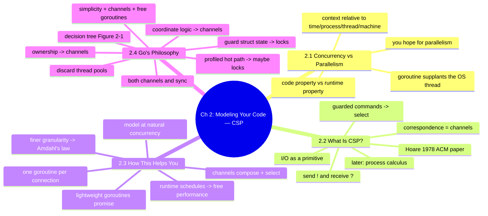
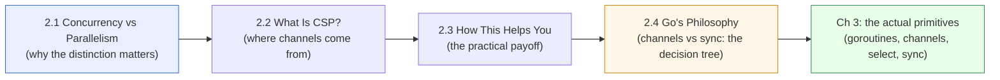

# Chapter 2 — Modeling Your Code: Communicating Sequential Processes

> Book: *Concurrency in Go* (Katherine Cox-Buday, O'Reilly 2017) · Chapter 2 · Pages ~23–35
> ⬅️ Prev chapter: [Ch 1 — Introduction to Concurrency](../ch01-introduction-to-concurrency/README.md) · ➡️ Next chapter: [Ch 3 — Go's Concurrency Building Blocks](../ch03-go-concurrency-building-blocks/README.md) · 🏠 [Book index](../README.md)

## 📖 Chapter Overview

Chapter 2 is the *conceptual foundation* for everything that follows: it explains **why** Go models concurrency the way it does before Chapter 3 shows **how** with concrete primitives. It opens by separating two ideas developers routinely conflate — **concurrency** (a property of how code is *structured*) from **parallelism** (a property of the *running program*) — and shows that you only ever write concurrent code that you *hope* runs in parallel, with the actual simultaneity decided by the runtime, OS, and hardware relative to a chosen *context*. It then traces Go's lineage to **Tony Hoare's 1978 paper, "Communicating Sequential Processes" (CSP)**, whose insight — that **input/output (communication) should be a first-class primitive** — directly inspired Go's channels (Hoare's `!`/`?` send/receive and "correspondence" map onto `ch <- v` / `<-ch`, and his guarded commands onto `select`). Next it makes the payoff practical ("How This Helps You"): goroutines let you model a problem at its **natural level of concurrency** (one goroutine per connection), the runtime multiplexes/schedules them for free, and **channels compose** where mutexes don't. It closes with Go's **philosophy** — Go ships *both* CSP channels and `sync` memory-access synchronization, and provides a **decision tree** (Figure 2-1) to choose between them — distilled to: *aim for simplicity, use channels when possible, and treat goroutines like a free resource.*

## 🧭 Chapter Mind Map

## 🗺️ How the pieces connect

## 📚 Mini-Chapters

| # | File | One-line summary |
|---|------|------------------|
| 2.1 | [Concurrency vs Parallelism](01-concurrency-vs-parallelism.md) | Concurrency is a property of the *code*; parallelism is a property of the *running program* — and correctness is relative to the chosen context. |
| 2.2 | [What Is CSP?](02-what-is-csp.md) | Hoare's 1978 "Communicating Sequential Processes" treats I/O as a first-class primitive (`!`/`?`, correspondence, guarded commands) — the root of Go's channels and `select`. |
| 2.3 | [How This Helps You](03-how-this-helps-you.md) | Goroutines let you model problems at their natural concurrency (a goroutine per connection); the runtime schedules them for free and channels compose where mutexes can't. |
| 2.4 | [Go's Philosophy on Concurrency](04-gos-philosophy-on-concurrency.md) | Go offers both channels and `sync`; a decision tree (Figure 2-1) picks between them — *aim for simplicity, use channels when possible, treat goroutines like a free resource.* |

## 🔑 Chapter-Level Takeaways

- **Concurrency ≠ parallelism.** You write concurrent code; the runtime grants parallelism relative to a context (time, process, thread, machine).
- **Go's channels descend from CSP.** Hoare's send/receive and correspondence became `ch <- v` / `<-ch`; guarded commands became `select`.
- **Natural mapping wins.** Modeling the problem as goroutines (one per connection) is simpler and lets the program scale to the host's parallelism for free.
- **Use both styles wisely.** Channels for transferring ownership and coordinating logic; `sync` for guarding a struct's internal state or a profiled hot path.
- **Philosophy in one line:** aim for simplicity, use channels when possible, and treat goroutines like a free resource.

## ✅ Verified Go programs for this chapter

All programs were written to `/tmp/cig/verify/ch2/`, run with Go 1.27, and pass `go vet`. Race-detector runs (`go run -race`) require cgo and a C compiler, which were unavailable in the verification environment; the two sync/ownership programs are race-free by construction and run cleanly without `-race`.

| Program | Mini-chapter | What it shows | Verification |
|---|---|---|---|
| `p1/main.go` | 2.1 | Same concurrent code under `GOMAXPROCS=1` vs `NumCPU` | `go run` ✅, `go vet` ✅ |
| `p2/main.go` | 2.2 | Hoare's `west → c → east` CSP pipeline via channels | `go run` ✅, `go vet` ✅ |
| `p3/main.go` | 2.3 | One goroutine per HTTP connection (`httptest`) | `go run` ✅, `go vet` ✅ |
| `p4a/main.go` | 2.4 | Mutex-guarded `Counter` (guard internal state) | `go run` ✅, `go vet` ✅ (race-free by construction) |
| `p4b/main.go` | 2.4 | Buffered channel ownership transfer | `go run` ✅, `go vet` ✅ (race-free by construction) |
| `p4c/main.go` | 2.4 | `select` composing two producers + timeout/cancel | `go run` ✅, `go vet` ✅ |

## 🔗 Chapter-Level References

- [Concurrency is not parallelism (go.dev/blog)](https://blog.golang.org/2013/01/concurrency-is-not-parallelism.html) — Rob Pike's canonical framing used throughout 2.1.
- [Bell Labs and CSP Threads — Russ Cox (swtch.com)](https://swtch.com/~rsc/thread/) — the CSP-to-Go lineage behind 2.2.
- [kat-co/concurrency-in-go-src](https://github.com/kat-co/concurrency-in-go-src) — the book's official source code for every chapter.
- [Go FAQ — CSP & "share memory by communicating"](https://go.dev/doc/faq#csp) — the philosophy quotes anchoring 2.4.
- [The Go Programming Language Specification](https://go.dev/ref/spec) — channels, `select`, and goroutines as language features.
