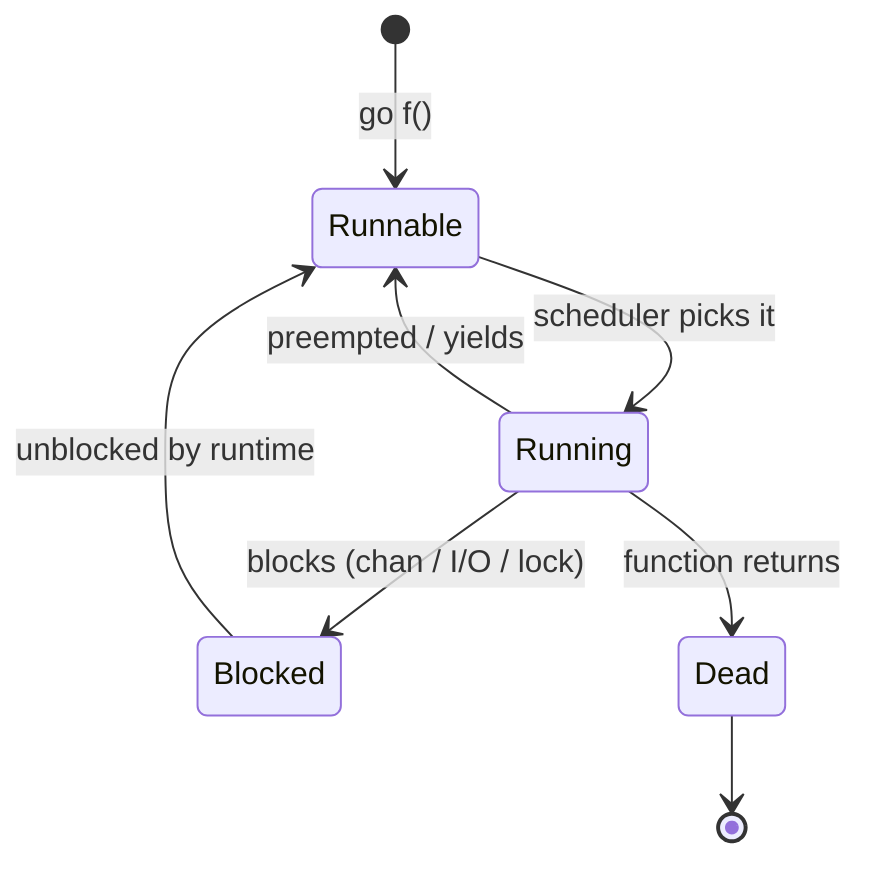
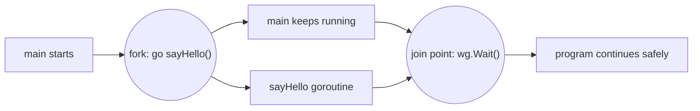
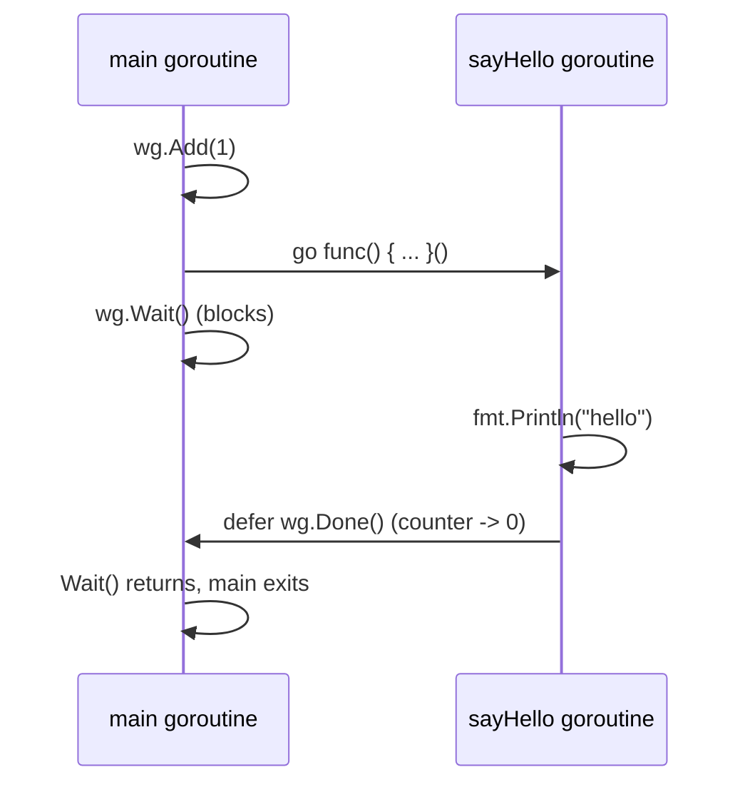
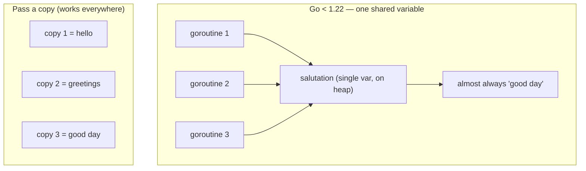

# Ch 3.1 — Goroutines: Basics & Closures

> Book: *Concurrency in Go* (Katherine Cox-Buday, O'Reilly 2017) · Chapter 3: Go's Concurrency Building Blocks · Pages ~37–42
> ⬅️ Prev: [Chapter 3 overview](README.md) · ➡️ Next: [Goroutines Under the Hood](02-goroutines-under-the-hood-mn-scheduler-fork-join-cost.md) · 🏠 [Book index](../README.md)

## 🎯 In One Paragraph

A **goroutine** is just a function running concurrently with the rest of your program; you start one by putting the `go` keyword in front of a function call. Every Go program already has one — the **main goroutine** — created automatically when the process starts. Goroutines are not OS threads and not quite "green threads"; the book classifies them as a special kind of **coroutine**: nonpreemptive concurrent subroutines whose suspend/resume points are managed *for you* by the Go runtime whenever they block. The `go` keyword performs a **fork** in Go's fork-join concurrency model, and you need an explicit **join point** (here, `sync.WaitGroup`) to guarantee the forked work actually runs and completes before the program moves on. Because goroutines share the same address space, closures launched as goroutines operate on the *original* variables they close over — which is powerful but introduces the classic loop-variable capture surprise (fixed by Go 1.22, but still worth understanding).

## 🧠 Key Concepts & Vocabulary

- **Goroutine** — a function scheduled to run concurrently (not necessarily in parallel) by the Go runtime. Started with `go f()`.
- **Main goroutine** — the implicit goroutine created when the process starts; when `main` returns, the process exits regardless of other goroutines still running.
- **Coroutine** — a concurrent subroutine that is *nonpreemptive*: it cannot be interrupted arbitrarily, only suspended/resumed at defined points. Goroutines are a *special class* of coroutine.
- **Implicitly managed suspension** — unlike classic coroutines, goroutines don't declare their own yield points; the runtime suspends a goroutine when it blocks and resumes it when it unblocks.
- **Fork** — splitting a child branch of execution off from its parent (the `go` statement).
- **Join / join point** — the place where a concurrent branch rejoins its parent. Without one, correctness is not guaranteed.
- **Closure** — an anonymous function that *closes over* (captures) variables from its enclosing lexical scope.
- **Shared address space** — goroutines run in the same memory space, so a closure mutates the *same* variable the parent sees.
- **Heap escape** — the compiler moves a captured variable to the heap when a goroutine may outlive the scope that declared it, so the goroutine never touches freed memory.

## 📚 Deep Dive

### Starting a goroutine — three equivalent forms

```go
// 1) Named function
go sayHello()

// 2) Anonymous function — must be invoked immediately with the trailing ()
go func() {
    fmt.Println("hello")
}()

// 3) Function stored in a variable, then launched
sayHello := func() { fmt.Println("hello") }
go sayHello()
```

That is genuinely *all* the syntax you need to begin. One keyword turns any function call into a concurrent block of logic.

### What a goroutine actually is

Goroutines are unique to Go. They are **not** OS threads and **not** exactly green threads (threads managed by a language runtime). They're **coroutines**: concurrent subroutines that are *nonpreemptive* — they can't be forcibly interrupted anywhere, only suspended and resumed at specific points. What makes Go's version special is its **deep integration with the runtime**: the runtime watches each goroutine's behavior and automatically suspends it when it blocks (e.g., on a channel or I/O) and resumes it when it unblocks. So goroutines behave *as if* preemptable, but historically only at blocking points.

> 🆕 Since Go 1.14, the scheduler is **asynchronously preemptible**: a goroutine stuck in a tight CPU loop with no function calls can still be preempted via signals. The book (2017) predates this, so its "nonpreemptive except at blocking points" description is now a simplification — see the next mini-chapter.



### The fork-join model

Go follows the **fork-join** concurrency model. *Fork*: at any point the program can split off a child branch to run concurrently with its parent. *Join*: at some future point those branches rejoin at a **join point**. The `go` statement is the fork; the goroutine is the forked branch.



### Why you need a join point (the race nobody sees)

```go
sayHello := func() { fmt.Println("hello") }
go sayHello()
// ... main returns here
```

As written, there is **no join point**, so it is *undetermined whether `sayHello` ever runs at all*. In practice `main` almost always exits before the goroutine is scheduled, so you usually see **no output**. A `time.Sleep` does *not* fix this — it only increases the *probability* the goroutine runs; it creates a race condition, not a guarantee. The correct fix is a real join point with `sync.WaitGroup`:

```go
package main

import (
	"fmt"
	"sync"
)

func sayHello() { fmt.Println("hello") }

func main() {
	var wg sync.WaitGroup
	wg.Add(1)
	go func() {
		defer wg.Done()
		sayHello()
	}()
	wg.Wait() // <-- the join point: deterministically blocks until sayHello finishes
}
```

```
hello
```

> `sync.WaitGroup` is covered in depth in [mini-chapter 03](03-sync-waitgroup.md). For now, know only that `Wait()` is the join point.

The handshake between main and the launched goroutine looks like this:



### Closures capture originals, not copies

Because goroutines share the parent's address space, a closure running in a goroutine mutates the *same* variable:

```go
var wg sync.WaitGroup
salutation := "hello"
wg.Add(1)
go func() {
	defer wg.Done()
	salutation = "welcome" // modifies the original
}()
wg.Wait()
fmt.Println(salutation) // welcome
```

Output: `welcome`. The goroutine and `main` see the same `salutation`.

### The loop-variable surprise

The book's famous example (note: analyzed under the book's 2017 Go version):

```go
var wg sync.WaitGroup
for _, salutation := range []string{"hello", "greetings", "good day"} {
	wg.Add(1)
	go func() {
		defer wg.Done()
		fmt.Println(salutation) // closes over the loop variable
	}()
}
wg.Wait()
```

On Go **< 1.22**, this typically prints:

```
good day
good day
good day
```

Why? There was a *single* `salutation` variable reused across iterations. The loop usually finishes before any goroutine runs, leaving `salutation` holding the last value, `"good day"`. The runtime is smart enough to notice the goroutines still reference `salutation`, so it **moves (escapes) the variable to the heap** instead of letting it be collected — that is why the goroutines don't crash reading freed memory. They just all read the same final value.

The book's fix: pass a **copy** into the closure as a parameter, shadowing the loop variable:

```go
var wg sync.WaitGroup
for _, salutation := range []string{"hello", "greetings", "good day"} {
	wg.Add(1)
	go func(salutation string) { // parameter = its own copy
		defer wg.Done()
		fmt.Println(salutation)
	}(salutation) // pass this iteration's value
}
wg.Wait()
```

Now each goroutine prints its own iteration's string (order still nondeterministic):

```
good day
hello
greetings
```



A complete, runnable program combining all three behaviors (and using a mutex so the result slices are race-free regardless of ordering):

```go
package main

import (
	"fmt"
	"sort"
	"sync"
)

func main() {
	// 1) shared address space: closure mutates the original
	var wg sync.WaitGroup
	salutation := "hello"
	wg.Add(1)
	go func() {
		defer wg.Done()
		salutation = "welcome"
	}()
	wg.Wait()
	fmt.Println("mutated:", salutation)

	// 2) loop capture — on Go >= 1.22 each iteration gets its own copy
	var wg2 sync.WaitGroup
	results := make([]string, 0, 3)
	var mu sync.Mutex
	for _, s := range []string{"hello", "greetings", "good day"} {
		wg2.Add(1)
		go func() {
			defer wg2.Done()
			mu.Lock()
			results = append(results, s)
			mu.Unlock()
		}()
	}
	wg2.Wait()
	sort.Strings(results)
	fmt.Println("captured (sorted):", results)

	// 3) explicit copy via parameter — correct on every Go version
	var wg3 sync.WaitGroup
	out := make([]string, 0, 3)
	var mu3 sync.Mutex
	for _, s := range []string{"hello", "greetings", "good day"} {
		wg3.Add(1)
		go func(salutation string) {
			defer wg3.Done()
			mu3.Lock()
			out = append(out, salutation)
			mu3.Unlock()
		}(s)
	}
	wg3.Wait()
	sort.Strings(out)
	fmt.Println("param copy (sorted):", out)
}
```

Verified output on Go 1.27:

```
mutated: welcome
captured (sorted): [good day greetings hello]
param copy (sorted): [good day greetings hello]
```

Note that with Go 1.22+ the `captured` slice contains all three distinct values — the historical "good day × 3" no longer happens.

## ⚠️ Pitfalls & Gotchas

- **No join point = no guarantee.** A bare `go f()` with nothing to wait on may never run before the program exits. `time.Sleep` is not a synchronization primitive; it hides races, it doesn't remove them.
- **Loop-variable capture (Go < 1.22).** Closing over a `range`/`for` loop variable in a goroutine captured the *shared* variable — almost always the last value. Fix by passing a copy, or upgrade to Go 1.22+.
- **Shared mutable state.** Because goroutines share the address space, concurrent reads/writes to the same variable are data races. Either synchronize (`sync.Mutex`) or share by communicating (channels).
- **Main exits first.** `main` returning kills every other goroutine immediately — no cleanup, no deferred functions in those goroutines run.
- **Capturing pointers / `&loopVar`.** Even with Go 1.22, taking the address of a value and aliasing it across iterations can still surprise you; be deliberate about what each goroutine owns.

## 🆕 Modern Go Notes

> [!NOTE] 🆕 Loop variable semantics changed in Go 1.22
> As of **Go 1.22**, `for` loops create a **new instance** of the loop variable each iteration. The book's "good day × 3" example now prints all three salutations without the parameter trick. Understanding the *old* behavior still matters: you'll read pre-1.22 code, and the mental model (closures capture variables, not values) is foundational.

> [!NOTE] 🆕 Asynchronous preemption (Go 1.14)
> The book says goroutines are only preemptible at blocking points. Since **Go 1.14** the runtime can preempt a goroutine even inside a tight CPU loop using OS signals, which fixed long-standing latency/GC-stall issues.

> [!TIP] 🆕 `sync.WaitGroup.Go` (Go 1.25)
> Go 1.25 added `wg.Go(func(){...})` which bundles `Add(1)` + `go` + `defer Done()`. The join-point examples above can be written more compactly — see [mini-chapter 03](03-sync-waitgroup.md).

## 🧪 Try It Yourself

1. Remove the `wg.Wait()` from the deterministic `sayHello` example and run it ~20 times. Count how often "hello" actually prints. (Expect: rarely.)
2. Replace `wg.Wait()` with `time.Sleep(time.Millisecond)` and observe that output becomes *likely* but still not guaranteed — then explain why that's worse than a WaitGroup.
3. Build the pre-1.22 loop example and run it under Go 1.22+. Confirm it prints all three values. Then add `GOEXPERIMENT=noloopvar`... (or reason about what the old compiler would have done).
4. Write a goroutine that captures a struct by value vs. by pointer and mutates a field. Predict and then verify what `main` sees in each case.

## ✅ Self-Check Questions

<details><summary>Q1: What is the minimal difference between a normal function call and a goroutine?</summary>
The `go` keyword in front of the call. `f()` runs synchronously; `go f()` schedules `f` to run concurrently and returns immediately.
</details>

<details><summary>Q2: Why might `go sayHello()` followed by the program ending print nothing?</summary>
There's no join point. `main` returns (and the process exits) before the scheduler ever runs the goroutine. The goroutine is created but never gets a chance to execute.
</details>

<details><summary>Q3: Does a closure in a goroutine operate on a copy or the original captured variable?</summary>
The original. Goroutines share the parent's address space, so mutations are visible to the parent (and vice versa) — which is also why you need synchronization.
</details>

<details><summary>Q4: On Go &lt; 1.22, why did the loop-salutation example print "good day" three times?</summary>
All three goroutines closed over the *same* single loop variable. The loop almost always finished before any goroutine ran, leaving that variable at the last value ("good day"), which the runtime had escaped to the heap so the goroutines could still read it.
</details>

<details><summary>Q5: How do you make the loop example correct without relying on Go 1.22?</summary>
Pass the current value as an argument to the closure (`go func(s string){...}(salutation)`) so each goroutine gets its own copy.
</details>

<details><summary>Q6: Why isn't time.Sleep a valid substitute for a join point?</summary>
It only raises the probability the goroutine runs in time; it provides no guarantee and introduces a race condition. A WaitGroup (or channel) deterministically blocks until the work is done.
</details>

## 🔑 Key Takeaways

- `go` + a function call = a goroutine. Anonymous funcs must be invoked immediately with `()`.
- Goroutines are runtime-managed coroutines, not OS threads; they suspend/resume automatically around blocking operations (and, since 1.14, can be asynchronously preempted).
- The `go` statement is a **fork**; you must add a **join point** (`WaitGroup`, channel, etc.) to guarantee correctness.
- Closures capture *variables*, not values, and goroutines share the address space — so synchronize shared state.
- The pre-1.22 loop-capture gotcha is fixed in Go 1.22, but the underlying model still matters for reading older code.

## 🔗 References & Further Reading

### 📝 Blogs / articles
- [Fixing For Loops in Go 1.22](https://go.dev/blog/loopvar-preview) — official go.dev blog explaining the loop-variable semantic change and why the closure example behaved the way it did.
- [Go internals: capturing loop variables in closures](https://eli.thegreenplace.net/2019/go-internals-capturing-loop-variables-in-closures/) — Eli Bendersky's deep dive into exactly *why* the old behavior happened (with a 2023 note on the 1.22 fix).
- [for Loop Semantic Changes in Go 1.22](https://go101.org/blog/2024-03-01-for-loop-semantic-changes-in-go-1.22.html) — go101's precise breakdown of which loops changed and which didn't.
- [Concurrency Trap #2: Incomplete Work](https://www.ardanlabs.com/blog/2019/04/concurrency-trap-2-incomplete-work.html) — Ardan Labs on why `main` doesn't wait for goroutines, i.e. the join-point problem.

### 💻 GitHub
- [golang/go — src/runtime/proc.go](https://github.com/golang/go/blob/master/src/runtime/proc.go) — the scheduler/goroutine lifecycle (`newproc`, `goexit`) implementation.
- [kat-co/concurrency-in-go-src](https://github.com/kat-co/concurrency-in-go-src) — the book's official source listings, including these goroutine examples.

### 📖 Official docs / specs
- [The Go Programming Language Specification — Go statements](https://go.dev/ref/spec#Go_statements) — the normative definition of what `go` does.
- [Effective Go — Goroutines](https://go.dev/doc/effective_go#goroutines) — the canonical introduction to goroutines and the fork model.
- [Go Wiki: LoopvarExperiment](https://go.dev/wiki/LoopvarExperiment) — details of the per-iteration loop variable change.
