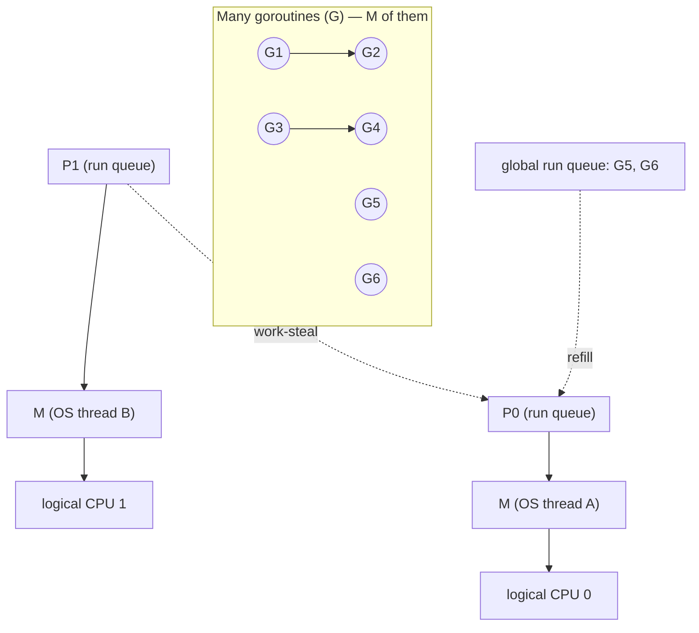
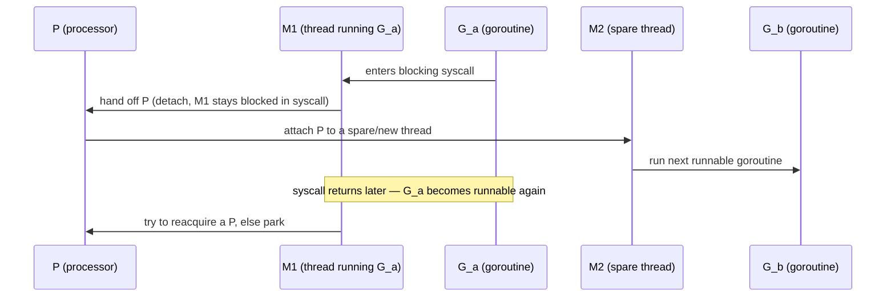
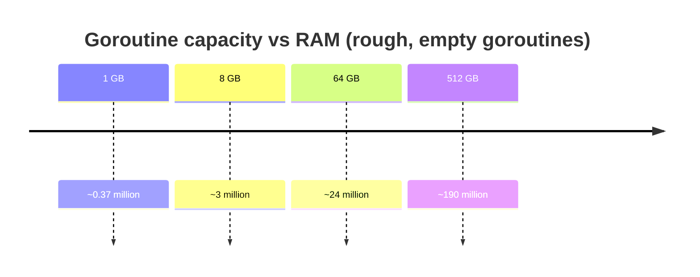
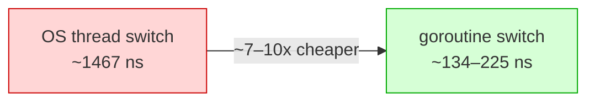

# Ch 3.2 — Goroutines Under the Hood: M:N Scheduler, Fork-Join, and Cost

> Book: *Concurrency in Go* (Katherine Cox-Buday, O'Reilly 2017) · Chapter 3: Go's Concurrency Building Blocks · Pages ~38–47
> ⬅️ Prev: [Goroutines Basics & Closures](01-goroutines-basics-and-closures.md) · ➡️ Next: [sync.WaitGroup](03-sync-waitgroup.md) · 🏠 [Book index](../README.md)

## 🎯 In One Paragraph

Goroutines are cheap because of *how Go runs them*. Instead of mapping one goroutine to one OS thread, Go uses an **M:N scheduler** that multiplexes *M* lightweight goroutines onto *N* OS threads, scheduling goroutines onto a small pool of "green threads" and transparently moving work off threads that block. Conceptually this implements the **fork-join** model from the previous chapter. The payoff is measurable: a goroutine starts with only a few kilobytes of stack (the book measures ~2.8 KB; empty goroutines grow/shrink their stack on demand), so you can realistically run **hundreds of thousands to millions** of them. And because the scheduler lives in **user space**, a context switch between goroutines is dramatically cheaper than an OS thread context switch — the book measures ~225 ns vs ~1,467 ns, roughly a 90% saving. The practical conclusion: create goroutines freely; only worry about their cost once you've *proven* they're the bottleneck.

## 🧠 Key Concepts & Vocabulary

- **M:N scheduler** — maps **M** green threads (goroutines' scheduling contexts) onto **N** OS threads. When goroutines outnumber threads, the scheduler distributes them and reschedules around blocking.
- **Green thread** — a thread-like execution context managed by the language runtime, not the OS kernel.
- **GMP model** — Go's concrete scheduler: **G** (goroutine), **M** (machine = OS thread), **P** (processor = scheduling context / run queue). The book calls it "M:N"; GMP is the implementation.
- **GOMAXPROCS** — the number of **P**s, i.e. how many goroutines can execute Go code *simultaneously*. Defaults to the number of logical CPUs.
- **Work stealing** — an idle P steals runnable goroutines from another P's run queue to keep cores busy.
- **Fork-join model** — `go` forks a branch; a join point later merges it back (see mini-chapter 01).
- **Stack growth** — a goroutine's stack starts tiny (~2 KB today) and the runtime grows/shrinks it automatically via copying.
- **Context switch** — saving one execution's state and loading another's. OS-thread switches save registers, memory maps, lookup tables; goroutine switches persist far less, in user space.
- **Goroutine leak** — an abandoned goroutine that never terminates; the GC does **not** collect running goroutines, so it lives until the process exits.

## 📚 Deep Dive

### The M:N scheduler and GMP

An OS can only schedule a limited number of threads efficiently. Go sidesteps this by putting its *own* scheduler in user space. The book describes it as **M:N**: *M* green threads mapped onto *N* OS threads, with goroutines scheduled onto the green threads. When a goroutine blocks (syscall, channel, lock), the scheduler can run a different goroutine on that thread — so blocking one goroutine doesn't waste a whole OS thread. The full mechanics are deferred to the book's Chapter 6; today the implementation is universally described as the **GMP** model:

- **G** — a goroutine (its stack, instruction pointer, and bookkeeping).
- **M** — an OS thread ("machine") that actually executes code.
- **P** — a logical processor holding a run queue of Gs; an M must hold a P to run Go code. The count of Ps = `GOMAXPROCS`.



How a blocking syscall is handled (why N threads, not one per goroutine):



### Fork-join, restated at the runtime level

The `go` statement is the **fork**; the runtime enqueues a new G. A join point (WaitGroup/channel) is where the parent waits for the child G to finish. The scheduler is free to run the child on any P/M, possibly in parallel if `GOMAXPROCS > 1`.

### Measuring a goroutine's memory footprint

Goroutines are "extraordinarily lightweight." The Go FAQ says a new goroutine gets *a few kilobytes*, and the runtime grows/shrinks the stack automatically. The book verifies this by exploiting two facts: (1) the GC does **not** collect a goroutine that is blocked forever, and (2) the runtime can introspect its own memory. Measure `runtime.MemStats.Sys` before and after spawning 10,000 goroutines that block permanently:

```go
package main

import (
	"fmt"
	"runtime"
	"sync"
)

func main() {
	memConsumed := func() uint64 {
		runtime.GC()
		var s runtime.MemStats
		runtime.ReadMemStats(&s)
		return s.Sys
	}

	var c <-chan any   // nil channel — receiving from it blocks forever
	var wg sync.WaitGroup
	noop := func() { wg.Done(); <-c } // signals it started, then blocks forever

	const numGoroutines = 1e4
	wg.Add(numGoroutines)
	before := memConsumed()
	for i := numGoroutines; i > 0; i-- {
		go noop()
	}
	wg.Wait()
	after := memConsumed()
	fmt.Printf("%.3fkb per goroutine\n", float64(after-before)/numGoroutines/1000)
}
```

The book reports **2.817 kb**. Verified on Go 1.27 this printed **3.573 kb** per goroutine — same order of magnitude; the exact number depends on Go version, OS, and how `Sys` accounts for runtime arenas, so treat it as "a few KB," not a constant.

> The `<-c` on a `nil` channel blocks forever, which is exactly how the example keeps the goroutines alive for measurement. In real code this would be a **goroutine leak** — the book addresses leak prevention in its Chapter 4.

Using "a few KB" per goroutine, the book extrapolates roughly how many fit in RAM (ignoring other processes and goroutine contents):

| Memory | Approx. goroutines | Order of magnitude |
|---|---|---|
| 2⁰ GB (1 GB) | ~372,000 | 10⁵ |
| 2³ GB (8 GB) | ~2.97 million | 10⁶ |
| 2⁹ GB (512 GB) | ~190 million | 10⁸–10⁹ |



The takeaway: on an 8 GB laptop you could *in theory* spin up millions of empty goroutines without swapping. Real goroutines use more (their stacks grow with call depth and captured data), but the point stands — they're tiny.

### Context switching: OS threads vs goroutines

Too many concurrent processes can waste all CPU time **context switching** — saving one context's state and loading another's — instead of doing work. At the OS level this is expensive: the kernel saves/restores registers, memory maps, and lookup tables. A **user-space** scheduler persists far less and only when needed, so it's much cheaper.

The book measures both. For **OS threads**, using Linux's `perf` pinned to one core:

```bash
taskset -c 0 perf bench sched pipe -T
# Total time: 2.935 sec over 1,000,000 pipe ops between two threads
# 2.935784 usecs/op
```

That measures a *round trip* (send **and** receive), so divide by two → **1.467 µs per context switch**.

For **goroutines**, an equivalent benchmark ping-pongs an empty `struct{}` between two goroutines on one CPU:

```go
package ctxswitch

import (
	"sync"
	"testing"
)

func BenchmarkContextSwitch(b *testing.B) {
	var wg sync.WaitGroup
	begin := make(chan struct{})
	c := make(chan struct{})

	var token struct{} // empty struct — zero bytes, so we time only the signal
	sender := func() {
		defer wg.Done()
		<-begin // don't count setup cost
		for i := 0; i < b.N; i++ {
			c <- token
		}
	}
	receiver := func() {
		defer wg.Done()
		<-begin
		for i := 0; i < b.N; i++ {
			<-c
		}
	}

	wg.Add(2)
	go sender()
	go receiver()
	b.StartTimer()
	close(begin) // release both goroutines at once
	wg.Wait()
}
```

Run pinned to one CPU like the thread benchmark:

```bash
go test -bench=. -cpu=1
```

The book reports **225 ns/op** (= 0.225 µs), about **92% faster** than the 1.467 µs OS-thread switch. Verified on Go 1.27 (default CPUs) this printed:

```
BenchmarkContextSwitch   8799330   134.4 ns/op
```

Even faster here — still firmly in the hundreds-of-nanoseconds range and far below an OS thread switch. Note `struct{}{}` (the **empty struct**) takes **zero bytes**, so the benchmark measures only the *signaling / scheduling* cost, not data copying.



The book's honest caveat: you can't name an exact goroutine count that becomes "too much" context switching, but the upper limit is high enough that switching cost is "unlikely to be any kind of barrier."

### Practical conclusion

Creating goroutines is very cheap — the FAQ notes CPU overhead averages about **three cheap instructions per function call**. So, per the book: only discuss a goroutine's cost *after* you've proven it's the root cause of a performance problem. More goroutines also means your program scales better across CPUs (bounded by Amdahl's law and how parallelizable your problem is).

## ⚠️ Pitfalls & Gotchas

- **Goroutine leaks.** The GC never reclaims a *running* (or forever-blocked) goroutine. A goroutine blocked on a channel that never receives, or in an infinite loop, lives until the process dies — leaking memory and sometimes other resources.
- **Footprint number is not a constant.** "~2.8 KB" is version/OS-specific. Stacks grow with recursion depth and captured state; a deeply-nested or data-heavy goroutine can use far more.
- **`GOMAXPROCS` ≠ goroutine count.** It bounds *parallelism* (simultaneous execution), not how many goroutines you can create. Millions of goroutines can share a handful of Ps.
- **Blocking syscalls cost a thread temporarily.** A goroutine in a blocking syscall detaches its P so other goroutines run, but the blocked M is tied up — spawning a vast number of goroutines all doing blocking syscalls can create many OS threads.
- **Benchmark isolation.** The context-switch benchmark deliberately starts the timer *after* goroutine setup and uses an empty struct to avoid measuring allocation/copy costs. Forgetting either inflates the number.

## 🆕 Modern Go Notes

> [!NOTE] 🆕 Stack size and the scheduler evolved
> The book's 2017 numbers predate several changes. Goroutine stacks have been as small as **2 KB** initial for years. **Go 1.14** added asynchronous preemption (goroutines no longer need to hit a function call to be preempted). The scheduler's work-stealing GMP design (Go 1.1+, Dmitry Vyukov) is the concrete form of the "M:N" description.

> [!TIP] 🆕 `GOMAXPROCS` is container-aware (Go 1.25)
> Historically `GOMAXPROCS` defaulted to all host CPUs even inside a CPU-limited container. **Go 1.25** makes the default respect the container's CPU quota (cgroup limits), avoiding over-subscription in Kubernetes-style environments.

> [!TIP] 🆕 Detecting leaks
> The book's "block forever" trick is a *deliberate* leak for measurement. In production, use [`uber-go/goleak`](https://github.com/uber-go/goleak) in tests to catch accidental leaks.

## 🧪 Try It Yourself

1. Run the memory-footprint program with `numGoroutines` of `1e3`, `1e4`, and `1e5`. Does the per-goroutine figure stabilize (law of large numbers)?
2. Run the context-switch benchmark with `-cpu=1` and then `-cpu=4`. Explain why more CPUs can change the number.
3. Set `GOMAXPROCS=1` via `runtime.GOMAXPROCS(1)` and spawn 100,000 goroutines that each do a little CPU work. Observe that they still all run (concurrency without parallelism).
4. Use `runtime.NumGoroutine()` before/after spawning and after a join point to watch goroutines appear and disappear.

## ✅ Self-Check Questions

<details><summary>Q1: What does "M:N scheduler" mean, and what are G, M, and P?</summary>
M goroutines are multiplexed onto N OS threads. In Go's GMP implementation: G = goroutine, M = OS thread ("machine"), P = logical processor holding a run queue. An M needs a P to execute Go code; the number of Ps is GOMAXPROCS.
</details>

<details><summary>Q2: Why doesn't a blocking goroutine waste an entire OS thread?</summary>
When a goroutine blocks, the scheduler can detach its P and run other runnable goroutines on another thread, so the core keeps doing useful work instead of sitting idle behind the blocked goroutine.
</details>

<details><summary>Q3: Roughly how much memory does an empty goroutine use, and why is the exact number fuzzy?</summary>
A few kilobytes (book: ~2.8 KB; measured ~3.6 KB on Go 1.27). It's fuzzy because stacks grow/shrink on demand and `MemStats.Sys` accounts for runtime arenas, so the figure varies by version, OS, and workload.
</details>

<details><summary>Q4: Why divide the perf pipe result by two but not the Go benchmark?</summary>
`perf bench sched pipe` measures a full round trip (send + receive = two switches), so you halve it to get one switch. The Go benchmark's `b.N` already counts individual send/receive operations, giving per-switch cost directly.
</details>

<details><summary>Q5: Why is a user-space (goroutine) context switch cheaper than an OS-thread switch?</summary>
The runtime controls what, how, and when state is persisted, so it saves far less than the kernel must (no full register/memory-map/lookup-table save-restore) and does it in user space without a kernel trap.
</details>

<details><summary>Q6: Does GOMAXPROCS limit how many goroutines you can create?</summary>
No. It limits how many goroutines can execute Go code *simultaneously* (parallelism). You can create millions of goroutines regardless; they share the Ps cooperatively.
</details>

## 🔑 Key Takeaways

- Go multiplexes goroutines onto threads with an **M:N (GMP)** user-space scheduler, rescheduling around blocking so threads stay busy.
- Goroutines are tiny — a few KB each, with stacks that grow/shrink — so hundreds of thousands to millions are practical.
- Goroutine context switches (~134–225 ns) are an order of magnitude cheaper than OS-thread switches (~1.5 µs).
- The GC never collects a running/blocked goroutine; abandoned goroutines **leak**.
- Create goroutines freely; measure before worrying about their cost.

## 🔗 References & Further Reading

### 📝 Blogs / articles
- [Go's Goroutine Scheduler Internals: The M:N Model, Work Stealing, and GOMAXPROCS Myths](https://www.javacodegeeks.com/2026/10/gos-goroutine-scheduler-internals-the-mn-model-work-stealing-and-the-gomaxprocs-myths-that-wont-die.html) — modern, detailed walk-through of GMP and GOMAXPROCS misconceptions.
- [The Go scheduler explained — deep dive into the GMP model](https://medium.com/@priyankaguha.2012/the-go-scheduler-explained-deep-dive-into-the-g-m-p-concurrency-model-dfaf40a7508c) — diagram-heavy explanation of G/M/P and user-space scheduling.
- [Go Goroutines vs Java Virtual Threads: Memory & Concurrency Overhead](https://dev.to/devanshu_patil/go-goroutines-vs-java-virtual-threads-memory-models-and-concurrency-overhead-8pa) — comparative numbers on goroutine stack size and switching cost.
- [Concurrency Trap #2: Incomplete Work](https://www.ardanlabs.com/blog/2019/04/concurrency-trap-2-incomplete-work.html) — Ardan Labs on main not waiting for goroutines and the leak implications.

### 💻 GitHub
- [golang/go — src/runtime/proc.go](https://github.com/golang/go/blob/master/src/runtime/proc.go) — the scheduler itself: `schedule`, `findrunnable`, work stealing, GMP structures.
- [uber-go/goleak](https://github.com/uber-go/goleak) — a test helper that fails tests leaking goroutines, the production-grade complement to the book's "block forever" trick.

### 📖 Official docs / specs
- [Go FAQ — Why goroutines instead of threads?](https://go.dev/doc/faq#goroutines) — source of the "few kilobytes / three cheap instructions" quote the book cites.
- [runtime package — MemStats / NumGoroutine](https://pkg.go.dev/runtime#MemStats) — the introspection APIs used in the footprint measurement.
- [Go 1.25 release notes — container-aware GOMAXPROCS](https://go.dev/doc/go1.25#runtime) — the modern default that respects cgroup CPU limits.
