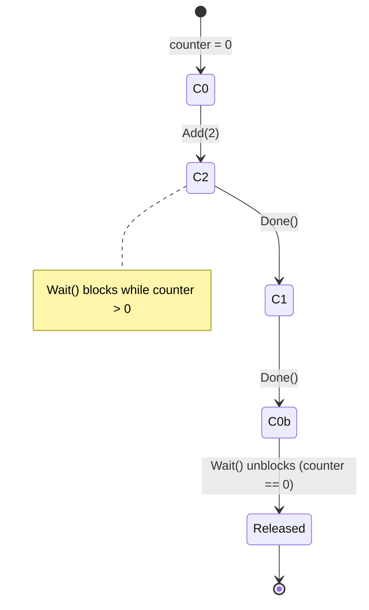
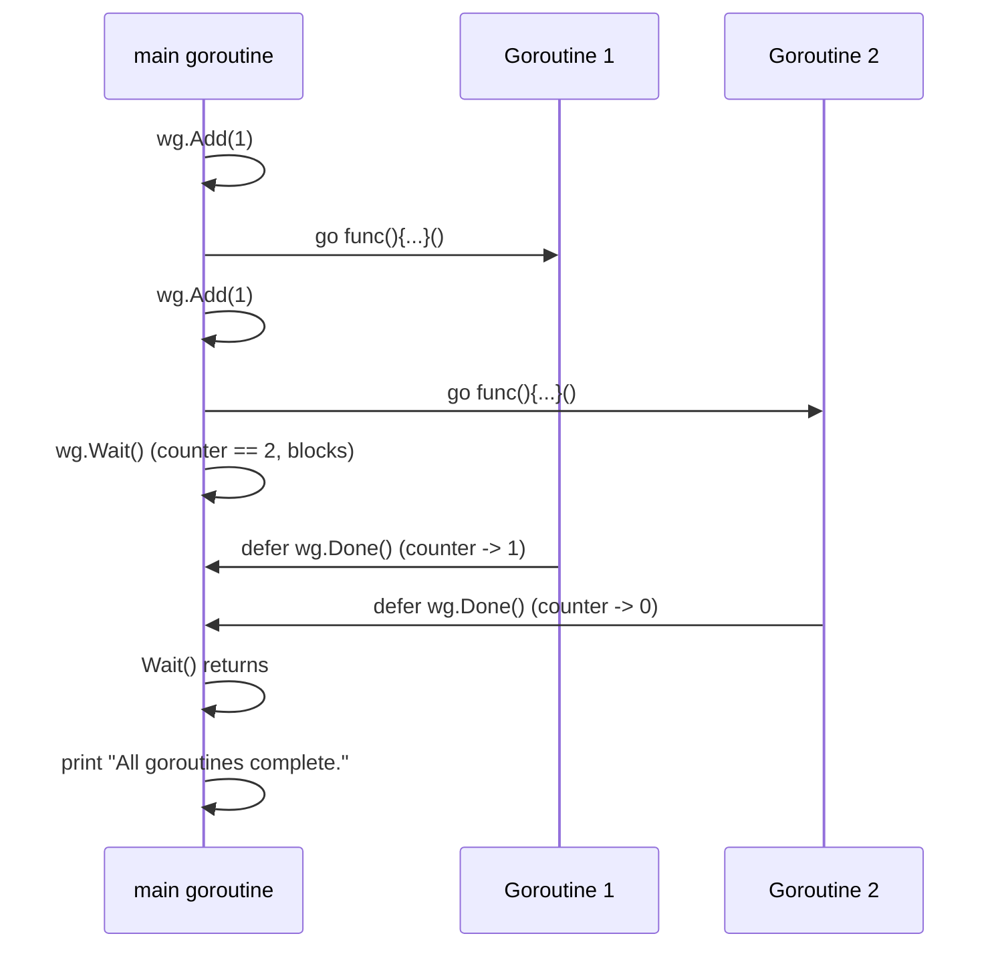
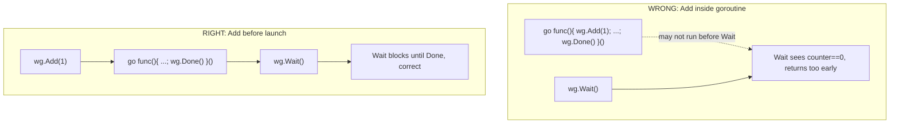

# Ch 3.3 — sync.WaitGroup

> Book: *Concurrency in Go* (Katherine Cox-Buday, O'Reilly 2017) · Chapter 3: Go's Concurrency Building Blocks · Pages ~47–49
> ⬅️ Prev: [Goroutines Under the Hood](02-goroutines-under-the-hood-mn-scheduler-fork-join-cost.md) · ➡️ Next: [Mutex & RWMutex](04-mutex-and-rwmutex.md) · 🏠 [Book index](../README.md)

## 🎯 In One Paragraph

`sync.WaitGroup` is the simplest way to **wait for a set of goroutines to finish** when you don't care about their individual results (or you collect those results some other way). Mentally it's a **concurrent-safe counter**: `Add(n)` raises the counter by `n`, each `Done()` lowers it by one, and `Wait()` blocks until the counter hits zero. The single most important rule is **where you call `Add`**: it must happen *before* the goroutine it tracks could possibly race with `Wait` — in practice, call `Add` in the launching goroutine (often right before `go`, or in bulk before a loop), never inside the goroutine you're tracking. `WaitGroup` is the concrete **join point** used throughout Chapter 3. If you *do* need results or error handling per goroutine, the book steers you toward channels + `select` instead (and today, `errgroup`).

## 🧠 Key Concepts & Vocabulary

- **`WaitGroup`** — a counting semaphore for "wait until this group of goroutines is done."
- **`Add(delta int)`** — add `delta` (usually 1, or a bulk count) to the counter. May be negative, but that's rare.
- **`Done()`** — decrement the counter by one; equivalent to `Add(-1)`. Call it with `defer` inside the goroutine.
- **`Wait()`** — block the calling goroutine until the counter reaches zero.
- **Join point** — the synchronization boundary; `Wait()` is one.
- **The Add-before-launch rule** — `Add` must be called from code guaranteed to run before `Wait`, i.e. not inside the tracked goroutine.
- **Zero value is usable** — `var wg sync.WaitGroup` is ready to use; no constructor needed. Do **not** copy a `WaitGroup` after first use.

## 📚 Deep Dive

### The counter model



- `Add(n)` → counter += n
- `Done()` → counter -= 1
- `Wait()` → blocks until counter == 0

If the counter ever goes **negative**, `WaitGroup` panics ("negative WaitGroup counter") — that's a sign of too many `Done()`s or a missing `Add`.

### Basic usage

```go
package main

import (
	"fmt"
	"sync"
	"time"
)

func main() {
	var wg sync.WaitGroup

	wg.Add(1) // one goroutine is beginning
	go func() {
		defer wg.Done() // signal completion even if we panic
		fmt.Println("1st goroutine sleeping...")
		time.Sleep(1 * time.Millisecond)
	}()

	wg.Add(1)
	go func() {
		defer wg.Done()
		fmt.Println("2nd goroutine sleeping...")
		time.Sleep(2 * time.Millisecond)
	}()

	wg.Wait() // block main until both Done()s bring the counter to 0
	fmt.Println("All goroutines complete.")
}
```

Verified output (the two "sleeping" lines appear in nondeterministic order; the final line is always last):

```
2nd goroutine sleeping...
1st goroutine sleeping...
All goroutines complete.
```

> The book notes `time.Sleep(1)` sleeps **1 nanosecond** (the arg is a `time.Duration`), which is effectively nothing. The example only demonstrates `WaitGroup`, not timing. The runnable version above uses explicit milliseconds for clarity.

Interaction diagram:



### Why `Add` must live outside the tracked goroutine

This is the central correctness rule. We have **no guarantee** when a goroutine is scheduled (see mini-chapter 01). If you put `Add(1)` *inside* the goroutine's closure, `main` could reach `Wait()` *before* any goroutine has run its `Add` — so the counter is still 0, `Wait()` returns immediately, and `main` proceeds (or exits) before the work happens. That's a race condition.



Customary practice: couple `Add` as closely as possible to the goroutine it tracks — *but on the launching side*.

### Bulk `Add` before a loop

When launching a known number of goroutines, call `Add` once with the total before the loop:

```go
package main

import (
	"fmt"
	"sync"
)

func main() {
	hello := func(wg *sync.WaitGroup, id int) {
		defer wg.Done()
		fmt.Printf("Hello from %v!\n", id)
	}

	const numGreeters = 5
	var wg sync.WaitGroup
	wg.Add(numGreeters) // add the whole group at once
	for i := 0; i < numGreeters; i++ {
		go hello(&wg, i+1)
	}
	wg.Wait()
}
```

Verified output (order nondeterministic):

```
Hello from 5!
Hello from 4!
Hello from 3!
Hello from 2!
Hello from 1!
```

> Pass the `WaitGroup` by **pointer** (`*sync.WaitGroup`) to functions. Copying a `WaitGroup` makes a separate counter and breaks the synchronization. In the inline-closure form you can rely on closure capture instead.

### When *not* to use a WaitGroup

`WaitGroup` is ideal when you don't need per-goroutine results or error handling. If you do, the book recommends **channels + `select`** (covered later in Chapter 3). WaitGroup gives you a single "everyone's done" signal — nothing more.

## ⚠️ Pitfalls & Gotchas

- **`Add` inside the goroutine.** The number-one bug: `Wait` can return before the goroutine even ran its `Add`. Always `Add` on the launching side.
- **Negative counter panic.** More `Done()` than `Add`, or a stray `Add(-1)`, panics with "sync: negative WaitGroup counter".
- **Forgetting `Done` on an error path.** If a goroutine can `return` early, use `defer wg.Done()` at the top so it always fires — otherwise `Wait()` blocks forever (deadlock).
- **Copying a WaitGroup.** `sync.WaitGroup` must not be copied after first use; pass it by pointer. `go vet` catches many of these.
- **Reusing a WaitGroup too early.** You may reuse a WaitGroup, but only after a previous `Wait()` has fully returned; calling `Add` with a positive delta concurrently with `Wait` is a race.
- **Using WaitGroup when you need results.** It carries no data and no error. Reach for channels or `errgroup` instead.

## 🆕 Modern Go Notes

> [!TIP] 🆕 `WaitGroup.Go` (Go 1.25)
> Go 1.25 added a method that fuses `Add(1)`, `go`, and `defer Done()` into one call, eliminating the most common WaitGroup bug class:
> ```go
> var wg sync.WaitGroup
> for i := 0; i < 5; i++ {
>     id := i + 1
>     wg.Go(func() {
>         fmt.Printf("Hello from %v!\n", id)
>     })
> }
> wg.Wait()
> ```
> `wg.Go(f)` runs `f` in a new goroutine and calls `Done` when it returns — you can never forget `Add`/`Done` or misplace them.

> [!TIP] 🆕 `errgroup` when goroutines can fail
> [`golang.org/x/sync/errgroup`](https://pkg.go.dev/golang.org/x/sync/errgroup) is a WaitGroup that also **propagates the first error** and (with a `context`) **cancels the rest**. Use it whenever your goroutines return errors. `g.SetLimit(n)` even bounds concurrency for worker-pool patterns. This is the book's "use channels + select for results" advice packaged as a library.

## 🧪 Try It Yourself

1. Move `wg.Add(1)` *inside* the goroutine in the basic example and run it many times. Observe "All goroutines complete." sometimes printing with missing/garbled "sleeping" lines — the race.
2. Delete one `defer wg.Done()` and watch the program deadlock (`fatal error: all goroutines are asleep - deadlock!`).
3. Rewrite the bulk example using Go 1.25's `wg.Go`. Confirm identical output with less code.
4. Convert the greeter example to `errgroup` where `hello` returns an `error` for `id == 3`; print the returned error.

## ✅ Self-Check Questions

<details><summary>Q1: What three operations make up a WaitGroup and what do they do?</summary>
`Add(n)` increments the counter by n; `Done()` decrements it by one; `Wait()` blocks until the counter is zero.
</details>

<details><summary>Q2: Why must Add be called before launching (not inside) the tracked goroutine?</summary>
Goroutine scheduling isn't guaranteed. If Add runs inside the goroutine, main may reach Wait before the goroutine runs Add, see counter 0, and return immediately — a race where Wait doesn't actually wait.
</details>

<details><summary>Q3: What happens if Done is called more times than Add?</summary>
The counter goes negative and the program panics with "sync: negative WaitGroup counter".
</details>

<details><summary>Q4: Why pass *sync.WaitGroup by pointer to helper functions?</summary>
A WaitGroup must not be copied after use; copying creates an independent counter, so Done on the copy doesn't affect the original and Wait never unblocks. Pass a pointer so all parties share one counter.
</details>

<details><summary>Q5: When should you reach for channels/errgroup instead of a bare WaitGroup?</summary>
When you need the goroutines' results or error handling/cancellation. WaitGroup only signals completion; it carries no values or errors.
</details>

<details><summary>Q6: What does Go 1.25's wg.Go(f) do, and which bug does it prevent?</summary>
It launches f in a new goroutine and automatically calls Done when f returns, internally doing the Add(1) too. It prevents forgetting/misplacing Add and Done (e.g., Add inside the goroutine, or a missing Done on an error path).
</details>

## 🔑 Key Takeaways

- `WaitGroup` is a concurrent-safe counter: `Add` up, `Done` down, `Wait` blocks at zero.
- Always call `Add` on the launching side, before the goroutine can race with `Wait`.
- Use `defer wg.Done()` so completion is signaled even on panic/early return.
- Pass WaitGroups by pointer; never copy them after use.
- Prefer channels/`errgroup` when you need results or error handling; prefer Go 1.25's `wg.Go` to avoid the classic Add/Done mistakes.

## 🔗 References & Further Reading

### 📝 Blogs / articles
- [Golang sync.WaitGroup: Powerful, but tricky](https://wundergraph.com/blog/golang-wait-groups) — the common pitfalls (Add placement, copying) plus the new `wg.Go` and when `errgroup` wins.
- [Go WaitGroup.Go in 1.25: When I Still Reach for errgroup](https://dev.to/abyzgenic/go-waitgroupgo-in-125-when-i-still-reach-for-errgroup-43e9) — practical comparison of `wg.Go` vs `errgroup`.
- [Worker Pools in Go: Bounded Concurrency with errgroup](https://webdevstation.com/posts/worker-pools-in-go-with-errgroup/) — using `errgroup.SetLimit` for results + error propagation, the "WaitGroup but with results" story.
- [Golang WaitGroup — Add, Done, Wait, examples, pitfalls](https://www.golinuxcloud.com/golang-waitgroup/) — the counter model and loop patterns with worked examples.

### 💻 GitHub
- [golang/go — src/sync/waitgroup.go](https://github.com/golang/go/blob/master/src/sync/waitgroup.go) — the actual implementation; see how the counter and waiter count pack into state and how `Wait` parks goroutines.
- [golang/sync — errgroup/errgroup.go](https://github.com/golang/sync/blob/master/errgroup/errgroup.go) — the canonical "WaitGroup with error + cancellation" used across the ecosystem.

### 📖 Official docs / specs
- [sync package — WaitGroup](https://pkg.go.dev/sync#WaitGroup) — the authoritative API, including the "do not copy" and `Go` (1.25) notes.
- [golang.org/x/sync/errgroup](https://pkg.go.dev/golang.org/x/sync/errgroup) — errgroup docs with `Group`, `WithContext`, and `SetLimit`.
- [The Go Memory Model](https://go.dev/ref/mem) — explains the happens-before guarantees that make `Wait` observe the goroutines' writes.
