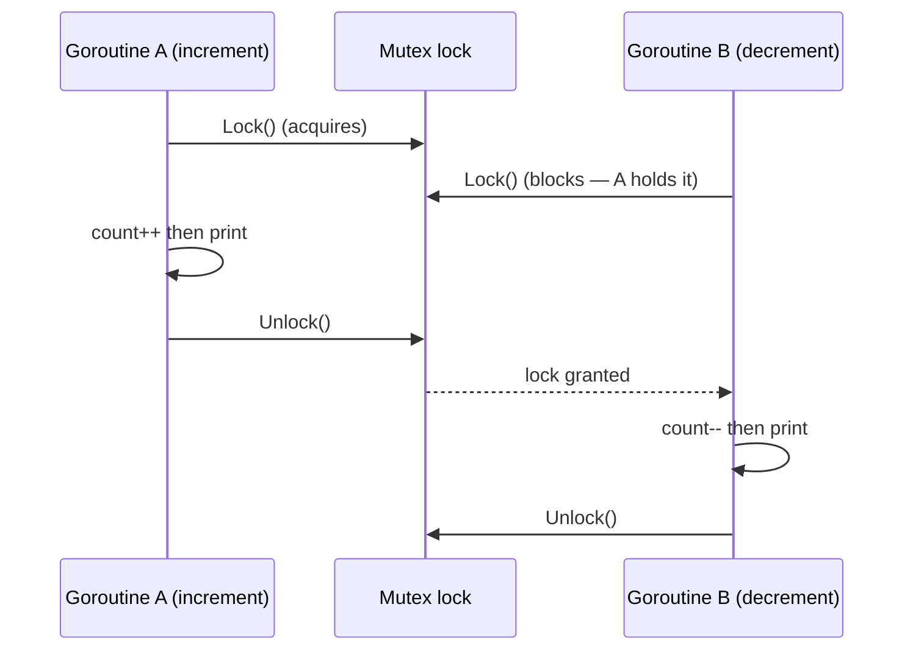
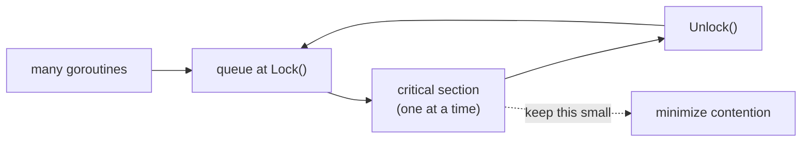
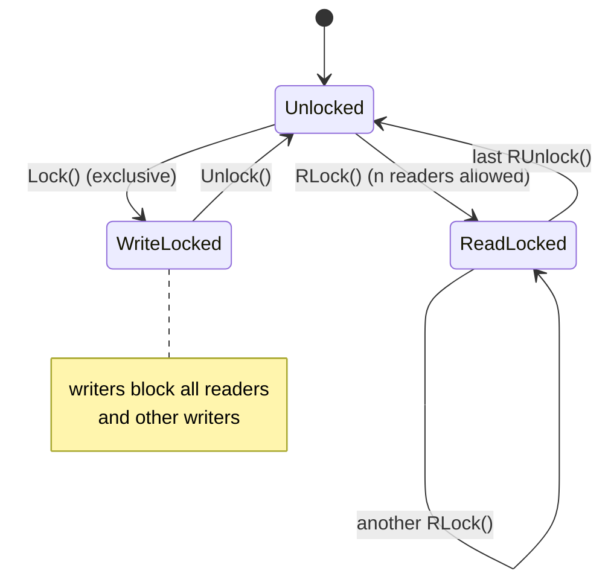

# Ch 3.4 — Mutex and RWMutex

> Book: *Concurrency in Go* (Katherine Cox-Buday, O'Reilly 2017) · Chapter 3: Go's Concurrency Building Blocks · Pages ~49–52
> ⬅️ Prev: [sync.WaitGroup](03-sync-waitgroup.md) · ➡️ Next: [sync.Cond](05-cond.md) · 🏠 [Book index](../README.md)

## 🎯 In One Paragraph

A **`sync.Mutex`** ("mutual exclusion") guards a **critical section** — code that needs exclusive access to a shared resource — so only one goroutine touches that memory at a time. You `Lock()` before entering and `Unlock()` after, and the idiomatic pattern is `defer lock.Unlock()` so the lock is always released, even on panic. Where channels "share memory by communicating," a Mutex "shares memory by communicating a *convention*" developers must follow. Because entering/leaving a critical section has a cost, keep critical sections small. When many goroutines only *read* shared memory and few *write* it, upgrade to **`sync.RWMutex`**, which lets any number of readers hold the lock simultaneously as long as no writer holds it — reducing contention. The book's benchmark shows RWMutex starts to pay off around 2¹³ (~8,000) concurrent readers; the general advice is to prefer `RWMutex` over `Mutex` whenever the read/write split logically applies.

## 🧠 Key Concepts & Vocabulary

- **Mutex (mutual exclusion)** — a lock ensuring only one goroutine is in the critical section at a time.
- **Critical section** — a region of code needing exclusive access to a shared resource; it's a bottleneck, so keep it short.
- **`Lock()` / `Unlock()`** — acquire / release exclusive ownership. Always pair; always `defer Unlock`.
- **`RWMutex` (reader/writer mutex)** — allows *many concurrent readers* OR *one exclusive writer*.
- **`RLock()` / `RUnlock()`** — acquire / release a *read* (shared) lock.
- **`sync.Locker`** — the interface `{ Lock(); Unlock() }` satisfied by both `*Mutex` and `*RWMutex`; `RWMutex.RLocker()` returns a `Locker` whose `Lock/Unlock` are really `RLock/RUnlock`.
- **Share memory by communicating convention** — a Mutex doesn't physically prevent access; it's a discipline the whole codebase must honor.
- **Cross-section of the critical section** — how much work/contention the lock covers; reducing it (e.g., read locks) reduces contention.
- **Non-reentrant** — Go mutexes are not recursive; locking twice from the same goroutine deadlocks.

## 📚 Deep Dive

### Mutex: guarding a shared counter

Two sets of goroutines increment and decrement a shared `count`; the Mutex serializes access:

```go
package main

import (
	"fmt"
	"sync"
)

func main() {
	var count int
	var lock sync.Mutex

	increment := func() {
		lock.Lock()         // request exclusive access to the critical section
		defer lock.Unlock() // always release, even on panic
		count++
		fmt.Printf("Incrementing: %d\n", count)
	}
	decrement := func() {
		lock.Lock()
		defer lock.Unlock()
		count--
		fmt.Printf("Decrementing: %d\n", count)
	}

	var arithmetic sync.WaitGroup
	for i := 0; i <= 5; i++ {
		arithmetic.Add(1)
		go func() { defer arithmetic.Done(); increment() }()
	}
	for i := 0; i <= 5; i++ {
		arithmetic.Add(1)
		go func() { defer arithmetic.Done(); decrement() }()
	}
	arithmetic.Wait()
	fmt.Println("Arithmetic complete. Final count:", count)
}
```

The per-line order is nondeterministic (goroutines interleave), but because 6 increments and 6 decrements run, the **final count is deterministically 0**. Verified sample:

```
Incrementing: 1
Decrementing: 0
...
Arithmetic complete. Final count: 0
```

Without the Mutex, `count++`/`count--` are read-modify-write races and the final value would be nondeterministic. (That version would be flagged by `go run -race`; this environment lacks a C compiler so `-race` couldn't run here, but the Mutex version is race-free by construction.)



### Why `defer Unlock`

Always release inside a `defer`:

```go
lock.Lock()
defer lock.Unlock()
// ... critical section; safe even if this panics
```

If you forget, or an early `return`/panic skips the `Unlock`, the lock is never released and the next `Lock()` blocks forever → **deadlock**. Entering/exiting a critical section is "somewhat expensive," so minimize time spent inside it — a lock is a bottleneck by definition.



### RWMutex: many readers, one writer

If most goroutines only read, a full Mutex over-serializes them. `RWMutex` lets **any number of readers** hold the lock at once *provided no writer holds it*; a writer needs exclusive access. This "reduces the cross-section" of the critical section.



The book's benchmark compares a *less active* producer (occasional writer) against *many* observer readers, timing both a shared `RWMutex` read-lock path and a plain `Mutex` path. It uses the `sync.Locker` interface so the same `producer`/`observer` functions work with either lock type, and `m.RLocker()` to pass the read side as a `Locker`:

```go
package main

import (
	"fmt"
	"math"
	"os"
	"sync"
	"text/tabwriter"
	"time"
)

func main() {
	producer := func(wg *sync.WaitGroup, l sync.Locker) {
		defer wg.Done()
		for i := 5; i > 0; i-- {
			l.Lock()
			l.Unlock()
			time.Sleep(1 * time.Microsecond) // make the producer less active than observers
		}
	}
	observer := func(wg *sync.WaitGroup, l sync.Locker) {
		defer wg.Done()
		l.Lock()
		defer l.Unlock()
	}
	test := func(count int, mutex, rwMutex sync.Locker) time.Duration {
		var wg sync.WaitGroup
		wg.Add(count + 1)
		begin := time.Now()
		go producer(&wg, mutex)
		for i := count; i > 0; i-- {
			go observer(&wg, rwMutex)
		}
		wg.Wait()
		return time.Since(begin)
	}

	tw := tabwriter.NewWriter(os.Stdout, 0, 1, 2, ' ', 0)
	defer tw.Flush()

	var m sync.RWMutex
	fmt.Fprintf(tw, "Readers\tRWMutex\tMutex\n")
	for i := 0; i < 15; i++ {
		count := int(math.Pow(2, float64(i)))
		fmt.Fprintf(tw, "%d\t%v\t%v\n",
			count,
			test(count, &m, m.RLocker()), // observers use the read lock
			test(count, &m, &m),          // observers use the full mutex
		)
	}
}
```

Note the two columns: in the first, observers take `m.RLocker()` (a read lock); in the second, observers take `&m` (the exclusive lock). The book runs up to 2¹⁹ readers and finds RWMutex only *reliably* wins past ~2¹³ readers. Verified sample (Go 1.27, timings vary run-to-run and at low counts noise dominates):

```
Readers  RWMutex     Mutex
1        60.29µs     1.087346ms
2        24.697µs    35.353µs
...
8192     2.472034ms  2.124693ms
16384    5.317885ms  6.488396ms
```

At small reader counts the numbers are noisy and can even favor `Mutex`; the RWMutex advantage emerges as reader concurrency grows. The practical rule: **use `RWMutex` when the read/write asymmetry logically applies** (many readers, rare writers), but don't assume it's always faster — measure for your workload.

## ⚠️ Pitfalls & Gotchas

- **Forgetting `Unlock`.** The commonest deadlock. Use `defer lock.Unlock()` right after `Lock()`.
- **Non-reentrancy.** Go mutexes are not recursive. Locking the same mutex twice in the same goroutine (e.g., a locked method calling another locked method) deadlocks. Restructure so the lock is acquired once.
- **Copying a locked mutex.** `sync.Mutex`/`RWMutex` must not be copied after use. Embed them by value and pass the *struct* by pointer, or `go vet` will complain.
- **RWMutex writer starvation / reader re-entrancy.** Go's `RWMutex` is writer-preferring: once a writer is waiting, new `RLock` calls block. A goroutine that holds an `RLock` and tries to `RLock` again *while a writer waits* can deadlock. Don't nest read locks.
- **Over-synchronizing.** Guarding too much code (a large critical section) kills throughput. Shrink the critical section; copy data out and release the lock before expensive work.
- **Assuming RWMutex is always faster.** For low contention or very short critical sections, a plain `Mutex` can be faster (RWMutex has more bookkeeping). The book's benchmark shows the crossover is around thousands of concurrent readers.

## 🆕 Modern Go Notes

> [!NOTE] 🆕 `TryLock` / `TryRLock` (Go 1.18)
> Go 1.18 added `Mutex.TryLock`, `RWMutex.TryLock`, and `RWMutex.TryRLock`, which attempt to acquire without blocking and return a bool. The docs warn their use is *rare* (often a design smell), but they're handy for "skip if busy" fast paths.

> [!NOTE] 🆕 Mutex internals: normal vs starvation mode (Go 1.9+)
> Since Go 1.9 the mutex has two modes. In **normal mode** waiters queue FIFO but a newly-arriving goroutine (already running on-CPU) can barge in and grab the lock — fast, but risks starving queued waiters. If a waiter fails to acquire for **>1 ms**, the mutex flips to **starvation mode**, where ownership is handed directly to the front of the queue, guaranteeing fairness. This is why real-world lock latency has a long tail.

> [!TIP] 🆕 Consider `sync/atomic` or channels first
> For a single counter like the book's example, `atomic.Int64` (Go 1.19 typed atomics) is lock-free and faster. The `sync` docs themselves say most primitives here are for low-level library code; higher-level coordination is "better done via channels."

## 🧪 Try It Yourself

1. Remove the Mutex from the increment/decrement program and run it 50 times, printing only the final count. Observe nondeterministic results (and run `go vet`/`-race` if you have a C compiler).
2. Replace the shared counter with `atomic.Int64` and compare code simplicity and speed.
3. In the RWMutex benchmark, make the producer *more* active (remove the sleep). Watch the RWMutex advantage shrink or vanish.
4. Write a method `(*Counter).IncTwice()` that calls a locked `Inc()` twice under the same held lock — observe the deadlock, then fix it.

## ✅ Self-Check Questions

<details><summary>Q1: What is a critical section and what does a Mutex guarantee about it?</summary>
A critical section is code needing exclusive access to a shared resource. A Mutex guarantees at most one goroutine executes inside the guarded section at a time.
</details>

<details><summary>Q2: Why is `defer lock.Unlock()` idiomatic?</summary>
It guarantees the lock is released no matter how the function exits — normal return, early return, or panic — preventing deadlocks from a forgotten Unlock.
</details>

<details><summary>Q3: How does RWMutex differ from Mutex?</summary>
RWMutex distinguishes read and write locks: any number of readers can hold the lock simultaneously (RLock), but a writer (Lock) needs exclusive access. Mutex is always exclusive.
</details>

<details><summary>Q4: Around what scale did the book's benchmark show RWMutex beginning to pay off, and why isn't it always faster?</summary>
Around 2¹³ (~8,000) concurrent readers. RWMutex has extra bookkeeping, so for short critical sections or low contention a plain Mutex can be faster; the read-concurrency benefit only dominates at high reader counts.
</details>

<details><summary>Q5: Why can nesting RLock calls deadlock in Go?</summary>
Go's RWMutex is writer-preferring: once a writer is waiting, new RLock calls block to avoid writer starvation. A goroutine holding an RLock that tries to RLock again while a writer waits blocks on itself — deadlock.
</details>

<details><summary>Q6: What is Go's mutex starvation mode and why does it exist?</summary>
If a waiter can't acquire the lock for over 1 ms, the mutex switches from normal (barging) mode to starvation mode, handing the lock directly to the longest-waiting goroutine. It exists to prevent queued waiters from being starved by newly-arriving barging goroutines.
</details>

## 🔑 Key Takeaways

- A Mutex guards a critical section so only one goroutine accesses shared memory at a time; always `Lock`, then `defer Unlock`.
- Keep critical sections small — they're bottlenecks and entering/leaving them costs.
- RWMutex allows many concurrent readers or one exclusive writer; prefer it when reads vastly outnumber writes.
- RWMutex isn't universally faster; the book's crossover is ~thousands of readers — measure.
- Go mutexes are non-reentrant and must not be copied; mind writer-preference, starvation mode, and consider atomics/channels for simple cases.

## 🔗 References & Further Reading

### 📝 Blogs / articles
- [Go sync.Mutex: Normal and Starvation Mode](https://victoriametrics.com/blog/go-sync-mutex/) — VictoriaMetrics' deep dive into the mutex state word and the two modes.
- [sync.RWMutex — Solving readers-writers problems](https://medium.com/golangspec/sync-rwmutex-ca6c6c3208a0) — golangspec visualizes reader/writer interleaving with a running example.
- [Mutex vs RWMutex in Golang: A Developer's Guide](https://dev.to/shrsv/mutex-vs-rwmutex-in-golang-a-developers-guide-2mb) — when each wins, with benchmarks echoing the book's crossover observation.
- [Detailed analysis of the Go sync.Mutex source code](https://sobyte.net/post/2022-01/go-mutex/) — the `mutexLocked`/`mutexWoken`/`mutexStarving` state bits explained.

### 💻 GitHub
- [golang/go — src/sync/mutex.go](https://github.com/golang/go/blob/master/src/sync/mutex.go) — the Mutex implementation, including the 1 ms starvation threshold comment.
- [golang/go — src/sync/rwmutex.go](https://github.com/golang/go/blob/master/src/sync/rwmutex.go) — RWMutex with its writer-preferring reader-count semaphore design.

### 📖 Official docs / specs
- [sync package — Mutex / RWMutex / Locker](https://pkg.go.dev/sync#Mutex) — API, the "do not copy" rule, and `TryLock` notes.
- [Go Memory Model](https://go.dev/ref/mem) — the happens-before guarantees `Unlock`→`Lock` provide.
- [sync/atomic package](https://pkg.go.dev/sync/atomic) — typed atomics (`atomic.Int64`, Go 1.19) for lock-free counters, the alternative to a Mutex-guarded counter.
