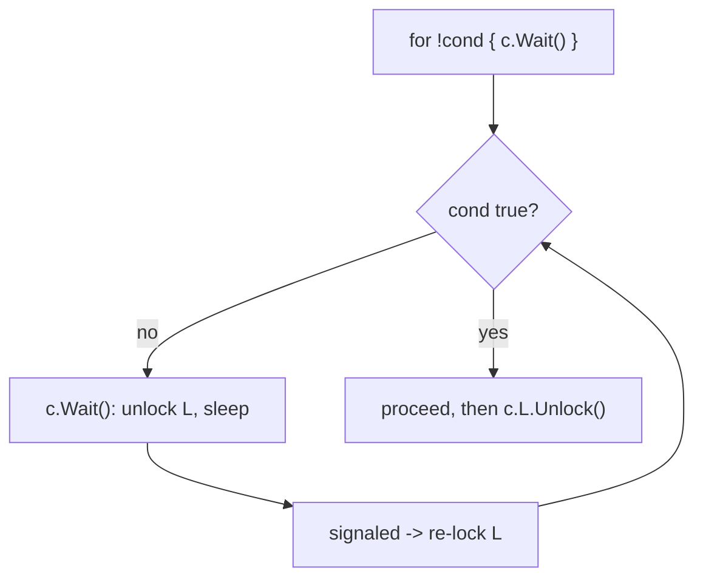
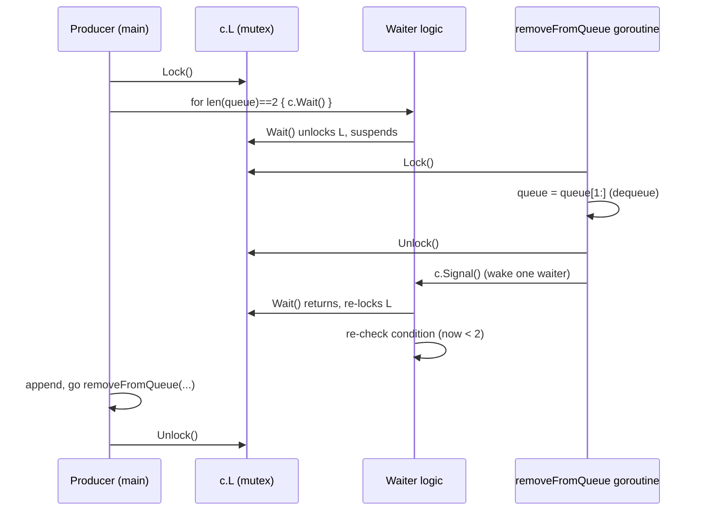
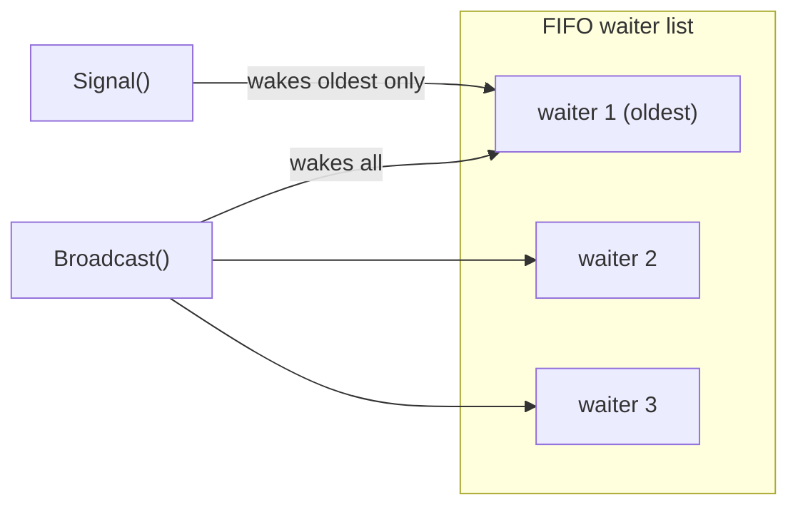
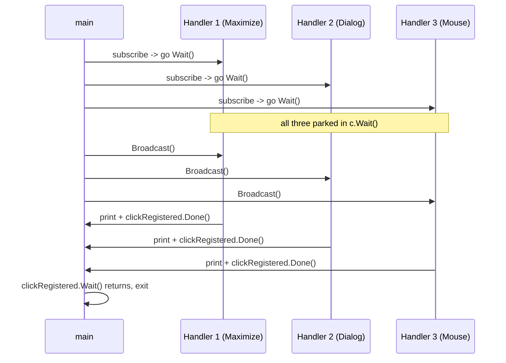

# Ch 3.5 — sync.Cond

> Book: *Concurrency in Go* (Katherine Cox-Buday, O'Reilly 2017) · Chapter 3: Go's Concurrency Building Blocks · Pages ~52–57
> ⬅️ Prev: [Mutex & RWMutex](04-mutex-and-rwmutex.md) · ➡️ Next: [sync.Once](06-once.md) · 🏠 [Book index](../README.md)

## 🎯 In One Paragraph

`sync.Cond` is, per its own doc comment, *"a rendezvous point for goroutines waiting for or announcing the occurrence of an event."* An "event" here is just a signal between goroutines carrying no data — only the fact that *something happened*. The naive way to wait for a condition is a spin loop (`for !ready {}`), which burns a whole CPU core; adding `time.Sleep` helps but forces you to guess a polling interval. `Cond` solves this properly: a waiting goroutine calls `Wait()`, which **efficiently suspends** it (freeing the OS thread for other goroutines) until another goroutine calls **`Signal()`** (wake one waiter) or **`Broadcast()`** (wake all waiters). `Wait()` hides a crucial side effect: on entry it **unlocks** the associated `Locker`, and on exit it **re-locks** it — so you must hold the lock around `Wait`, and you must re-check your condition in a **`for` loop** because a wake-up doesn't guarantee your specific condition is now true. `Broadcast` is the standout capability — notifying many goroutines at once is awkward with channels — making `Cond` the natural fit for the book's "button click fires all registered handlers" example.

## 🧠 Key Concepts & Vocabulary

- **`sync.Cond`** — a condition variable: goroutines wait for / announce an event.
- **`sync.NewCond(l Locker)`** — constructs a Cond around a `Locker` (usually `&sync.Mutex{}`); the lock is exposed as `c.L`.
- **`Wait()`** — atomically unlocks `c.L`, suspends the goroutine until signaled, then re-locks `c.L` before returning.
- **`Signal()`** — wake the **single** longest-waiting goroutine (runtime keeps a FIFO list of waiters).
- **`Broadcast()`** — wake **all** waiting goroutines.
- **Rendezvous point** — where waiters and announcers meet; the Cond coordinates them safely.
- **Spurious / imprecise wake-ups** — a signal means "*something* happened," not "*your* condition is true"; always re-check in a loop.
- **The hidden Unlock/Lock side effect** — `Wait` releases the lock while sleeping and re-acquires it on return, even though the code "looks" like it holds the lock throughout.

## 📚 Deep Dive

### From busy-wait to Cond

Polling a condition wastes CPU:

```go
for conditionTrue() == false { }                 // pegs one core at 100%
for conditionTrue() == false { time.Sleep(1 * time.Millisecond) } // better, but you guess the interval
```

Too-long a sleep adds latency; too-short wastes CPU. `Cond` lets a goroutine sleep *exactly* until signaled:

```go
c := sync.NewCond(&sync.Mutex{})
c.L.Lock()
for conditionTrue() == false {
	c.Wait() // suspends; releases c.L while asleep, re-acquires on wake
}
c.L.Unlock()
```



The key insight: `Wait()` does not merely block — it **suspends** the goroutine so other goroutines can run on the OS thread. And it quietly calls `Unlock` on entry and `Lock` on exit. So although the code looks like it holds `c.L` the whole time, it doesn't while sleeping.

### Both sides: a bounded queue (Signal)

A queue of fixed length 2, enqueuing 10 items; a consumer goroutine dequeues after a delay and `Signal`s that there's room:

```go
package main

import (
	"fmt"
	"sync"
	"time"
)

func main() {
	c := sync.NewCond(&sync.Mutex{})
	queue := make([]any, 0, 10)

	removeFromQueue := func(delay time.Duration) {
		time.Sleep(delay)
		c.L.Lock()
		queue = queue[1:]              // dequeue
		fmt.Println("Removed from queue")
		c.L.Unlock()
		c.Signal()                     // tell a waiter: room is available
	}

	for i := 0; i < 10; i++ {
		c.L.Lock()
		for len(queue) == 2 {          // loop, not if: re-check the condition
			c.Wait()                   // sleep until signaled room exists
		}
		fmt.Println("Adding to queue")
		queue = append(queue, struct{}{})
		go removeFromQueue(10 * time.Millisecond)
		c.L.Unlock()
	}
}
```

Verified output (trimmed): the program adds all 10 items, always waiting for at least one dequeue before adding past capacity, and exits before the last two dequeues happen:

```
Adding to queue
Adding to queue
Removed from queue
Adding to queue
Removed from queue
...
Adding to queue
```

Why a `for` loop around `Wait`, not an `if`? Because a signal means *something* occurred — not necessarily that *your* condition (`len(queue) < 2`) now holds. Re-checking in a loop is mandatory for correctness.



### Signal vs Broadcast

The runtime keeps a **FIFO list** of waiting goroutines.

- **`Signal()`** finds the goroutine waiting **longest** and wakes just that one.
- **`Broadcast()`** wakes **all** waiting goroutines.



`Signal` is trivially reproducible with channels; `Broadcast` (repeatedly notifying *many* goroutines) is much harder to do with channels — and `Cond` is also more performant than channels for this. That's the main reason to reach for `Cond`.

### Broadcast: the button-click example

A GUI button with an arbitrary number of click handlers. One `Broadcast()` fires them all:

```go
package main

import (
	"fmt"
	"sync"
)

type Button struct {
	Clicked *sync.Cond
}

func main() {
	button := Button{Clicked: sync.NewCond(&sync.Mutex{})}

	// Register a handler on its own goroutine; don't return until it's parked in Wait.
	subscribe := func(c *sync.Cond, fn func()) {
		var goroutineRunning sync.WaitGroup
		goroutineRunning.Add(1)
		go func() {
			goroutineRunning.Done() // confirm the goroutine is running
			c.L.Lock()
			defer c.L.Unlock()
			c.Wait() // park until Broadcast
			fn()
		}()
		goroutineRunning.Wait()
	}

	var clickRegistered sync.WaitGroup
	clickRegistered.Add(3)
	subscribe(button.Clicked, func() {
		fmt.Println("Maximizing window.")
		clickRegistered.Done()
	})
	subscribe(button.Clicked, func() {
		fmt.Println("Displaying annoying dialog box!")
		clickRegistered.Done()
	})
	subscribe(button.Clicked, func() {
		fmt.Println("Mouse clicked.")
		clickRegistered.Done()
	})

	button.Clicked.Broadcast() // one call -> all three handlers run

	clickRegistered.Wait() // keep main alive until the handlers print
}
```

Verified output (handler order nondeterministic):

```
Mouse clicked.
Maximizing window.
Displaying annoying dialog box!
```

Three details worth noting:

- The inner `goroutineRunning` WaitGroup ensures `subscribe` doesn't return until the handler goroutine is actually running (and about to park in `Wait`), so the later `Broadcast` isn't missed.
- The outer `clickRegistered` WaitGroup only exists so `main` doesn't exit before the handlers finish printing. Remove it and you could call `Broadcast()` repeatedly, re-invoking all three handlers each time — something channels can't do easily.
- Like the rest of `sync`, `Cond` works best constrained to a tight scope or encapsulated in a type (here, `Button`).



## ⚠️ Pitfalls & Gotchas

- **Using `if` instead of `for` around `Wait`.** A wake-up doesn't prove your condition holds (another goroutine may have consumed the change, or it was a broadcast). Always loop and re-check.
- **Forgetting you hold the lock.** You must call `Wait`, `Signal`-adjacent state changes while holding `c.L`. `Wait` releases/re-acquires it internally; code after `Wait` runs with the lock held again, so don't double-lock.
- **Missed signals (lost wakeups).** If you `Signal`/`Broadcast` before the waiter has entered `Wait`, the signal is lost. The button example's `goroutineRunning` WaitGroup exists precisely to avoid this.
- **No timeout.** `Cond.Wait` can't time out natively. To add a deadline you typically bolt on a channel/`context`, or just use channels + `select` instead.
- **`Signal` vs `Broadcast` mix-ups.** `Signal` wakes one waiter; if several conditions share one Cond, waking the "wrong" one can stall. Broadcast + loop re-check is safer (if less efficient) when in doubt.
- **Copying a Cond.** Like other `sync` types, a `Cond` must not be copied after first use; pass by pointer / embed and share.

## 🆕 Modern Go Notes

> [!NOTE] 🆕 `Cond` is often replaced by channels today
> Idiomatic modern Go frequently prefers **channels** (close a channel to broadcast "done" to all receivers), **`context`** (for cancellation broadcasts), or `errgroup`. The Go team has discussed that `sync.Cond` is rarely the right tool; the `sync` docs themselves say higher-level coordination is "better done via channels." `Cond` still shines for high-frequency, data-less, repeated broadcasts where channel overhead matters.

> [!TIP] 🆕 Broadcasting with a closed channel
> A common channel idiom reproduces `Broadcast` once: every waiter does `<-done`, and the signaler `close(done)`. All receivers unblock simultaneously. The limitation (and why `Cond.Broadcast` still exists) is that a closed channel can't be "re-opened" — you can't broadcast *repeatedly* on the same channel the way `Cond.Broadcast` can.

> [!TIP] 🆕 `testing/synctest` (Go 1.25)
> Testing Cond-based coordination deterministically is hard. Go 1.25's `testing/synctest` lets you run concurrent code in a fake-time "bubble," making Wait/Signal/Broadcast timing reproducible in tests.

## 🧪 Try It Yourself

1. Change the queue example's `for len(queue) == 2` to `if len(queue) == 2` and add a second producer. Reason about (and try to trigger) a case where the invariant breaks.
2. Remove the `goroutineRunning` WaitGroup from `subscribe` and run the button example many times. Observe occasional missed handlers (lost wakeup) because `Broadcast` fired before a handler parked.
3. Replace the button's `Cond.Broadcast` with a `close(done)` channel broadcast. Then try to make it fire twice — see why you can't.
4. Add a timeout to a Cond wait using a helper goroutine + channel, and discuss how `select` on channels would be simpler.

## ✅ Self-Check Questions

<details><summary>Q1: What hidden side effects does Cond.Wait have?</summary>
On entry it calls Unlock on c.L (releasing the lock while the goroutine sleeps); on exit (after being signaled) it calls Lock on c.L again. So you must hold the lock before calling Wait, and you hold it again after Wait returns.
</details>

<details><summary>Q2: Why must you re-check the condition in a for loop around Wait?</summary>
A signal only means something occurred, not that your specific condition is now true. Another goroutine may have consumed the change, or a Broadcast woke everyone. Looping re-verifies the condition before proceeding.
</details>

<details><summary>Q3: What's the difference between Signal and Broadcast?</summary>
Signal wakes only the single longest-waiting goroutine (FIFO). Broadcast wakes all waiting goroutines.
</details>

<details><summary>Q4: Why is Cond a better fit than channels for the button example?</summary>
Broadcast can notify an arbitrary number of waiters at once and can do so repeatedly; reproducing repeated broadcast to many goroutines with channels is awkward (a closed channel only broadcasts once). Cond is also more performant for this.
</details>

<details><summary>Q5: What is a lost wakeup and how does the button example prevent it?</summary>
A lost wakeup is when Signal/Broadcast fires before a goroutine has entered Wait, so the signal is missed. The example uses a goroutineRunning WaitGroup so subscribe only returns once the handler goroutine is running and about to Wait, ensuring Broadcast isn't called too early.
</details>

<details><summary>Q6: Why does the busy-wait-with-Sleep approach the book shows still fall short?</summary>
You must guess the sleep interval: too long adds latency before reacting to the condition; too short wastes CPU polling. Cond.Wait sleeps exactly until signaled, avoiding the trade-off entirely.
</details>

## 🔑 Key Takeaways

- `Cond` is a condition variable: `Wait` to sleep until an event, `Signal`/`Broadcast` to announce it.
- `Wait` atomically unlocks the Locker while sleeping and re-locks it on wake — always hold `c.L` around it.
- Always wrap `Wait` in a `for` loop that re-checks the condition (signals are imprecise).
- `Signal` wakes one (longest-waiting) goroutine; `Broadcast` wakes all — the latter is `Cond`'s killer feature.
- Guard against lost wakeups (ensure waiters are parked before signaling); modern Go often prefers channels/`context`, reserving `Cond` for repeated data-less broadcasts.

## 🔗 References & Further Reading

### 📝 Blogs / articles
- [Go sync.Cond, the Most Overlooked Sync Mechanism](https://victoriametrics.com/blog/go-sync-cond/) — VictoriaMetrics explains the busy-wait → Cond progression and the Unlock/Lock side effect in depth.
- [Understanding sync.Cond in Go: Producer-Consumer Scenarios](https://dev.to/crusty0gphr/understanding-synccond-in-go-synchronizing-goroutines-in-producer-consumer-scenarios-271i) — the bounded-queue pattern mirroring the book's example.
- [From Polling to Partying: Cooler Goroutines with sync.Cond](https://dev.to/2nguyenlong000k/from-polling-to-partying-writing-cooler-goroutines-with-synccond-1ld8) — why Cond beats polling, with Signal/Broadcast walk-throughs.
- [sync.Cond Test Broadcast — why check in a loop? (Stack Overflow)](https://stackoverflow.com/questions/33841585/sync-cond-test-broadcast) — authoritative discussion of the mandatory for-loop re-check.

### 💻 GitHub
- [golang/go — src/sync/cond.go](https://github.com/golang/go/blob/master/src/sync/cond.go) — the implementation: the `notifyList`, `Wait`'s unlock/relock, and `copyChecker`.
- [golang/go — src/runtime/sema.go](https://github.com/golang/go/blob/master/src/runtime/sema.go) — the `notifyListAdd`/`notifyListWait`/`notifyListNotifyOne`/`notifyListNotifyAll` runtime support behind `Wait`/`Signal`/`Broadcast`.

### 📖 Official docs / specs
- [sync package — Cond](https://pkg.go.dev/sync#Cond) — the "rendezvous point" doc comment the book quotes, plus the API.
- [sync package — NewCond](https://pkg.go.dev/sync#NewCond) — constructor semantics and the `L Locker` field.
- [testing/synctest (Go 1.25)](https://pkg.go.dev/testing/synctest) — deterministic testing of concurrency that uses condition-variable-style waiting.
