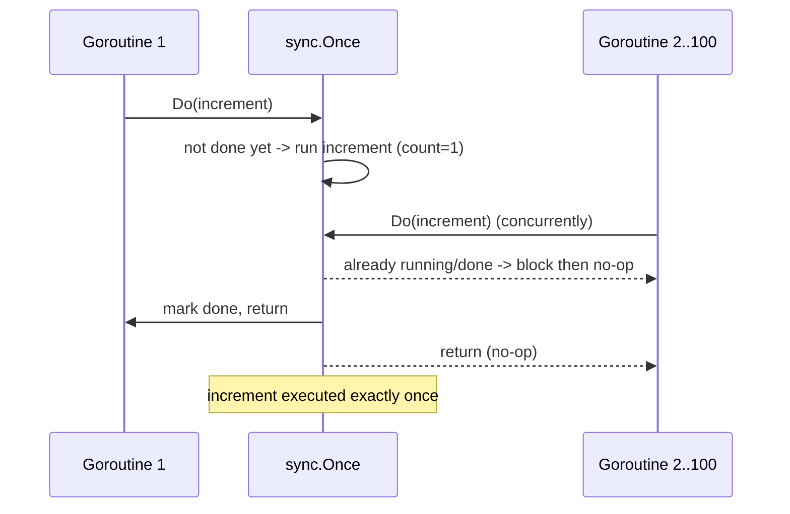
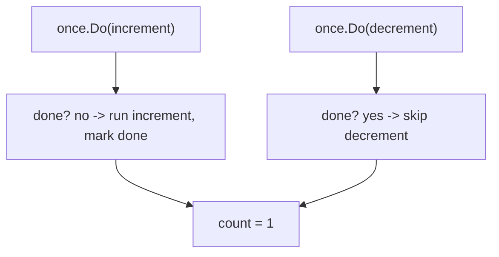
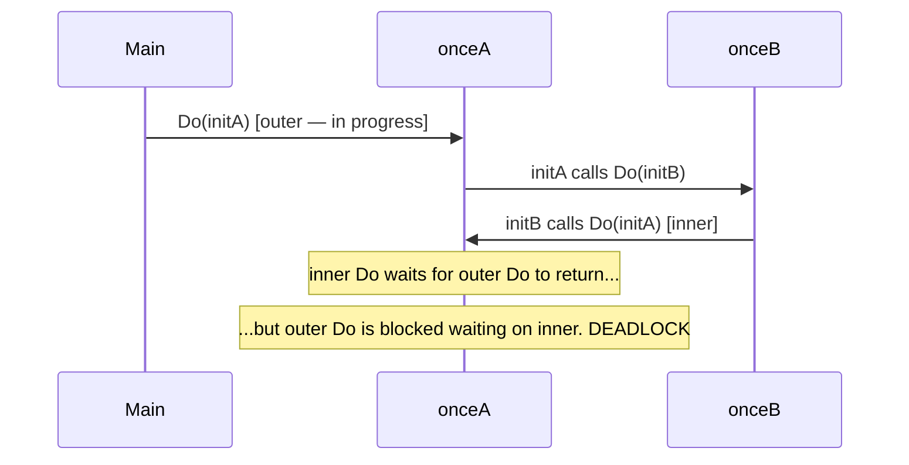

# Ch 3.6 — sync.Once

> Book: *Concurrency in Go* (Katherine Cox-Buday, O'Reilly 2017) · Chapter 3: Go's Concurrency Building Blocks · Pages ~57–59
> ⬅️ Prev: [sync.Cond](05-cond.md) · ➡️ Next: [sync.Pool](07-pool.md) · 🏠 [Book index](../README.md)

## 🎯 In One Paragraph

`sync.Once` guarantees that a function runs **exactly once**, no matter how many goroutines call it or how often — perfect for one-time initialization (singletons, lazy setup). You wrap the work in `once.Do(fn)`; the very first `Do` runs `fn` (and blocks concurrent callers until it finishes), and every subsequent `Do` is a no-op. Two subtleties bite people: (1) `Once` counts **calls to `Do`**, not *which* function you pass — so `once.Do(inc); once.Do(dec)` runs only `inc`, because the second `Do` sees the once already "used"; and (2) because `Do` blocks until the first invocation *returns*, a function that re-enters its own `Once` (directly or via a cycle) **deadlocks** — `Once` enforces "run once" even if the only way to honor that is to freeze your program and reveal the logic flaw. The takeaway: couple a `Once` tightly to the single function it's meant to guard, ideally wrapped in a small function or type.

## 🧠 Key Concepts & Vocabulary

- **`sync.Once`** — a primitive ensuring a function is executed exactly once across all goroutines.
- **`Do(f func())`** — runs `f` only on the first call; later calls do nothing. Blocks concurrent first-callers until `f` returns.
- **Exactly-once / run-once semantics** — the guarantee is about *number of executions*, enforced with internal synchronization (atomic fast path + mutex slow path).
- **Counts `Do` calls, not functions** — a given `Once` tracks whether `Do` has *ever* run, regardless of which function argument you pass.
- **Tight coupling** — a `Once` is logically bound to the one function it guards; formalize this in a small lexical scope (function or type).
- **Re-entrant deadlock** — calling `Do` again from inside the function the same `Once` is running blocks forever.
- **Zero value usable** — `var once sync.Once` is ready; don't copy a `Once` after use.

## 📚 Deep Dive

### Exactly-once across many goroutines

```go
package main

import (
	"fmt"
	"sync"
)

func main() {
	var count int
	increment := func() { count++ }

	var once sync.Once
	var increments sync.WaitGroup
	increments.Add(100)
	for i := 0; i < 100; i++ {
		go func() {
			defer increments.Done()
			once.Do(increment) // only the first of 100 calls actually runs increment
		}()
	}
	increments.Wait()
	fmt.Printf("Count is %d\n", count)
}
```

It's tempting to guess `100`, but the output is:

```
Count is 1
```

All 100 goroutines call `once.Do(increment)`, but only the first invocation runs `increment`; the other 99 are no-ops. `Once` uses sync primitives internally to make this safe even across goroutines.



Go itself leans on this pattern heavily. The book runs `grep -ir sync.Once $(go env GOROOT)/src | wc -l` and gets **70** matches — evidence that "run exactly once" is a genuinely common need.

### It counts `Do` calls, not unique functions

```go
package main

import (
	"fmt"
	"sync"
)

func main() {
	var count int
	increment := func() { count++ }
	decrement := func() { count-- }

	var once sync.Once
	once.Do(increment) // runs: count = 1
	once.Do(decrement) // no-op: once is already used

	fmt.Printf("Count: %d\n", count)
}
```

Output:

```
Count: 1
```

Not `0`. The second `Do` doesn't run `decrement` at all — `Once` only remembers *that `Do` ran*, not *which* function. This is why a `Once` is "tightly coupled" to the specific function it's meant to guard. The book recommends formalizing that coupling: wrap the `Once` and its function in a small function or a type so they can't drift apart.



### The deadlock: re-entrant / cyclic Once

```go
var onceA, onceB sync.Once
var initB func()
initA := func() { onceB.Do(initB) }
initB = func() { onceA.Do(initA) }
onceA.Do(initA) // DEADLOCK
```

Trace it: `onceA.Do(initA)` starts running `initA`, which calls `onceB.Do(initB)`, which runs `initB`, which calls `onceA.Do(initA)` again. But `onceA`'s first `Do` hasn't *returned* yet — and `Do` blocks any further call to the same `Once` until the in-flight call completes. So the inner `onceA.Do` waits for the outer `onceA.Do` to finish, which is waiting on the inner one: a **classic deadlock** via circular reference.



The lesson: `Once` only promises "called once." Sometimes it keeps that promise by **deadlocking** and thereby exposing a flaw in your initialization logic (here, a circular dependency). It is not a general guard against "multiple initialization" semantics beyond the literal run-once guarantee.

### A complete, runnable summary program

```go
package main

import (
	"fmt"
	"sync"
)

func main() {
	// 1) exactly-once across 100 goroutines
	var count int
	increment := func() { count++ }
	var once sync.Once
	var increments sync.WaitGroup
	increments.Add(100)
	for i := 0; i < 100; i++ {
		go func() {
			defer increments.Done()
			once.Do(increment)
		}()
	}
	increments.Wait()
	fmt.Printf("Count is %d\n", count) // 1

	// 2) counts Do calls, not functions
	var count2 int
	inc := func() { count2++ }
	dec := func() { count2-- }
	var once2 sync.Once
	once2.Do(inc)
	once2.Do(dec)                       // no-op
	fmt.Printf("Count: %d\n", count2)   // 1

	// 3) modern Go 1.21 helper: OnceValue
	config := sync.OnceValue(func() string {
		fmt.Println("computing config (once)")
		return "loaded"
	})
	fmt.Println(config(), config())     // computed once, returned twice
}
```

Verified output on Go 1.27:

```
Count is 1
Count: 1
computing config (once)
loaded loaded
```

## ⚠️ Pitfalls & Gotchas

- **Expecting per-function semantics.** `Once` tracks the *Once*, not the function. Passing different functions to the same `Once` runs only the first. Keep one `Once` per one function.
- **Re-entrant / cyclic Do → deadlock.** Calling the same `Once.Do` (directly or through a cycle) from within the running function freezes the program. Break the cycle.
- **Copying a `Once`.** `sync.Once` must not be copied after first use; a copy has a fresh "not done" state, defeating the guarantee. Share by pointer / embed in a struct.
- **Assuming it retries on panic/error.** If the function passed to `Do` *panics*, the classic `Once` still marks itself done — subsequent `Do` calls won't retry (and with the 1.21 helpers, they re-panic with the same value). If you need retry-on-failure, `Once` is the wrong tool.
- **Leaving the function too far from its `Once`.** Scattered `once.Do(...)` calls across a package are fragile. Encapsulate in a helper function or type.

## 🆕 Modern Go Notes

> [!TIP] 🆕 `OnceFunc`, `OnceValue`, `OnceValues` (Go 1.21)
> Go 1.21 added three helpers that compress the pattern into a single declaration and return a *callable*:
> ```go
> setup := sync.OnceFunc(func() { fmt.Println("init once") })       // func()
> cfg   := sync.OnceValue(func() string { return load() })          // func() string
> a, b  := sync.OnceValues(func() (T, error) { return build() })    // func() (T, error)
> ```
> These bundle the `Once` *and* its function together, structurally eliminating the "which function?" and "wrap it in a type" advice the book gives. If the wrapped function panics, the returned function panics with the same value on every subsequent call. For most "lazy init / singleton" needs in modern Go, prefer these over a bare `sync.Once`.

> [!NOTE] 🆕 `OnceFunc` vs `init()`
> With `OnceFunc`/`OnceValue`, you rarely need package `init()` for anything beyond driver registration — lazy, on-demand initialization is cleaner and testable (no global init ordering surprises).

## 🧪 Try It Yourself

1. Change `once.Do(increment)` to use a *fresh* `Once` per goroutine and observe `Count is 100` — proving the guarantee is per-`Once`, not per-call.
2. Make the function passed to `Do` panic; catch it with `recover` in one goroutine and confirm later `Do` calls do **not** re-run it.
3. Rewrite the singleton pattern with `sync.OnceValue` returning a `*Config`, and verify the expensive loader runs once across concurrent callers.
4. Reproduce the `onceA`/`onceB` deadlock, then break the cycle (e.g., initialize B eagerly) so it completes.

## ✅ Self-Check Questions

<details><summary>Q1: What does sync.Once guarantee?</summary>
That the function passed to Do is executed exactly once, across all goroutines and all calls, with internal synchronization making it concurrency-safe. Concurrent first-callers block until that single execution returns.
</details>

<details><summary>Q2: Why does once.Do(inc); once.Do(dec) leave the count at 1, not 0?</summary>
Once counts whether Do has ever run, not which function was passed. The first Do runs inc; the second Do sees the Once already used and skips dec entirely.
</details>

<details><summary>Q3: Why does the onceA/onceB example deadlock?</summary>
The outer onceA.Do(initA) is still in progress when initA → initB → onceA.Do(initA) is called again. Do blocks additional calls to the same Once until the in-flight call returns, but that call is itself waiting on the inner one — a circular wait.
</details>

<details><summary>Q4: If the function passed to Do panics, will a later Do retry it?</summary>
No. The classic Once marks itself done regardless; later Do calls are no-ops (and the 1.21 helpers re-panic with the same value). Once is not a retry-on-failure mechanism.
</details>

<details><summary>Q5: What practice does the book recommend to avoid the "which function?" confusion?</summary>
Couple each Once tightly to the one function it guards by wrapping both in a small lexical scope — a helper function or a type. The Go 1.21 OnceFunc/OnceValue/OnceValues helpers do this structurally.
</details>

<details><summary>Q6: Roughly how often does Go's own standard library use sync.Once, per the book?</summary>
About 70 occurrences in the GOROOT source (via grep), showing that exactly-once initialization is a common, practical need.
</details>

## 🔑 Key Takeaways

- `sync.Once` runs a function exactly once across all goroutines; later `Do` calls are no-ops.
- It counts *calls to `Do`*, not which function — so bind one `Once` to one function.
- Re-entrant or cyclic `Do` calls deadlock, surfacing circular-initialization bugs.
- Don't copy a `Once`; it won't retry on panic — it's for one-time init, not error recovery.
- Prefer Go 1.21's `OnceFunc`/`OnceValue`/`OnceValues` in new code to bundle the `Once` with its function.

## 🔗 References & Further Reading

### 📝 Blogs / articles
- [Go sync.Once is Simple... Does It Really?](https://victoriametrics.com/blog/go-sync-once/) — VictoriaMetrics dissects the atomic fast path, the slow path, and panic behavior.
- [sync.OnceFunc, OnceValue, OnceValues: When Each Beats sync.Once](https://dev.to/gabrielanhaia/synconcefunc-oncevalue-oncevalues-when-each-beats-synconce-4jp) — picking the right 1.21 helper for the job.
- [sync.OnceFunc vs init(): Lazy Initialization Done Right in Go](https://dev.to/gabrielanhaia/synconcefunc-vs-init-lazy-initialization-done-right-in-go-10mk) — why lazy once-helpers often beat package `init`.
- [Lazy Initialization with sync.Once](https://go-cookbook.com/snippets/concurrency/lazy-initialization-with-sync-once) — concise singleton/lazy-init recipe and the 1.21 upgrades.

### 💻 GitHub
- [golang/go — src/sync/once.go](https://github.com/golang/go/blob/master/src/sync/once.go) — the `done` atomic flag + mutex `doSlow` implementation; note the `defer atomic.StoreUint32` even on panic.
- [golang/go — src/sync/oncefunc.go](https://github.com/golang/go/blob/master/src/sync/oncefunc.go) — the 1.21 `OnceFunc`/`OnceValue`/`OnceValues` helpers and their panic-propagation handling.

### 📖 Official docs / specs
- [sync package — Once](https://pkg.go.dev/sync#Once) — the API and the "do not copy after use" note.
- [sync package — OnceFunc / OnceValue / OnceValues](https://pkg.go.dev/sync#OnceFunc) — official docs for the Go 1.21 helpers, including panic semantics.
- [Go 1.21 release notes — sync](https://go.dev/doc/go1.21#sync) — announcement of the Once helper additions.
