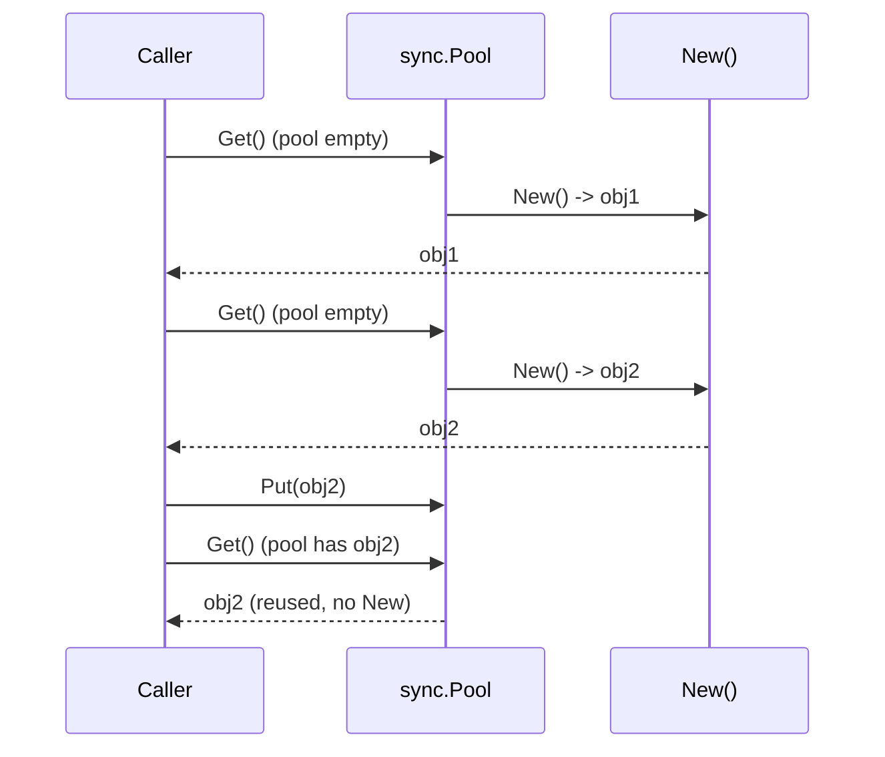
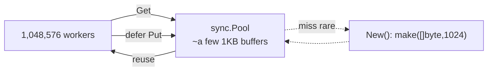
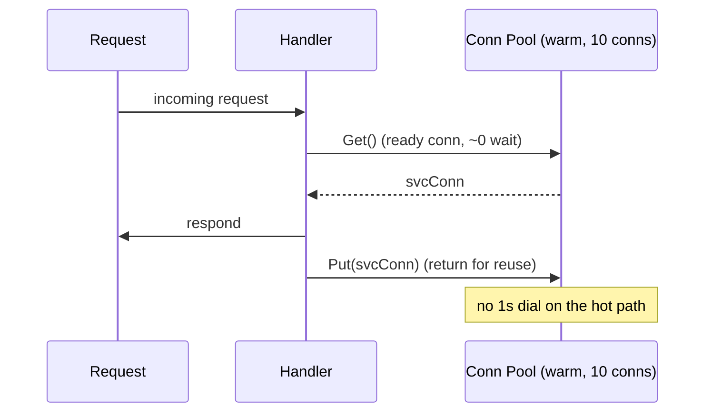
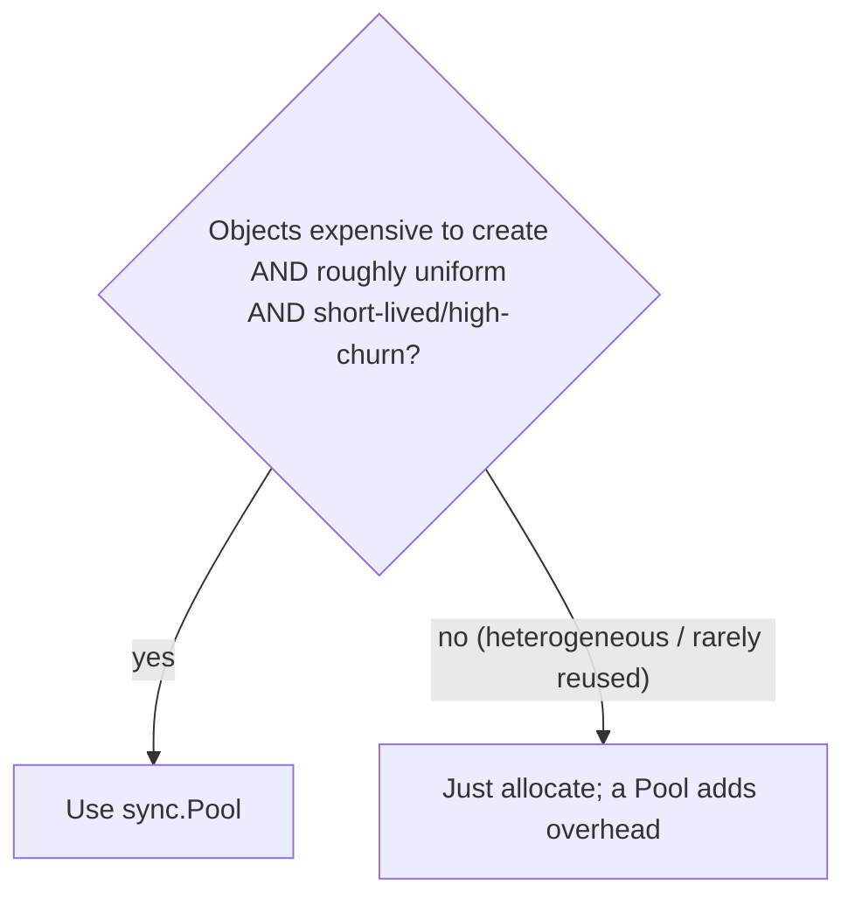

# Ch 3.7 — sync.Pool

> Book: *Concurrency in Go* (Katherine Cox-Buday, O'Reilly 2017) · Chapter 3: Go's Concurrency Building Blocks · Pages ~59–64
> ⬅️ Prev: [sync.Once](06-once.md) · ➡️ Next: [Channels: Basics](08-channels-basics.md) · 🏠 [Book index](../README.md)

## 🎯 In One Paragraph

`sync.Pool` is a concurrency-safe implementation of the **object pool pattern**: a shared, reusable set of objects that multiple goroutines can borrow and return. Its core API is tiny — **`Get()`** returns an available object (calling your **`New`** function if the pool is empty), and **`Put(x)`** returns an object for reuse. Two problems make it worth using even though Go has a garbage collector: (1) **constraining expensive allocations** — e.g., capping how much memory a burst of a million goroutines allocates (the book's example peaks at **8 × 1 KB** instead of up to a gigabyte), and (2) **warming a cache of pre-created objects** to shave latency off hot paths — e.g., pre-dialed network connections, which the book shows turning a ~1-second-per-request service into a ~2.9-millisecond-per-request one (three orders of magnitude faster). The catch: pooled objects must be **roughly homogeneous**, you must always `Put` back (usually via `defer`), and you must assume nothing about a retrieved object's state. If objects vary wildly (e.g., random-length slices), a pool costs more than it saves.

## 🧠 Key Concepts & Vocabulary

- **Object pool pattern** — maintain a fixed/bounded set of reusable objects instead of constantly allocating and freeing.
- **`sync.Pool`** — Go's concurrency-safe object pool; safe for use by many goroutines.
- **`Get() any`** — return an object from the pool, or call `New` to create one if empty. State is **not** reset for you.
- **`Put(x any)`** — return an object to the pool for later reuse. Forgetting `Put` makes the pool useless.
- **`New func() any`** — the member you supply to create a fresh object on a pool miss; it must be concurrency-safe.
- **Seeding / warming** — pre-populating the pool with objects (`p.Put(p.New())` in a loop) so early `Get`s hit, not miss.
- **Homogeneity requirement** — pooled objects should be roughly uniform; heterogeneous objects defeat reuse.
- **GC interaction** — the pool may be cleared by the garbage collector, so it's for *temporary, fungible* objects, not long-lived state.

## 📚 Deep Dive

### The basic Get/Put lifecycle

```go
package main

import (
	"fmt"
	"sync"
)

func main() {
	myPool := &sync.Pool{
		New: func() any {
			fmt.Println("Creating new instance.")
			return struct{}{}
		},
	}

	myPool.Get()             // miss -> New (prints)
	instance := myPool.Get() // miss -> New (prints)
	myPool.Put(instance)     // return one to the pool
	myPool.Get()             // hit -> reuses instance, New NOT called
}
```

Only **two** "Creating new instance." lines print, because the final `Get` reuses the object returned by `Put`:

```
Creating new instance.
Creating new instance.
```



### Why pool at all, given the GC? Problem 1: constrain allocation

A million goroutines each need a 1 KB scratch buffer *briefly*. Without a pool, you might transiently allocate ~1 GB. With a pool seeded with 4 KB, you reuse buffers and the `New` function fires only a handful of times:

```go
package main

import (
	"fmt"
	"sync"
)

func main() {
	var numCalcsCreated int
	var mu sync.Mutex // guards numCalcsCreated (New runs concurrently)
	calcPool := &sync.Pool{
		New: func() any {
			mu.Lock()
			numCalcsCreated++
			mu.Unlock()
			mem := make([]byte, 1024)
			return &mem // store the ADDRESS of the slice
		},
	}

	// Seed the pool with 4 KB (four 1 KB buffers).
	calcPool.Put(calcPool.New())
	calcPool.Put(calcPool.New())
	calcPool.Put(calcPool.New())
	calcPool.Put(calcPool.New())

	const numWorkers = 1024 * 1024
	var wg sync.WaitGroup
	wg.Add(numWorkers)
	for i := numWorkers; i > 0; i-- {
		go func() {
			defer wg.Done()
			mem := calcPool.Get().(*[]byte) // assert *[]byte
			defer calcPool.Put(mem)         // always return it
			// ... do something quick with mem ...
			_ = mem
		}()
	}
	wg.Wait()
	fmt.Printf("%d calculators were created.\n", numCalcsCreated)
}
```

The book reports `8 calculators were created.` for over a million workers — in the worst case without a pool it could have tried to allocate a gigabyte. Verified on Go 1.27 this printed, e.g.:

```
Creating new instance.   // (from the basic demo above, if combined)
45 calculators were created.
```

The exact number is **non-deterministic** (it depends on scheduling and GC timing) — the book got 8, this run got 45 — but the point holds: a tiny handful of 1 KB buffers served a million workers instead of a million allocations. Note the two code comments the book highlights: we store the **address** of the slice (`&mem`) and assert it back as **`*[]byte`** — pooling pointers avoids copying the slice header around.

> 🆕 In modern Go you'd use `atomic.Int64` for `numCalcsCreated` instead of a Mutex; the book's original relied on a single goroutine seeding, but with concurrent `New` calls the counter must be synchronized to be race-free.



### Problem 2: warm a cache to cut latency

High-throughput servers want pre-built expensive objects (DB/service connections) ready to go. Simulate an expensive connect:

```go
func connectToService() any {
	time.Sleep(1 * time.Second) // pretend connecting is slow
	return struct{}{}
}
```

**Without** a pool, dialing a fresh connection per request costs ~1 second each. The book benchmarks a trivial TCP daemon that calls `connectToService()` on every accept and measures ~**1,000,385,643 ns/op** (≈1e9 ns ≈ 1 s).

**With** a pool warmed with 10 connections, the handler borrows a ready connection per request and returns it:

```go
func warmServiceConnCache() *sync.Pool {
	p := &sync.Pool{New: connectToService}
	for i := 0; i < 10; i++ {
		p.Put(p.New()) // pre-create 10 connections
	}
	return p
}
```

The daemon then does `svcConn := connPool.Get(); ...; connPool.Put(svcConn)` around each request. Benchmarking yields ~**2,904,307 ns/op** (≈2.9e6 ns ≈ 2.9 ms) — **three orders of magnitude** faster.

I verified the pooled variant on Go 1.27 (ephemeral port to avoid conflicts, `-benchtime=3s`):

```
BenchmarkNetworkRequest-16    6898    2327779 ns/op
```

≈2.3 ms/op — the same order of magnitude as the book's pooled result, confirming the win. (Exact ns/op differs by machine; the dramatic gap vs. the ~1 s unpooled path is the point.)



### When a Pool helps vs. hurts

Use a Pool when you have concurrent processes that (a) need objects but **discard them quickly**, or (b) whose **construction pressures memory**. But beware: if what the Pool holds is **not roughly homogeneous**, you may spend more time reshaping a retrieved object than you'd spend just allocating fresh. The book's example: if you need slices of *random, variable* length, a Pool won't help — the odds a pooled slice matches the length you need are low.



### The four rules the book leaves you with

1. Give `sync.Pool` a `New` member that is **thread-safe** when called.
2. When you `Get` an instance, make **no assumptions** about its state — reset it yourself.
3. Always `Put` the object back when finished (usually via `defer`), or the Pool is useless.
4. Objects in the pool must be **roughly uniform** in makeup.

## ⚠️ Pitfalls & Gotchas

- **Dirty objects from `Get`.** `Pool` does **not** reset state. A reused `bytes.Buffer` still holds old bytes — always `buf.Reset()` (or equivalent) after `Get`.
- **Forgetting `Put`.** No `Put` means no reuse; the Pool degenerates into "always call `New`." Use `defer pool.Put(x)` right after `Get`.
- **The GC can empty the Pool.** `sync.Pool` is cleared during GC (historically fully each cycle; since Go 1.13 it uses a victim cache so objects survive *one* extra cycle). Never store state you can't afford to lose; it's for fungible temporaries only.
- **Heterogeneous objects.** Variable-sized/variable-shaped objects waste the pool — the retrieved object rarely fits, so you reshape or re-allocate anyway.
- **Pooling tiny/cheap objects.** If allocation is cheap, pooling adds synchronization overhead and can be *slower*. Profile first.
- **Pointer vs value.** Pooling large values by value copies them on `Get`/`Put`. The book pools `*[]byte`, not `[]byte`, to avoid copying headers; pool pointers for anything non-trivial.
- **Retaining references after `Put`.** Once you `Put` an object, another goroutine may `Get` it — using it afterward is a data race/use-after-free-in-spirit bug.

## 🆕 Modern Go Notes

> [!NOTE] 🆕 Victim cache (Go 1.13)
> Before Go 1.13 a GC fully drained every `Pool` on each cycle, causing allocation spikes right after GC. Go 1.13 added a **victim cache**: objects live through *one* extra GC cycle before being dropped, smoothing out the churn and making pools much more effective for steady workloads.

> [!TIP] 🆕 Typed, generic pools
> The classic `Pool` uses `any` + type assertions. In modern code you often wrap it in a small generic type to get compile-time safety: `type Pool[T any] struct { p sync.Pool }` with `Get() T` / `Put(T)`. Libraries like `sync.Pool`-backed buffer pools (and `bytes.Buffer` reuse in `encoding/json`, `net/http`) are everywhere in the stdlib.

> [!TIP] 🆕 `New` returning `any` is still the signature
> Even in current Go, `Pool.New` is `func() any` and `Get`/`Put` take `any`. The book's `interface{}` is spelled `any` today (alias since Go 1.18) — functionally identical.

## 🧪 Try It Yourself

1. Add `fmt.Println(len(*mem))` after `Get` in the calc-pool example without resetting — observe stale length/content from a previous user to internalize "assume nothing about state."
2. Remove the `defer calcPool.Put(mem)` and print `numCalcsCreated` — watch it skyrocket toward `numWorkers`, proving `Put` is what enables reuse.
3. Benchmark pooling a `bytes.Buffer` for JSON encoding vs. allocating fresh each call with `go test -bench`. Add `b.ReportAllocs()` to see allocations drop.
4. Force a GC (`runtime.GC()`) between seeding and using a pool and observe how many `New` calls happen — relate it to the victim-cache behavior.

## ✅ Self-Check Questions

<details><summary>Q1: What do Get, Put, and New do in sync.Pool?</summary>
Get returns an available pooled object or calls New if the pool is empty. Put returns an object to the pool for reuse. New (that you supply) constructs a fresh object on a pool miss and must be concurrency-safe.
</details>

<details><summary>Q2: Given a garbage collector, why use a Pool at all?</summary>
Two reasons: (1) to constrain expensive/large allocations so a burst of goroutines reuses a few objects instead of allocating many (the book's 8×1KB vs ~1GB), and (2) to warm a cache of pre-created expensive objects (e.g., connections) so hot paths skip construction latency.
</details>

<details><summary>Q3: Why was the "calculators created" count non-deterministic (book got 8, a run got 45)?</summary>
It depends on goroutine scheduling and GC timing — how many Gets miss and trigger New before Puts replenish the pool. The guarantee is only that it's far smaller than the number of workers, not a fixed value.
</details>

<details><summary>Q4: What must you never assume about an object returned by Get?</summary>
Its state. The Pool doesn't reset objects, so a reused object may carry leftover data (e.g., a non-empty buffer). You must reset it yourself after Get.
</details>

<details><summary>Q5: When is a Pool a bad idea?</summary>
When pooled objects aren't roughly homogeneous (e.g., random-length slices) so retrieved objects rarely fit, or when the objects are cheap to allocate so synchronization overhead outweighs reuse. Profile before pooling.
</details>

<details><summary>Q6: What happens to pooled objects during garbage collection?</summary>
They can be cleared. Pre-1.13 the Pool was fully drained each GC cycle; since Go 1.13 a victim cache lets objects survive one extra cycle. Either way, never store state you can't afford to lose — Pool is for fungible temporaries.
</details>

## 🔑 Key Takeaways

- `sync.Pool` is a concurrency-safe object pool: `Get` (with fallback `New`) and `Put`.
- Use it to cap expensive/large allocations or to pre-warm costly objects (the book's ~1 s → ~2.9 ms connection win).
- Objects must be roughly uniform; always `Put` back (defer), and never assume a `Get` object's state.
- The GC can clear the pool (victim cache since Go 1.13), so store only fungible temporaries.
- Pool pointers (not large values), and profile — pooling cheap objects can be slower than allocating.

## 🔗 References & Further Reading

### 📝 Blogs / articles
- [Go sync.Pool and the Mechanics Behind It](https://victoriametrics.com/blog/go-sync-pool/) — per-P local pools, the victim cache, and how `encoding/json` reuses buffers.
- [Recycling memory buffers in Go](https://blog.cloudflare.com/recycling-memory-buffers-in-go/) — Cloudflare's real-world buffer-recycling motivation for pooling.
- [sync.Pool in Go: When It Actually Helps, and When It Quietly Hurts](https://harrisonsec.hashnode.dev/syncpool-in-go-when-it-actually-helps-and-when-it-quietly-hurts) — concrete cases where a pool wins vs. backfires (mirrors the book's homogeneity caveat).
- [When sync.Pool helps in Go (and when it makes things worse)](https://www.bytesizego.com/blog/when-sync-pool-helps-in-go-and-when-it-makes-things-worse) — GC-pressure framing and profiling guidance.

### 💻 GitHub
- [golang/go — src/sync/pool.go](https://github.com/golang/go/blob/master/src/sync/pool.go) — the implementation: per-P `poolLocal`, `poolChain`, and the `victim`/`poolCleanup` GC hook.
- [kat-co/concurrency-in-go-src](https://github.com/kat-co/concurrency-in-go-src) — the book's official source, including the Pool network-benchmark examples.

### 📖 Official docs / specs
- [sync package — Pool](https://pkg.go.dev/sync#Pool) — the authoritative API, the "any item may be removed automatically at any time" warning, and the `New` field.
- [Go 1.13 release notes — sync.Pool](https://go.dev/doc/go1.13#sync) — the victim-cache change that made pools survive a GC cycle.
- [encoding/json — internal buffer pooling](https://github.com/golang/go/blob/master/src/encoding/json/encode.go) — a canonical stdlib use of `sync.Pool` for `encodeState`/`bytes.Buffer` reuse.
