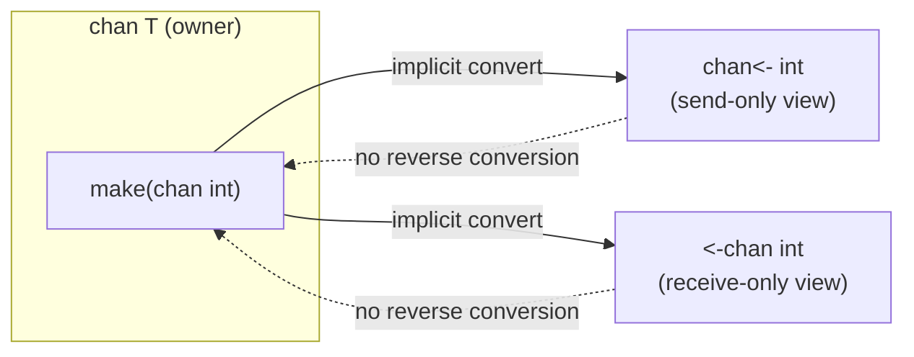
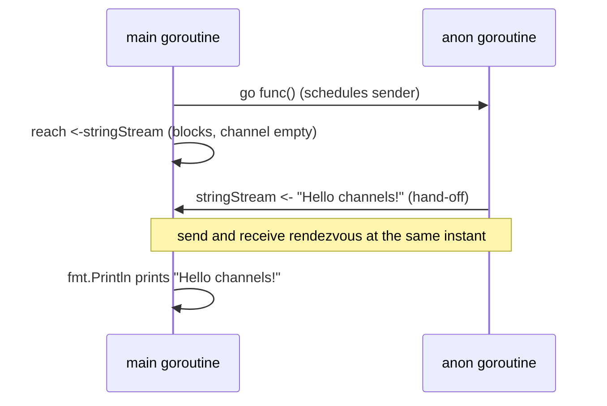
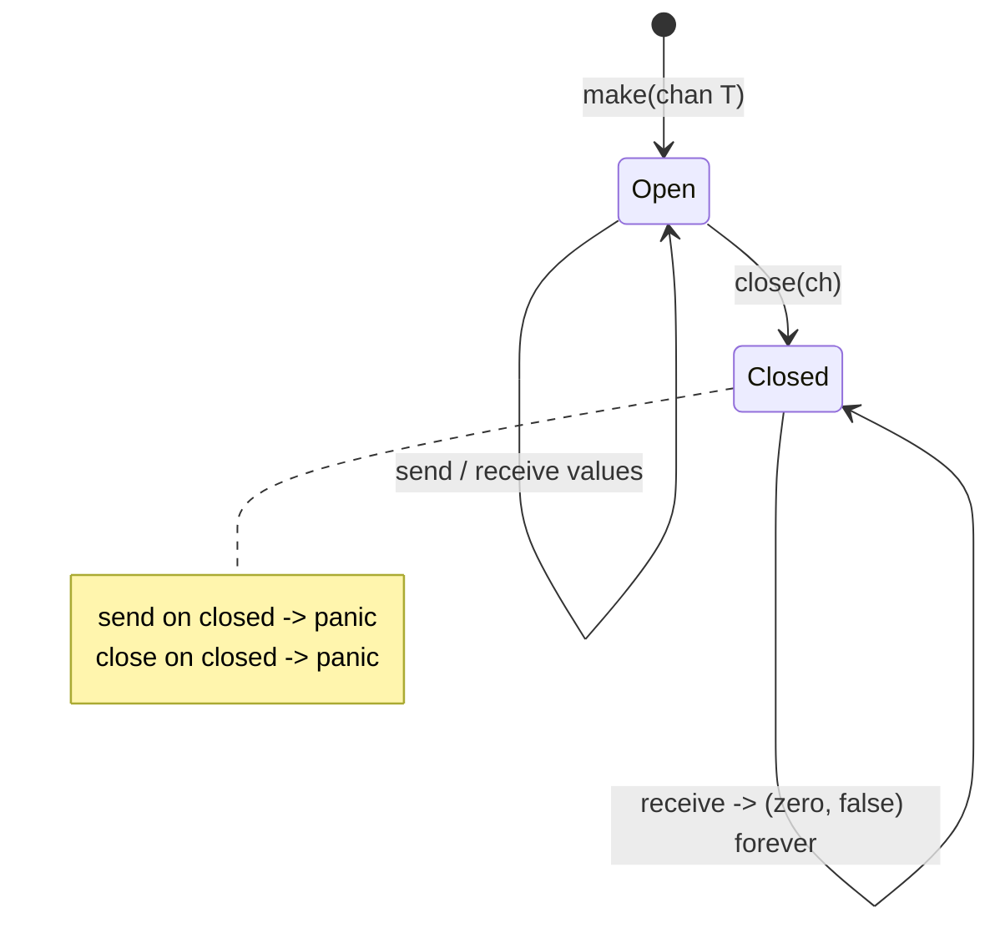
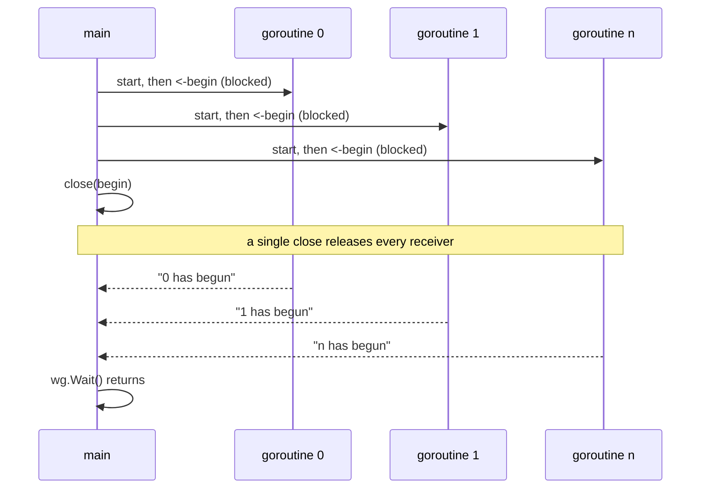

# Ch 3.8 — Channels: Basics

> Book: *Concurrency in Go* (Katherine Cox-Buday, O'Reilly 2017) · Chapter 3: Go's Concurrency Building Blocks · Pages ~64–70
> ⬅️ Prev: [sync.Pool](07-pool.md) · ➡️ Next: [Buffered & nil channels, ownership](09-buffered-nil-channels-and-ownership.md) · 🏠 [Book index](../README.md)

## 🎯 In One Paragraph

Channels are Go's first-class communication primitive, borrowed from Hoare's **CSP** (Communicating Sequential Processes). Where the `sync` package lets you *protect* shared memory, channels let you *pass* information between goroutines so that "the disparate parts of your program don't require knowledge of each other, only a reference to the same place in memory." You create a channel with `make`, send with `ch <- v`, receive with `v := <-ch`, and can restrict a channel to send-only (`chan<- T`) or receive-only (`<-chan T`) for type-safe APIs. Channels are **blocking**: a send blocks until a receiver is ready (and vice versa), which gives deterministic hand-offs but can also produce `deadlock!`. A two-value receive `v, ok := <-ch` tells you whether the value was really sent or is the zero value from a **closed** channel. Closing a channel is a universal "no more values" sentinel that lets you `range` cleanly and, powerfully, unblock any number of waiting goroutines at once.

## 🧠 Key Concepts & Vocabulary

- **Channel**: A typed conduit (`chan T`) for passing values between goroutines; a reference type whose zero value is `nil`.
- **CSP lineage**: Channels implement Tony Hoare's idea of processes communicating by message passing rather than by sharing memory.
- **`<-` operator**: Data flows *in the direction the arrow points*. `ch <- v` sends; `v := <-ch` receives.
- **Bidirectional channel** (`chan T`): can both send and receive.
- **Directional channel**: send-only `chan<- T` (arrow on the right) or receive-only `<-chan T` (arrow on the left). Mostly used as function parameters/returns.
- **Implicit conversion**: a bidirectional `chan T` is auto-converted to `chan<- T` or `<-chan T` where one is expected; the reverse is **not** allowed.
- **Blocking semantics**: send blocks while the channel is full; receive blocks while it is empty. For an unbuffered channel, "full" means "no waiting receiver."
- **Deterministic blocking**: because send and receive each wait for the other, the two goroutines synchronize at the hand-off point — no data race, no lost message.
- **Deadlock**: if every goroutine is blocked waiting on a channel that will never be satisfied, the runtime aborts with `fatal error: all goroutines are asleep - deadlock!`.
- **Two-value receive** (`v, ok := <-ch`): `ok == true` → value was sent; `ok == false` → channel is closed and `v` is the zero value.
- **`close(ch)`**: signals "no more sends." Receivers can keep reading forever, getting the zero value with `ok == false`.
- **`range ch`**: iterates received values, stopping automatically when the channel is closed (no exit condition, no `ok`).
- **Close-to-broadcast**: closing one channel unblocks *all* goroutines receiving on it — a cheap one-to-many signal.

## 📚 Deep Dive

### Declaring and instantiating

Splitting declaration from instantiation shows both halves clearly:

```go
var dataStream chan interface{}      // declare: a nil channel of empty-interface values
dataStream = make(chan interface{})  // instantiate with the built-in make
```

In day-to-day code you'll usually use the short form and a concrete element type:

```go
intStream := make(chan int)
```

The element type is part of the channel's type: a `chan int` can only carry `int`s. Using `chan interface{}` (today you'd often write `chan any`) lets any value pass, at the cost of type safety.

### Directional channels

Add `<-` to the channel type to restrict direction:

```go
var recvOnly <-chan interface{}      // receive-only
var sendOnly chan<- interface{}      // send-only
```

You rarely *make* a directional channel directly; instead you make a bidirectional one and let Go convert it where a direction is required:

```go
var receiveChan <-chan interface{}
var sendChan chan<- interface{}
dataStream := make(chan interface{})

receiveChan = dataStream // ok: chan T -> <-chan T
sendChan = dataStream    // ok: chan T -> chan<- T
```

Violating a direction is a **compile-time** error, which is exactly the point — the type system enforces your intent:

```go
writeStream := make(chan<- interface{})
readStream := make(<-chan interface{})

<-writeStream            // invalid: receive from send-only channel
readStream <- struct{}{} // invalid: send to receive-only channel
```

```text
invalid operation: <-writeStream (receive from send-only type chan<- interface{})
invalid operation: readStream <- struct{}{} (send to receive-only type <-chan interface{})
```



### Send, receive, and why it "just works"

```go
stringStream := make(chan string)
go func() {
    stringStream <- "Hello channels!" // send; blocks until main receives
}()
fmt.Println(<-stringStream)           // receive; blocks until the goroutine sends
```

Output:

```text
Hello channels!
```

Earlier in the chapter we learned a scheduled goroutine isn't *guaranteed* to run before `main` exits. Yet this program is **complete and correct** with nothing omitted. Why? Because channels block. `fmt.Println(<-stringStream)` cannot return until a value arrives, and the anonymous goroutine cannot finish until its send succeeds. The two goroutines rendezvous deterministically — the send and the receive happen together.



### Deadlock from a missed send

Blocking is a double-edged sword. If the sender never sends, the receiver waits forever:

```go
stringStream := make(chan string)
go func() {
    if 0 != 1 { // always true, so we return before sending
        return
    }
    stringStream <- "Hello channels!"
}()
fmt.Println(<-stringStream) // waits for a value that never comes
```

```text
fatal error: all goroutines are asleep - deadlock!

goroutine 1 [chan receive]:
main.main()
```

When the anonymous goroutine exits without sending, `main` is the only goroutine left and it is permanently blocked on the receive, so the runtime detects a global deadlock and aborts. (Verified in `/tmp/cig/verify/ch3b/08c_deadlock`.) Later chapters show how structuring **channel ownership** and using `context` prevents this.

### Two-value receive and closed channels

The receive operator can return a second boolean:

```go
stringStream := make(chan string)
go func() { stringStream <- "Hello channels!" }()
salutation, ok := <-stringStream
fmt.Printf("(%v): %v\n", ok, salutation) // (true): Hello channels!
```

`ok` distinguishes a real sent value from the zero value produced by a **closed** channel. Closing is done with the built-in `close`:

```go
valueStream := make(chan interface{})
close(valueStream)
```

You can still *read* from a closed channel — indefinitely — getting the zero value and `ok == false`:

```go
intStream := make(chan int)
close(intStream)
integer, ok := <-intStream
fmt.Printf("(%v): %v\n", ok, integer) // (false): 0
```

This supports many downstream readers draining a single upstream writer. A closed channel is a *universal sentinel* — far cleaner than inventing a magic value per type.



### Ranging over a channel

`for ... range ch` consumes values until the channel is closed, with no explicit exit condition:

```go
intStream := make(chan int)
go func() {
    defer close(intStream) // very common pattern: close when done producing
    for i := 1; i <= 5; i++ {
        intStream <- i
    }
}()

for integer := range intStream {
    fmt.Printf("%v ", integer)
}
// 1 2 3 4 5
```

The `range` form handles the closed-channel bookkeeping for you, which keeps the loop concise.

### Closing to unblock many goroutines at once

Because a closed channel can be received from any number of times, closing is a cheap **broadcast**. Instead of sending `n` times to wake `n` goroutines, close once:

```go
begin := make(chan struct{})
var wg sync.WaitGroup
for i := 0; i < 5; i++ {
    wg.Add(1)
    go func(i int) {
        defer wg.Done()
        <-begin // all five block here
        fmt.Printf("%v has begun\n", i)
    }(i)
}
fmt.Println("Unblocking goroutines...")
close(begin) // one close releases all five
wg.Wait()
```

None of the workers print until `close(begin)` fires:

```text
Unblocking goroutines...
4 has begun
2 has begun
3 has begun
0 has begun
1 has begun
```

The order is nondeterministic. This is the channel equivalent of `sync.Cond.Broadcast` (see [05-cond.md](05-cond.md)); Cox-Buday prefers the channel form because channels compose.



### A complete, runnable program

Everything above verified end-to-end (`/tmp/cig/verify/ch3b/08a_basics`, output confirmed):

```go
package main

import (
	"fmt"
	"sync"
)

func main() {
	// 1) Basic send/receive across goroutines.
	stringStream := make(chan string)
	go func() { stringStream <- "Hello channels!" }()
	fmt.Println(<-stringStream)

	// 2) Two-value receive.
	intStream := make(chan int)
	go func() { intStream <- 42 }()
	val, ok := <-intStream
	fmt.Printf("(%v): %v\n", ok, val) // (true): 42

	// 3) Reading from a closed channel.
	closedStream := make(chan int)
	close(closedStream)
	z, ok := <-closedStream
	fmt.Printf("(%v): %v\n", ok, z) // (false): 0

	// 4) Range over a channel.
	nums := make(chan int)
	go func() {
		defer close(nums)
		for i := 1; i <= 5; i++ {
			nums <- i
		}
	}()
	for n := range nums {
		fmt.Printf("%v ", n)
	}
	fmt.Println()

	// 5) Unblock N goroutines by closing.
	begin := make(chan struct{})
	var wg sync.WaitGroup
	for i := 0; i < 5; i++ {
		wg.Add(1)
		go func(i int) {
			defer wg.Done()
			<-begin
			fmt.Printf("%v has begun\n", i)
		}(i)
	}
	fmt.Println("Unblocking goroutines...")
	close(begin)
	wg.Wait()
}
```

## ⚠️ Pitfalls & Gotchas

- **Blocking causes deadlock when nobody completes the other side.** The `if 0 != 1 { return }` example aborts with `all goroutines are asleep - deadlock!`.
- **Sending on a closed channel panics** (`send on closed channel`) — only the owner should close, and only once. See [09](09-buffered-nil-channels-and-ownership.md).
- **Closing a `nil` channel panics**; receiving/sending on `nil` blocks forever. Always initialize with `make`.
- **Direction violations are compile errors**, not runtime errors — a feature, not a bug.
- **`range` won't terminate if the producer never closes** the channel — you'll leak the ranging goroutine.
- **Order after a broadcast close is nondeterministic**; don't rely on the wake-up sequence.
- **Don't confuse "scheduled" with "ran."** Correctness here comes from blocking hand-offs, not from timing luck.

## 🆕 Modern Go Notes

> [!note] `any` instead of `interface{}`
> Since Go 1.18, `any` is a built-in alias for `interface{}`. The book's `chan interface{}` is better written `chan any` in new code. The behavior is identical.

> [!note] Loop variable capture (Go 1.22)
> The `go func(i int){...}(i)` pattern passes the loop variable as an argument to avoid capturing a shared variable. Since **Go 1.22** each iteration of a `for` loop gets a fresh variable, so `go func(){ use(i) }()` is now safe too. The explicit-parameter style still works and remains clear, so the book's examples compile and run correctly on modern Go.

> [!note] `struct{}{}` as a signal
> For pure signaling channels (like `begin` above) prefer `chan struct{}` over `chan interface{}`: an empty struct carries no data and allocates nothing, making intent ("this is a signal, not data") explicit.

## 🧪 Try It Yourself

1. Rewrite the `stringStream` example using a receive-only channel returned from a helper function. What type must the helper return?
2. Change the deadlock example so the goroutine *sometimes* sends based on a random coin flip. Run it a few times — when does it deadlock and when does it print?
3. Replace the `sync.WaitGroup` in the broadcast example with a second "all done" channel the workers close. Can you still detect completion?
4. Make a `range` loop over a channel whose producer forgets to `close`. Add `-race`? (No race, but it will deadlock — explain why.)

## ✅ Self-Check Questions

<details><summary>Why does the simple `stringStream` program always print before exiting, even though goroutine scheduling is not guaranteed?</summary>
Because channels block. `main` receives with `<-stringStream`, which cannot return until a value is sent; the goroutine's send cannot complete until `main` receives. The two synchronize at the hand-off, so the print always happens.
</details>

<details><summary>What does the `ok` in `v, ok := <-ch` tell you?</summary>
`ok == true` means `v` was a value actually sent on the channel. `ok == false` means the channel is closed (and drained), so `v` is the element type's zero value.
</details>

<details><summary>Can you receive from a closed channel? How many times?</summary>
Yes, an unlimited number of times. Each receive returns the zero value with `ok == false`. This supports multiple downstream readers off one upstream writer.
</details>

<details><summary>How do you unblock 100 goroutines waiting on the same channel with a single operation?</summary>
`close` the channel once. A closed channel can be received from any number of times, so every waiting receiver unblocks — cheaper and faster than 100 sends.
</details>

<details><summary>What happens if you try to receive from a send-only channel?</summary>
A compile-time error: `receive from send-only type chan<- ...`. Direction constraints are enforced by the type checker.
</details>

<details><summary>Why does `for v := range ch` not need the `ok` boolean?</summary>
`range` handles closed-channel detection internally and stops the loop automatically when the channel is closed, so there is no need for an explicit exit condition or `ok` value.
</details>

## 🔑 Key Takeaways

- Channels pass data between goroutines (CSP), decoupling producers from consumers.
- `ch <- v` sends, `<-ch` receives; the arrow shows data-flow direction.
- Directional types (`chan<-`, `<-chan`) encode intent and are enforced at compile time.
- Channels **block**, giving deterministic hand-offs but risking deadlock if a side never completes.
- `v, ok := <-ch` distinguishes sent values from the zero value of a **closed** channel.
- `range` drains until close; `close` is a cheap one-to-many broadcast.

## 🔗 References & Further Reading

📝 Blogs/articles:
- [Curious Channels — Dave Cheney](https://dave.cheney.net/2013/04/30/curious-channels) — the classic post on closed-channel and nil-channel behavior underpinning these rules.
- [The Nature Of Channels In Go — Ardan Labs (Bill Kennedy)](https://www.ardanlabs.com/blog/2014/02/the-nature-of-channels-in-go.html) — channels as a synchronization mechanism that controls goroutine interaction.
- [Share Memory By Communicating — go.dev/blog](https://go.dev/blog/codelab-share) — the CSP philosophy behind preferring channels over shared memory.

💻 GitHub:
- [kat-co/concurrency-in-go-src](https://github.com/kat-co/concurrency-in-go-src) — the book's official source listings, including these channel examples.
- [golang/go src/runtime/chan.go](https://github.com/golang/go/blob/master/src/runtime/chan.go) — the actual channel implementation (`chansend`, `chanrecv`, `closechan`).

📖 Official docs/specs:
- [The Go Programming Language Specification — Channel types & Send/Receive](https://go.dev/ref/spec#Channel_types) — canonical rules for channel operations and directionality.
- [Effective Go — Channels](https://go.dev/doc/effective_go#channels) — idiomatic channel usage and patterns.
- [pkg.go.dev builtin: make / close](https://pkg.go.dev/builtin#close) — reference for `make` and `close` semantics.
