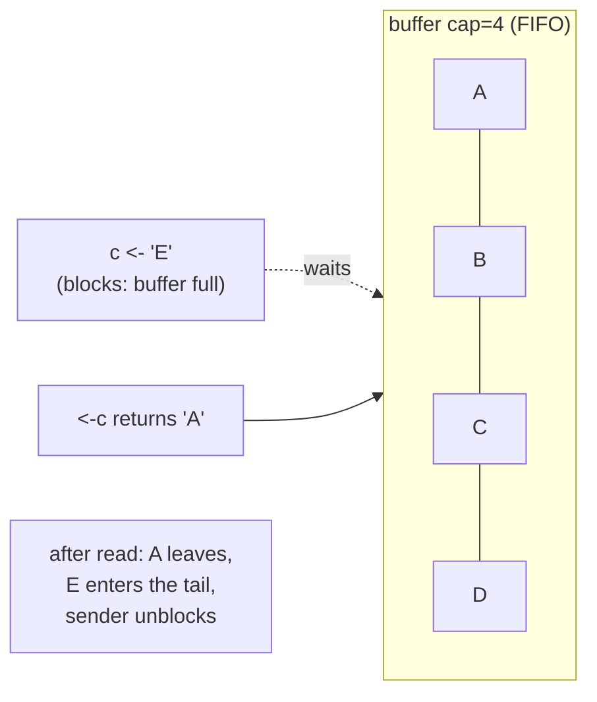
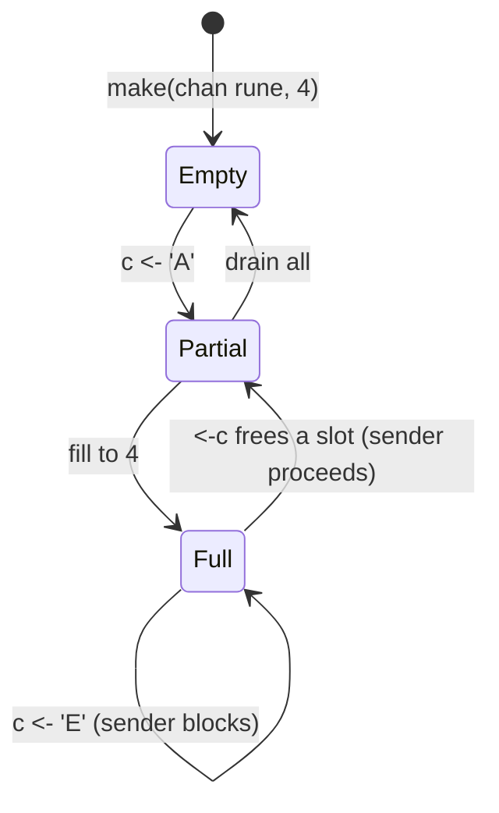
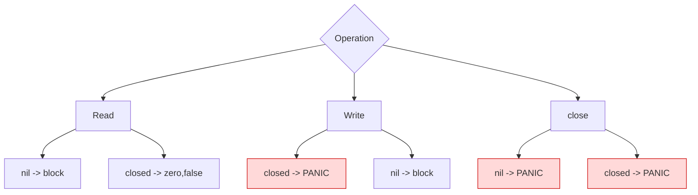
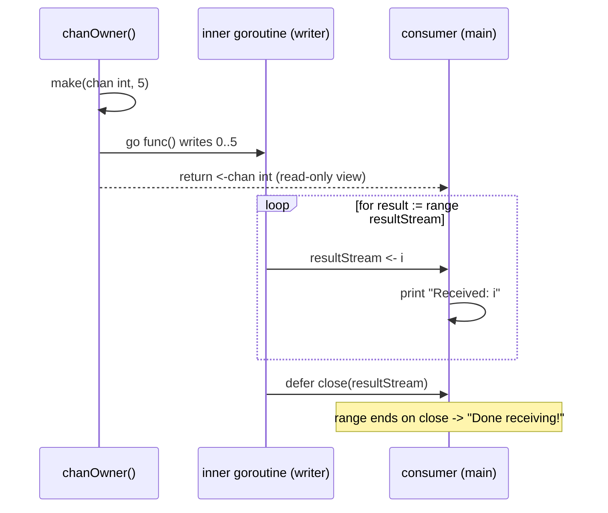

# Ch 3.9 — Buffered Channels, nil Channels, and Channel Ownership

> Book: *Concurrency in Go* (Katherine Cox-Buday, O'Reilly 2017) · Chapter 3: Go's Concurrency Building Blocks · Pages ~70–78
> ⬅️ Prev: [Channels: basics](08-channels-basics.md) · ➡️ Next: [The select statement](10-select-statement.md) · 🏠 [Book index](../README.md)

## 🎯 In One Paragraph

A **buffered channel** is created with a capacity (`make(chan T, n)`) and acts as an in-memory **FIFO queue**: a sender can deposit up to `n` values before any receiver shows up, and only blocks on the `n+1`-th send. An **unbuffered channel** is just a buffered channel of capacity 0 — already "full" before any send — so it forces sender and receiver to meet. Because the goroutine that calls `make` chooses the capacity, buffering is tightly coupled to the producer, which is why buffered channels work best when the producer knows exactly how many values it will emit. The channel zero value is `nil`, and operating on it is dangerous: reading or writing blocks forever (possibly deadlocking) and **closing panics**. Cox-Buday distills all of this into a single result table and then tames it with the **channel-ownership pattern**: one goroutine *instantiates, writes, and closes* a channel and exposes only a `<-chan` read view, which structurally eliminates the panic/deadlock cases and leaves consumers with just two concerns — detecting close and handling blocking.

## 🧠 Key Concepts & Vocabulary

- **Buffered channel**: `make(chan T, n)`; holds up to `n` queued values. Send blocks only when full; receive blocks only when empty.
- **Capacity vs. length**: `cap(ch)` is the fixed buffer size; `len(ch)` is how many values are currently queued.
- **Unbuffered channel == capacity 0**: `make(chan T)` and `make(chan T, 0)` are equivalent — full before any write, so every send needs a matching receive.
- **FIFO queue semantics**: values come out in the order they went in.
- **Direct hand-off optimization**: if a buffered channel is empty *and* a receiver is already waiting, the value bypasses the buffer and goes sender→receiver directly.
- **Producer coupling**: whoever calls `make` decides buffering, so channel creation should sit next to the writing goroutine.
- **Premature optimization risk**: buffering can hide deadlocks by making them intermittent — a bad trade.
- **`nil` channel**: the zero value of a channel; read/write block forever, `close` panics.
- **Channel ownership**: a goroutine that *instantiates, writes to, and closes* a channel, exposing it to others only as a read-only `<-chan`.
- **Owner vs. consumer responsibilities**: owners have write access (`chan`/`chan<-`); consumers have read-only access (`<-chan`).

## 📚 Deep Dive

### Buffered channels: capacity decouples send from receive

```go
var dataStream chan interface{}
dataStream = make(chan interface{}, 4) // capacity 4
```

With capacity 4, a producer can perform four sends even with **no reader**. "Full" and "empty" are functions of the buffer size. Visualize filling a `chan rune` of capacity 4:



Step by step (no readers): `c <- 'A'` fills slot 0, `'B'`,`'C'`,`'D'` fill the rest. The channel is now full. The next send `c <- 'E'` **blocks** — the sending goroutine parks until a receiver frees a slot. A single `<-c` pops `A` (FIFO), the blocked send of `E` then completes onto the tail.



Buffered channels are still **blocking** — the preconditions (full/empty) just differ. They are, in effect, an in-memory FIFO queue for concurrent processes.

### Unbuffered is buffered with capacity 0

```go
a := make(chan int)    // capacity 0
b := make(chan int, 0) // identical behavior
```

A capacity-0 channel is "full" immediately, so every send must rendezvous with a receive. That's why unbuffered channels are a *synchronization point* while buffered channels are a *queue*.

### The direct hand-off detail

If a buffered channel is empty and a receiver is already waiting, the runtime passes the value straight from sender to receiver, bypassing the buffer entirely. You never observe this directly, but it explains why buffered channels don't add latency when a consumer is keeping up.

### A complete buffered-channel program

The producer can push all five values and finish before the consumer reads even one, because the buffer absorbs them. Using a `bytes.Buffer` reduces interleaving noise (it doesn't guarantee ordering). Verified at `/tmp/cig/verify/ch3b/09a_buffered`:

```go
package main

import (
	"bytes"
	"fmt"
	"os"
)

func main() {
	var stdoutBuff bytes.Buffer
	defer stdoutBuff.WriteTo(os.Stdout)

	intStream := make(chan int, 4) // buffered
	go func() {
		defer close(intStream)
		defer fmt.Fprintln(&stdoutBuff, "Producer Done.")
		for i := 0; i < 5; i++ {
			fmt.Fprintf(&stdoutBuff, "Sending: %d\n", i)
			intStream <- i
		}
	}()

	for integer := range intStream {
		fmt.Fprintf(&stdoutBuff, "Received %v.\n", integer)
	}
}
```

Observed output (the producer front-loads its work):

```text
Sending: 0
Sending: 1
Sending: 2
Sending: 3
Sending: 4
Producer Done.
Received 0.
Received 1.
Received 2.
Received 3.
Received 4.
```

> The optimization: if a writer knows exactly how many values it will produce, sizing the buffer to that count lets it emit everything quickly and exit. The book warns there are caveats (Chapter 4) — buffering can mask deadlocks.

### nil channels: the dangerous zero value

A declared-but-not-`make`d channel is `nil`. All three operations misbehave:

```go
var dataStream chan interface{}
<-dataStream // blocks forever -> deadlock if it's the only goroutine
```
```text
fatal error: all goroutines are asleep - deadlock!
goroutine 1 [chan receive (nil chan)]:
```

```go
var dataStream chan interface{}
dataStream <- struct{}{} // also blocks forever
```
```text
fatal error: all goroutines are asleep - deadlock!
goroutine 1 [chan send (nil chan)]:
```

```go
var dataStream chan interface{}
close(dataStream) // PANIC
```
```text
panic: close of nil channel
```

All three verified at `/tmp/cig/verify/ch3b/09c_nil_read`, `09d_close_nil`. The panic on close is the worst outcome — **always initialize channels with `make` first.** (nil channels aren't useless, though: a `nil` case in a `select` is permanently disabled, a trick covered in [10](10-select-statement.md) and Chapter 4.)

### Table 3-2 — Result of channel operations given channel state

| Operation | Channel state | Result |
|-----------|---------------|--------|
| **Read** | `nil` | Block (forever) |
| | Open and Not Empty | Value |
| | Open and Empty | Block |
| | Closed | `<default value>`, `false` |
| | Write Only (`chan<-`) | Compilation Error |
| **Write** | `nil` | Block (forever) |
| | Open and Full | Block |
| | Open and Not Full | Write Value |
| | Closed | **panic** |
| | Receive Only (`<-chan`) | Compilation Error |
| **close** | `nil` | **panic** |
| | Open and Not Empty | Closes channel; reads succeed until drained, then produce default value |
| | Open and Empty | Closes channel; reads produce default value |
| | Closed | **panic** |
| | Receive Only (`<-chan`) | Compilation Error |

Three operations can **block** a goroutine and three can **panic** — which looks scary until you impose ownership.



### Channel ownership — the pattern that defuses the table

**Owner** = the goroutine that instantiates, writes, and closes a channel. The owner's checklist:

1. **Instantiate** the channel.
2. **Perform writes**, or hand ownership to another goroutine.
3. **Close** the channel.
4. **Encapsulate** 1–3 and expose only a reader (`<-chan`) view.

This removes entire rows of the danger table:

- You initialize it → no deadlock from writing to `nil`, no panic from closing `nil`.
- You alone decide when to close → no panic from writing to a closed channel, no panic from double-close.
- Compile-time type checking blocks improper writes by consumers.

A **consumer** only ever has a `<-chan` and only worries about two things:

- Knowing when the channel is **closed** (check the `ok` value).
- Responsibly **handling blocking** (time out, stop on signal, or block for the program's life — algorithm-dependent).



Verified program (`/tmp/cig/verify/ch3b/09b_ownership`):

```go
package main

import "fmt"

// chanOwner owns the channel's full lifecycle and returns a read-only view.
func chanOwner() <-chan int {
	resultStream := make(chan int, 5) // buffered: we know we'll produce 6
	go func() {
		defer close(resultStream) // close exactly once, here
		for i := 0; i <= 5; i++ {
			resultStream <- i
		}
	}()
	return resultStream // implicitly converts chan int -> <-chan int
}

func main() {
	resultStream := chanOwner()
	for result := range resultStream { // consumer: only blocks & detects close
		fmt.Printf("Received: %d\n", result)
	}
	fmt.Println("Done receiving!")
}
```

Output:

```text
Received: 0
Received: 1
Received: 2
Received: 3
Received: 4
Received: 5
Done receiving!
```

The entire lifecycle of `resultStream` lives inside `chanOwner`, so it's obvious the write never hits a nil/closed channel and the close happens exactly once. Cox-Buday's advice: **keep the scope of channel ownership small**. A channel stashed as a struct field with many methods touching it quickly becomes impossible to reason about.

## ⚠️ Pitfalls & Gotchas

- **Closing a `nil` channel panics**; writing to a closed channel panics; double-close panics. Ownership prevents all three.
- **Buffering can hide deadlocks.** A program that deadlocks unbuffered may "work" with a buffer until load changes — then fail at 3 a.m. Prefer finding deadlocks early.
- **Buffering is a premature optimization** unless the producer genuinely knows its output count or you have a measured backpressure need.
- **`len`/`cap` on a channel are racy as flow control** — another goroutine can change them between check and use. Don't gate logic on them.
- **Sender must not close a multi-producer channel** — if several goroutines write, closing from one can panic the others. Coordinate close out-of-band.
- **A consumer closing a channel is an anti-pattern** — consumers only read.

## 🆕 Modern Go Notes

> [!note] `nil` channel in `select` is a feature
> Setting a channel variable to `nil` disables its `select` case. This is the standard way to "turn off" a branch in a `for-select` loop (e.g., stop sending once a source is drained) — expanded in [10](10-select-statement.md) and Chapter 4.

> [!note] Ownership still matters even with generics & errgroup
> Modern helpers like `golang.org/x/sync/errgroup` and `sync.WaitGroup.Go` (Go 1.25) manage goroutine lifetimes, but none of them close your channels for you. The owner-writes-and-closes discipline is unchanged in Go 1.27.

## 🧪 Try It Yourself

1. Change the buffered example's capacity to `1`, then `0`. How does the interleaving of `Sending`/`Received` change?
2. Print `len(intStream)` and `cap(intStream)` right after the producer's loop (before it exits). What do you expect vs. observe, and why is reading `len` here racy in general?
3. Deliberately close `resultStream` twice in `chanOwner`. Observe the panic, then explain how ownership normally prevents it.
4. Make a channel owned by one goroutine but written by two. Trigger a `send on closed channel` panic, then redesign so only the owner closes.

## ✅ Self-Check Questions

<details><summary>What is the relationship between an unbuffered channel and a buffered one?</summary>
An unbuffered channel is a buffered channel with capacity 0 — `make(chan T)` equals `make(chan T, 0)`. It is "full" before any send, forcing a rendezvous.
</details>

<details><summary>When does a send on a buffered channel of capacity n block?</summary>
When the buffer already holds n values (it is full). The sending goroutine parks until a receive frees a slot.
</details>

<details><summary>What are the three operations on a nil channel and their outcomes?</summary>
Read → blocks forever. Write → blocks forever. Close → panics (`close of nil channel`). Always `make` before use.
</details>

<details><summary>List the owner's four responsibilities in the ownership pattern.</summary>
1) Instantiate the channel. 2) Write to it (or pass ownership). 3) Close it. 4) Encapsulate those and expose only a read-only `<-chan` view.
</details>

<details><summary>Which rows of Table 3-2 does channel ownership eliminate as hazards?</summary>
Write-to-nil (block), close-nil (panic), write-to-closed (panic), and double-close (panic) — because the single owner always initializes and closes exactly once.
</details>

<details><summary>Why can buffering be dangerous rather than helpful?</summary>
It can mask deadlocks by making them intermittent and load-dependent, and it is often a premature optimization that complicates reasoning about backpressure.
</details>

## 🔑 Key Takeaways

- Buffered channels are FIFO queues; send blocks only when full, receive only when empty.
- Unbuffered = capacity 0; it's a synchronization point, not a queue.
- The creating goroutine chooses buffering, so couple channel creation to the producer.
- `nil` channels block on read/write and **panic on close** — always `make` first.
- Table 3-2 shows 3 blocking and 3 panicking cases; **channel ownership** eliminates the dangerous ones.
- Owners instantiate/write/close and expose `<-chan`; consumers only detect close and handle blocking.

## 🔗 References & Further Reading

📝 Blogs/articles:
- [The Behavior Of Channels — Ardan Labs (Bill Kennedy)](https://www.ardanlabs.com/blog/2017/10/the-behavior-of-channels.html) — choosing buffered vs unbuffered by the delivery guarantee you need.
- [Curious Channels — Dave Cheney](https://dave.cheney.net/2013/04/30/curious-channels) — precise behavior of nil and closed channels, the basis for Table 3-2.
- [Go buffered channel — cap, len, blocking, backpressure, deadlocks — GoLinuxCloud](https://www.golinuxcloud.com/golang-buffered-channel/) — practical walk-through of full/empty blocking and backpressure.

💻 GitHub:
- [kat-co/concurrency-in-go-src](https://github.com/kat-co/concurrency-in-go-src) — the book's official listings, including the ownership example.
- [golang/go src/runtime/chan.go](https://github.com/golang/go/blob/master/src/runtime/chan.go) — `hchan` struct, buffer ring (`qcount`, `dataqsiz`, `buf`), and the direct hand-off path in `send`.

📖 Official docs/specs:
- [Go spec — Making slices, maps and channels (`make`)](https://go.dev/ref/spec#Making_slices_maps_and_channels) — the capacity argument and its meaning for channels.
- [Go spec — Close](https://go.dev/ref/spec#Close) — the defined behavior and panics of `close`.
- [Effective Go — Channels](https://go.dev/doc/effective_go#channels) — buffered channels as semaphores and idiomatic ownership.
