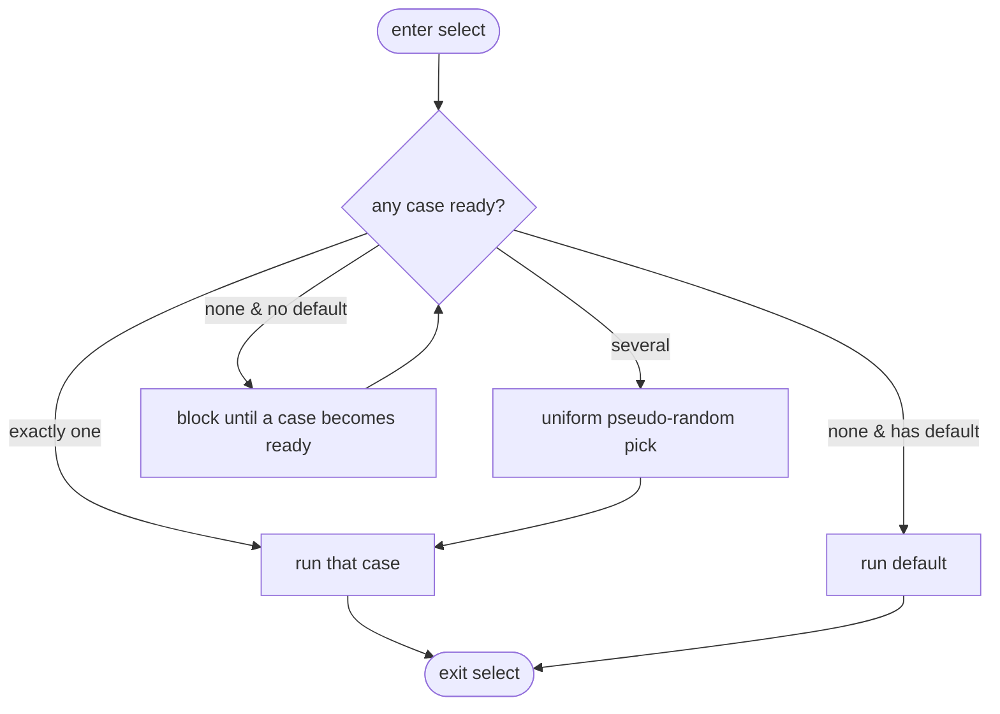
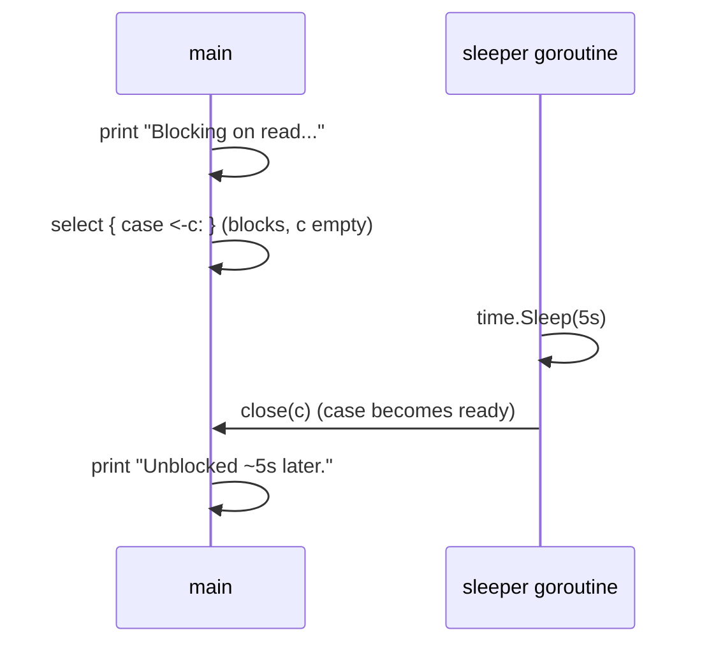
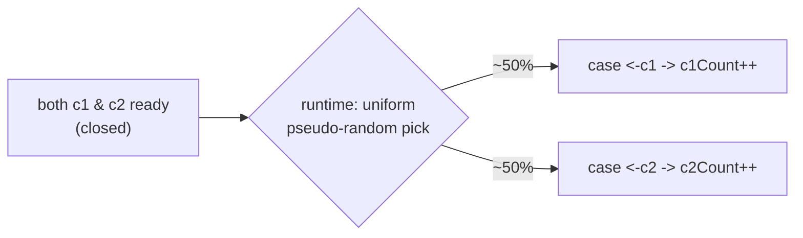
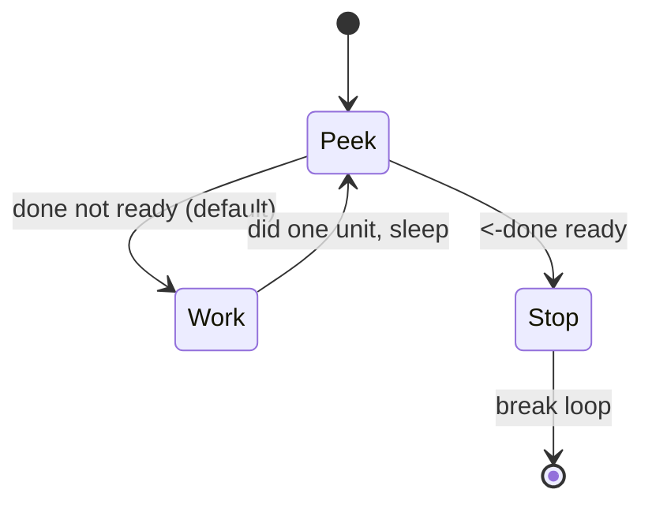

# Ch 3.10 — The select Statement

> Book: *Concurrency in Go* (Katherine Cox-Buday, O'Reilly 2017) · Chapter 3: Go's Concurrency Building Blocks · Pages ~78–82
> ⬅️ Prev: [Buffered & nil channels, ownership](09-buffered-nil-channels-and-ownership.md) · ➡️ Next: [The GOMAXPROCS lever](11-gomaxprocs-lever.md) · 🏠 [Book index](../README.md)

## 🎯 In One Paragraph

If channels are the glue that binds goroutines, `select` is the glue that binds channels — it's how you compose multiple channel operations into larger abstractions, both locally inside a function and globally at the seams between subsystems. Syntactically it resembles `switch`, but the resemblance is skin-deep: `select`'s `case`s are **not** evaluated top-to-bottom, there is **no fall-through**, and all cases (reads *and* writes) are considered **simultaneously** to see which are ready. If none are ready the whole `select` blocks; if several are ready the runtime picks one by a **uniform pseudo-random** choice (preventing starvation). Combined with `time.After` for timeouts, a `default` clause for non-blocking "do something else," and the `for-select` loop for "work while watching for a stop signal," `select` gives you cancellation, timeouts, waiting, and defaults — the toolkit for safe channel composition. And `select {}` with no cases simply blocks forever.

## 🧠 Key Concepts & Vocabulary

- **`select`**: a control structure that waits on multiple channel operations at once and proceeds with whichever becomes ready.
- **Not a `switch`**: cases are evaluated *simultaneously*, not sequentially; there is no fall-through and no implicit ordering.
- **Ready case**: a read whose channel is populated or closed, or a write whose channel is not at capacity.
- **Blocking select**: if no case is ready and there's no `default`, the whole statement blocks until one becomes ready.
- **Uniform pseudo-random selection**: when multiple cases are ready, the runtime chooses one with equal probability — a deliberate anti-starvation design, guaranteed by the spec.
- **`time.After(d)`**: returns a `<-chan Time` that fires once after duration `d`; the idiomatic timeout branch.
- **`default` clause**: runs immediately if no case is ready, making the `select` non-blocking.
- **`for-select` loop**: a `for` loop wrapping a `select`, usually with `default`, so a goroutine makes progress while watching a `done` channel.
- **Empty select (`select {}`)**: no cases; blocks the goroutine forever.
- **nil-channel case**: a case whose channel is `nil` is never ready — a way to disable a branch.

## 📚 Deep Dive

### Anatomy

```go
var c1, c2 <-chan interface{}
var c3 chan<- interface{}
select {
case <-c1:
    // do something when c1 is readable
case <-c2:
    // do something when c2 is readable
case c3 <- struct{}{}:
    // do something when c3 is writable
}
```

It looks like `switch`, but **all** the channel operations are checked at once. "Ready" means: for a read, the channel is populated or closed; for a write, the channel is not full. If none are ready, the statement blocks until one is. If several are ready, one is chosen pseudo-randomly.



### Blocking until something happens

```go
start := time.Now()
c := make(chan interface{})
go func() {
    time.Sleep(5 * time.Second)
    close(c)
}()

fmt.Println("Blocking on read...")
select {
case <-c:
    fmt.Printf("Unblocked %v later.\n", time.Since(start))
}
```

```text
Blocking on read...
Unblocked 5.000170047s later.
```

With a single case this is equivalent to a bare `<-c`, but it's the seed for the richer forms below.



### Multiple ready channels → uniform random

```go
c1 := make(chan interface{}); close(c1)
c2 := make(chan interface{}); close(c2)

var c1Count, c2Count int
for i := 1000; i >= 0; i-- {
    select {
    case <-c1:
        c1Count++
    case <-c2:
        c2Count++
    }
}
fmt.Printf("c1Count: %d\nc2Count: %d\n", c1Count, c2Count)
```

Both channels are closed, so both cases are always ready. Across ~1001 iterations the counts split roughly evenly (one verified run at `/tmp/cig/verify/ch3b/10a_select_random`):

```text
c1Count: 502
c2Count: 499
```

Why randomize? The runtime **cannot know your intent** — it can't infer why you grouped these channels. The best general strategy is to work well in the average case, so it weights every ready case equally. This prevents starvation: a deterministic order could let one busy channel permanently starve another. (You therefore **cannot** use case order for priority.)



### Timeouts with `time.After`

If no channel may ever become ready but you can't block forever, time out:

```go
var c <-chan int // nil channel: its case never fires
select {
case <-c:
case <-time.After(1 * time.Second):
    fmt.Println("Timed out.")
}
```

```text
Timed out.
```

`time.After(d)` returns a channel that sends the current time after `d`, giving a concise timeout branch. (Chapter 4 shows a more robust cancellation approach with `context`.)

### Non-blocking with `default`

If you want to do something *now* when nothing is ready:

```go
start := time.Now()
var c1, c2 <-chan int
select {
case <-c1:
case <-c2:
default:
    fmt.Printf("In default after %v\n", time.Since(start))
}
```

```text
In default after 1.421µs
```

The `default` runs essentially instantly, letting you exit the `select` without blocking.

### The `for-select` loop

Combine `default` with a `for` loop so a goroutine does work while periodically checking a stop signal:

```go
done := make(chan interface{})
go func() {
    time.Sleep(5 * time.Second)
    close(done)
}()

workCounter := 0
loop:
for {
    select {
    case <-done:
        break loop // labeled break exits the for, not just the select
    default:
    }

    workCounter++          // simulate work
    time.Sleep(1 * time.Second)
}
fmt.Printf("Achieved %v cycles of work before signalled to stop.\n", workCounter)
```

```text
Achieved 5 cycles of work before signalled to stop.
```

Each iteration peeks at `done` (non-blocking, thanks to `default`), does a unit of work, and repeats until `done` is closed. The `loop:` label is required because a bare `break` would only exit the `select`.



### The empty select

```go
select {} // no cases — blocks the current goroutine forever
```

Useful to park `main` while background goroutines run (though a bare block will deadlock if *every* goroutine is parked).

### A complete, runnable program

Verified at `/tmp/cig/verify/ch3b/10b_select_timeout` (uses shorter durations so it finishes quickly):

```go
package main

import (
	"fmt"
	"time"
)

func main() {
	// 1) Timeout: nil channel never fires; time.After wins.
	var c <-chan int
	select {
	case <-c:
	case <-time.After(200 * time.Millisecond):
		fmt.Println("Timed out.")
	}

	// 2) default: run immediately when no channel is ready.
	start := time.Now()
	var c1, c2 <-chan int
	select {
	case <-c1:
	case <-c2:
	default:
		fmt.Printf("In default after %v\n", time.Since(start))
	}

	// 3) for-select loop: work while watching for done.
	done := make(chan struct{})
	go func() {
		time.Sleep(500 * time.Millisecond)
		close(done)
	}()
	workCounter := 0
loop:
	for {
		select {
		case <-done:
			break loop
		default:
		}
		workCounter++
		time.Sleep(100 * time.Millisecond)
	}
	fmt.Printf("Achieved %v cycles of work before signalled to stop.\n", workCounter)
}
```

Output:

```text
Timed out.
In default after 1.326µs
Achieved 5 cycles of work before signalled to stop.
```

## ⚠️ Pitfalls & Gotchas

- **Case order is not priority.** Ready cases are chosen uniformly at random; you can't rely on top-to-bottom ordering.
- **`break` inside a `select` only exits the `select`.** To leave an enclosing `for`, use a labeled `break loop` (or `return`).
- **A `default` in a tight `for-select` with no work becomes a busy-wait**, burning CPU. Add real work or a blocking case.
- **`time.After` in a hot loop leaks timers** until they fire — each call allocates a new timer. In long-running loops prefer a reusable `time.Timer`/`time.NewTimer` (or `context`), as the standard docs now recommend.
- **Sending in a `select` case still panics on a closed channel** — `select` doesn't make sends safe, it only chooses among ready ops.
- **`select {}` blocks forever**; if it's the only goroutine left, you get a deadlock abort.

## 🆕 Modern Go Notes

> [!note] Prefer `context` for cancellation/timeout
> Since Go 1.7, `context.Context` is the idiomatic way to propagate cancellation and deadlines. A common pattern is `case <-ctx.Done():` inside a `for-select`. `context.WithTimeout`/`WithCancel` (and `WithCancelCause`, Go 1.20) generally replace ad-hoc `done` channels and raw `time.After` timeouts in production code. Chapter 4+ builds on this.

> [!note] `time.After` reuse and `context.AfterFunc` (Go 1.21)
> The runtime got smarter about timers, but `time.After` still can't be cancelled early. For "do X after a delay unless cancelled," `context.AfterFunc` (Go 1.21) is cleaner. For repeated timeouts in a loop, reuse one `time.Timer` and `Reset` it.

> [!note] Disabling a case with a nil channel
> Assigning `nil` to a channel variable disables its `select` case (a nil channel is never ready). This is the canonical trick to turn a branch on/off dynamically in a `for-select` loop — e.g., stop reading a drained source without spinning.

## 🧪 Try It Yourself

1. Add a `default` to the "multiple ready channels" example and run it. Why do the counts collapse (one channel wins almost everything, or `default` fires)?
2. Replace `time.After` in the `for-select` with a `context.WithTimeout`. Compare readability.
3. Build a two-channel merge with `select`: read from `a` and `b`, print whichever arrives, exit when both are closed. (Hint: set a channel variable to `nil` once it's drained.)
4. Write a priority select: prefer `high` over `low`. Why does a single `select` not give you priority, and how does a nested `select` with `default` fix it?

## ✅ Self-Check Questions

<details><summary>How is `select` different from `switch`?</summary>
`select` evaluates all channel-operation cases simultaneously (not sequentially), has no fall-through, blocks if none are ready, and picks pseudo-randomly among several ready cases. `switch` tests conditions in order.
</details>

<details><summary>When multiple cases are ready, which one runs?</summary>
One chosen by a uniform pseudo-random selection — each ready case has equal probability. This is a deliberate anti-starvation design and means case order carries no priority.
</details>

<details><summary>What does a `default` clause do?</summary>
It runs immediately if no case is ready, making the `select` non-blocking. It's commonly paired with a `for` loop (`for-select`) so a goroutine can keep working while polling a signal.
</details>

<details><summary>How do you add a timeout to a blocking `select`?</summary>
Add `case <-time.After(d):`. `time.After` returns a channel that fires after duration `d`, so the `select` unblocks via that case if nothing else becomes ready first.
</details>

<details><summary>Why does `break` inside a `for-select` sometimes not exit the loop?</summary>
A bare `break` only breaks out of the innermost `select`, not the surrounding `for`. Use a labeled `break loop` or `return` to leave the loop.
</details>

<details><summary>What does `select {}` do and when is it used?</summary>
It blocks the current goroutine forever (no case can ever be ready). It's sometimes used to keep `main` alive while background goroutines run — but causes a deadlock abort if it's the only remaining goroutine.
</details>

## 🔑 Key Takeaways

- `select` composes multiple channel ops; it's the glue binding channels together.
- All cases are considered at once; no fall-through, no ordering-based priority.
- Multiple ready cases → **uniform pseudo-random** choice → prevents starvation.
- `time.After` gives timeouts; `default` makes the `select` non-blocking.
- `for-select` with `default` lets a goroutine work while watching a `done` signal (use labeled `break`).
- `select {}` blocks forever; a `nil` channel disables its case.

## 🔗 References & Further Reading

📝 Blogs/articles:
- [Buffered, Unbuffered, Select, and Production Patterns — Cristian Curteanu](https://cristiancurteanu.com/go-channels-buffered-vs-unbuffered-select-and-production-patterns/) — select in real production patterns, timeouts, and leak avoidance.
- [Removing Randomness from Go's Select Statement — iximiuz Labs](https://labs.iximiuz.com/courses/having-fun-go-code-9be4efac/module-runtime/lesson-predictable-select) — hands-on look at *why* `select` randomizes and what happens if you don't.
- [Go select statement: multiplexing channels — golangtutorial.com](https://golangtutorial.com/golang-select/) — the random-choice rule, non-blocking default, timeouts without leaking timers, and context cancellation.

💻 GitHub:
- [golang/go — issue #21806 "select is not fair"](https://github.com/golang/go/issues/21806) — discussion confirming the uniform-pseudo-random guarantee and its edge cases.
- [golang/go src/runtime/select.go](https://github.com/golang/go/blob/master/src/runtime/select.go) — `selectgo`, the actual implementation, including the random permutation of cases.

📖 Official docs/specs:
- [Go spec — Select statements](https://go.dev/ref/spec#Select_statements) — the formal rules, including "uniform pseudo-random" selection and the empty `select`.
- [pkg.go.dev time.After](https://pkg.go.dev/time#After) — behavior, and the note about preferring `NewTimer` to avoid leaks in loops.
- [pkg.go.dev context](https://pkg.go.dev/context) — `Context.Done()` for cancellation/timeout in `select`.
