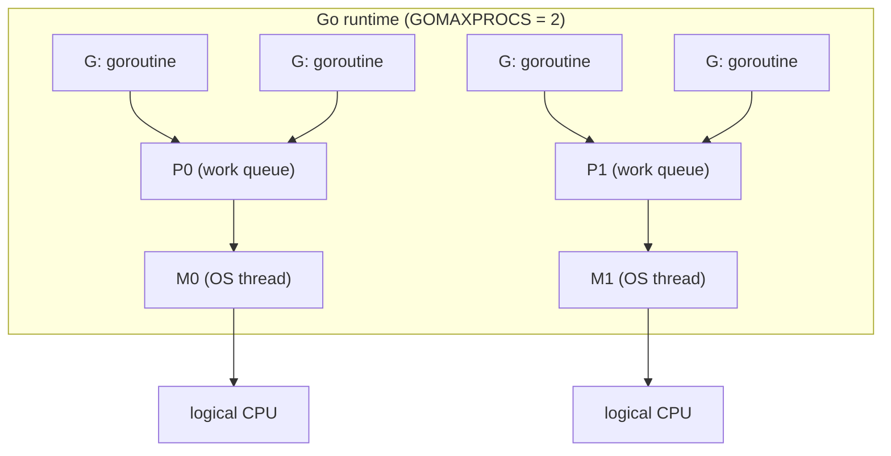
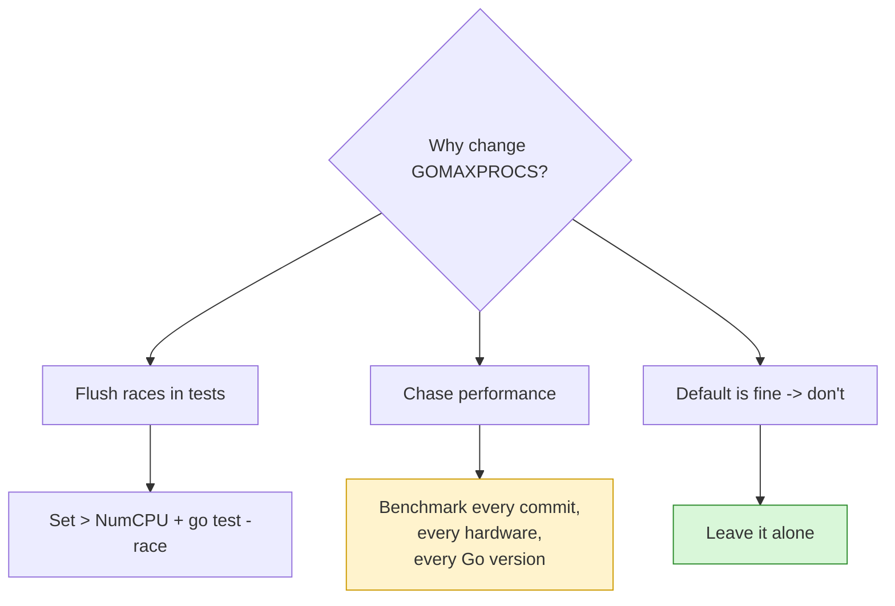
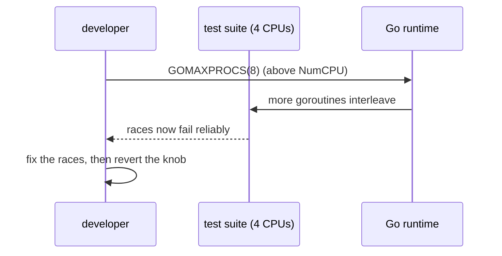

# Ch 3.11 — The GOMAXPROCS Lever

> Book: *Concurrency in Go* (Katherine Cox-Buday, O'Reilly 2017) · Chapter 3: Go's Concurrency Building Blocks · Pages ~83–84
> ⬅️ Prev: [The select statement](10-select-statement.md) · ➡️ Next: [Ch 4 — Concurrency Patterns in Go](../ch04-concurrency-patterns-in-go/README.md) · 🏠 [Book index](../README.md)

## 🎯 In One Paragraph

`runtime.GOMAXPROCS` is the one tuning knob the chapter exposes, and Cox-Buday argues its name is **misleading**: people assume it's about the number of logical CPUs, but what it really controls is the number of OS threads that host the scheduler's "work queues" (the *P*s, or processors, in the Go runtime's G-M-P model from [02](02-goroutines-under-the-hood-mn-scheduler-fork-join-cost.md)). Before Go 1.5 it defaulted to 1, so programs often did `runtime.GOMAXPROCS(runtime.NumCPU())`; since Go 1.5 the runtime defaults it to the number of logical CPUs, so you almost never need to set it. The honest advice is: **most of the time, don't touch it** — Go's scheduler is good enough that changing it usually does more harm than good. The legitimate uses are narrow: temporarily *raising* it above CPU count to shake out race conditions more reliably, or (rarely, with careful per-commit, per-hardware, per-Go-version benchmarking) squeezing out performance at the cost of portability and long-term stability.

## 🧠 Key Concepts & Vocabulary

- **`runtime.GOMAXPROCS(n)`**: sets the number of OS threads (the *P*s / work queues) that can execute Go code simultaneously, and **returns the previous value**.
- **Misnomer**: it's *not* the CPU count; it controls worker *queues/threads*, which only indirectly relates to logical processors.
- **Work queues (P)**: each hosts runnable goroutines; `GOMAXPROCS` sets how many exist. Tied to the M:N scheduler.
- **Pre-1.5 default = 1**: only one goroutine ran at a time; the `runtime.GOMAXPROCS(runtime.NumCPU())` incantation was common.
- **Post-1.5 default = NumCPU**: the runtime now auto-sets it to the logical CPU count.
- **`runtime.NumCPU()`**: number of logical CPUs the process can use.
- **Race-shaking use case**: raising `GOMAXPROCS` above CPU count increases interleaving, surfacing latent data races sooner.
- **"Closer to the metal" tradeoff**: manual tuning trades abstraction and portability for possible local speedups.

## 📚 Deep Dive

### What it actually controls

In the G-M-P scheduler, **G** = goroutine, **M** = OS thread, **P** = processor/context with a run queue. A goroutine must be attached to a *P* (via an *M*) to execute Go code. `GOMAXPROCS` sets the number of *P*s — the parallelism width of your program. More *P*s means more goroutines can run Go code at the same instant (up to the number of real CPUs).



### The historical snippet

Before Go 1.5 you'd routinely see:

```go
runtime.GOMAXPROCS(runtime.NumCPU())
```

because the default was 1 and almost everyone wants to use all cores. From **Go 1.5** onward this is the default, so the snippet is now redundant (and, post Go 1.25, often counterproductive in containers — see Modern Go Notes).

### Reading and setting (runnable)

`GOMAXPROCS(n)` sets a new value and returns the old one; passing a value `< 1` (conventionally `-1`) reads the current value without changing it. Verified at `/tmp/cig/verify/ch3b/11a_gomaxprocs` on a 16-CPU host:

```go
package main

import (
	"fmt"
	"runtime"
)

func main() {
	fmt.Printf("NumCPU: %d\n", runtime.NumCPU())

	current := runtime.GOMAXPROCS(-1) // read without changing
	fmt.Printf("Current GOMAXPROCS: %d\n", current)

	prev := runtime.GOMAXPROCS(2) // set to 2, returns previous
	fmt.Printf("Previous GOMAXPROCS was: %d, now set to 2\n", prev)
	fmt.Printf("Verify GOMAXPROCS now: %d\n", runtime.GOMAXPROCS(-1))

	runtime.GOMAXPROCS(current) // restore
	fmt.Printf("Restored GOMAXPROCS: %d\n", runtime.GOMAXPROCS(-1))
}
```

Observed output:

```text
NumCPU: 16
Current GOMAXPROCS: 16
Previous GOMAXPROCS was: 16, now set to 2
Verify GOMAXPROCS now: 2
Restored GOMAXPROCS: 16
```

### Should you tweak it?

**Usually no.** Go's scheduling algorithm is good enough that raising or lowering the number of worker queues/threads is more likely to hurt than help. Two situations where it can help:

1. **Flushing out race conditions.** Cox-Buday recounts a flaky test suite on 4-CPU infrastructure: with only four goroutines running at once, races rarely triggered. **Raising `GOMAXPROCS` above the CPU count** increased interleaving, triggered the races far more often, and got them fixed faster. (Pair this with `go test -race`.)
2. **Experimental performance tuning.** Some workloads run better with a specific worker count — but only discoverable by experiment, and fragile.



### The caution

If you tune for performance, Cox-Buday warns: re-benchmark **after every commit, on different hardware, and across Go versions**. Tweaking `GOMAXPROCS` "pushes your program closer to the metal it's running on, but at the cost of abstraction and long-term performance stability." The runtime's defaults improve over time; hard-coding a number opts you out of those improvements.



## ⚠️ Pitfalls & Gotchas

- **The name lies.** It's threads/work-queues, not "max processors." Don't reason about it as a CPU count.
- **Setting it to a hard-coded number** forgoes runtime improvements and portability across machines/Go versions.
- **Raising it for races is a diagnostic, not a fix.** Revert after you've fixed the underlying data race.
- **In containers (pre-Go 1.25), the default over-counted CPUs.** On a 64-core node with a 2-CPU cgroup limit, Go saw 64 and spawned too many threads → CFS throttling and tail-latency spikes.
- **It doesn't limit goroutines**, only how many run Go code in parallel; you can still have millions of goroutines.

## 🆕 Modern Go Notes

> [!note] Container-aware GOMAXPROCS (Go 1.25)
> Before Go 1.25, `GOMAXPROCS` defaulted to the *host* logical-CPU count, ignoring cgroup CPU limits — a classic Kubernetes footgun. **Since Go 1.25**, on Linux the runtime reads the cgroup CPU quota at startup and defaults `GOMAXPROCS` to the *lower* of the machine's CPU count and the container's CPU limit, and it **updates automatically** if the limit changes at runtime. This largely removes the need for `uber-go/automaxprocs` on new Go. (It still doesn't read memory limits — `GOMEMLIMIT` is separate.)

> [!note] `uber-go/automaxprocs` for older Go / portability
> On Go versions before 1.25, import `uber-go/automaxprocs` (blank import) to set `GOMAXPROCS` from the cgroup CPU quota automatically. It remains common in existing codebases and for ECS (`rdforte/gomaxecs`).

> [!note] `GOMAXPROCS` env var
> You can set the value without code via the `GOMAXPROCS` environment variable; the function call overrides it. Go 1.25's container-aware default also respects an explicit env/flag if you set one.

## 🧪 Try It Yourself

1. Run the demo program with `GOMAXPROCS=1 go run .` — does the function still report the right values? What changed in `NumCPU` vs `GOMAXPROCS`?
2. Write a tiny program with a deliberate data race (two goroutines incrementing a shared `int`). Run `go test -race` (or `go run -race`) with `GOMAXPROCS=1` vs a high value. Does the higher value surface the race more often?
3. Benchmark a CPU-bound parallel workload (e.g., summing a big slice in N goroutines) across `GOMAXPROCS` = 1, NumCPU/2, NumCPU, 2×NumCPU. Where does it stop improving?
4. If you have Docker, run a Go 1.25+ program in a container with `--cpus=2` and print `runtime.GOMAXPROCS(-1)`. Compare to a pre-1.25 image.

## ✅ Self-Check Questions

<details><summary>Why does Cox-Buday call the name GOMAXPROCS misleading?</summary>
People assume it's the number of logical CPUs, but it actually controls the number of OS threads hosting the scheduler's work queues (the P's). It relates to CPU count only indirectly.
</details>

<details><summary>What does `runtime.GOMAXPROCS(n)` return?</summary>
The previous value of GOMAXPROCS. Passing a value < 1 (e.g., -1) reads the current value without changing it.
</details>

<details><summary>What was the pre-1.5 default, and what is the default now?</summary>
Before Go 1.5 the default was 1 (hence the common `GOMAXPROCS(NumCPU())` snippet). Since Go 1.5 it defaults to the number of logical CPUs.
</details>

<details><summary>Give a legitimate reason to set GOMAXPROCS above the CPU count.</summary>
To flush out race conditions: more parallel interleaving triggers latent data races more reliably, so they can be found and fixed (use with `go test -race`).
</details>

<details><summary>What precautions does the book recommend if you tune GOMAXPROCS for performance?</summary>
Re-benchmark after every commit, on different hardware, and with different Go versions — because the knob trades abstraction and long-term stability for local speedups.
</details>

<details><summary>How did Go 1.25 change the default in containers?</summary>
On Linux the runtime now reads the cgroup CPU quota and defaults GOMAXPROCS to the lower of host CPUs and the container limit, updating automatically if the limit changes — avoiding the old over-threading/CFS-throttling problem.
</details>

## 🔑 Key Takeaways

- `GOMAXPROCS` controls scheduler work queues (P's / OS threads), not literally "max processors."
- It returns the previous value; pass `-1` to read without changing.
- Default was 1 pre-1.5; since 1.5 it's `NumCPU`; since 1.25 it's container-aware on Linux.
- **Usually leave it alone** — the scheduler's defaults beat manual tuning in most cases.
- Raising it above CPU count is a handy way to surface data races in tests.
- If you tune it, re-benchmark across commits, hardware, and Go versions.

## 🔗 References & Further Reading

📝 Blogs/articles:
- [Container-aware GOMAXPROCS — go.dev/blog](https://go.dev/blog/container-aware-gomaxprocs) — the official explanation of the Go 1.25 change and what GOMAXPROCS semantically means.
- [GOMAXPROCS and Kubernetes: Go App Throttled, How to Fix It — dev.to](https://dev.to/ohugonnot/gomaxprocs-and-kubernetes-go-app-throttled-how-to-fix-it-li6) — the CFS-throttling problem from host-vs-container CPU mismatch.
- [Go 1.25/1.26 shipped features that matter — Stackademic/Medium](https://medium.com/stackademic/go-1-25-and-1-26-shipped-features-your-team-is-probably-ignoring-heres-what-actually-matters-11d87aee888e) — context on the container-aware default and related runtime changes.

💻 GitHub:
- [uber-go/automaxprocs](https://github.com/uber-go/automaxprocs) — automatically set GOMAXPROCS from the Linux container CPU quota (pre-1.25 essential).
- [golang/go src/runtime/proc.go](https://github.com/golang/go/blob/master/src/runtime/proc.go) — the scheduler, `GOMAXPROCS`, `startTheWorld`/`stopTheWorld`, and P management.

📖 Official docs/specs:
- [pkg.go.dev runtime.GOMAXPROCS](https://pkg.go.dev/runtime#GOMAXPROCS) — canonical signature, return value, and env-var behavior.
- [pkg.go.dev runtime.NumCPU](https://pkg.go.dev/runtime#NumCPU) — the logical CPU count used by the default.
- [Go release notes — Go 1.5](https://go.dev/doc/go1.5) — the release that changed the default from 1 to NumCPU.
