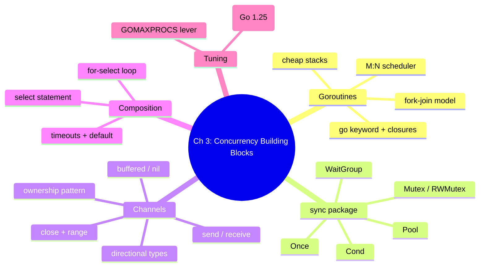
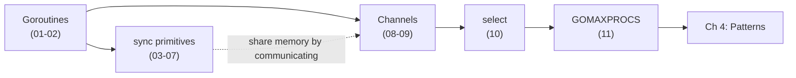

# Chapter 3 — Go's Concurrency Building Blocks

> Book: *Concurrency in Go* (Katherine Cox-Buday, O'Reilly 2017) · Chapter 3 · Pages ~37–84
> ⬅️ Prev: [Ch 2 — Modeling Your Code](../ch02-modeling-your-code-csp/README.md) · ➡️ Next: [Ch 4 — Concurrency Patterns in Go](../ch04-concurrency-patterns-in-go/README.md) · 🏠 [Book index](../README.md)

## Overview

This chapter is the toolbox. It walks through every low-level concurrency primitive Go gives you and, crucially, *when* to reach for each. It opens with **goroutines** — the lightweight, runtime-scheduled units of concurrent work — and explains how the **M:N scheduler** multiplexes them onto OS threads using a fork-join model at tiny cost. It then covers the **memory-access-synchronization** side of the house: `sync.WaitGroup` for waiting on a set of goroutines, `Mutex`/`RWMutex` for guarding critical sections, `Cond` for signaling on a condition, `Once` for one-time initialization, and `Pool` for reusing expensive objects. The second half pivots to Go's signature CSP style: **channels** for communicating between goroutines, the **`select`** statement for composing channels, and finally the **`GOMAXPROCS`** lever for (rarely) tuning scheduler parallelism. The throughline is Go's maxim — *share memory by communicating* — balanced against the reality that the `sync` package is still the right tool for simple, performance-sensitive memory guards.

## Mini-chapters

| # | File | One-line summary |
|---|------|------------------|
| 3.1 | [01-goroutines-basics-and-closures.md](01-goroutines-basics-and-closures.md) | Starting goroutines with `go`, anonymous functions, and how closures capture variables. |
| 3.2 | [02-goroutines-under-the-hood-mn-scheduler-fork-join-cost.md](02-goroutines-under-the-hood-mn-scheduler-fork-join-cost.md) | The M:N scheduler, fork-join concurrency, green threads, and why goroutines are cheap. |
| 3.3 | [03-sync-waitgroup.md](03-sync-waitgroup.md) | `sync.WaitGroup` for waiting on a collection of goroutines to finish. |
| 3.4 | [04-mutex-and-rwmutex.md](04-mutex-and-rwmutex.md) | `Mutex` and `RWMutex` for guarding critical sections and read/write access. |
| 3.5 | [05-cond.md](05-cond.md) | `sync.Cond` for signaling goroutines when a condition changes (`Wait`/`Signal`/`Broadcast`). |
| 3.6 | [06-once.md](06-once.md) | `sync.Once` for running initialization exactly once. |
| 3.7 | [07-pool.md](07-pool.md) | `sync.Pool` for pooling and reusing expensive allocations. |
| 3.8 | [08-channels-basics.md](08-channels-basics.md) | Declaring, directional, send/receive, close, range, and unblocking many goroutines by closing. |
| 3.9 | [09-buffered-nil-channels-and-ownership.md](09-buffered-nil-channels-and-ownership.md) | Buffered & nil channels, the operations/state result table, and the channel-ownership pattern. |
| 3.10 | [10-select-statement.md](10-select-statement.md) | `select` for composing channels: random choice, timeouts, `default`, and the `for-select` loop. |
| 3.11 | [11-gomaxprocs-lever.md](11-gomaxprocs-lever.md) | `runtime.GOMAXPROCS`: what it really controls, defaults over time, and when to tune it. |

## How the pieces fit

- **Goroutines (3.1–3.2)** are the *units* of concurrent work.
- **`sync` (3.3–3.7)** protects shared memory when goroutines must coordinate without messages.
- **Channels (3.8–3.9)** move data between goroutines; **`select` (3.10)** composes channels into larger abstractions with cancellation, timeouts, and waiting.
- **`GOMAXPROCS` (3.11)** is the single scheduler knob — almost always best left at its default.

Together these are everything you need before Chapter 4 assembles them into reusable **concurrency patterns**.
