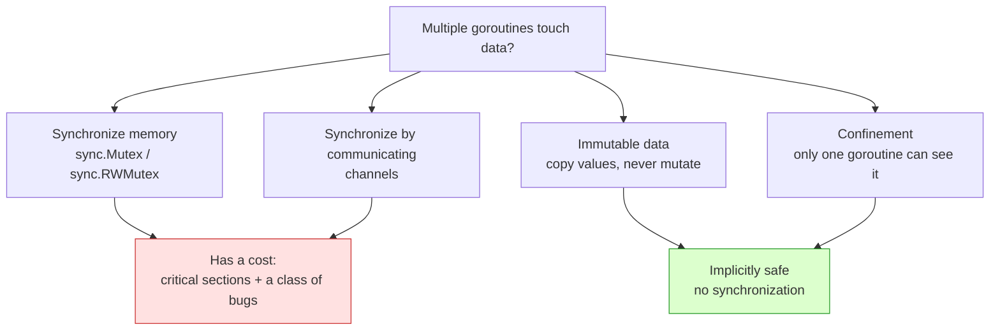
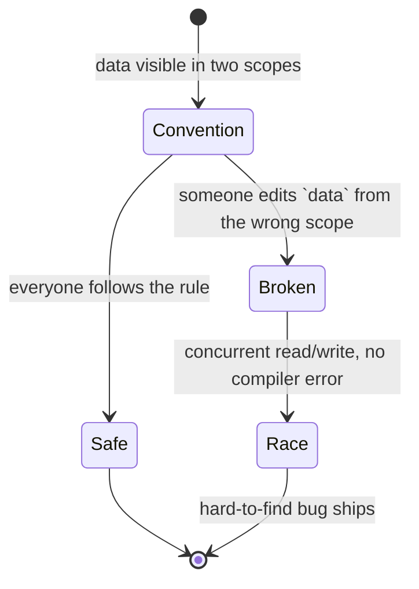
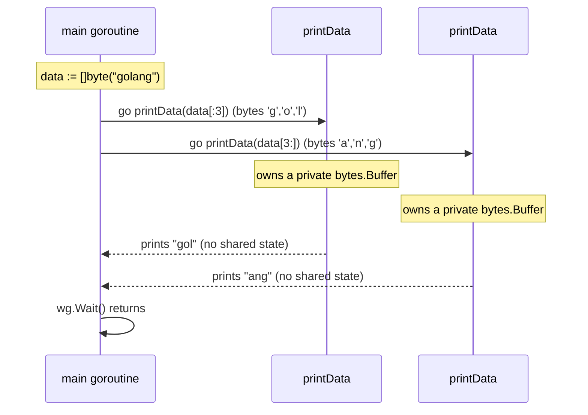

# Ch 4.1 — Confinement

> Book: *Concurrency in Go* (Katherine Cox-Buday, O'Reilly 2017) · Chapter 4: Concurrency Patterns in Go · Pages ~85–89
> ⬅️ Prev: [Chapter 4 overview](./README.md) · ➡️ Next: [The for-select Loop](./02-for-select-loop.md) · 🏠 [Book index](../README.md)

## 🎯 In One Paragraph

When several goroutines might touch the same data, there are four ways to stay safe: synchronize with memory primitives (`sync.Mutex`), synchronize by communicating (channels), rely on **immutable data**, or rely on **confinement**. Confinement is the deceptively simple idea of arranging your program so a given piece of data is only ever reachable from *one* concurrent process. If only one goroutine can see it, no two goroutines can race on it, so **no synchronization is required at all**. Confinement comes in two flavors: *ad hoc* (safe only by convention and discipline) and *lexical* (safe because the compiler and scope rules make the wrong thing impossible to write). Lexical confinement is the one to reach for: it gives you smaller critical sections (often none), lower cognitive load, and lets you write plain synchronous code inside each confined scope.

## 🧠 Key Concepts & Vocabulary

- **Confinement** — ensuring information is only ever available from one concurrent process; when achieved, the program is *implicitly* concurrent-safe and needs no synchronization.
- **Immutable data** — data that is never modified after creation. In Go you approximate it by passing *copies of values* rather than pointers. Go has no language-level immutable pointers.
- **Ad hoc confinement** — confinement held together only by *convention* (team rules, codebase style, community norms). Fragile; realistically needs static analysis to enforce, which most teams don't have.
- **Lexical confinement** — using *lexical scope* to expose only the correct data and primitives to each goroutine, so it is *impossible* to do the wrong thing. The compiler enforces it.
- **Channel direction confinement** — exposing only the send (`chan<- T`) or only the receive (`<-chan T`) aspect of a channel to a given goroutine, confining each role.
- **Critical section** — a region of code that must not run concurrently with itself. Confinement aims to eliminate these rather than guard them.

## 📚 Deep Dive

### The four safe-operation options



Immutable data is, in some sense, ideal: every goroutine may read the same value, but none may modify it. To "change" it you build a new copy. That removes critical sections (and can make programs faster). Go does not offer immutable pointers, so you lean on value copies. Confinement is the other implicitly-safe option — a little more involved than copying values, so the rest of this note explores it.

### Ad hoc confinement — safe only by promise

Ad hoc confinement works only because everyone *agrees* not to misuse shared data. Consider this (adapted from the book): a `data` slice is visible to both the producer closure and the consumer loop, but by convention we only read it from the producer.

```go
package main

import "fmt"

func main() {
	data := make([]int, 4)

	loopData := func(handleData chan<- int) {
		defer close(handleData)
		for i := range data { // only this closure should touch `data`
			handleData <- data[i]
		}
	}

	handleData := make(chan int)
	go loopData(handleData)

	for num := range handleData {
		fmt.Println(num) // prints 0 0 0 0
	}
}
```

Nothing *stops* the `for num := range handleData` loop (or anyone else) from also reading or writing `data`. The confinement is a gentleman's agreement. On a real codebase touched by many people under deadline pressure, that agreement quietly breaks. A static-analysis tool *could* catch it, but relying on that assumes a level of tooling maturity most teams never reach. Hence: prefer lexical confinement, which "wields the compiler to enforce the confinement."



### Lexical confinement — let the compiler enforce it

Lexical confinement restricts *what is in scope* so the wrong operation won't even compile. We already saw this with channel directions in Chapter 3: the owner creates the channel and only hands out a read-only view.

```go
package main

import "fmt"

// chanOwner confines the WRITE aspect of `results` to its own closure.
func chanOwner() <-chan int { // returns a receive-only channel
	results := make(chan int, 5)
	go func() {
		defer close(results)
		for i := 0; i <= 5; i++ {
			results <- i
		}
	}()
	return results
}

// consumer is handed a receive-only channel: it can do nothing but read.
func consumer(results <-chan int) {
	for result := range results {
		fmt.Printf("Received: %d\n", result)
	}
	fmt.Println("Done receiving!")
}

func main() {
	results := chanOwner() // only a read view escapes chanOwner
	consumer(results)
}
```

Output:

```
Received: 0
Received: 1
Received: 2
Received: 3
Received: 4
Received: 5
Done receiving!
```

- The `results` channel is instantiated *inside* `chanOwner`'s lexical scope, so only the inner closure can write to it. The write aspect is confined.
- `chanOwner` returns `<-chan int` — a receive-only view. `consumer` takes `<-chan int` and physically cannot send on it; the compiler rejects any attempt. The read aspect is confined to `consumer`.

Channels are already concurrent-safe, so this is a gentle lead-in. The real payoff is confining a type that is **not** concurrent-safe, like `bytes.Buffer`:

```go
package main

import (
	"bytes"
	"fmt"
	"sync"
)

// printData cannot see the original slice; it only receives the sub-slice
// it is given, so each goroutine is confined to its own disjoint bytes.
func printData(wg *sync.WaitGroup, data []byte) {
	defer wg.Done()
	var buff bytes.Buffer // a fresh, goroutine-local, NON-concurrent-safe buffer
	for _, b := range data {
		fmt.Fprintf(&buff, "%c", b)
	}
	fmt.Println(buff.String())
}

func main() {
	var wg sync.WaitGroup
	wg.Add(2)
	data := []byte("golang")
	go printData(&wg, data[:3]) // "gol"
	go printData(&wg, data[3:]) // "ang"
	wg.Wait()
}
```

Output (goroutine ordering may swap the two lines):

```
gol
ang
```

`printData` does not close over `data`; it only receives a `[]byte` argument. We hand each goroutine a **disjoint sub-slice** (`data[:3]` and `data[3:]`), so even though both slices share the same backing array, the two goroutines write to non-overlapping index ranges and each owns a private `bytes.Buffer`. Because of lexical scope we made it *impossible*¹ to do the wrong thing — so no mutex, no channel, no synchronization.



> ¹ Ignoring the `unsafe` package — it is called *unsafe* for a reason.

### Why bother, when synchronization exists?

Two concrete wins:

1. **Performance** — synchronization has a cost. No critical section means nothing to lock, so you never pay that cost.
2. **Reduced cognitive load** — you sidestep an entire category of synchronization bugs (deadlocks, forgotten unlocks, lock ordering). Inside a confined scope you get to write ordinary synchronous code and reason about it sequentially.

The catch: confinement can be *hard to establish*. Not all data decomposes into neat, disjoint, owned pieces. When it doesn't, fall back to Go's concurrency primitives (channels and mutexes).

## ⚠️ Pitfalls & Gotchas

- **Ad hoc confinement rots.** It is only as strong as the discipline of everyone who edits the file. Without enforced static analysis, treat it as temporary.
- **Shared backing arrays.** Two sub-slices of the same slice share one backing array. Confinement holds only if the index ranges are disjoint (as with `data[:3]` / `data[3:]`). Overlapping sub-slices passed to concurrent goroutines re-introduce a data race.
- **Closing over the variable breaks confinement.** If `printData` had closed over `data` instead of taking a parameter, the confinement would evaporate — the closure could touch the whole slice.
- **Passing a pointer leaks the mutable aliasing.** Confinement by value copy only works while you actually copy. Hand out `*T` and you have shared mutable state again.
- **Returning a bidirectional channel** (`chan int` instead of `<-chan int`) throws away the compiler-enforced confinement of the write aspect.

## 🆕 Modern Go Notes

> 🆕 **Generics instead of `interface{}` for generic confinement.** The book leans on `interface{}` for reusable helpers. Since Go 1.18 you can write type-safe generic owners, e.g. `func chanOwner[T any]() <-chan T`, preserving confinement without type assertions.

> 🆕 **`sync.OnceValue` (Go 1.21) for lazily-built immutable data.** When you want an immutable, lazily-initialized shared value, `sync.OnceValue(func() T { ... })` computes it exactly once and every goroutine reads the same copy — a clean pairing with the immutable-data strategy.

> 🆕 **Race detector.** Build or test with `-race` to catch broken confinement at runtime. (In a toolchain without a C compiler, `-race` needs `CGO_ENABLED=1` and `gcc`/`clang`; if unavailable you can only verify via plain `go run`.)

## 🧪 Try It Yourself

1. Modify the `bytes.Buffer` example to split `data` into *overlapping* sub-slices (e.g. `data[:4]` and `data[2:]`) and run with `go run -race`. Explain what the race detector reports and why.
2. Rewrite `chanOwner`/`consumer` using generics so it streams `string` values with zero type assertions.
3. Turn the ad hoc example into a lexically confined one: make `data` unreachable from the consumer loop so the confinement is compiler-enforced.
4. Benchmark a mutex-guarded counter versus a confinement approach (one goroutine owns the counter, others send increments on a channel). Compare allocations and ns/op.

## ✅ Self-Check Questions

<details><summary>1. What are the four strategies for safe concurrent operation listed in this section?</summary>
Memory synchronization primitives (e.g. `sync.Mutex`), synchronization via communication (channels), immutable data, and data protected by confinement.
</details>

<details><summary>2. Why is immutable data implicitly concurrent-safe?</summary>
Because no goroutine ever modifies it. All goroutines may read the same value; to "change" it you must create a new copy, so there is no shared mutable state and therefore no data race.
</details>

<details><summary>3. What is the difference between ad hoc and lexical confinement?</summary>
Ad hoc confinement is enforced only by convention and relies on developer discipline (or static analysis). Lexical confinement uses lexical scope so the compiler makes incorrect access impossible to write.
</details>

<details><summary>4. In the `bytes.Buffer` example, why is no synchronization needed even though both goroutines share the same backing array?</summary>
Each goroutine only receives a disjoint sub-slice (`data[:3]` vs `data[3:]`), writes to non-overlapping indices, and uses its own private `bytes.Buffer`. There is no overlapping shared mutable state, so no synchronization is required.
</details>

<details><summary>5. What two benefits does confinement give you over synchronization?</summary>
Improved performance (no critical sections to lock, so no synchronization cost) and reduced cognitive load (you avoid an entire class of synchronization bugs and can write synchronous code inside the confined scope).
</details>

<details><summary>6. How does returning `<-chan int` from `chanOwner` enforce confinement?</summary>
The receive-only type means callers physically cannot send on the channel; any attempt fails to compile. The write aspect stays confined to the owner's closure.
</details>

## 🔑 Key Takeaways

- Confinement = only one concurrent process can ever reach the data ⇒ implicitly safe, no synchronization.
- Two forms: **ad hoc** (convention, fragile) and **lexical** (compiler-enforced, preferred).
- Confine channel *direction* (`chan<-` / `<-chan`) and hand goroutines private, disjoint data (e.g. sub-slices + a local `bytes.Buffer`).
- Payoff: fewer/no critical sections, better performance, far less room for synchronization bugs.
- Cost: it can be hard to establish; when you can't, fall back to channels and mutexes.

## 🔗 References & Further Reading

📝 Blogs/articles
- [Golang Concurrency: How Confinement Improves Performance Without Locks](https://dev.to/bahaanoah/golang-concurrency-how-confinement-improves-performance-without-locks-1ld5) — walks through the confinement pattern and why it avoids mutexes.
- [Serial Confinement in Go](https://dev.to/l_walid/serial-confinement-in-go-2ak0) — explains achieving confinement by transferring ownership through channels.
- [Notes from Concurrency Patterns in Go](https://notsocomplex.medium.com/notes-from-concurrency-patterns-in-go-8cfc55b44e24) — a reader's summary of this exact chapter, useful as a cross-check.
- [Principles of designing Go APIs with channels (channel notes gist)](https://gist.github.com/gammazero/eaa8faa67dabacfdc8d2c732bbf84cc5) — "An API should declare the directionality of its channels," the core of channel-direction confinement.

💻 GitHub
- [kat-co/concurrency-in-go-src](https://github.com/kat-co/concurrency-in-go-src) — the book's official source code, including the confinement examples.
- [boolean-maybe/tiki testdata/go-concurrency.md](https://github.com/boolean-maybe/tiki/blob/main/testdata/go-concurrency.md) — concise notes on CSP, "share memory by communicating," and confinement.

📖 Official docs/specs
- [pkg.go.dev: bytes.Buffer](https://pkg.go.dev/bytes#Buffer) — documents that a `Buffer` is *not* safe for concurrent use, which is exactly why confinement matters here.
- [The Go Memory Model](https://go.dev/ref/mem) — the formal rules that make "no shared access" implicitly safe.
- [Effective Go: Share by communicating](https://go.dev/doc/effective_go#sharing) — the idiom underpinning confinement and channel ownership.
