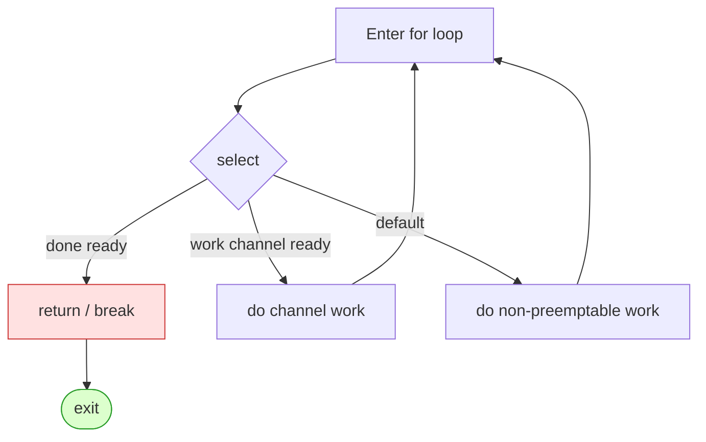
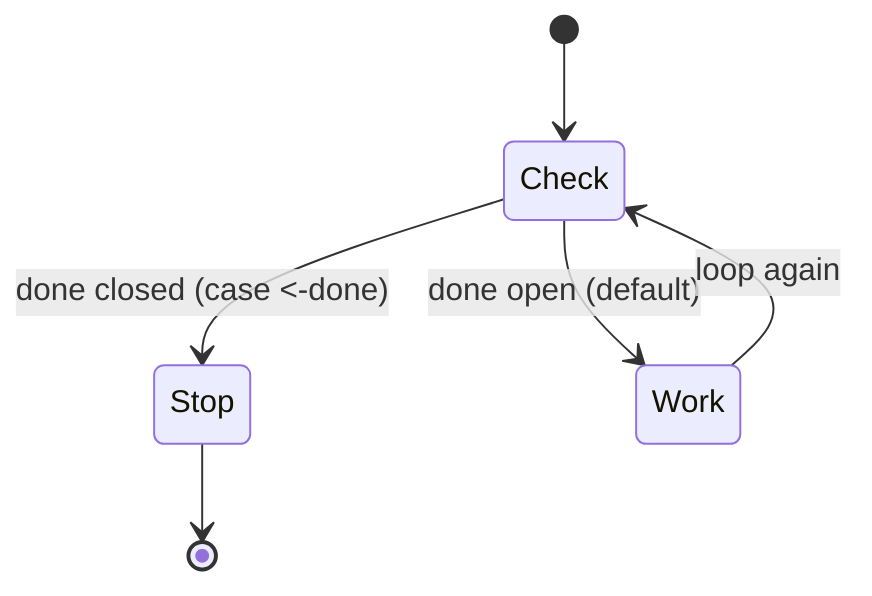
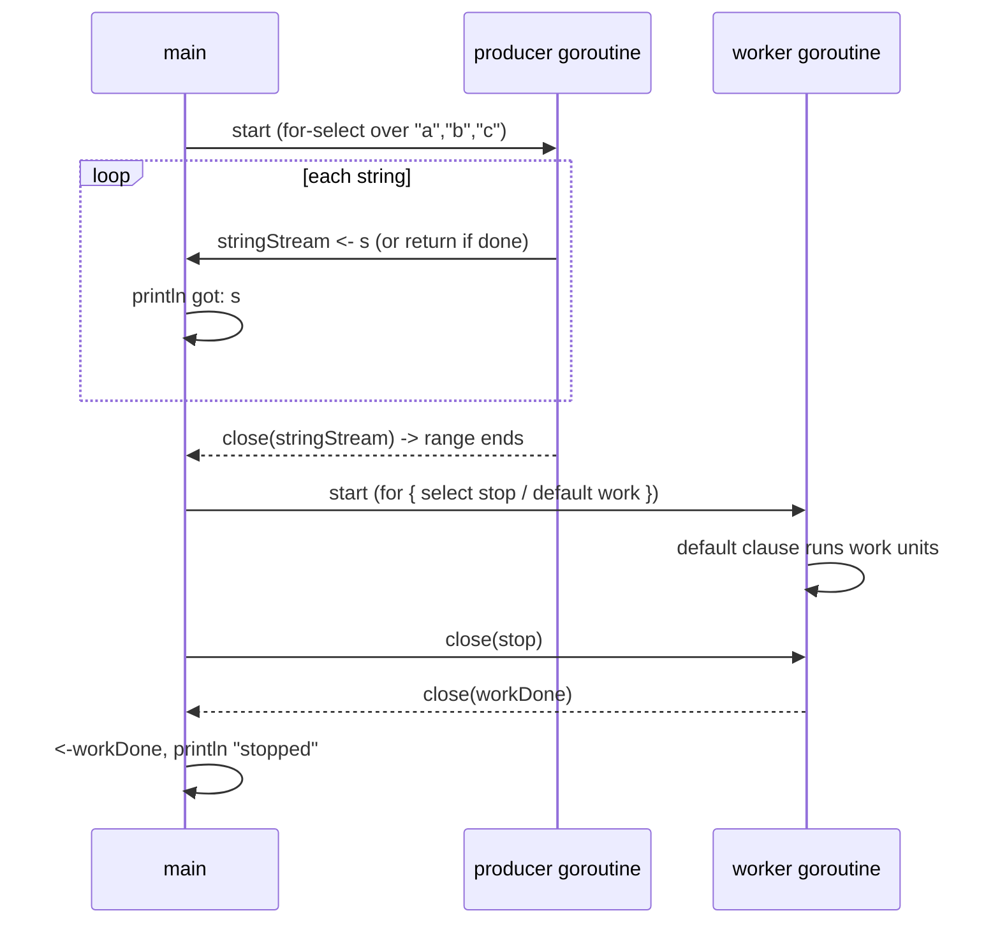

# Ch 4.2 — The for-select Loop

> Book: *Concurrency in Go* (Katherine Cox-Buday, O'Reilly 2017) · Chapter 4: Concurrency Patterns in Go · Pages ~89–90
> ⬅️ Prev: [Confinement](./01-confinement.md) · ➡️ Next: [Preventing Goroutine Leaks](./03-preventing-goroutine-leaks.md) · 🏠 [Book index](../README.md)

## 🎯 In One Paragraph

The **for-select loop** is one of the most common shapes you'll see in idiomatic Go: a `for` loop wrapping a `select` statement. It is not a feature of the language — just a convention — but it shows up everywhere because it is the natural way to repeatedly wait on channel operations while remaining responsive to a cancellation signal. The two canonical uses are (1) *sending iteration-variable values out on a channel* while still honoring a `done` channel, and (2) *looping until told to stop*, where the body either sits after a short `select` or lives inside the `select`'s `default` clause. Which of the two "loop forever" variants you pick is purely stylistic.

## 🧠 Key Concepts & Vocabulary

- **for-select loop** — the idiom `for { select { ... } }` (or `for range` + `select`): loop repeatedly, each iteration multiplexing over channel operations.
- **`done` channel** — a read-only channel whose *closure* signals "stop." A closed channel's receive returns immediately, so a `case <-done:` becomes ready the instant it's closed.
- **`default` clause** — makes a `select` non-blocking: if no other case is ready, `default` runs immediately. Used to interleave "non-preemptable work" between cancellation checks.
- **Non-preemptable work** — a chunk of work you don't want (or can't) interrupt mid-way; you check `done` *between* chunks, not during.
- **Sending iteration variables out** — converting an iterable (slice, map range, etc.) into a stream of values on a channel.

## 📚 Deep Dive

### The bare shape

```go
for { // loop infinitely, or `for x := range something`
    select {
    // do some work with channels
    }
}
```

That's the whole pattern. Everything below is just the two recurring situations where it appears.



### Use case 1 — sending iteration variables out on a channel

You often want to turn something iterable into channel values, while still being cancellable. The `select` lets the send race against `done`:

```go
for _, s := range []string{"a", "b", "c"} {
    select {
    case <-done:
        return               // bail out if cancelled
    case stringStream <- s:  // otherwise emit the next value
    }
}
```

Each loop iteration blocks until *either* the consumer is ready to receive `s`, *or* `done` is closed. This is exactly the shape every generator and pipeline stage uses (see [Pipeline Best Practices](./07-pipeline-best-practices.md)).

### Use case 2 — looping infinitely until stopped

Two stylistic variations; choose whichever reads better to you.

**Variation A — keep the `select` as short as possible, work after it:**

```go
for {
    select {
    case <-done:
        return
    default:
    }

    // Do non-preemptable work
}
```

If `done` isn't closed, the empty `default` fires immediately, we fall out of the `select`, and run the work. The `select` is just a fast "should I stop?" check.

**Variation B — embed the work in the `default` clause:**

```go
for {
    select {
    case <-done:
        return
    default:
        // Do non-preemptable work
    }
}
```

Entering the `select`, if `done` isn't closed we execute `default` (the work). Functionally equivalent to Variation A — purely a matter of taste.



### Complete runnable program

This verified program shows **both** use cases: emitting iteration values on a channel (honoring `done`), then a stop-driven worker using the `default`-clause variant.

```go
package main

import (
	"fmt"
	"time"
)

func main() {
	done := make(chan interface{})
	stringStream := make(chan string)

	// Use case 1: send iteration variables out on a channel.
	go func() {
		defer close(stringStream)
		for _, s := range []string{"a", "b", "c"} {
			select {
			case <-done:
				return
			case stringStream <- s:
			}
		}
	}()

	for s := range stringStream {
		fmt.Println("got:", s)
	}

	// Use case 2: loop until stopped (work inside default).
	workDone := make(chan interface{})
	stop := make(chan interface{})
	go func() {
		defer close(workDone)
		counter := 0
		for {
			select {
			case <-stop:
				return
			default:
				counter++ // non-preemptable work
				if counter == 3 {
					fmt.Println("did 3 units of work")
				}
			}
			if counter >= 3 {
				return
			}
		}
	}()
	time.Sleep(10 * time.Millisecond)
	close(stop)
	<-workDone
	fmt.Println("stopped")
}
```

Output:

```
got: a
got: b
got: c
did 3 units of work
stopped
```



## ⚠️ Pitfalls & Gotchas

- **Busy-spin with `default`.** Variation A/B loop as fast as the CPU allows if the work is trivial and nothing blocks. That is fine for genuinely non-preemptable CPU work, but a `default` with no real work just pegs a core. If you need to *wait*, drop `default` and block in the `select`.
- **Forgetting the `done` case on a send.** A plain `stringStream <- s` with no `select` can block forever if the consumer goes away — that's a goroutine leak (next chapter). Always pair the send with `case <-done:`.
- **Checking `done` too coarsely.** With the "work after the select" variant, cancellation is only noticed between work chunks. If a chunk is long, cancellation latency is high.
- **`break` inside `select` breaks the `select`, not the `for`.** A bare `break` exits the `select` only; use `return`, a labeled `break`, or a sentinel to leave the loop.

## 🆕 Modern Go Notes

> 🆕 **`context.Context` usually replaces the raw `done` channel.** Modern code writes `case <-ctx.Done():` and reads `ctx.Err()` to learn *why* it stopped. The for-select shape is identical; only the signal source changes. (See Chapter 6 — the `context` package.)

> 🆕 **`for range <-chan`.** The idiom `for v := range ch` is the for-select loop's simpler cousin when you only consume one channel and rely on its *close* to terminate — no explicit `select` needed.

> 🆕 **Go 1.22 loop-variable semantics.** Each iteration of a `for` loop now gets a fresh copy of the loop variable, so launching a goroutine that captures the range variable inside a for-select is no longer a footgun. Pre-1.22 you had to shadow (`s := s`).

## 🧪 Try It Yourself

1. Convert Variation A into a version that uses `time.Sleep` to avoid busy-spinning, and measure CPU usage difference.
2. Rewrite the producer goroutine to use `context.WithCancel` instead of a raw `done` channel.
3. Add a second work channel to the worker's `select` so it does real work *and* stays cancellable (no `default`).
4. Demonstrate the "`break` only exits select" gotcha by writing a loop that accidentally never terminates, then fix it with a label.

## ✅ Self-Check Questions

<details><summary>1. Is the for-select loop a Go language feature?</summary>
No. It is an idiomatic convention — a `for` loop wrapping a `select` — not a built-in construct.
</details>

<details><summary>2. What are the two canonical scenarios for the for-select loop?</summary>
(1) Sending iteration-variable values out on a channel while honoring a `done` channel, and (2) looping infinitely until stopped.
</details>

<details><summary>3. What is the difference between the two "loop forever" variations?</summary>
In one, the `select` is kept short (just a cancellation check with empty `default`) and the work runs after the `select`. In the other, the work lives inside the `default` clause. They are functionally equivalent; the choice is stylistic.
</details>

<details><summary>4. Why does `case <-done:` become ready as soon as `done` is closed?</summary>
Receiving from a closed channel returns immediately (with the zero value), so the case is always selectable once the channel is closed — making it a reliable cancellation signal.
</details>

<details><summary>5. What does `default` do to a `select`, and what's the risk of using it in a tight loop?</summary>
It makes the `select` non-blocking — if no other case is ready, `default` runs instantly. In a tight loop with trivial work this busy-spins and pegs a CPU core.
</details>

<details><summary>6. Why must a bare channel send inside a for-select usually share a `select` with `done`?</summary>
Otherwise the send can block forever if the receiver disappears, leaking the goroutine. Pairing it with `case <-done:` keeps the goroutine preemptable.
</details>

## 🔑 Key Takeaways

- `for { select { ... } }` is the backbone idiom for "wait on channels, repeatedly, while staying cancellable."
- Use case 1: emit iterable values with `case stringStream <- s:` racing `case <-done:`.
- Use case 2: loop until stopped, with work either after a short `select` or inside `default`.
- `default` makes `select` non-blocking; don't busy-spin with it unless the work is genuinely CPU-bound and non-preemptable.
- In modern Go, `ctx.Done()` typically replaces the hand-rolled `done` channel.

## 🔗 References & Further Reading

📝 Blogs/articles
- [Go Concurrency Patterns: Pipelines and cancellation (The Go Blog)](https://go.dev/blog/pipelines) — shows for-select + `done` channels throughout real pipeline stages.
- [Curious Channels — Dave Cheney](https://dave.cheney.net/2013/04/30/curious-channels) — why receiving from a closed channel returns instantly, the mechanic behind `case <-done:`.
- [Go Concurrency Patterns (golangtutorial.com)](https://golangtutorial.com/golang-concurrency-patterns/) — copy-paste for-select and cancellation idioms with production framing.

💻 GitHub
- [kat-co/concurrency-in-go-src](https://github.com/kat-co/concurrency-in-go-src) — the book's official source, including the for-select examples.
- [golang/go: src/context/context.go](https://github.com/golang/go/blob/master/src/context/context.go) — `Done()` returns the channel you `select` on in the modern for-select loop.

📖 Official docs/specs
- [The Go Programming Language Specification: Select statements](https://go.dev/ref/spec#Select_statements) — precise semantics of `select`, `default`, and blocking.
- [The Go Programming Language Specification: For statements](https://go.dev/ref/spec#For_statements) — `for` and `for range` semantics (incl. Go 1.22 loop-variable change).
- [pkg.go.dev: context](https://pkg.go.dev/context) — `Context.Done()` / `Context.Err()`, the modern cancellation signal.
