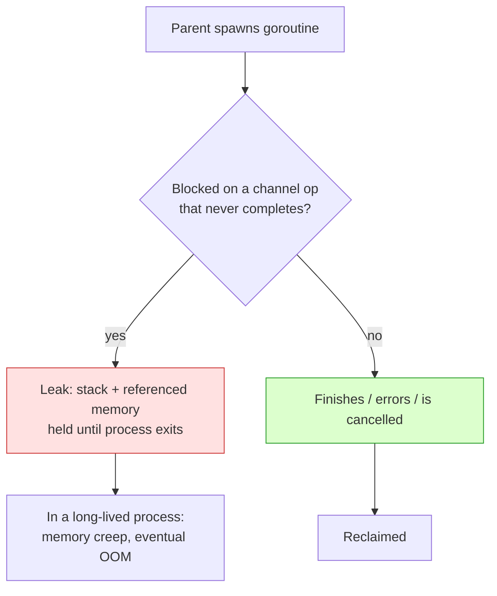
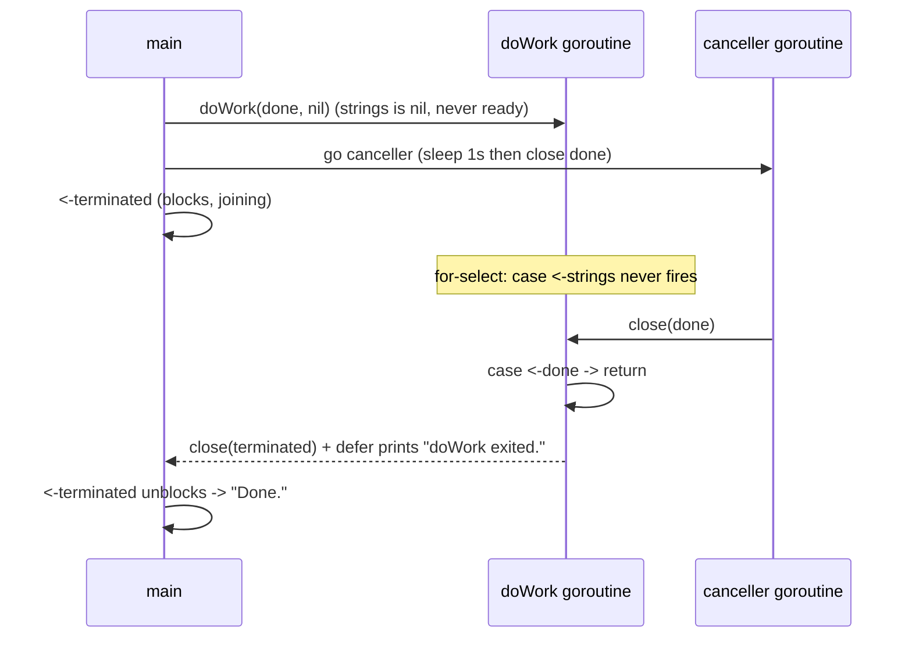
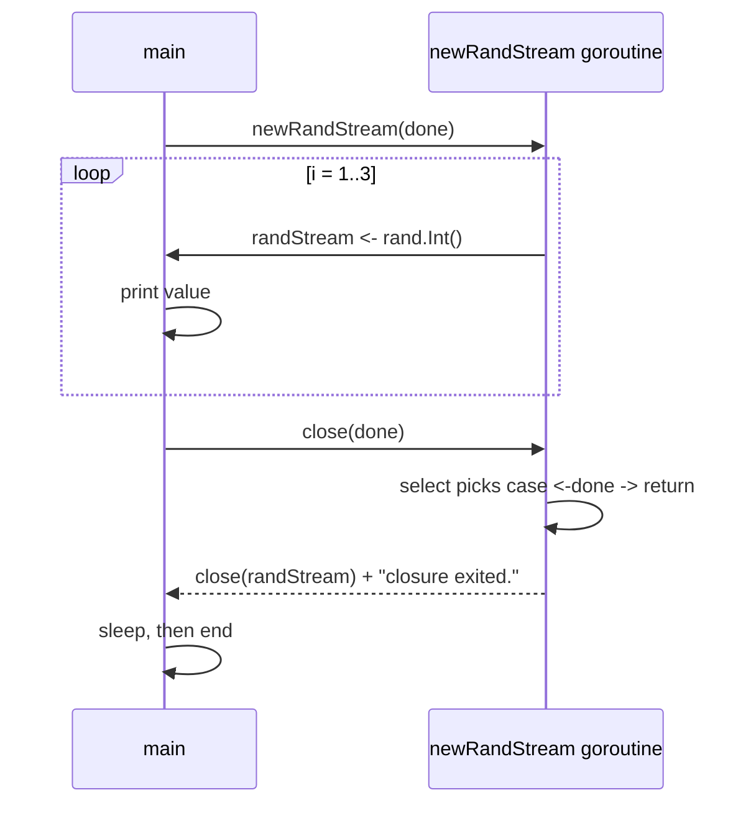

# Ch 4.3 — Preventing Goroutine Leaks

> Book: *Concurrency in Go* (Katherine Cox-Buday, O'Reilly 2017) · Chapter 4: Concurrency Patterns in Go · Pages ~90–94
> ⬅️ Prev: [The for-select Loop](./02-for-select-loop.md) · ➡️ Next: [The or-channel](./04-or-channel.md) · 🏠 [Book index](../README.md)

## 🎯 In One Paragraph

Goroutines are cheap to spawn, but they are **not garbage collected** — a goroutine blocked forever on a channel operation lingers for the life of the process, pinning its stack and everything it references. A goroutine ends in one of three ways: it finishes its work, it hits an unrecoverable error, or it's *told to stop*. The first two come for free from your algorithm; the third — cancellation — is the one you must engineer, and it's the most important because goroutines are usually part of an interconnected web where a parent (often `main`) holds the context needed to decide when children should die. The fix is a simple, pervasive convention: pass a **`done` channel** (by convention the *first* parameter, read-only) into every goroutine, and have the parent `close(done)` to signal cancellation. This works for goroutines that **receive** on a channel and, with a `select`, for goroutines that **send** on one — the two directions where blocking leaks occur. The governing rule: *if a goroutine is responsible for creating a goroutine, it is also responsible for ensuring it can stop that goroutine.*

## 🧠 Key Concepts & Vocabulary

- **Goroutine leak** — a goroutine that blocks forever (on a send or receive that will never complete) and is never reclaimed; it holds memory and stack for the entire process lifetime.
- **Three paths to termination** — (1) completed its work, (2) unrecoverable error, (3) told to stop. Only #3 (cancellation) must be designed in.
- **`done` channel** — the cancellation signal; a read-only `<-chan interface{}` passed into the child, *closed* by the parent to broadcast "stop." Conventionally the first parameter.
- **Network effect / interconnectedness** — goroutines cooperate in a graph; whether a child should continue often depends on the state of others, which only the parent knows.
- **Receiver leak** — a goroutine blocked reading from a channel nobody writes to (e.g. a `nil` channel).
- **Sender leak** — a goroutine blocked writing to a channel nobody reads from anymore.
- **The responsibility rule** — "If a goroutine creates a goroutine, it is also responsible for ensuring it can stop it." Enables composition and scaling.

## 📚 Deep Dive

### Why goroutines leak



The runtime multiplexes goroutines onto OS threads so you rarely think about threads — but goroutines still cost resources and are never collected while blocked. In a short program a leak is harmless; in a long-lived server that keeps spawning goroutines, leaks cause steady memory creep and eventually failure.

### A leak you can see

```go
doWork := func(strings <-chan string) <-chan interface{} {
    completed := make(chan interface{})
    go func() {
        defer fmt.Println("doWork exited.") // never prints!
        defer close(completed)
        for s := range strings { // ranges forever over a nil channel
            fmt.Println(s)
        }
    }()
    return completed
}

doWork(nil) // nil channel -> range blocks forever
fmt.Println("Done.")
```

Passing `nil` means `strings` never receives anything. Ranging over a `nil` channel blocks forever, so the `doWork` goroutine lives for the whole process. The deferred `"doWork exited."` never runs. (If you had joined this goroutine via `completed`, you'd deadlock instead.)

### Fix 1 — cancel a *receiving* goroutine with `done`

```go
package main

import (
	"fmt"
	"time"
)

func doWork(
	done <-chan interface{}, // convention: `done` is the FIRST parameter
	strings <-chan string,
) <-chan interface{} {
	terminated := make(chan interface{})
	go func() {
		defer fmt.Println("doWork exited.")
		defer close(terminated)
		for {
			select {
			case s := <-strings:
				fmt.Println(s)
			case <-done: // cancellation
				return
			}
		}
	}()
	return terminated
}

func main() {
	done := make(chan interface{})
	terminated := doWork(done, nil)

	go func() {
		time.Sleep(1 * time.Second) // cancel after 1s
		fmt.Println("Canceling doWork goroutine...")
		close(done)
	}()

	<-terminated // join
	fmt.Println("Done.")
}
```

Output:

```
Canceling doWork goroutine...
doWork exited.
Done.
```

Even though `strings` is `nil`, the goroutine exits cleanly because the `select` also watches `done`. We join via `<-terminated` and get **no deadlock**, because a third goroutine closes `done` after one second. Leak eliminated.



### Fix 2 — cancel a *sending* goroutine with `done`

The mirror problem: a goroutine blocked trying to *write* to a channel nobody reads anymore. First, the leak:

```go
newRandStream := func() <-chan int {
    randStream := make(chan int)
    go func() {
        defer fmt.Println("newRandStream closure exited.") // never prints
        defer close(randStream)
        for {
            randStream <- rand.Int() // blocks once the reader stops
        }
    }()
    return randStream
}

randStream := newRandStream()
for i := 1; i <= 3; i++ {
    fmt.Printf("%d: %d\n", i, <-randStream) // reads only 3
}
// goroutine now blocks forever on the 4th send -> leak
```

After the 3rd read the consumer stops, the producer blocks on the 4th send, and the deferred message never prints. The fix is symmetric — give the producer a `done` and move the send *into* a `select`:

```go
package main

import (
	"fmt"
	"math/rand"
	"time"
)

func newRandStream(done <-chan interface{}) <-chan int {
	randStream := make(chan int)
	go func() {
		defer fmt.Println("newRandStream closure exited.")
		defer close(randStream)
		for {
			select {
			case randStream <- rand.Int(): // send, but...
			case <-done: // ...stay cancellable
				return
			}
		}
	}()
	return randStream
}

func main() {
	done := make(chan interface{})
	randStream := newRandStream(done)
	fmt.Println("3 random ints:")
	for i := 1; i <= 3; i++ {
		fmt.Printf("%d: %d\n", i, <-randStream)
	}
	close(done)

	time.Sleep(1 * time.Second) // simulate ongoing work
}
```

Output (values differ per run — see Modern Go note on seeding):

```
3 random ints:
1: 3429177326265603282
2: 7552205470593136463
3: 1110936365342377927
newRandStream closure exited.
```

Now the deferred `"newRandStream closure exited."` *does* print — the producer is properly cleaned up.



### The governing convention

> **If a goroutine is responsible for creating a goroutine, it is also responsible for ensuring it can stop it.**

This rule keeps programs *composable* and lets them *scale* as they grow. Every mechanism for stopping a goroutine — regardless of its type or purpose — builds on the foundation of passing in a `done` channel. The book revisits this in [Pipelines](./06-pipelines-intro.md) and in the `context` package (Chapter 6).

## ⚠️ Pitfalls & Gotchas

- **`nil` channels block forever.** A send or receive on a `nil` channel never proceeds. Great for *disabling* a `select` case on purpose; a silent leak if accidental.
- **Ranging over a channel that's never closed** blocks forever once drained. Make sure *someone* closes it (or add a `done` case).
- **Sender leaks are easy to miss.** The receive-side `done` pattern is well known; remember the send side needs `select { case ch <- v: case <-done: }` too.
- **Joining a leaked goroutine deadlocks.** If you `<-terminated` but the goroutine can never reach `close(terminated)`, your parent blocks forever as well.
- **Closing `done` more than once panics.** Close it exactly once (often via `defer close(done)` in the owner). Receivers are fine; a closed channel keeps yielding zero values.
- **Only the owner closes a channel.** Don't close `randStream` from the consumer side; the producer owns and closes it.

## 🆕 Modern Go Notes

> 🆕 **`context.Context` is the modern `done` channel.** `ctx, cancel := context.WithCancel(ctx)` gives you `ctx.Done()` to `select` on and `cancel()` to broadcast. It also carries deadlines (`WithTimeout`/`WithDeadline`) and, since Go 1.20, a cancellation *cause* via `context.WithCancelCause` + `context.Cause(ctx)`.

> 🆕 **`math/rand` auto-seeds (Go 1.20+).** The top-level `rand.Int()` is now seeded with a random value automatically, so your output won't match the book's fixed numbers. Use `math/rand/v2` (Go 1.22) for the modern API, or seed explicitly for reproducibility.

> 🆕 **Detect leaks in tests with `uber-go/goleak`.** `defer goleak.VerifyNone(t)` fails a test if goroutines linger after it. `goleak.VerifyTestMain(m)` checks a whole package. Go 1.27 adds a GC-assisted leaked-goroutine detector, but tooling like goleak remains the practical first line of defense.

## 🧪 Try It Yourself

1. Run the first leak example and add a `runtime.NumGoroutine()` print before and after `doWork(nil)` to observe the leaked goroutine.
2. Rewrite `doWork` and `newRandStream` to take a `context.Context` instead of a `done` channel.
3. Add a `goleak.VerifyNone(t)` test around the *fixed* `newRandStream` and around the *leaking* version; confirm one passes and one fails.
4. Make the sender leak fire deterministically: read only 2 of 3 values, then print `runtime.NumGoroutine()`.

## ✅ Self-Check Questions

<details><summary>1. Why can a blocked goroutine cause a memory problem?</summary>
Goroutines are not garbage collected while alive. A goroutine blocked forever holds its stack and everything it references for the entire process lifetime; in a long-lived program that keeps spawning them, this causes memory creep and eventual failure.
</details>

<details><summary>2. What are the three ways a goroutine can terminate, and which one must you engineer?</summary>
It completes its work, hits an unrecoverable error, or is told to stop. The first two come from your algorithm for free; cancellation (being told to stop) is the one you must design in.
</details>

<details><summary>3. By convention, what is the `done` channel's type and parameter position, and how is cancellation signaled?</summary>
It is a read-only channel (e.g. `<-chan interface{}`), passed as the first parameter, and cancellation is signaled by the parent calling `close(done)`.
</details>

<details><summary>4. Why does passing `nil` for the `strings` channel cause a leak in the first `doWork`?</summary>
Ranging over (or receiving from) a `nil` channel blocks forever, so the goroutine never exits and is never reclaimed.
</details>

<details><summary>5. How do you prevent a goroutine blocked on a *send* from leaking?</summary>
Move the send into a `select` that also watches `done`: `select { case ch <- v: case <-done: return }`, so closing `done` unblocks and terminates it.
</details>

<details><summary>6. State the governing convention for goroutine lifetimes.</summary>
If a goroutine is responsible for creating a goroutine, it is also responsible for ensuring it can stop that goroutine.
</details>

## 🔑 Key Takeaways

- Goroutines aren't GC'd while blocked — a forever-blocked goroutine is a leak.
- Design cancellation explicitly via a read-only `done` channel passed as the first argument; `close(done)` to signal.
- Receiver leaks: watch `done` in the `select`. Sender leaks: put the send *inside* a `select` with `done`.
- Rule: the goroutine that starts another is responsible for being able to stop it.
- Modern Go: prefer `context.Context`; verify with `uber-go/goleak`.

## 🔗 References & Further Reading

📝 Blogs/articles
- [Go Concurrency Patterns: Pipelines and cancellation (The Go Blog)](https://go.dev/blog/pipelines) — the `done`-channel cancellation technique applied across a pipeline.
- [Preventing Goroutine Leaks with Context, Timeout & Cancellation (dev.to)](https://dev.to/serifcolakel/go-concurrency-mastery-preventing-goroutine-leaks-with-context-timeout-cancellation-best-1lg0) — modern best practices for the same problem.
- [Featherlight In-Production Goroutine Leak Detection — Uber Engineering](https://www.uber.com/us/en/blog/leakprof-featherlight-in-production-goroutine-leak-detection/) — how leaks look at scale and how Uber finds them.
- [Goroutine Leak Profiles (The Go Blog)](https://go.dev/blog/goroutine-leak-profiles) — tooling for detecting un-terminated goroutines.

💻 GitHub
- [uber-go/goleak](https://github.com/uber-go/goleak) — goroutine leak detector for tests (`VerifyNone`, `VerifyTestMain`).
- [kat-co/concurrency-in-go-src](https://github.com/kat-co/concurrency-in-go-src) — the book's official source for the leak examples.

📖 Official docs/specs
- [pkg.go.dev: context](https://pkg.go.dev/context) — modern cancellation/deadline API that replaces the raw `done` channel.
- [The Go Memory Model](https://go.dev/ref/mem) — guarantees around channel close/receive used to signal cancellation.
- [pkg.go.dev: runtime.NumGoroutine](https://pkg.go.dev/runtime#NumGoroutine) — count live goroutines to observe leaks.
