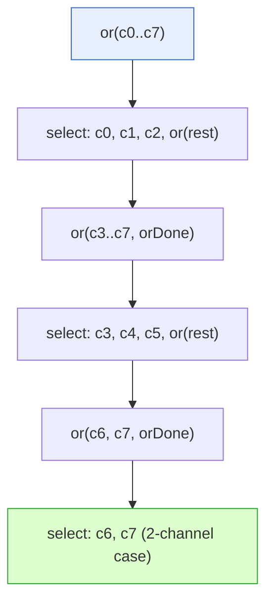
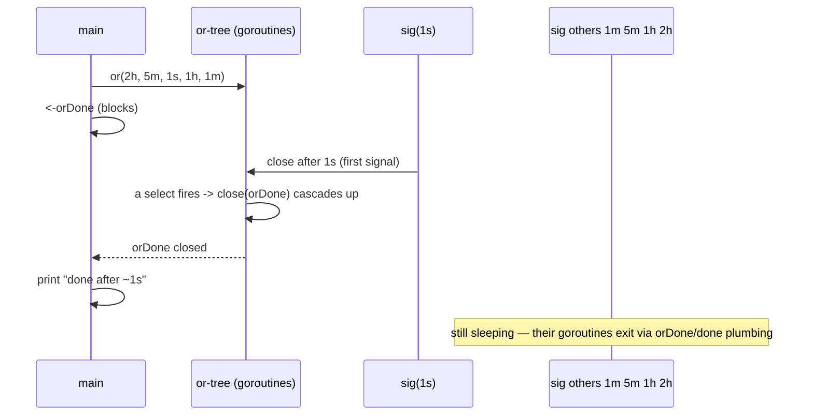

# Ch 4.4 — The or-channel

> Book: *Concurrency in Go* (Katherine Cox-Buday, O'Reilly 2017) · Chapter 4: Concurrency Patterns in Go · Pages ~94–97
> ⬅️ Prev: [Preventing Goroutine Leaks](./03-preventing-goroutine-leaks.md) · ➡️ Next: [Error Handling](./05-error-handling.md) · 🏠 [Book index](../README.md)

## 🎯 In One Paragraph

Sometimes you want to combine several `done` channels into *one* composite `done` channel that closes the instant **any** of its components closes. If you know the count at compile time you can hand-write a `select`, but when the number of channels is only known at runtime — or you just want a one-liner — the **or-channel** pattern does it with recursion and goroutines. The `or` function takes a variadic slice of channels, builds a *tree* of goroutines each `select`-ing over a handful of channels, and returns a single channel that closes as soon as the earliest component fires. It trades a modest number of extra goroutines (about ⌊x/2⌋ for x inputs) for the ability to compose an arbitrary, runtime-determined set of cancellation signals — exactly the kind of thing you need at the boundaries between modules where many cancellation conditions converge.

## 🧠 Key Concepts & Vocabulary

- **or-channel** — a composite `done` channel built from N input channels that closes when the first input closes (or is written to).
- **Variadic channels** — `channels ...<-chan interface{}`; the arbitrary, possibly runtime-sized input set.
- **Recursion termination criteria** — `len == 0` → return `nil`; `len == 1` → return that channel directly.
- **Two-channel special case** — an optimization: when exactly two channels remain, `select` over just those two instead of recursing, keeping goroutine count down.
- **The recurrence / tree** — each recursive call handles channels 0,1,2 and recurses on `channels[3:]` plus `orDone`, forming a binary-ish tree whose first signal propagates to the root.
- **`orDone` plumbing** — passing the parent's `orDone` into the recursive call so that when an upper goroutine exits, the lower goroutines exit too (no leaks).
- **Goroutine cost** — roughly `f(x) = ⌊x/2⌋` extra goroutines for `x` inputs; usually a premature-optimization concern given Go's cheap goroutines.

## 📚 Deep Dive

### The pattern

```go
var or func(channels ...<-chan interface{}) <-chan interface{}
or = func(channels ...<-chan interface{}) <-chan interface{} {
    switch len(channels) {
    case 0:
        return nil          // no channels -> composite does nothing
    case 1:
        return channels[0]  // one channel -> it IS the composite
    }

    orDone := make(chan interface{})
    go func() {
        defer close(orDone)

        switch len(channels) {
        case 2: // optimization: avoid recursing for just two
            select {
            case <-channels[0]:
            case <-channels[1]:
            }
        default: // 3+ channels: handle 0,1,2 and recurse on the rest
            select {
            case <-channels[0]:
            case <-channels[1]:
            case <-channels[2]:
            case <-or(append(channels[3:], orDone)...):
            }
        }
    }()
    return orDone
}
```

Reading it piece by piece:

- **Signature** — takes a variadic slice of receive-only channels, returns one receive-only channel.
- **Termination criteria** — recursion needs base cases. Zero channels → `nil` (a composite of nothing shouldn't do anything). One channel → just return it.
- **Main body** — because of how we recurse, every recursive call has at least two channels. We spawn a goroutine so we can wait on the channels without blocking the caller.
- **Two-channel optimization** — keeps the goroutine count bounded by not recursing when only two remain.
- **Recursive `default`** — `select`s over channels 0,1,2 *and* over `or(channels[3:] + orDone)`. This destructures the tail of the slice into a sub-tree; the first signal anywhere returns. Passing `orDone` down means when goroutines *up* the tree exit, goroutines *down* the tree also exit — preventing leaks.



### Using it

```go
package main

import (
	"fmt"
	"time"
)

var or func(channels ...<-chan interface{}) <-chan interface{}

func main() {
	or = func(channels ...<-chan interface{}) <-chan interface{} {
		switch len(channels) {
		case 0:
			return nil
		case 1:
			return channels[0]
		}
		orDone := make(chan interface{})
		go func() {
			defer close(orDone)
			switch len(channels) {
			case 2:
				select {
				case <-channels[0]:
				case <-channels[1]:
				}
			default:
				select {
				case <-channels[0]:
				case <-channels[1]:
				case <-channels[2]:
				case <-or(append(channels[3:], orDone)...):
				}
			}
		}()
		return orDone
	}

	// sig returns a channel that closes after `after` elapses.
	sig := func(after time.Duration) <-chan interface{} {
		c := make(chan interface{})
		go func() {
			defer close(c)
			time.Sleep(after)
		}()
		return c
	}

	start := time.Now()
	<-or(
		sig(2*time.Hour),
		sig(5*time.Minute),
		sig(1*time.Second), // this one wins
		sig(1*time.Hour),
		sig(1*time.Minute),
	)
	fmt.Printf("done after %v\n", time.Since(start))
}
```

Output:

```
done after 1.000216772s
```

Despite handing `or` five channels with wildly different timers, the one that closes after **one second** causes the entire composite channel to close — regardless of where in the tree it sits. The first signal wins and cascades to the root.



### Cost and when to use it

The terseness costs extra goroutines — about `f(x) = ⌊x/2⌋` for `x` inputs. But spinning up goroutines is one of Go's strengths, and worrying about this count is usually premature optimization. More importantly: **if you don't know the number of `done` channels at compile time, there is no other way to combine them.**

This pattern shines at the **intersection of modules**, where a call tree accumulates multiple cancellation conditions. Combine them with `or` and pass the single result down the stack. Chapter 6's `context` package offers another, often more descriptive, way to do this; and a variant of or-channel reappears in "Replicated Requests" (Chapter 5).

## ⚠️ Pitfalls & Gotchas

- **Closing vs. writing.** The composite fires when a component is *closed* **or** *written to*. For pure cancellation semantics, only ever `close()` your `done` channels — don't send values on them.
- **Forgetting to pass `orDone` down.** Omit it from the recursive `append` and lower-tree goroutines won't be told to exit when an upper one does — a goroutine leak.
- **`append(channels[3:], orDone)` may mutate backing array.** It appends to a sub-slice; in this read-only-of-signals context it's benign, but be wary if you reuse the original slice elsewhere.
- **Zero-channel case returns `nil`.** Receiving from the result then blocks forever. That's intentional (a composite of nothing), but don't `<-or()` with no args by accident.
- **The extra goroutines are real.** For a huge, frequently-rebuilt set of channels, the ⌊x/2⌋ goroutines add up; measure before dismissing.

## 🆕 Modern Go Notes

> 🆕 **`context` often replaces or-channel.** To combine multiple cancellation sources, derive child contexts (`context.WithCancel`) or, in Go 1.21+, use `context.AfterFunc` to run cleanup when any context is done. The book itself points to `context` as a more descriptive alternative.

> 🆕 **Generic or-channel.** With Go 1.18 generics you can write `func or[T any](channels ...<-chan T) <-chan T` instead of `interface{}`, keeping the exact structure but with type safety.

> 🆕 **`reflect.Select` for a dynamic flat select.** As an alternative to the recursive tree, `reflect.Select` can `select` over a runtime-sized slice of cases in a single goroutine — at the cost of reflection overhead and less readable code.

## 🧪 Try It Yourself

1. Add a `fmt.Printf` of `runtime.NumGoroutine()` right before `<-or(...)` and shortly after, to observe the ⌊x/2⌋ goroutines appear and then drain.
2. Rewrite `or` as a generic `or[T any]` and use it with `<-chan struct{}`.
3. Implement the same "first to close wins" behavior using only `context.WithCancel` and compare readability.
4. Make one of the `sig` channels *send a value* instead of closing, and confirm the composite still fires (demonstrating "closed or written to").

## ✅ Self-Check Questions

<details><summary>1. What does the or-channel pattern produce?</summary>
A single composite `done` channel that closes as soon as any one of its component channels closes (or is written to).
</details>

<details><summary>2. What are the two recursion termination criteria, and why each?</summary>
`len(channels) == 0` returns `nil` (a composite of no channels shouldn't do anything); `len(channels) == 1` returns that single channel directly (it already *is* the composite).
</details>

<details><summary>3. Why is there a special case for exactly two channels?</summary>
It's an optimization to keep the number of goroutines constrained: with two channels you can `select` over them directly instead of recursing and spawning another goroutine.
</details>

<details><summary>4. Why is `orDone` passed into the recursive call?</summary>
So that when a goroutine higher up the tree exits (closing its `orDone`), the goroutines lower down the tree are also signaled to exit, preventing goroutine leaks.
</details>

<details><summary>5. How many extra goroutines does `or` roughly create for x input channels?</summary>
About ⌊x/2⌋.
</details>

<details><summary>6. When is the or-channel pattern genuinely necessary rather than optional?</summary>
When you don't know the number of `done` channels until runtime — a hand-written `select` can't enumerate an unknown number of cases, so composing them recursively is the only way.
</details>

## 🔑 Key Takeaways

- or-channel = combine N `done` channels into one that closes on the first signal.
- Base cases: 0 → `nil`, 1 → the channel itself; recurse on `channels[3:]` plus `orDone`.
- The two-channel special case bounds goroutine growth; `orDone` plumbing prevents leaks.
- Cost ≈ ⌊x/2⌋ goroutines — usually negligible given cheap goroutines.
- Use it at module boundaries where many cancellation conditions converge; `context` is the modern alternative.

## 🔗 References & Further Reading

📝 Blogs/articles
- [Go Concurrency Patterns: Pipelines and cancellation (The Go Blog)](https://go.dev/blog/pipelines) — fan-in/merge and composed cancellation closely related to or-channel.
- [Curious Channels — Dave Cheney](https://dave.cheney.net/2013/04/30/curious-channels) — close semantics and `nil` channels, the primitives or-channel exploits.
- [Notes from Concurrency Patterns in Go](https://notsocomplex.medium.com/notes-from-concurrency-patterns-in-go-8cfc55b44e24) — reader notes covering the or-channel recursion.

💻 GitHub
- [kat-co/concurrency-in-go-src](https://github.com/kat-co/concurrency-in-go-src) — the book's official or-channel implementation.
- [golang/go: src/reflect/value.go (Select)](https://github.com/golang/go/blob/master/src/reflect/value.go) — `reflect.Select`, the dynamic-select alternative to the recursive tree.

📖 Official docs/specs
- [pkg.go.dev: context](https://pkg.go.dev/context) — the modern, more descriptive way to compose cancellation, including `AfterFunc`.
- [pkg.go.dev: reflect.Select](https://pkg.go.dev/reflect#Select) — select over a runtime-sized set of channels.
- [The Go Programming Language Specification: Close](https://go.dev/ref/spec#Close) — what closing a channel guarantees, the basis for "first close wins."
