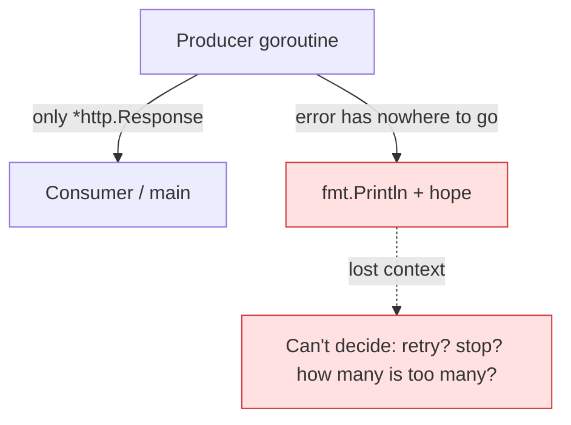
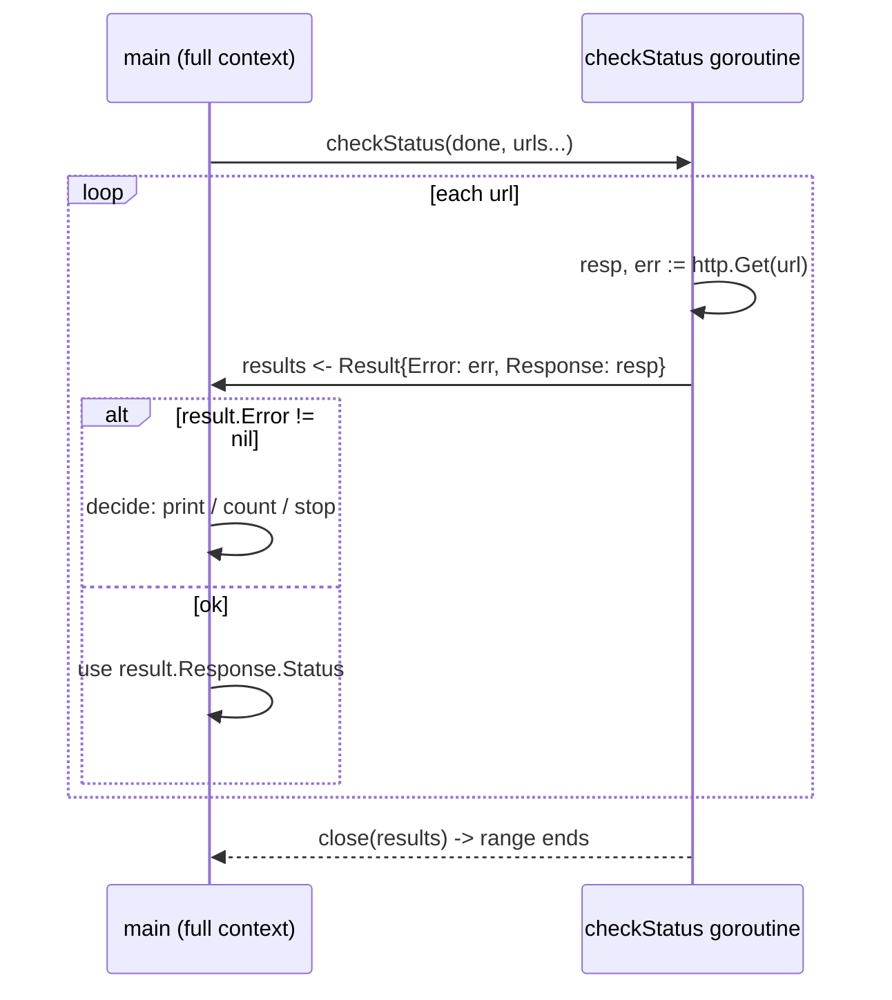
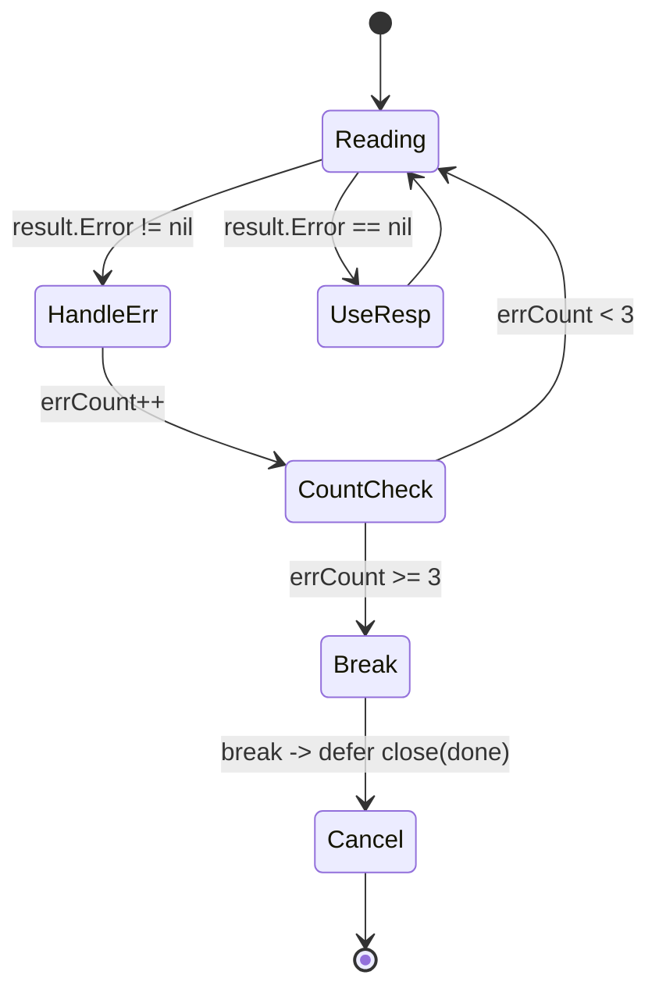

# Ch 4.5 — Error Handling

> Book: *Concurrency in Go* (Katherine Cox-Buday, O'Reilly 2017) · Chapter 4: Concurrency Patterns in Go · Pages ~97–100
> ⬅️ Prev: [The or-channel](./04-or-channel.md) · ➡️ Next: [Pipelines (intro)](./06-pipelines-intro.md) · 🏠 [Book index](../README.md)

## 🎯 In One Paragraph

Error handling in concurrent programs is easy to get wrong because we spend our attention on *how goroutines share and coordinate data* and forget to design the error paths with equal care. Go deliberately rejected exceptions, making a statement that errors deserve first-class attention. The central question is: *who is responsible for handling the error?* A concurrent goroutine runs independently of its parent and siblings, so it usually **lacks the context** to decide what to do with an error — it can't meaningfully swallow it, retry it, or escalate it. The fix is **separation of concerns**: a producer goroutine should *send* its errors to a part of the program that has the full picture (typically the parent/`main` goroutine), which can then make an informed decision. Concretely, you couple each result with its possible error in a single `Result` type and pass that down the same channel you'd use for successful values — so errors flow through the same communication lines as data, and error handling returns to the familiar synchronous Go pattern.

## 🧠 Key Concepts & Vocabulary

- **"Who handles the error?"** — the fundamental question; at some point the program must stop ferrying the error up and actually *act* on it.
- **No exceptions in Go** — Go uses explicit `error` return values, signaling that error handling is a first-class design concern, not an afterthought.
- **Separation of concerns (errors)** — producer goroutines should *report* errors, not *decide* on them; the parent with full program context decides.
- **`Result` type** — a struct coupling the possible output with the possible error (`struct { Error error; Response *http.Response }`), representing the complete set of outcomes of one iteration.
- **Coupling result + error** — passing both through the same channel so the consumer gets the full outcome and can react intelligently.
- **Errors as first-class citizens** — when a goroutine can produce errors, those errors should be tightly coupled with its result type and travel the same communication path as regular values.

## 📚 Deep Dive

### The anti-pattern: a goroutine deciding alone

```go
checkStatus := func(done <-chan interface{}, urls ...string) <-chan *http.Response {
    responses := make(chan *http.Response)
    go func() {
        defer close(responses)
        for _, url := range urls {
            resp, err := http.Get(url)
            if err != nil {
                fmt.Println(err) // what else can it do?!
                continue
            }
            select {
            case <-done:
                return
            case responses <- resp:
            }
        }
    }()
    return responses
}
```

The goroutine is cornered. It can't pass the error back (the channel only carries `*http.Response`), it can't know "how many errors is too many," and it can't know whether to keep going. So it does the only thing it can — prints the error and *hopes something is watching*. Running against `["https://www.google.com", "https://badhost"]` yields:

```
Response: 200 OK
Get https://badhost: dial tcp: lookup badhost ... no such host
```

> Don't put your goroutines in this awkward position.



### The pattern: couple result with error

Create a type that holds *both* the response and the error, and send it on one channel:

```go
package main

import (
	"fmt"
	"net/http"
)

type Result struct {
	Error    error
	Response *http.Response
}

func checkStatus(done <-chan interface{}, urls ...string) <-chan Result {
	results := make(chan Result)
	go func() {
		defer close(results)
		for _, url := range urls {
			var result Result
			resp, err := http.Get(url)
			result = Result{Error: err, Response: resp} // couple them
			select {
			case <-done:
				return
			case results <- result:
			}
		}
	}()
	return results
}

func main() {
	done := make(chan interface{})
	defer close(done)

	urls := []string{"https://www.google.com", "https://badhost"}
	for result := range checkStatus(done, urls...) {
		if result.Error != nil {
			fmt.Printf("error: %v\n", result.Error)
			continue
		}
		fmt.Printf("Response: %v\n", result.Response.Status)
	}
}
```

Output:

```
Response: 200 OK
error: Get "https://badhost": dial tcp: lookup badhost ... no such host
```

Now the **main goroutine** — which has the full program context — decides what to do. The producer's only job is to *report* the complete outcome (`Result`) of each iteration.



### The payoff: smart decisions in the consumer

Because errors flow back as values, the consumer can build real policy. Here we stop after 3 errors:

```go
package main

import (
	"fmt"
	"net/http"
)

type Result struct {
	Error    error
	Response *http.Response
}

func checkStatus(done <-chan interface{}, urls ...string) <-chan Result {
	results := make(chan Result)
	go func() {
		defer close(results)
		for _, url := range urls {
			resp, err := http.Get(url)
			result := Result{Error: err, Response: resp}
			select {
			case <-done:
				return
			case results <- result:
			}
		}
	}()
	return results
}

func main() {
	done := make(chan interface{})
	defer close(done)

	errCount := 0
	urls := []string{"a", "https://www.google.com", "b", "c", "d"}
	for result := range checkStatus(done, urls...) {
		if result.Error != nil {
			fmt.Printf("error: %v\n", result.Error)
			errCount++
			if errCount >= 3 {
				fmt.Println("Too many errors, breaking!")
				break // closing done via defer cancels the producer
			}
			continue
		}
		fmt.Printf("Response: %v\n", result.Response.Status)
	}
}
```

Output:

```
error: Get "a": unsupported protocol scheme ""
Response: 200 OK
error: Get "b": unsupported protocol scheme ""
error: Get "c": unsupported protocol scheme ""
Too many errors, breaking!
```

When we `break`, the deferred `close(done)` fires, which cancels the producer goroutine (via its `case <-done:`), so no leak. Error handling here follows the *ordinary* Go pattern — the only trick was carrying the error through the same channel as the data.



## ⚠️ Pitfalls & Gotchas

- **Don't `fmt.Println(err)` inside the goroutine as your error strategy.** It discards context and forces a lonely, uninformed decision. Report the error outward instead.
- **Partial results on error.** On a failed `http.Get`, `resp` is `nil`; the `Result` still carries the `nil` response. Always check `result.Error` *before* touching `result.Response`.
- **Leaking the producer on early `break`.** If you `break` out of the consumer loop without a `done`/cancel mechanism, the producer may block forever on its next send. The `defer close(done)` pattern prevents this.
- **Swallowing errors by only sending successes.** If the result channel carries only `*http.Response`, errors have nowhere to go — the root cause of the anti-pattern.
- **Unclosed response bodies.** The book's examples omit it for brevity, but in real code you must `resp.Body.Close()` (e.g. `defer`) to avoid leaking connections.

## 🆕 Modern Go Notes

> 🆕 **`errors.Is` / `errors.As` / `%w` (Go 1.13).** Wrap errors with `fmt.Errorf("fetching %s: %w", url, err)` and inspect them in the consumer with `errors.Is`/`errors.As` to make policy decisions on *error kind*, not string matching.

> 🆕 **`errors.Join` (Go 1.20).** When you collect multiple errors across goroutines, `errors.Join(errs...)` aggregates them into one error whose `Is`/`As` still unwrap each component.

> 🆕 **`golang.org/x/sync/errgroup`.** For the common "run N tasks, stop on first error" shape, `errgroup.Group` wraps `sync.WaitGroup`, propagates the first error from `Wait()`, and (via `WithContext`) cancels siblings automatically — a packaged version of coupling results with errors and letting the coordinator decide. Go 1.25's `sync.WaitGroup.Go` streamlines the plain-WaitGroup variant.

> 🆕 **Error message punctuation.** Modern Go wraps the URL in quotes (`Get "badhost": ...`) where the 2017 book shows it unquoted — that's why the verified output differs slightly from the book's.

## 🧪 Try It Yourself

1. Change `Result` to carry `(url string, status string, err error)` and have the consumer print which URL failed.
2. Replace the raw `done` channel with `context.Context` and cancel the producer with `cancel()` after 3 errors.
3. Rewrite the whole thing with `errgroup.WithContext` and compare how error propagation and cancellation change.
4. Wrap the `http.Get` error with `%w` and use `errors.As` in the consumer to detect a `*net.DNSError` specifically.

## ✅ Self-Check Questions

<details><summary>1. What is the most fundamental question when designing concurrent error handling?</summary>
"Who should be responsible for handling the error?" — i.e., which part of the program has enough context to actually act on it.
</details>

<details><summary>2. Why can't a producer goroutine usually decide what to do with its own errors?</summary>
Because it runs independently of its parent and siblings and lacks the broader program context needed to decide whether to retry, continue, or stop — and if its channel only carries successes, it can't even report the error.
</details>

<details><summary>3. What is the recommended structure for returning errors from a goroutine?</summary>
Couple the possible result and the possible error in a single `Result` struct and send it on the same channel used for successful values, so the consumer receives the complete outcome.
</details>

<details><summary>4. In the coupled-error version, why check `result.Error` before `result.Response`?</summary>
On failure `result.Response` may be `nil`; touching it would panic. The error must be handled first.
</details>

<details><summary>5. When the consumer `break`s after too many errors, how is the producer goroutine prevented from leaking?</summary>
A deferred `close(done)` fires on function exit, signaling the producer via its `case <-done:` to return, so it doesn't block forever on its next send.
</details>

<details><summary>6. What does it mean to treat errors as "first-class citizens" here?</summary>
When a goroutine can produce errors, those errors are given the same status as results: tightly coupled with the result type and passed through the same communication path as regular values.
</details>

## 🔑 Key Takeaways

- Design error paths with the same care as data flow; Go's explicit errors demand it.
- A goroutine usually lacks context to handle its own errors — it should *report*, the coordinator should *decide*.
- Couple result + error in one type and send it on the same channel the data uses.
- The consumer can then build real policy (count, retry, cancel) using ordinary Go error handling.
- Modern Go: wrap with `%w`, inspect with `errors.Is/As`, aggregate with `errors.Join`, coordinate with `errgroup`.

## 🔗 References & Further Reading

📝 Blogs/articles
- [Handling errors concurrently in Go with ErrGroup (dev.to)](https://dev.to/bstncartwright/handling-errors-concurrently-in-go-with-errgroup-i8) — the modern packaged version of "report errors, let the coordinator decide."
- [Advanced Go Concurrency — Encore Blog](https://encore.dev/blog/advanced-go-concurrency) — error propagation and cancellation across goroutines in depth.
- [Concurrency in Go — Part 3: concurrent errors and panic handling (dev.to)](https://dev.to/ohugonnot/concurrency-in-go-part-3-concurrent-errors-and-panic-handling-1bli) — why Go has no forced stop and how that shapes error design.

💻 GitHub
- [golang/sync: errgroup/errgroup.go](https://github.com/golang/sync/blob/master/errgroup/errgroup.go) — reference implementation of error propagation + context cancellation for goroutine groups.
- [kat-co/concurrency-in-go-src](https://github.com/kat-co/concurrency-in-go-src) — the book's official source for the `Result`/`checkStatus` examples.

📖 Official docs/specs
- [pkg.go.dev: errors](https://pkg.go.dev/errors) — `Is`, `As`, `Join`, and wrapping semantics for modern error handling.
- [go.dev/blog: Working with Errors in Go 1.13](https://go.dev/blog/go1.13-errors) — `%w` wrapping and unwrapping, directly applicable to the `Result` pattern.
- [pkg.go.dev: golang.org/x/sync/errgroup](https://pkg.go.dev/golang.org/x/sync/errgroup) — API docs for the errgroup coordinator.
