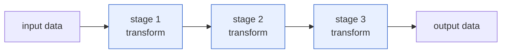
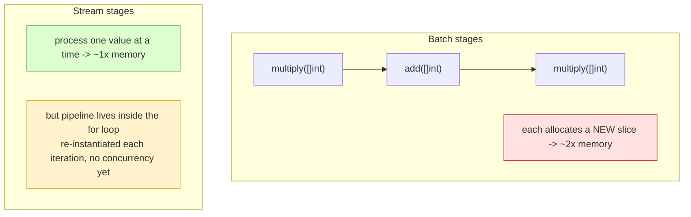
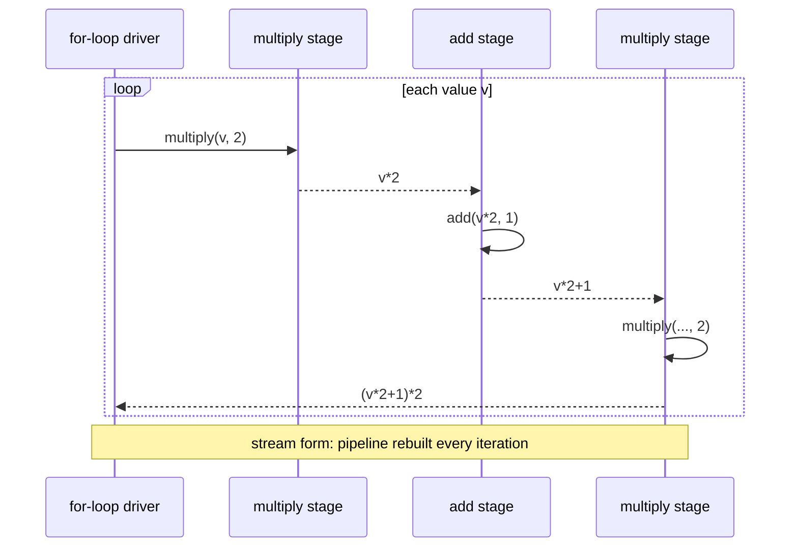

# Ch 4.6 — Pipelines (Introduction)

> Book: *Concurrency in Go* (Katherine Cox-Buday, O'Reilly 2017) · Chapter 4: Concurrency Patterns in Go · Pages ~100–104
> ⬅️ Prev: [Error Handling](./05-error-handling.md) · ➡️ Next: [Pipeline Best Practices](./07-pipeline-best-practices.md) · 🏠 [Book index](../README.md)

## 🎯 In One Paragraph

A **pipeline** is an abstraction for processing streams or batches of data: a series of **stages**, each of which takes data in, performs one operation, and passes the data back out. The word comes from the 1850s (a line of pipes carrying liquid); in software we're transporting *data*. The power of the pattern is **separation of concerns** — you can modify a stage without touching others, mix and match how stages combine without rewriting them, run stages concurrently with their neighbors, and later fan-out or rate-limit portions of the flow. For something to *be* a pipeline stage it must satisfy two properties: it **consumes and returns the same type**, and it must be **reified** by the language (Go functions are reified, so they qualify). Stages come in two styles: **batch processing** (operate on a whole slice at once — simple but doubles memory) and **stream processing** (one element at a time — tiny footprint but, in this naive function form, re-instantiates the pipeline every iteration and doesn't yet scale). This intro builds the intuition with plain functions; the channel-based version that unlocks concurrency comes next.

## 🧠 Key Concepts & Vocabulary

- **Pipeline** — a series of stages that each take data in, transform it, and emit it; a tool for building abstractions, especially over streams/batches.
- **Stage** — one operation in the pipeline; "takes data in, performs a transformation, sends data out."
- **Stage properties** — (1) consumes and returns the *same type*; (2) is **reified** by the language so it can be passed around.
- **Reification** — the language exposes a concept as a first-class, passable value. Go functions are reified: you can type variables as function signatures and pass them around.
- **Batch processing** — a stage operates on chunks (slices) of data all at once.
- **Stream processing** — a stage receives and emits one discrete element at a time.
- **Separation of concerns** — each stage is independent, enabling modification, recombination, concurrency, fan-out, and rate-limiting.
- **Higher-order functions / monads** — pipeline stages are closely related to functional programming and can be viewed as a subset of monads (useful background, not required).

## 📚 Deep Dive

### What a pipeline is

We build programs out of functions, structs, and methods to abstract away irrelevant detail and to work on one area without disturbing others. If one logical change forces you to edit many unrelated places, that's a symptom of poor abstraction. A pipeline is *another* abstraction tool, especially potent for streams/batches of data.



### Batch stages

Two "boring" functions — but constructed as pipeline stages:

```go
multiply := func(values []int, multiplier int) []int {
    multipliedValues := make([]int, len(values))
    for i, v := range values {
        multipliedValues[i] = v * multiplier
    }
    return multipliedValues
}

add := func(values []int, additive int) []int {
    addedValues := make([]int, len(values))
    for i, v := range values {
        addedValues[i] = v + additive
    }
    return addedValues
}
```

Because each consumes `[]int` and returns `[]int` (same type) and Go functions are reified, we can *combine* them:

```go
ints := []int{1, 2, 3, 4}
for _, v := range add(multiply(ints, 2), 1) {
    fmt.Println(v) // 3 5 7 9
}
```

And add another stage with **zero changes** to the existing functions — just wrap:

```go
for _, v := range multiply(add(multiply(ints, 2), 1), 2) {
    fmt.Println(v) // 6 10 14 18
}
```

That composability is the whole point: no new function, no edits, no change to how we consume the result. Of course you *could* write it procedurally — `2*(v*2+1)` — and initially that looks simpler, but it doesn't give you the independent, recombinable stages that pay off with streams.

### Batch vs. stream — the memory cost

Batch stages each allocate a *new slice of equal length* to preserve the original. So at peak the program holds roughly **double** the input slice. Stream stages fix this by processing one element at a time:

```go
multiply := func(value, multiplier int) int { return value * multiplier }
add := func(value, additive int) int        { return value + additive }

ints := []int{1, 2, 3, 4}
for _, v := range ints {
    fmt.Println(multiply(add(multiply(v, 2), 1), 2)) // 6 10 14 18
}
```

Now the footprint is just the input size. **But** we had to pull the pipeline *into the loop body* and let `range` feed it. That hurts: it limits how we feed the pipeline, limits scaling, and effectively *re-instantiates the pipeline every iteration* (three function calls per element). It also doesn't yet give us concurrency or fan-out — those come with channels in the next section.



### Complete runnable program

This verified program demonstrates batch composition, adding a stage without edits, and the stream rewrite side by side:

```go
package main

import "fmt"

// Batch stages: consume and return []int.
func multiplyBatch(values []int, multiplier int) []int {
	out := make([]int, len(values))
	for i, v := range values {
		out[i] = v * multiplier
	}
	return out
}

func addBatch(values []int, additive int) []int {
	out := make([]int, len(values))
	for i, v := range values {
		out[i] = v + additive
	}
	return out
}

// Stream stages: consume and return a single int.
func multiplyStream(value, multiplier int) int { return value * multiplier }
func addStream(value, additive int) int        { return value + additive }

func main() {
	ints := []int{1, 2, 3, 4}

	fmt.Println("batch add(multiply(x,2),1):")
	for _, v := range addBatch(multiplyBatch(ints, 2), 1) {
		fmt.Println(v)
	}

	fmt.Println("batch multiply(add(multiply(x,2),1),2):")
	for _, v := range multiplyBatch(addBatch(multiplyBatch(ints, 2), 1), 2) {
		fmt.Println(v)
	}

	fmt.Println("stream multiply(add(multiply(x,2),1),2):")
	for _, v := range ints {
		fmt.Println(multiplyStream(addStream(multiplyStream(v, 2), 1), 2))
	}
}
```

Output:

```
batch add(multiply(x,2),1):
3
5
7
9
batch multiply(add(multiply(x,2),1),2):
6
10
14
18
stream multiply(add(multiply(x,2),1),2):
6
10
14
18
```



## ⚠️ Pitfalls & Gotchas

- **Batch doubles memory.** Each batch stage allocates a new equal-length slice. For large inputs or many stages this is expensive.
- **Naive stream form doesn't scale.** Pulling the pipeline into the `for` body re-creates it each iteration and ties feeding to a single loop — no concurrency, no fan-out, limited reuse. Channels fix this (next section).
- **A stage must return the *same type* it consumes to compose.** Break that and you can no longer freely wrap/reorder stages.
- **Procedural code looks simpler at first.** `2*(v*2+1)` is shorter, but loses independent, recombinable, concurrent-capable stages.
- **In-place mutation defeats reuse.** To keep the original data unaltered, batch stages must allocate new slices rather than mutate inputs.

## 🆕 Modern Go Notes

> 🆕 **`iter.Seq` and range-over-func (Go 1.23).** Modern Go can model a *pull* stream as an iterator `func(yield func(T) bool)`, usable directly in `for v := range seq`. This gives stream-style composition without channels/goroutines when concurrency isn't needed. Channels remain the tool when stages must run concurrently.

> 🆕 **Generics for type-safe stages (Go 1.18).** Instead of the book's later `interface{}` stages, write `func mapStage[A, B any](in []A, f func(A) B) []B` for compile-time-checked, reusable batch stages.

> 🆕 **`slices` package (Go 1.21).** Helpers like `slices.Collect`, `slices.Values`, and `slices.Map`-style patterns reduce the boilerplate of allocating result slices in batch stages.

## 🧪 Try It Yourself

1. Add a `subtract` batch stage and compose a 4-stage pipeline without editing any existing stage.
2. Measure allocations of the batch vs. stream version with `testing.B` and `-benchmem`.
3. Reimplement the batch stages with generics: `mapStage[int, int]`.
4. Rewrite the stream pipeline as an `iter.Seq[int]` and consume it with range-over-func (Go 1.23+).

## ✅ Self-Check Questions

<details><summary>1. Define a pipeline and a stage.</summary>
A pipeline is a series of stages for processing streams/batches of data. A stage is a single operation that takes data in, transforms it, and passes it back out.
</details>

<details><summary>2. What two properties must something satisfy to be a pipeline stage?</summary>
It must consume and return the same type, and it must be reified by the language (so it can be passed around). Go functions satisfy both.
</details>

<details><summary>3. What does "reified" mean, and why do Go functions qualify?</summary>
Reification means the language exposes a concept as a first-class value you can work with directly. Go functions are reified because you can declare variables of a function-signature type and pass functions around.
</details>

<details><summary>4. What is the memory cost of batch processing and why?</summary>
Roughly double the input slice, because each batch stage allocates a new slice of equal length to hold its results while leaving the original unaltered.
</details>

<details><summary>5. What is the downside of the naive stream version even though it uses less memory?</summary>
Pulling the pipeline into the `for` loop body re-instantiates it every iteration (several function calls per element), ties feeding to a single loop, limits reuse, and provides no concurrency or fan-out.
</details>

<details><summary>6. Why is the composability of stages valuable?</summary>
You can add, remove, reorder, or reuse stages without modifying existing stages or the consumer — each change is localized, demonstrating strong separation of concerns.
</details>

## 🔑 Key Takeaways

- A pipeline = chained stages; each takes data in, transforms it, emits it.
- Stage requirements: same in/out type + reified (Go functions fit).
- Batch stages are simple but ~2x memory; stream stages are 1x memory but the naive form doesn't scale or run concurrently.
- Composability (add/reorder/reuse stages without edits) is the payoff.
- Channels (next) turn these into concurrent, scalable, fan-out-able pipelines.

## 🔗 References & Further Reading

📝 Blogs/articles
- [Go Concurrency Patterns: Pipelines and cancellation (The Go Blog)](https://go.dev/blog/pipelines) — the canonical treatment of pipelines and stages in Go.
- [Pipeline Patterns in Go (Medium / statuscode)](https://medium.com/statuscode/pipeline-patterns-in-go-a37bb3a7e61d) — extends the Go Blog pipeline with error handling and extra features.
- [Gist of Go: Pipelines (antonz.org)](https://antonz.org/go-concurrency/pipelines/) — an interactive, ground-up explanation of pipelines.

💻 GitHub
- [kat-co/concurrency-in-go-src](https://github.com/kat-co/concurrency-in-go-src) — the book's official source for the multiply/add stages.
- [sudix bounded-parallelism gist](https://gist.github.com/sudix/9929302) — a worked example based on the Go Blog pipeline article.

📖 Official docs/specs
- [pkg.go.dev: iter](https://pkg.go.dev/iter) — `iter.Seq`/range-over-func, the modern pull-stream alternative to naive stream stages.
- [pkg.go.dev: slices](https://pkg.go.dev/slices) — helpers that simplify batch-stage slice allocation.
- [Effective Go: Functions as values](https://go.dev/doc/effective_go) — background on Go's reified functions that makes stages composable.
