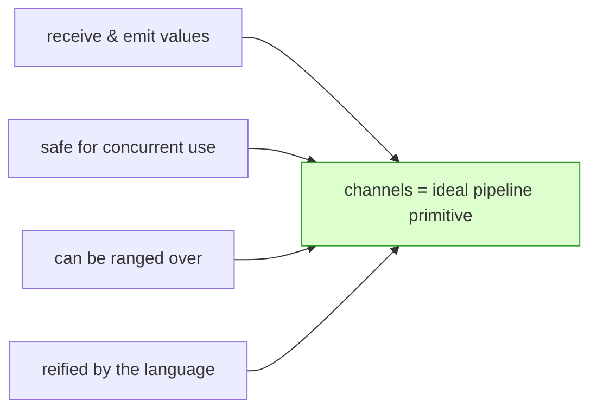
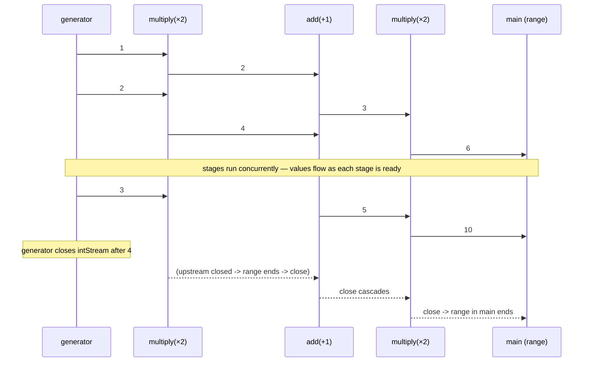
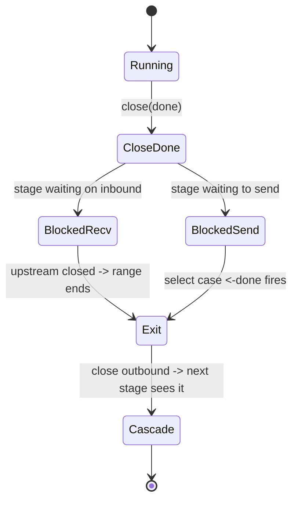

# Ch 4.7 — Best Practices for Constructing Pipelines

> Book: *Concurrency in Go* (Katherine Cox-Buday, O'Reilly 2017) · Chapter 4: Concurrency Patterns in Go · Pages ~104–109
> ⬅️ Prev: [Pipelines (intro)](./06-pipelines-intro.md) · ➡️ Next: [Some Handy Generators](./08-handy-generators.md) · 🏠 [Book index](../README.md)

## 🎯 In One Paragraph

Channels are the ideal primitive for pipelines because they satisfy every requirement: they receive and emit values, they're concurrency-safe, they can be ranged over, and they're reified. Converting the function-based pipeline to channels costs more code but buys two huge things: **each stage runs in its own goroutine, concurrently**, so a stage only waits for its inputs and its ability to send its outputs; and the whole pipeline becomes **uniformly preemptable** by closing a single shared `done` channel. The pipeline begins with a **generator** that converts discrete values into a stream on a channel, then each stage ranges over its incoming channel and sends on a new outgoing channel from inside a `select` that also watches `done`. Closing `done` *cascades* termination through every stage, because each stage is preemptable both when blocked on a receive (its upstream closes, ending the `range`) and when blocked on a send (the `select`'s `done` case fires). By induction, the entire pipeline is always preemptable.

## 🧠 Key Concepts & Vocabulary

- **Generator** — a function that converts a discrete set of values into a stream on a channel; the pipeline's starting stage.
- **Channel-based stage** — a function taking `done` plus an inbound channel, returning a new outbound channel; it ranges over inbound and sends on outbound inside a `select` with `done`.
- **Concurrent stages** — every stage runs in its own goroutine, so stages execute independently, overlapping in time.
- **Preemptability** — the ability to stop a stage no matter what it's blocked on (receive or send), achieved via closed upstream channels and the `done` `select` case.
- **Cascade** — closing `done` propagates termination through all stages, as does the closing of each stage's outbound channel.
- **Recurrence relation / induction** — the beginning (generator) and end (final range) are preemptable by construction; every middle stage is built identically, so by induction the whole pipeline is preemptable.

## 📚 Deep Dive

### Why channels fit pipelines



### The channel pipeline

```go
package main

import "fmt"

// generator: discrete values -> stream on a channel.
func generator(done <-chan interface{}, integers ...int) <-chan int {
	intStream := make(chan int)
	go func() {
		defer close(intStream)
		for _, i := range integers {
			select {
			case <-done: // preemptable on send
				return
			case intStream <- i:
			}
		}
	}()
	return intStream
}

func multiply(done <-chan interface{}, intStream <-chan int, multiplier int) <-chan int {
	multipliedStream := make(chan int)
	go func() {
		defer close(multipliedStream)
		for i := range intStream { // preemptable on receive (upstream close)
			select {
			case <-done:
				return
			case multipliedStream <- i * multiplier:
			}
		}
	}()
	return multipliedStream
}

func add(done <-chan interface{}, intStream <-chan int, additive int) <-chan int {
	addedStream := make(chan int)
	go func() {
		defer close(addedStream)
		for i := range intStream {
			select {
			case <-done:
				return
			case addedStream <- i + additive:
			}
		}
	}()
	return addedStream
}

func main() {
	done := make(chan interface{})
	defer close(done) // guarantees clean exit, no leaks

	intStream := generator(done, 1, 2, 3, 4)
	pipeline := multiply(done, add(done, multiply(done, intStream, 2), 1), 2)

	for v := range pipeline {
		fmt.Println(v)
	}
}
```

Output:

```
6
10
14
18
```

More code than the plain-function version — what did we gain? Three functions, each starting a goroutine, each taking a `done` channel (the leak-prevention pattern from [chapter 4.3](./03-preventing-goroutine-leaks.md)), each returning a channel and (except the generator) taking one. Breaking it down:

- `done := make(...); defer close(done)` — ensures clean exit and never leaks goroutines.
- `generator(done, 1,2,3,4)` — converts discrete ints into a stream; the send shares a `select` with `done`. You'll *always* start a pipeline with a generator because you begin with a batch of data that must become a channel.
- `pipeline := multiply(done, add(done, multiply(done, intStream, 2), 1), 2)` — the same "×2, +1, ×2" pipeline, but now each stage's output channel feeds the next stage's input.

### Two important differences from the function version

1. **Channels** — lets us `range` the final output *and* lets each stage execute safely in a concurrent context (inputs/outputs are channel-safe).
2. **Concurrent stages** — each stage runs in its own goroutine, so a stage only waits for its inputs and for the ability to send its outputs. Stages overlap in time (critical for Fan-Out/Fan-In, next chapter).



### How values flow (the book's table)

Each row is a for-loop iteration; a cell shows the value entering that stage that iteration:

| Iteration | Generator | Multiply | Add | Multiply | Value |
|-----------|-----------|----------|-----|----------|-------|
| 0 | 1 |   |   |   |   |
| 0 |   | 1 |   |   |   |
| 0 | 2 |   | 2 |   |   |
| 0 |   | 2 |   | 3 |   |
| 0 | 3 |   | 4 |   | 6 |
| 1 |   | 3 |   | 5 |   |
| 1 | 4 |   | 6 |   | 10 |
| 2 | (closed) | 4 |   | 7 |   |
| 2 |   | (closed) | 8 |   | 14 |
| 3 |   |   | (closed) | 9 |   |
| 3 |   |   |   | (closed) | 18 |

### What if you `close(done)` early?

Closing `done` mid-flight *cascades* through the pipeline. The book's second table shows the generator closing, then each successive stage closing, until `range` in `main` exits. Two mechanisms make this work in **every** stage:

- **Ranging over the incoming channel** — when upstream closes, the `range` exits (handles the *receive-blocked* case).
- **The send sharing a `select` with `done`** — handles the *send-blocked* case.

So no matter what a stage is blocked on, closing `done` forces it to terminate.



### Preemptability by induction

- **Beginning (generator):** two things must be preemptable — *creating* the discrete value (your responsibility; here ranging a slice is instantaneous enough), and *sending* it (handled by `select` + `done`).
- **End (final range):** preemptable because the channel it ranges over closes on preemption, ending the range — i.e., it inherits preemptability from its upstream.
- **Middle stages:** always "range over a channel, send on another inside a `select` with `done`." If blocked on receive, the upstream close unblocks it (and by induction the upstream *will* close, being either a stage like this or the preemptable generator). If blocked on send, the `select` makes it preemptable.

Therefore the **entire pipeline is always preemptable by closing `done`.**

## ⚠️ Pitfalls & Gotchas

- **Forgetting `defer close(done)`** (or never closing `done`) leaves stages blocked and leaks goroutines when you stop early.
- **A stage that doesn't `defer close(outbound)`** will hang the downstream `range` forever.
- **A send without the `done` `select` case** reintroduces a send-blocked leak; every send must share a `select` with `done`.
- **Unbuffered channels mean lock-step hand-off.** Throughput is gated by the slowest stage; a single expensive stage rate-limits the whole pipeline (motivation for Fan-Out/Fan-In).
- **Only the stage that owns an output channel closes it.** Never close a channel from a downstream consumer.
- **Non-instantaneous value creation in the generator** must *also* be made preemptable, or the generator can't be cancelled while producing.

## 🆕 Modern Go Notes

> 🆕 **`context.Context` replaces the shared `done`.** Pass `ctx` through all stages and `select { case <-ctx.Done(): return; case out <- v: }`. You also get deadlines and a cancellation cause (`context.WithCancelCause`, Go 1.20).

> 🆕 **Generics remove `interface{}` from stages.** `func stage[A, B any](ctx context.Context, in <-chan A, f func(A) B) <-chan B` is a fully type-safe, reusable channel stage (Go 1.18+).

> 🆕 **`golang.org/x/sync/errgroup` for stage lifecycle + errors.** Wrapping each stage's goroutine in an `errgroup.Group` (with `WithContext`) propagates the first error and cancels the rest — a tidy way to manage a pipeline's goroutines. Go 1.25's `sync.WaitGroup.Go` similarly simplifies plain lifecycle management.

> 🆕 **`testing/synctest` (Go 1.25).** Deterministically test concurrent pipelines (including timing and cancellation cascades) without flaky sleeps.

## 🧪 Try It Yourself

1. Add a `print`/`tee`-style stage that forwards values unchanged while logging them, and insert it anywhere without touching other stages.
2. Call `close(done)` after reading just the first value from `pipeline` and verify (with `runtime.NumGoroutine`) that all stage goroutines drain.
3. Convert every stage to take `context.Context` and cancel with a `WithTimeout`.
4. Rewrite the stages as a single generic `stage[A, B any]` and rebuild the ×2/+1/×2 pipeline.

## ✅ Self-Check Questions

<details><summary>1. Why are channels uniquely suited to building pipelines in Go?</summary>
They can receive and emit values, are safe for concurrent use, can be ranged over, and are reified by the language — exactly the requirements of a pipeline stage.
</details>

<details><summary>2. What is a generator and why does a pipeline always start with one?</summary>
A generator converts a discrete set of values into a stream on a channel. Pipelines start with one because you always begin with a batch of data that must be turned into a channel to feed the stages.
</details>

<details><summary>3. What are the two differences between the channel pipeline and the function pipeline?</summary>
(1) It uses channels, enabling `range` over the output and safe concurrent execution of each stage; (2) each stage runs concurrently in its own goroutine, waiting only for its inputs and the ability to send outputs.
</details>

<details><summary>4. What two mechanisms let closing `done` cascade through every stage?</summary>
Ranging over the incoming channel (which exits when upstream closes, handling receive-blocking) and sharing the send with a `select` on `done` (handling send-blocking).
</details>

<details><summary>5. Explain why the whole pipeline is preemptable "by induction."</summary>
The generator is preemptable by construction (value creation + a `select`-guarded send). Each middle stage is built identically, so if blocked on receive it unblocks when its (preemptable) upstream closes, and if blocked on send its `select` with `done` preempts it. The final range inherits preemptability from its upstream. Thus every stage, and so the whole pipeline, is preemptable.
</details>

<details><summary>6. What limits the throughput of a simple unbuffered channel pipeline?</summary>
The slowest stage: because stages hand off in lock-step over unbuffered channels, one computationally expensive stage rate-limits the entire pipeline — motivating Fan-Out/Fan-In.
</details>

## 🔑 Key Takeaways

- Channels satisfy all pipeline requirements; use them for concurrent, cancellable pipelines.
- Start with a generator; each stage ranges inbound and sends outbound inside a `select` with `done`.
- Every stage runs in its own goroutine and overlaps in time.
- `close(done)` cascades termination via (a) upstream close ending `range` and (b) the `done` `select` case.
- By induction the whole pipeline is always preemptable — provided every stage follows the pattern.

## 🔗 References & Further Reading

📝 Blogs/articles
- [Go Concurrency Patterns: Pipelines and cancellation (The Go Blog)](https://go.dev/blog/pipelines) — the definitive source on channel pipelines, cancellation, and the `done` channel.
- [Applying Modern Go Concurrency Patterns to Data Pipelines (Medium / amboss)](https://medium.com/amboss/applying-modern-go-concurrency-patterns-to-data-pipelines-b3b5327908d4) — modern take with context and error handling.
- [Go Concurrency pipelines (dev.to)](https://dev.to/ishankhare07/go-concurrency-pipelines-gmc) — a worked, optimized real-world pipeline example.

💻 GitHub
- [kat-co/concurrency-in-go-src](https://github.com/kat-co/concurrency-in-go-src) — the book's official generator/multiply/add channel pipeline.
- [golang/go: src/context/context.go](https://github.com/golang/go/blob/master/src/context/context.go) — `Context.Done()` used to make modern pipelines preemptable.

📖 Official docs/specs
- [The Go Programming Language Specification: Channel types / close](https://go.dev/ref/spec#Channel_types) — semantics of channel send/receive/close that cascade termination.
- [pkg.go.dev: context](https://pkg.go.dev/context) — the modern replacement for the shared `done` channel.
- [The Go Memory Model](https://go.dev/ref/mem) — happens-before guarantees for channel operations relied on by concurrent stages.
