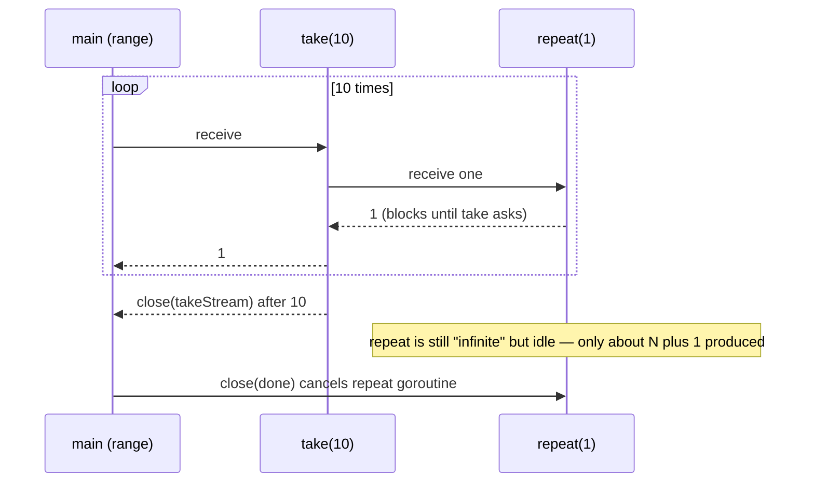
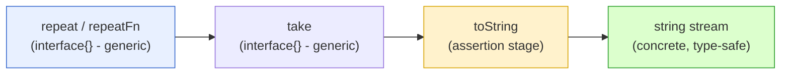
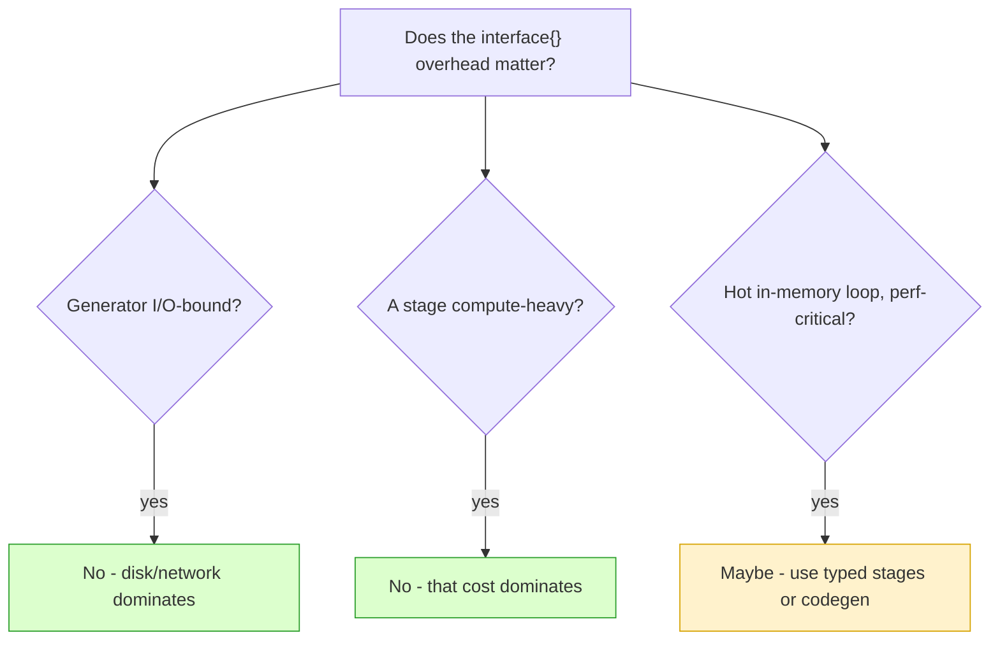

# Ch 4.8 — Some Handy Generators

> Book: *Concurrency in Go* (Katherine Cox-Buday, O'Reilly 2017) · Chapter 4: Concurrency Patterns in Go · Pages ~109–113
> ⬅️ Prev: [Pipeline Best Practices](./07-pipeline-best-practices.md) · ➡️ Next: [Fan-Out, Fan-In](./09-fan-out-fan-in.md) · 🏠 [Book index](../README.md)

## 🎯 In One Paragraph

A **generator** is any function that converts a set of discrete values into a stream on a channel — the natural start of a pipeline. This section builds a tiny reusable toolkit of generic generators and stages: **`repeat`** emits its arguments over and over forever; **`take`** pulls only the first *N* values off an incoming stream and then stops; **`repeatFn`** repeatedly calls a function and emits each result (great for infinite streams like random numbers); and **`toString`** is a type-assertion stage that converts an `interface{}` stream into a `string` stream. These helpers deal in `chan interface{}` deliberately — so a single standard library of pipeline stages can be reused regardless of element type — because operations like "repeat" and "take" need only know the *arity* of their parameters, not the element type. When you *do* need a concrete type, you add a small assertion stage like `toString`. Crucially, `repeat` and `take` composed together are *lazy*: because `repeat`'s send blocks on `take`'s receive, an "infinite" generator only ever produces about N+1 values. A benchmark confirms the generic approach costs only a small constant factor over type-specific stages (~2× in ns/op), which is dwarfed in practice by I/O or compute-heavy stages.

## 🧠 Key Concepts & Vocabulary

- **Generator** — a function converting discrete values into a stream of values on a channel.
- **`repeat`** — emits its variadic values in a loop, forever, until `done` closes.
- **`take`** — a stage that forwards only the first `num` values from `valueStream`, then closes and exits.
- **`repeatFn`** — like `repeat` but emits the result of calling `fn()` each time; ideal for generated (e.g. random) streams.
- **`toString`** — a stage that type-asserts each `interface{}` value to `string` and emits it on a `chan string`.
- **Laziness / backpressure** — `repeat`'s send blocks on the downstream receive, so an infinite generator paired with `take(n)` only generates ~N+1 values.
- **Arity over type** — generic stages (`repeat`, `take`) need only know how many parameters they take, not the element type — justifying `interface{}`.
- **Assertion stage** — when a concrete type is needed, insert a stage that performs the type assertion (e.g. `toString`).

## 📚 Deep Dive

### `repeat` — an infinite source

```go
repeat := func(done <-chan interface{}, values ...interface{}) <-chan interface{} {
    valueStream := make(chan interface{})
    go func() {
        defer close(valueStream)
        for {
            for _, v := range values {
                select {
                case <-done:
                    return
                case valueStream <- v:
                }
            }
        }
    }()
    return valueStream
}
```

It repeats the values you pass, infinitely, until you tell it to stop (close `done`).

### `take` — a limiter

```go
take := func(done <-chan interface{}, valueStream <-chan interface{}, num int) <-chan interface{} {
    takeStream := make(chan interface{})
    go func() {
        defer close(takeStream)
        for i := 0; i < num; i++ {
            select {
            case <-done:
                return
            case takeStream <- <-valueStream: // receive one, then send it on
            }
        }
    }()
    return takeStream
}
```

`take` forwards only the first `num` items from its incoming stream, then exits. Composed with `repeat`:

```go
done := make(chan interface{})
defer close(done)
for num := range take(done, repeat(done, 1), 10) {
    fmt.Printf("%v ", num) // 1 1 1 1 1 1 1 1 1 1
}
```

Even though `repeat(done, 1)` *could* generate an infinite stream of ones, because `repeat`'s send blocks on `take`'s receive, it only ever generates **N+1** values (where N is the take count). This is backpressure/laziness for free.



### `repeatFn` — repeat a function

```go
repeatFn := func(done <-chan interface{}, fn func() interface{}) <-chan interface{} {
    valueStream := make(chan interface{})
    go func() {
        defer close(valueStream)
        for {
            select {
            case <-done:
                return
            case valueStream <- fn():
            }
        }
    }()
    return valueStream
}
```

Use it for an on-demand infinite stream of random ints:

```go
done := make(chan interface{})
defer close(done)
randFn := func() interface{} { return rand.Int() }
for num := range take(done, repeatFn(done, randFn), 10) {
    fmt.Println(num)
}
```

An infinite channel of random integers generated only as needed — paired with `take`, exactly 10 (≈N+1) are computed.

### `toString` — a type-assertion stage

Because the generic stages carry `interface{}`, you convert to a concrete type with a small stage:

```go
toString := func(done <-chan interface{}, valueStream <-chan interface{}) <-chan string {
    stringStream := make(chan string)
    go func() {
        defer close(stringStream)
        for v := range valueStream {
            select {
            case <-done:
                return
            case stringStream <- v.(string): // assert to string
            }
        }
    }()
    return stringStream
}
```

```go
done := make(chan interface{})
defer close(done)
var message string
for token := range toString(done, take(done, repeat(done, "I", "am."), 5)) {
    message += token
}
fmt.Printf("message: %s...", message) // message: Iam.Iam.I...
```

### Why `interface{}`? (the design argument)

Empty interfaces are a bit taboo in Go, but for pipeline stages the book argues it's fine: it lets you keep a **standard library of reusable stages**. `repeat`/`repeatFn` only care about "generate a stream by looping"; `take` only cares about "limit the stream." None of them need to know the element type — only the *arity* of their parameters. When you need a concrete type, drop in an assertion stage (`toString`). The overhead of the extra stage/goroutine and the assertion is negligible (benchmarked below). If it still bothers you, write a Go code generator to produce typed versions.



### Complete runnable program

This verified program exercises all four helpers:

```go
package main

import (
	"fmt"
	"math/rand"
)

func repeat(done <-chan interface{}, values ...interface{}) <-chan interface{} {
	valueStream := make(chan interface{})
	go func() {
		defer close(valueStream)
		for {
			for _, v := range values {
				select {
				case <-done:
					return
				case valueStream <- v:
				}
			}
		}
	}()
	return valueStream
}

func take(done <-chan interface{}, valueStream <-chan interface{}, num int) <-chan interface{} {
	takeStream := make(chan interface{})
	go func() {
		defer close(takeStream)
		for i := 0; i < num; i++ {
			select {
			case <-done:
				return
			case takeStream <- <-valueStream:
			}
		}
	}()
	return takeStream
}

func repeatFn(done <-chan interface{}, fn func() interface{}) <-chan interface{} {
	valueStream := make(chan interface{})
	go func() {
		defer close(valueStream)
		for {
			select {
			case <-done:
				return
			case valueStream <- fn():
			}
		}
	}()
	return valueStream
}

func toString(done <-chan interface{}, valueStream <-chan interface{}) <-chan string {
	stringStream := make(chan string)
	go func() {
		defer close(stringStream)
		for v := range valueStream {
			select {
			case <-done:
				return
			case stringStream <- v.(string):
			}
		}
	}()
	return stringStream
}

func main() {
	done := make(chan interface{})
	defer close(done)

	for num := range take(done, repeat(done, 1), 10) {
		fmt.Printf("%v ", num)
	}
	fmt.Println()

	randFn := func() interface{} { return rand.Int() }
	for num := range take(done, repeatFn(done, randFn), 3) {
		fmt.Println(num)
	}

	var message string
	for token := range toString(done, take(done, repeat(done, "I", "am."), 5)) {
		message += token
	}
	fmt.Printf("message: %s...\n", message)
}
```

Output (random values differ per run):

```
1 1 1 1 1 1 1 1 1 1 
2920139622328590834
2007402313510694172
2891166654908644311
message: Iam.Iam.I...
```

### Benchmark: generic vs. typed

To prove the generic cost is small, benchmark `toString(take(repeat("a"), b.N))` (generic) against a type-specific `string` `repeat`/`take`:

```go
func BenchmarkGeneric(b *testing.B) {
	done := make(chan interface{})
	defer close(done)
	b.ResetTimer()
	for range toString(done, take(done, repeat(done, "a"), b.N)) {
	}
}

func BenchmarkTyped(b *testing.B) {
	// local string-typed repeat + take (no interface{}, no assertion)...
	done := make(chan interface{})
	defer close(done)
	b.ResetTimer()
	for range take(done, repeat(done, "a"), b.N) {
	}
}
```

**The book's 2017 result (reproduced for reference):**

```
BenchmarkGeneric-4   1000000   2266 ns/op
BenchmarkTyped-4     1000000   1181 ns/op
```

**Verified on this machine (go1.27, 13th-gen i5):**

```
BenchmarkGeneric-16   1000000   1180 ns/op   0 B/op   0 allocs/op
BenchmarkTyped-16     2527095    537 ns/op   0 B/op   0 allocs/op
```

Both runs agree on the shape: the type-specific stages are about **twice as fast** per op, but the absolute difference is tiny (and the book notes it's only "marginally faster in magnitude"). The limiting factor in a real pipeline is almost always the generator's I/O (disk/network) or a computationally intensive stage — either of which dwarfs this nanosecond-scale overhead. If it still bothers you, generate typed stages with a Go code generator.



## ⚠️ Pitfalls & Gotchas

- **`take` panics on a closed upstream.** `takeStream <- <-valueStream` does a *nested* receive; if `valueStream` is already closed it receives the zero value (an untyped `nil` `interface{}`), which may then fail a later assertion. Pair `take` with a generator that outlives it (like `repeat`).
- **`toString` panics on a non-string.** `v.(string)` is an *unchecked* assertion. Feed it only string values, or use the comma-ok form `s, ok := v.(string)` in real code.
- **`repeat`/`repeatFn` leak without `done`.** They loop forever; you must `close(done)` (here via `defer`) or they block on send after the consumer stops.
- **Laziness depends on unbuffered channels.** The N+1 efficiency relies on the send blocking on the receive. Buffer the channels and the generator races ahead, producing extra values.
- **`interface{}` boxing has a cost** (and in other code, allocations). Here it benchmarks at 0 allocs/op because the values are small/interned, but boxing larger values will allocate.

## 🆕 Modern Go Notes

> 🆕 **Generics make these type-safe (Go 1.18).** Rewrite as `func repeat[T any](done <-chan interface{}, values ...T) <-chan T`, `func take[T any](...)`, `func repeatFn[T any](done, fn func() T) <-chan T`. The `toString` assertion stage disappears entirely — you just use `repeat[string]`. This is the modern answer to the book's `interface{}` debate.

> 🆕 **`any` is the spelling for `interface{}` (Go 1.18).** Prefer `any` in new code.

> 🆕 **`math/rand` auto-seeds (Go 1.20+); `math/rand/v2` (Go 1.22).** `rand.Int()` no longer needs `rand.Seed`, so `repeatFn` random output differs from the book each run. `math/rand/v2` offers a cleaner API (`rand.Int64N`, etc.).

> 🆕 **`iter.Seq` (Go 1.23) for non-concurrent generators.** When you don't need concurrency, a pull iterator (`func(yield func(T) bool)`) gives `repeat`/`take`-like composition with range-over-func and no goroutines. Channels remain the choice when stages must run concurrently.

> 🆕 **`b.Loop()` (Go 1.24).** Modern benchmarks prefer `for b.Loop() { ... }` over `for i := 0; i < b.N; i++`, which also removes the need for manual `b.ResetTimer()` in simple cases.

## 🧪 Try It Yourself

1. Rewrite all four helpers with generics and delete `toString`; rebuild the "Iam.Iam.I..." example with `repeat[string]`.
2. Buffer the channels in `repeat`/`take` and count (via a side counter) how many values `repeat` actually produces — observe laziness break.
3. Use `repeatFn` with a function that reads lines from a file, and `take` the first 5 — note how it becomes I/O-bound.
4. Re-run the benchmark with `for b.Loop()` (Go 1.24) and with buffered vs. unbuffered channels; compare ns/op.

## ✅ Self-Check Questions

<details><summary>1. What does a generator do, and name the two in this section.</summary>
It converts a discrete set of values into a stream on a channel. The two generators are `repeat` (emits its arguments forever) and `repeatFn` (emits the result of calling a function forever).
</details>

<details><summary>2. Why does `take(done, repeat(done, 1), 10)` only generate about 11 values despite `repeat` being infinite?</summary>
Because `repeat`'s send blocks on `take`'s receive (backpressure over an unbuffered channel). `repeat` only produces a value when `take` asks for one, so only ~N+1 values are ever generated.
</details>

<details><summary>3. Why do the generic stages use `interface{}`, and what's the justification?</summary>
So a single reusable library of pipeline stages works for any element type. Stages like `repeat` and `take` need only the arity of their parameters, not the element type, so `interface{}` lets them stay generic. Concrete types are handled by assertion stages like `toString`.
</details>

<details><summary>4. What does the `toString` stage do and what's its risk?</summary>
It type-asserts each incoming `interface{}` value to `string` and emits it on a `chan string`. The risk is an unchecked `v.(string)` assertion panicking if a non-string flows through.
</details>

<details><summary>5. What did the benchmark show about generic vs. typed stages?</summary>
Typed stages are roughly twice as fast per op (book: 1181 vs 2266 ns/op; verified: ~537 vs ~1180 ns/op), but the absolute difference is tiny and is dwarfed in practice by I/O-bound generators or compute-heavy stages.
</details>

<details><summary>6. What is the modern Go answer to the `interface{}` debate for these helpers?</summary>
Use generics (Go 1.18+): write `repeat[T any]`, `take[T any]`, `repeatFn[T any]`, which are type-safe and eliminate the need for assertion stages like `toString`.
</details>

## 🔑 Key Takeaways

- `repeat`, `repeatFn` = infinite generators; `take` = limiter; `toString` = assertion stage.
- `repeat` + `take` is lazy: infinite source, only ~N+1 values produced (backpressure via unbuffered channels).
- `interface{}` keeps the stage library reusable because generic stages care about arity, not type.
- Generic vs. typed benchmarks ~2× per op but negligible vs. real I/O/compute — verified at ~1180 vs ~537 ns/op on go1.27.
- Modern Go: use generics to make all of these type-safe and drop `toString`.

## 🔗 References & Further Reading

📝 Blogs/articles
- [Go Concurrency Patterns: Pipelines and cancellation (The Go Blog)](https://go.dev/blog/pipelines) — generators, `gen`/`sq`/`merge` stages, the foundation these helpers build on.
- [Pipeline Patterns in Go (Medium / statuscode)](https://medium.com/statuscode/pipeline-patterns-in-go-a37bb3a7e61d) — reusable generator/stage helpers with added features.
- [Gist of Go: Pipelines (antonz.org)](https://antonz.org/go-concurrency/pipelines/) — interactive `repeat`/`take`-style generator examples.

💻 GitHub
- [kat-co/concurrency-in-go-src](https://github.com/kat-co/concurrency-in-go-src) — the book's official `repeat`/`take`/`repeatFn`/`toString` and the benchmark code.
- [golang/go: src/math/rand/v2](https://github.com/golang/go/tree/master/src/math/rand/v2) — the modern RNG used in `repeatFn`-style generators.

📖 Official docs/specs
- [pkg.go.dev: iter](https://pkg.go.dev/iter) — `iter.Seq`/range-over-func, the non-concurrent modern alternative to channel generators.
- [pkg.go.dev: testing (Benchmarks, b.Loop)](https://pkg.go.dev/testing#hdr-Benchmarks) — how the generic-vs-typed benchmark is written and run.
- [Go 1.18 release notes: Generics](https://go.dev/doc/go1.18#generics) — the type parameters that make these helpers type-safe without `interface{}`.
