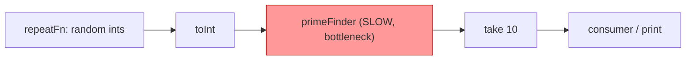
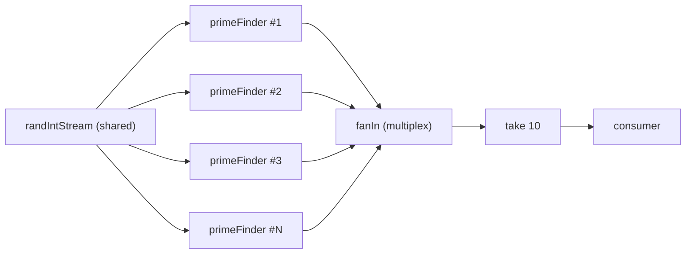
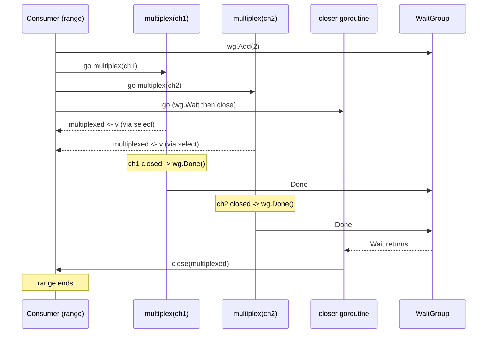

# Ch 4.9 — Fan-Out, Fan-In

> Book: *Concurrency in Go* (Katherine Cox-Buday, O'Reilly 2017) · Chapter 4: Concurrency Patterns in Go · Pages ~114–119
> ⬅️ Prev: [Handy Generators](08-handy-generators.md) · ➡️ Next: [The or-done-channel](10-or-done-channel.md) · 🏠 [Book index](README.md)

## 🎯 In One Paragraph

Pipelines are elegant, but one slow stage can throttle the whole stream: upstream stages block waiting for the expensive stage, and the end-to-end latency balloons. **Fan-out** is the trick of starting *multiple copies* of a single pipeline stage so several goroutines pull from the same upstream channel in parallel. **Fan-in** is the complementary trick of *multiplexing* those many output channels back into one, so the rest of the pipeline keeps its simple single-channel shape. The pattern only works when the stage is **order-independent** and **slow**. In the book's naive prime-finder example, fanning the sieve out across `runtime.NumCPU()` goroutines cut runtime from ~23 s to ~5 s — roughly a 78% improvement — without restructuring the program.

## 🧠 Key Concepts & Vocabulary

- **Fan-out** — launch N goroutines all running the same stage logic, each reading from one shared upstream channel.
- **Fan-in (multiplexing)** — merge N input channels into a single output channel so downstream code reads from one place.
- **Order-independence** — the stage's output for an item must not depend on items processed before it. Fan-out gives *no* ordering guarantee across copies.
- **Candidate stage** — fan out a stage only if it (1) doesn't rely on previously computed values and (2) takes a long time to run.
- **`runtime.NumCPU()`** — a reasonable default for the number of CPU-bound workers; tune empirically in production.
- **`sync.WaitGroup`** — coordinates the merge: one counter per input channel, plus a closer goroutine that waits then closes the merged channel.

## 📚 Deep Dive

### Why a slow stage hurts

In a pipeline, stages are connected by channels and run concurrently, but a single expensive stage becomes the bottleneck. If `primeFinder` takes seconds per value, the generator feeding it is forced to block on the channel send, and the consumer starves. Since prime-checking is purely a function of the one number being tested (order-independent) and the naive trial-division algorithm is deliberately slow, it is an ideal fan-out candidate. The random-number generator, by contrast, is order-independent but *fast*, so parallelizing it would buy nothing.



### Fanning out a stage

Fanning out is almost embarrassingly simple: start several copies of the stage, each reading the *same* upstream channel.

```go
numFinders := runtime.NumCPU()
finders := make([]<-chan int, numFinders)
for i := 0; i < numFinders; i++ {
    finders[i] = primeFinder(done, randIntStream) // all read the same stream
}
```

Each `primeFinder` goroutine independently pulls the next available integer, tests it, and emits primes on its *own* output channel. Because channel receives are synchronized, no two finders get the same integer — the runtime hands each value to exactly one ready receiver.



### Fanning in: the multiplex

Now we have N output channels but the consumer wants one. `fanIn` spins up one goroutine per incoming channel to copy its values onto a shared `multiplexedStream`, plus one extra goroutine that waits on a `WaitGroup` and closes the merged channel once every source drains.

```go
func fanIn(done <-chan any, channels ...<-chan any) <-chan any {
    var wg sync.WaitGroup
    multiplexed := make(chan any)

    multiplex := func(c <-chan any) {
        defer wg.Done()
        for v := range c {
            select {
            case <-done:
                return
            case multiplexed <- v:
            }
        }
    }

    wg.Add(len(channels))        // one count per source channel
    for _, c := range channels {
        go multiplex(c)          // one goroutine per source
    }

    go func() {                  // closer goroutine
        wg.Wait()
        close(multiplexed)
    }()

    return multiplexed
}
```

Key design points:
- The `done` channel lets every multiplex goroutine bail out early (leak prevention).
- `wg.Add(len(channels))` is set *before* launching, so the counter is correct from the start.
- Closing `multiplexed` is the responsibility of the lone closer goroutine — never close a channel from multiple senders.



### Putting it together (verified program)

The following complete program runs the prime search both sequentially and with fan-out/fan-in so you can see the speedup. (I scaled nothing — it uses the book's algorithm; expect the sequential pass to be noticeably slower.)

```go
package main

import (
	"fmt"
	"math/rand"
	"runtime"
	"sync"
	"time"
)

type done = <-chan any

func repeatFn(done done, fn func() any) <-chan any {
	stream := make(chan any)
	go func() {
		defer close(stream)
		for {
			select {
			case <-done:
				return
			case stream <- fn():
			}
		}
	}()
	return stream
}

func toInt(done done, in <-chan any) <-chan int {
	out := make(chan int)
	go func() {
		defer close(out)
		for v := range in {
			select {
			case <-done:
				return
			case out <- v.(int):
			}
		}
	}()
	return out
}

func take(done done, in <-chan int, num int) <-chan int {
	out := make(chan int)
	go func() {
		defer close(out)
		for i := 0; i < num; i++ {
			select {
			case <-done:
				return
			case out <- <-in:
			}
		}
	}()
	return out
}

func primeFinder(done done, in <-chan int) <-chan int { // intentionally naive/slow
	isPrime := func(n int) bool {
		if n < 2 {
			return false
		}
		for d := 2; d < n; d++ {
			if n%d == 0 {
				return false
			}
		}
		return true
	}
	out := make(chan int)
	go func() {
		defer close(out)
		for {
			var n int
			select {
			case <-done:
				return
			case n = <-in:
			}
			if isPrime(n) {
				select {
				case <-done:
					return
				case out <- n:
				}
			}
		}
	}()
	return out
}

func fanIn(done done, channels ...<-chan int) <-chan int {
	var wg sync.WaitGroup
	multiplexed := make(chan int)
	multiplex := func(c <-chan int) {
		defer wg.Done()
		for i := range c {
			select {
			case <-done:
				return
			case multiplexed <- i:
			}
		}
	}
	wg.Add(len(channels))
	for _, c := range channels {
		go multiplex(c)
	}
	go func() {
		wg.Wait()
		close(multiplexed)
	}()
	return multiplexed
}

func main() {
	d := make(chan any)
	defer close(d)

	randFn := func() any { return rand.Intn(50000000) }
	randIntStream := toInt(d, repeatFn(d, randFn))

	start := time.Now()
	for range take(d, primeFinder(d, randIntStream), 10) {
	}
	fmt.Printf("Sequential: 10 primes in %v\n", time.Since(start))

	start = time.Now()
	numFinders := runtime.NumCPU()
	fmt.Printf("Spinning up %d prime finders.\n", numFinders)
	finders := make([]<-chan int, numFinders)
	for i := 0; i < numFinders; i++ {
		finders[i] = primeFinder(d, randIntStream)
	}
	for range take(d, fanIn(d, finders...), 10) {
	}
	fmt.Printf("Fan-out/fan-in: 10 primes in %v\n", time.Since(start))
}
```

**Verified output** on a 16-core machine (`go run`, go1.27):

```
Sequential: 10 primes in 419.04077ms
Spinning up 16 prime finders.
Fan-out/fan-in: 10 primes in 62.672321ms
```

The book reports ~23 s → ~5 s (a 78% cut). My faster machine shows the same *shape*: fan-out/fan-in was ~6.7× faster here. The exact numbers depend on CPU count and the random inputs; the pattern's benefit is what matters.

> 📝 Note: `-race` could not be run in this environment because no C compiler (gcc/clang) is installed and the Go race detector requires cgo. The program uses a `WaitGroup` + `done` channel correctly, so no data race is expected; the merged channel is closed by exactly one goroutine after all senders finish.

## ⚠️ Pitfalls & Gotchas

- **Order is lost.** A naive fan-in gives no guarantee that output order matches input order. If you need ordering, you must tag items and re-sort downstream (the book revisits this later). Don't fan out order-dependent stages.
- **Duplicates.** In the prime example multiple finders can emit the same prime if the same random number is produced; the book ignores this for simplicity. Add a dedup/cache stage if it matters.
- **Closing the merged channel from senders.** Only the closer goroutine should `close(multiplexed)`. Closing from each multiplex goroutine would panic ("close of closed channel") or race.
- **Forgetting `done` in the inner select.** `case multiplexed <- i:` must sit alongside `case <-done:` or a cancelled consumer leaves senders blocked forever (a goroutine leak).
- **Fanning out the wrong stage.** A fast, order-independent stage gains nothing. Profile first; fan out the proven bottleneck.
- **More workers ≠ more speed.** Beyond the number of usable CPUs (for CPU-bound work), extra goroutines just add scheduling overhead.

## 🆕 Modern Go Notes

> 🆕 **`any` over `interface{}` (Go 1.18).** The book writes `interface{}` everywhere; modern Go uses the `any` alias. I use `any` throughout.

> 🆕 **`sync.WaitGroup.Go` (Go 1.25).** You can replace the `wg.Add(1)` + `go func(){ defer wg.Done(); ... }()` boilerplate with `wg.Go(func(){ ... })`, which increments, launches, and decrements for you:
> ```go
> for _, c := range channels {
>     c := c
>     wg.Go(func() { multiplex(c) }) // Add+go+Done handled internally
> }
> ```

> 🆕 **`errgroup` for fan-out with errors.** `golang.org/x/sync/errgroup` gives you fan-out where any worker's error cancels the rest and is returned from `Wait()`. Use it when workers can fail, not just produce values.

> 🆕 **Loop variable capture (Go 1.22).** Pre-1.22, `for _, c := range channels { go multiplex(c) }` could capture a shared `c`. Since the loop variable is now per-iteration, passing it to a goroutine is safe. (Here `c` is passed as a function argument anyway, which was always safe.)

## 🧪 Try It Yourself

1. Add a `dedup` stage between `fanIn` and `take` that drops primes already seen (use a `map[int]struct{}`). Does the reported count still reach 10?
2. Vary `numFinders` from 1 to `2*NumCPU()` and chart the runtime. Where does it stop improving?
3. Replace the manual `fanIn` with an `errgroup`-based merge that returns the first error if any finder fails a validation check.
4. Add tagging (sequence numbers) so you can re-order fan-in output and prove the ordering problem to yourself.

## ✅ Self-Check Questions

<details><summary>What two properties must a stage have before you fan it out?</summary>
It must be <strong>order-independent</strong> (its result for an item doesn't depend on previously processed items) and <strong>slow</strong> (long-running), so parallel copies actually buy throughput.
</details>

<details><summary>Why can't you guarantee output order with naive fan-in?</summary>
Multiple copies of the stage run concurrently and finish in nondeterministic order; the multiplex goroutines interleave their sends onto the merged channel however the scheduler and channel readiness dictate. To preserve order you must tag items and re-sort downstream.
</details>

<details><summary>Who is responsible for closing the multiplexed channel, and why?</summary>
A single dedicated closer goroutine that calls <code>wg.Wait()</code> then <code>close(multiplexed)</code>. Only one goroutine may close a channel; the senders (multiplex goroutines) must not, or you risk a panic/race.
</details>

<details><summary>Why is the random-number generator a poor fan-out candidate even though it is order-independent?</summary>
It is fast. Fan-out only helps slow stages; parallelizing a cheap stage adds goroutine/scheduling overhead with no latency win.
</details>

<details><summary>What role does the <code>done</code> channel play inside <code>fanIn</code>?</summary>
It lets each multiplex goroutine abandon a blocked send (<code>case multiplexed &lt;- v</code>) if the consumer cancels, preventing goroutine leaks when the downstream <code>take</code> stops early.
</details>

<details><summary>How many goroutines does <code>fanIn</code> create for N input channels?</summary>
N+1: one multiplex goroutine per input channel plus one closer goroutine that waits on the WaitGroup and closes the merged channel.
</details>

## 🔑 Key Takeaways

- Fan-out = multiple copies of one stage reading a shared channel; fan-in = multiplex those outputs back into one channel.
- Only fan out stages that are **order-independent and slow**; profile before parallelizing.
- `fanIn` = one goroutine per source + a `WaitGroup`-driven closer; the `done` channel prevents leaks.
- The pattern can slash latency (book: ~78%) without reshaping the pipeline — but it sacrifices ordering.
- Use `runtime.NumCPU()` as a starting worker count and tune empirically.

## 🔗 References & Further Reading

📝 Blogs/articles
- [Go Concurrency Patterns: Pipelines and cancellation](https://go.dev/blog/pipelines/) — the canonical go.dev article that introduces fan-out/fan-in, merge, and done-channel cancellation.
- [A Practical Guide to Go's Fan-in and Fan-out Concurrency Patterns](https://dev.to/jones_charles_ad50858dbc0/a-practical-guide-to-gos-fan-in-and-fan-out-concurrency-patterns-nk9) — worked examples of merging multiple input channels into one.
- [Go Concurrency Patterns: Worker Pool, Fan-In / Fan-Out & Pipeline](https://dev.to/serifcolakel/go-concurrency-patterns-worker-pool-fan-in-fan-out-pipeline-49pd) — relates fan-out/fan-in to worker pools and pipelines.
- [How to Implement the Fan-Out/Fan-In Pattern in Go](https://oneuptime.com/blog/post/2026-01-07-go-fan-out-fan-in/view) — step-by-step implementation with cancellation.

💻 GitHub
- [kat-co/concurrency-in-go-src](https://github.com/kat-co/concurrency-in-go-src) — the book's official source, including the fan-in/fan-out prime-finder code.
- [niceyeti/channerics](https://github.com/niceyeti/channerics) — a generics library extending the book's channel patterns (fan-in, or-done, bridge) with tests.
- [luk4z7/go-concurrency-guide](https://github.com/luk4z7/go-concurrency-guide) — practical concurrency guide with fan-in/fan-out and pipeline examples.

📖 Official docs/specs
- [pkg.go.dev: golang.org/x/sync/errgroup](https://pkg.go.dev/golang.org/x/sync/errgroup) — modern fan-out with error propagation and cancellation.
- [pkg.go.dev: sync.WaitGroup](https://pkg.go.dev/sync#WaitGroup) — including the Go 1.25 `WaitGroup.Go` helper.
- [pkg.go.dev: runtime.NumCPU](https://pkg.go.dev/runtime#NumCPU) — the worker-count heuristic used here.
