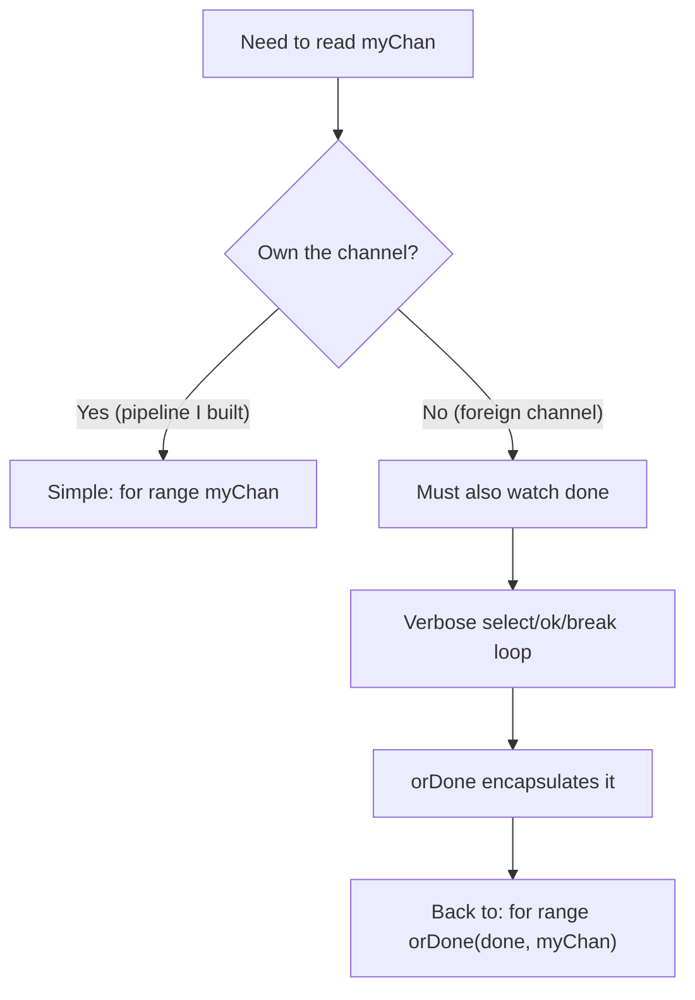
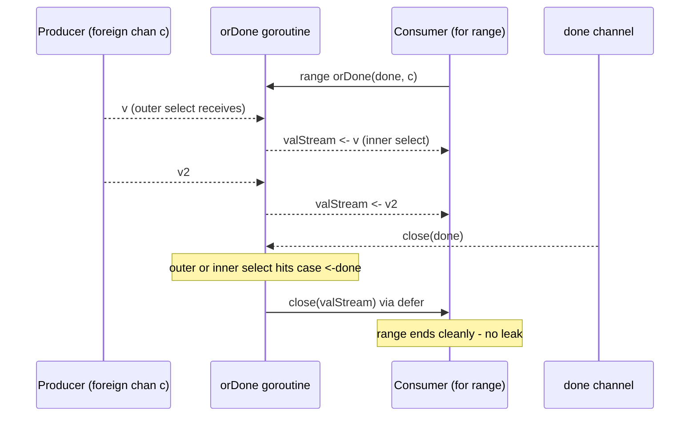

# Ch 4.10 — The or-done-channel

> Book: *Concurrency in Go* (Katherine Cox-Buday, O'Reilly 2017) · Chapter 4: Concurrency Patterns in Go · Pages ~119–120
> ⬅️ Prev: [Fan-Out, Fan-In](09-fan-out-fan-in.md) · ➡️ Next: [The tee-channel](11-tee-channel.md) · 🏠 [Book index](README.md)

## 🎯 In One Paragraph

When you consume a channel produced by *someone else's* code — a different subsystem, a library, a stage you don't own — you can't assume it respects your cancellation `done` channel. To stay leak-free you must wrap every receive in a `select` that also watches `done`. Done inline, this turns a clean `for val := range myChan` into a verbose labelled-loop with `ok`-checks and nested `break`s that quickly becomes unreadable, especially when nested. The **or-done-channel** encapsulates that verbosity inside one small goroutine so your call site goes right back to a simple `for range`. It trades one tidy helper goroutine for dramatically clearer consumer code — a direct application of "use goroutines to write *clearer* concurrent code, not just faster code."

## 🧠 Key Concepts & Vocabulary

- **Disparate channels** — channels created by code you don't control; their lifetime/cancellation semantics are unknown to you.
- **Leak-safe receive** — a receive wrapped in `select { case <-done: ...; case v, ok := <-c: ... }` so a cancelled consumer never blocks forever.
- **The verbose expansion** — the labelled `for`/`select`/`ok`-check loop you'd otherwise write by hand.
- **or-done (a.k.a. or-channel for ranges)** — a helper returning a new channel that is closed when either the source closes *or* `done` fires.
- **Readability over premature optimization** — prefer the clear helper unless profiling proves a tight hand-rolled loop is necessary.

## 📚 Deep Dive

### The problem: a receive that ignores cancellation

The clean form you *want* to write:

```go
for val := range myChan {
    // do something with val
}
```

…ignores `done` entirely. If `myChan` never closes and the producer stops sending, this `range` blocks forever and the goroutine leaks. The leak-safe hand-rolled version is noisy:

```go
loop:
for {
    select {
    case <-done:
        break loop
    case maybeVal, ok := <-myChan:
        if !ok {
            return // or break loop
        }
        // do something with maybeVal
    }
}
```

Now imagine that inside two levels of nesting. The labels, the `ok` check, and the `break loop` obscure the actual work.



### The or-done helper

`orDone` launches one goroutine that performs the verbose loop *once*, forwarding values onto a fresh `valStream`. The consumer ranges over `valStream` and never sees the machinery.

```go
func orDone(done, c <-chan any) <-chan any {
    valStream := make(chan any)
    go func() {
        defer close(valStream)
        for {
            select {
            case <-done:
                return
            case v, ok := <-c:
                if !ok {
                    return
                }
                select {            // nested select: forwarding must also respect done
                case valStream <- v:
                case <-done:
                }
            }
        }
    }()
    return valStream
}
```

Two `select`s matter here:
1. The **outer** one picks between cancellation and a new value from `c`.
2. The **inner** one forwards that value, but still bails if `done` fires *while blocked on the send* — otherwise a slow consumer plus a cancel would deadlock the helper.

`defer close(valStream)` guarantees the consumer's `range` always terminates: when `c` closes, when `done` fires, or when the helper returns for any reason.



### Using it

```go
for val := range orDone(done, myChan) {
    // do something with val — clean again
}
```

That is the whole payoff: foreign channels become as easy to consume as channels you own.

### Verified program

This complete program reads a foreign-style channel through `orDone` and also demonstrates that cancelling `done` stops the stream cleanly.

```go
package main

import (
	"fmt"
	"time"
)

type done = <-chan any

func orDone(done, c <-chan any) <-chan any {
	valStream := make(chan any)
	go func() {
		defer close(valStream)
		for {
			select {
			case <-done:
				return
			case v, ok := <-c:
				if !ok {
					return
				}
				select {
				case valStream <- v:
				case <-done:
				}
			}
		}
	}()
	return valStream
}

func main() {
	// Case 1: source closes normally.
	d := make(chan any)
	src := make(chan any)
	go func() {
		defer close(src)
		for i := 0; i < 5; i++ {
			src <- i
		}
	}()
	fmt.Print("normal close: ")
	for v := range orDone(d, src) {
		fmt.Printf("%v ", v)
	}
	fmt.Println()
	close(d)

	// Case 2: source never closes, but we cancel via done.
	d2 := make(chan any)
	neverCloses := make(chan any)
	go func() { // keeps sending forever
		i := 0
		for {
			select {
			case <-d2:
				return
			case neverCloses <- i:
				i++
			}
		}
	}()
	fmt.Print("cancelled early: ")
	count := 0
	for v := range orDone(d2, neverCloses) {
		fmt.Printf("%v ", v)
		count++
		if count == 3 {
			close(d2) // cancel; orDone closes valStream, range ends
		}
	}
	fmt.Println("\n(no goroutine left blocked)")
	time.Sleep(10 * time.Millisecond)
}
```

**Verified output** (`go run`, go1.27):

```
normal close: 0 1 2 3 4 
cancelled early: 0 1 2 
(no goroutine left blocked)
```

Case 1 drains a channel that closes on its own; Case 2 proves that `orDone` lets us stop ranging over a channel that *never* closes simply by closing `done`.

> 📝 Note: `-race` was unavailable here (no C compiler for cgo, which the race detector needs). The forwarding goroutine always exits via one of its `done` branches or when `c` closes, so it cannot leak.

## ⚠️ Pitfalls & Gotchas

- **Forgetting the inner select.** If you forward with a bare `valStream <- v`, a cancelled-but-slow consumer leaves the helper blocked on the send forever — the very leak you were trying to prevent.
- **Thinking you own foreign channels.** The whole point is that you *don't* know when `c` closes. Never assume a library channel honours your `done`.
- **Over-nesting by hand.** Resist writing the labelled-loop inline in multiple places; centralize it in `orDone`.
- **Double-close of `done`.** `close(done)` twice panics. Prefer closing once (often via `defer`) or use `context`'s cancel, which is idempotent.
- **Premature optimization.** The author explicitly warns: reach for a hand-rolled tight `select` loop only after readability-first `orDone` is proven a bottleneck.

## 🆕 Modern Go Notes

> 🆕 **`context.Context` instead of a bare `done` channel.** In modern code the `done <-chan any` is usually `ctx.Done()`. `orDone` becomes `orDone(ctx context.Context, c <-chan T)` selecting on `ctx.Done()`. You gain a cancellation *cause* (`ctx.Err()`), deadlines, and idempotent cancel.

> 🆕 **Generics (Go 1.18).** The book's `interface{}` can be `orDone[T any](done <-chan struct{}, c <-chan T) <-chan T`, giving a type-safe stream and eliminating per-element type assertions.

> 🆕 **`context.AfterFunc` (Go 1.21).** If you want a side-effect (metrics, logging) when the stream is cancelled, `context.AfterFunc(ctx, fn)` registers it without an extra goroutine of your own.

## 🧪 Try It Yourself

1. Rewrite `orDone` with generics: `func orDone[T any](done <-chan struct{}, c <-chan T) <-chan T`. Confirm the call site no longer needs type assertions.
2. Swap the `done` channel for a `context.Context` and print `ctx.Err()` when the stream ends early.
3. Remove the inner `select` (forward with a plain send) and reproduce a goroutine leak using a slow consumer — then put it back.
4. Nest two `orDone`s (e.g. `orDone(done, orDone(done, c))`) and confirm values still flow and cancellation still works.

## ✅ Self-Check Questions

<details><summary>Why do you need or-done for foreign channels but not for channels you built in a pipeline?</summary>
Channels you build respect your <code>done</code> channel by construction (every stage selects on it). Foreign channels make no such promise, so you must wrap each receive in a select that also watches <code>done</code> to avoid blocking forever.
</details>

<details><summary>What is the purpose of the inner (second) select inside orDone?</summary>
It forwards the received value onto <code>valStream</code> but still honours cancellation: if <code>done</code> fires while the forwarding send is blocked (slow consumer), the goroutine returns instead of deadlocking.
</details>

<details><summary>What guarantees the consumer's `for range orDone(...)` always terminates?</summary>
The <code>defer close(valStream)</code> in the helper goroutine. Whether the source closes, <code>done</code> fires, or the source signals <code>!ok</code>, the goroutine returns and <code>valStream</code> is closed, ending the range.
</details>

<details><summary>Does or-done improve performance?</summary>
No — it improves <em>readability</em>. It adds one goroutine and a channel hop. Its value is clearer consumer code; the author warns against hand-optimizing it away prematurely.
</details>

<details><summary>How does orDone relate to the or-channel pattern from earlier in the chapter?</summary>
The or-channel combines multiple done channels into one "any of these fired" signal; or-done applies a similar select-on-done idea but to a <em>value stream</em>, giving you a range-able channel that also stops on cancellation.
</details>

## 🔑 Key Takeaways

- Foreign channels don't honour your `done`; wrap receives in a cancellation-aware select — or let `orDone` do it once.
- `orDone` returns a channel closed when the source closes *or* `done` fires, restoring the simple `for range` at the call site.
- The inner forwarding select is essential to avoid leaking on a slow/cancelled consumer.
- It's a readability pattern, not a performance one — favour clarity first.
- In modern Go, back it with `context` and generics.

## 🔗 References & Further Reading

📝 Blogs/articles
- [Goroutine Ownership and Cancellation Contracts: Preventing Leaks in Long-Running Go Services](https://dev.to/neeraj_singhi_golang/goroutine-ownership-and-cancellation-contracts-preventing-leaks-in-long-running-go-services-31ld) — the ownership/cancellation model that motivates or-done.
- [Managing Goroutine Lifecycle and Context Cancellation in Web Servers](https://dev.to/viklogix/managing-goroutine-lifecycle-and-context-cancellation-in-web-servers-effective-strategies-for-46d8) — why `Done()` is cooperative and must be actively selected on.
- [Advanced Tested Recipes: Go channel patterns](https://golangtutorial.com/golang-channel-patterns/) — tested or-done, tee, and bridge recipes with real output.

💻 GitHub
- [kat-co/concurrency-in-go-src](https://github.com/kat-co/concurrency-in-go-src) — the book's official or-done source.
- [leetcode-golang-classroom/golang-or-done-and-tee-channel-sample](https://github.com/leetcode-golang-classroom/golang-or-done-and-tee-channel-sample) — a runnable or-done + tee demo with graceful shutdown.
- [niceyeti/channerics](https://github.com/niceyeti/channerics) — generic `OrDone` and related channel helpers with tests.

📖 Official docs/specs
- [pkg.go.dev: context](https://pkg.go.dev/context) — the modern replacement for a hand-rolled `done` channel.
- [The Go Programming Language Specification — Select statements](https://go.dev/ref/spec#Select_statements) — exact semantics of the `select` used inside or-done.
- [Go blog: Pipelines and cancellation](https://go.dev/blog/pipelines/) — the done-channel cancellation idiom or-done builds on.
