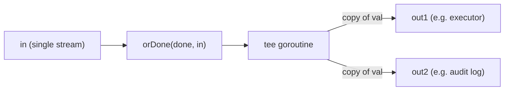
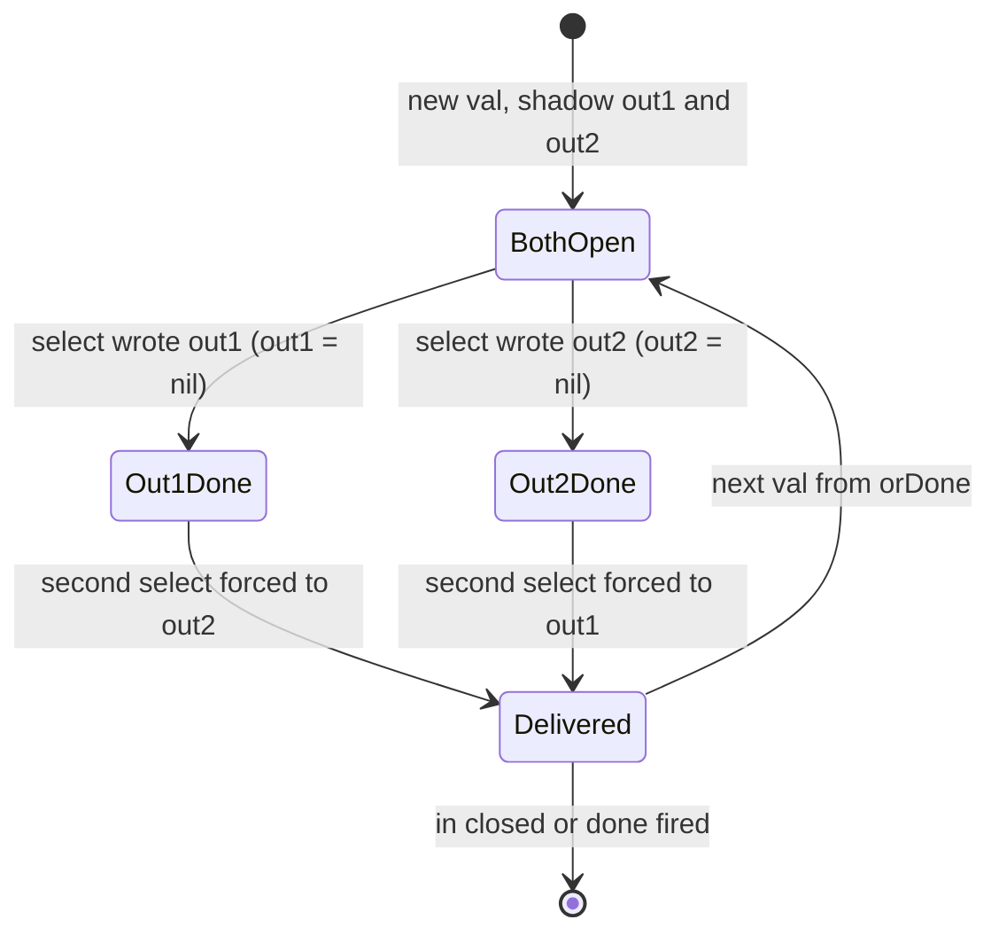
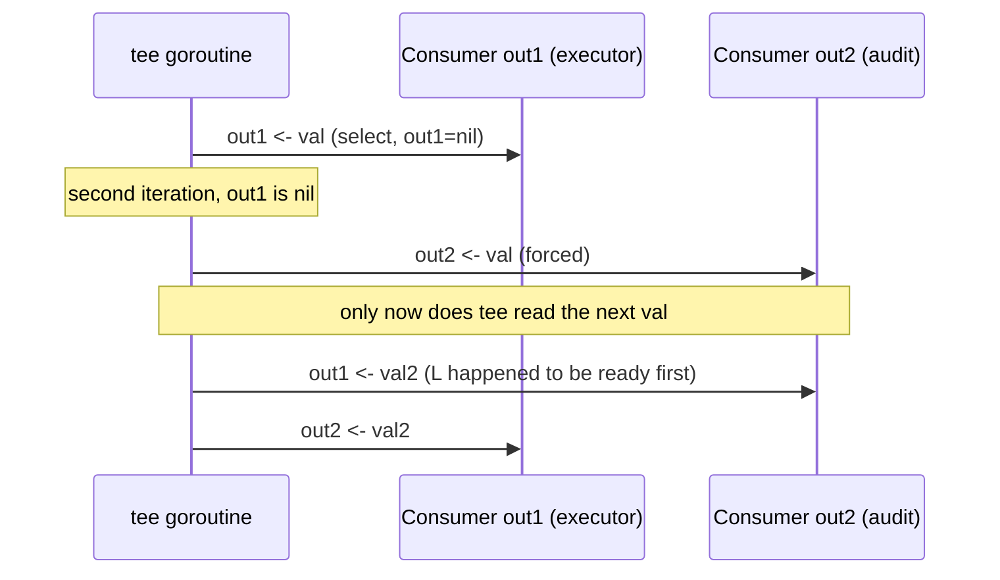

# Ch 4.11 — The tee-channel

> Book: *Concurrency in Go* (Katherine Cox-Buday, O'Reilly 2017) · Chapter 4: Concurrency Patterns in Go · Pages ~120–121
> ⬅️ Prev: [The or-done-channel](10-or-done-channel.md) · ➡️ Next: [The bridge-channel](12-bridge-channel.md) · 🏠 [Book index](README.md)

## 🎯 In One Paragraph

Named after the Unix `tee` command, the **tee-channel** takes one input channel and returns **two** output channels that each receive *every* value from the input. The classic use case is a stream you want to both act on and record: a channel of user commands where one copy goes to an executor and an identical copy goes to an audit log. The implementation reads each value once (through `orDone` for cancellation safety) and then, using a single `select` with shadowed, nil-able channel variables, delivers that value to *both* outputs before advancing. The important behavioral note: the two outputs are **tightly coupled** — iteration over the input cannot proceed until *both* consumers have accepted the current value.

## 🧠 Key Concepts & Vocabulary

- **tee** — split one channel into two identical streams (from Unix `tee`, which writes stdin to both stdout and a file).
- **Shadowed local channels** — inside the loop we redeclare `out1, out2 := out1, out2` so we can nil them out per value without destroying the real outputs.
- **nil-channel trick** — a send on a `nil` channel blocks forever, so setting a channel to `nil` removes its `case` from the `select`, forcing the other output to be written next.
- **Two-iteration select** — one `select` run twice guarantees each value reaches both outputs without one blocking the other.
- **Tight coupling** — the producer advances only after both consumers read the current value; the slower consumer paces the input.

## 📚 Deep Dive

### The shape of tee

```go
func tee(done <-chan any, in <-chan any) (<-chan any, <-chan any) {
    out1 := make(chan any)
    out2 := make(chan any)
    go func() {
        defer close(out1)
        defer close(out2)
        for val := range orDone(done, in) {
            out1, out2 := out1, out2 // shadow so we can nil them per value
            for i := 0; i < 2; i++ {
                select {
                case <-done:
                case out1 <- val:
                    out1 = nil
                case out2 <- val:
                    out2 = nil
                }
            }
        }
    }()
    return out1, out2
}
```

Walk through one value:
1. We shadow `out1`/`out2` with local copies so our edits don't clobber the channels we `defer close` and return.
2. First `select` iteration: whichever output is ready first receives `val`; we then set *that* local to `nil`.
3. Second iteration: the nil'd channel's `case` can never fire (send on nil blocks forever), so the `select` is forced to write to the *other* output.
4. After both writes, we move to the next `val`.

This "one select, two iterations, nil after write" idiom is why neither output can starve the other within a single value — but it also means both must accept the value before the loop advances.



### Why the nil trick instead of two sends?

If you wrote `out1 <- val; out2 <- val` sequentially, a consumer blocked on `out1` would stall `out2` even if `out2`'s consumer was ready — and vice versa. The single `select` lets *either* proceed first; nil-ing the completed one then guarantees the second send happens next. The two outputs make progress in whichever order their consumers are ready, yet both are always written before the next value.



### Coupling and throughput

Because iteration blocks until both outputs accept the value, a slow reader on `out2` paces the whole tee (and therefore the upstream producer). The author notes this is usually fine — managing per-consumer throughput should be a concern *outside* `tee` (e.g., buffer or drop downstream), not baked into the splitter.



### Verified program

```go
package main

import "fmt"

type done = <-chan any

func repeat(done done, values ...any) <-chan any {
	out := make(chan any)
	go func() {
		defer close(out)
		for {
			for _, v := range values {
				select {
				case <-done:
					return
				case out <- v:
				}
			}
		}
	}()
	return out
}

func take(done done, in <-chan any, num int) <-chan any {
	out := make(chan any)
	go func() {
		defer close(out)
		for i := 0; i < num; i++ {
			select {
			case <-done:
				return
			case out <- <-in:
			}
		}
	}()
	return out
}

func orDone(done, c <-chan any) <-chan any {
	valStream := make(chan any)
	go func() {
		defer close(valStream)
		for {
			select {
			case <-done:
				return
			case v, ok := <-c:
				if !ok {
					return
				}
				select {
				case valStream <- v:
				case <-done:
				}
			}
		}
	}()
	return valStream
}

func tee(done done, in <-chan any) (<-chan any, <-chan any) {
	out1 := make(chan any)
	out2 := make(chan any)
	go func() {
		defer close(out1)
		defer close(out2)
		for val := range orDone(done, in) {
			out1, out2 := out1, out2 // shadow
			for i := 0; i < 2; i++ {
				select {
				case <-done:
				case out1 <- val:
					out1 = nil
				case out2 <- val:
					out2 = nil
				}
			}
		}
	}()
	return out1, out2
}

func main() {
	d := make(chan any)
	defer close(d)

	out1, out2 := tee(d, take(d, repeat(d, 1, 2), 4))
	for val1 := range out1 {
		fmt.Printf("out1: %v, out2: %v\n", val1, <-out2)
	}
}
```

**Verified output** (`go run`, go1.27):

```
out1: 1, out2: 1
out1: 2, out2: 1
out1: 1, out2: 2
out1: 2, out2: 2
```

Every value from `repeat(1,2)` (four of them, via `take`) appears on *both* outputs. Note the consumer here reads `out1` in the `range` and `out2` inside the loop body (`<-out2`), which keeps both outputs draining in lockstep as the coupling requires. (The pairing of printed values can interleave because the select picks whichever output is ready first, but each stream independently receives `1 2 1 2`.)

> 📝 Note: `-race` unavailable in this environment (no C compiler for cgo). The goroutine closes both outputs via `defer` and only ever sends — no shared mutable state — so no data race is expected.

## ⚠️ Pitfalls & Gotchas

- **Reading only one output.** If you drain `out1` but never read `out2`, the tee goroutine blocks on the `out2` send and the whole stream stalls (and upstream with it). Always consume both outputs, or wrap each in a buffer/orDone.
- **Forgetting to shadow.** Nil-ing the *returned* `out1`/`out2` instead of local copies would break the channels you return and the `defer close`. The `out1, out2 := out1, out2` shadow is mandatory.
- **Assuming independent speeds.** The outputs are coupled; the slower consumer paces both. Decouple downstream if you need independent rates.
- **Expecting deterministic pairing.** Which output receives a given value first is nondeterministic (select chooses a ready case). Each stream still gets every value.
- **Splitting into >2.** This `tee` is hard-wired to two. Generalize carefully (slice of outputs, nil each after write) if you need N copies.

## 🆕 Modern Go Notes

> 🆕 **Generics (Go 1.18).** `func tee[T any](done <-chan struct{}, in <-chan T) (<-chan T, <-chan T)` removes the `any` and the type assertions, giving two typed streams.

> 🆕 **`context.Context` for `done`.** Replace the `done` channel with `ctx.Done()` so cancellation carries a cause and deadlines, consistent with the rest of a modern pipeline.

> 🆕 **Buffered outputs for decoupling.** If you want the two consumers to run at independent rates, make `out1`/`out2` buffered or feed each through a small buffer stage — the book explicitly says throughput management belongs *outside* tee.

## 🧪 Try It Yourself

1. Add a slow `time.Sleep` to the `out2` consumer and observe how it paces `out1` too (the coupling in action).
2. Generalize `tee` to `teeN(done, in, n int) []<-chan any` using a slice of outputs and nil-after-write.
3. Give each output a buffer of 4 and re-run the slow-consumer experiment; note how buffering decouples the rates up to the buffer size.
4. Rewrite with generics and a `context.Context`; confirm cancellation still closes both outputs.

## ✅ Self-Check Questions

<details><summary>Why are out1 and out2 shadowed inside the loop?</summary>
So we can set each local copy to <code>nil</code> after it has been written for the current value — without destroying the real channels that are returned to the caller and closed via <code>defer</code>. Each value starts with fresh non-nil locals.
</details>

<details><summary>What does setting a channel to nil accomplish in the select?</summary>
A send on a nil channel blocks forever, so that <code>case</code> can never be selected again. After the first output is written and nil'd, the second select iteration is forced to write to the other output.
</details>

<details><summary>Why run the select exactly twice per value?</summary>
There are two outputs and each must receive the value. Two iterations — with the written one nil'd between them — guarantee both get the value while letting whichever consumer is ready go first.
</details>

<details><summary>What happens if a consumer stops reading one of the outputs?</summary>
The tee goroutine blocks on that output's send, stalling the entire stream and backing up the upstream producer. Both outputs must be consumed (or buffered).
</details>

<details><summary>Why does tee read through orDone(done, in) rather than ranging in directly?</summary>
<code>orDone</code> makes the read cancellation-safe: if <code>done</code> fires, the input loop terminates cleanly instead of potentially blocking on a foreign channel that ignores cancellation.
</details>

## 🔑 Key Takeaways

- tee turns one channel into two identical streams — ideal for "do it *and* log/audit it."
- The single-select + nil-after-write + two-iterations idiom delivers each value to both outputs without one blocking the other within a value.
- Outputs are **tightly coupled**: the slower consumer paces the input; decouple with buffers downstream if needed.
- Always consume both outputs or the tee stalls.
- Modernize with generics + `context`.

## 🔗 References & Further Reading

📝 Blogs/articles
- [Advanced Tested Recipes: Go channel patterns](https://golangtutorial.com/golang-channel-patterns/) — tested tee-channel recipe with real output and when to use it.
- [Go Concurrency Patterns (overview)](https://golangtutorial.com/golang-concurrency-patterns/) — places tee among the broader channel-composition patterns.
- [Go Concurrency Patterns: Pipelines and cancellation](https://go.dev/blog/pipelines/) — the cancellation idiom tee relies on via orDone.

💻 GitHub
- [kat-co/concurrency-in-go-src](https://github.com/kat-co/concurrency-in-go-src) — the book's official tee-channel source.
- [leetcode-golang-classroom/golang-or-done-and-tee-channel-sample](https://github.com/leetcode-golang-classroom/golang-or-done-and-tee-channel-sample) — runnable or-done + tee demo with graceful shutdown.
- [niceyeti/channerics](https://github.com/niceyeti/channerics) — generic `Tee` plus other channel patterns with tests.

📖 Official docs/specs
- [The Go Programming Language Specification — Select statements](https://go.dev/ref/spec#Select_statements) — why a send on a nil channel blocks and never gets selected.
- [pkg.go.dev: context](https://pkg.go.dev/context) — modern cancellation source to replace the bare `done` channel.
- [tee(1) — GNU coreutils manual](https://www.gnu.org/software/coreutils/manual/html_node/tee-invocation.html) — the Unix command the pattern is named after.
