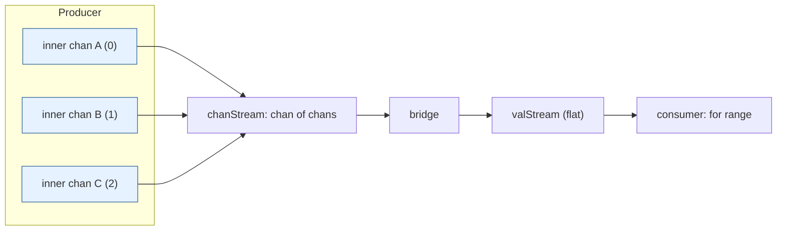
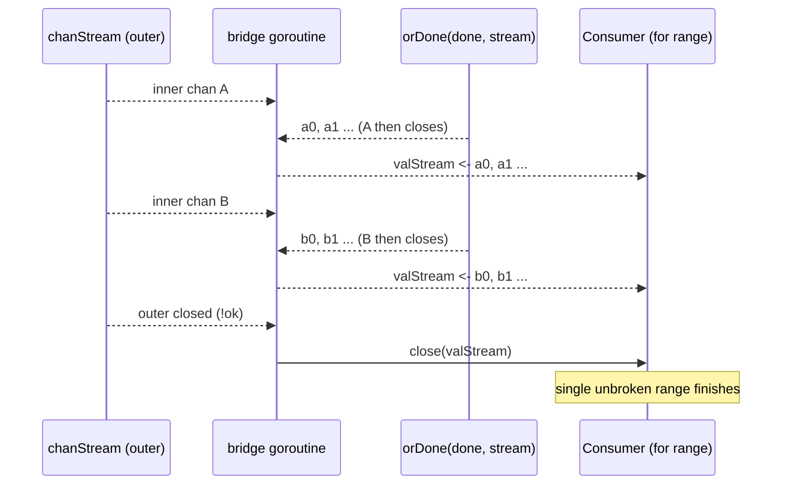

# Ch 4.12 — The bridge-channel

> Book: *Concurrency in Go* (Katherine Cox-Buday, O'Reilly 2017) · Chapter 4: Concurrency Patterns in Go · Pages ~122–123
> ⬅️ Prev: [The tee-channel](11-tee-channel.md) · ➡️ Next: [Queuing](13-queuing.md) · 🏠 [Book index](README.md)

## 🎯 In One Paragraph

Sometimes a consumer must read from a **channel of channels** — `<-chan <-chan any` — where values arrive from an *ordered sequence* of different source channels rather than one steady stream. This happens when a pipeline stage's lifetime is intermittent: each time the stage restarts in a fresh goroutine, confinement rules say the new goroutine owns a *new* channel, so the consumer effectively faces a sequence of channels over time. Reading a channel-of-channels inline is cumbersome. The **bridge-channel** pattern *destructures* it into one flat channel: a helper pulls each inner channel off the outer stream in order, drains it completely (via `orDone`), then moves to the next, presenting the consumer with a single uninterrupted `for range`. This is distinct from fan-in/or-channel, which coalesce a *set* of channels with no ordering promise.

## 🧠 Key Concepts & Vocabulary

- **Channel of channels** — `<-chan <-chan any`; a stream whose elements are themselves channels.
- **Sequence vs set** — bridge handles an *ordered sequence* (one after another); fan-in/or-channel handle an unordered *set* (all at once).
- **Bridging** — flattening a channel-of-channels into a single value channel so the consumer sees one stream.
- **Intermittent stage** — a stage that dies and is restarted; each restart (per confinement) creates a new owned channel → a sequence of channels.
- **Outer loop** — pulls the next inner channel off `chanStream`.
- **Inner loop** — drains the current inner channel (through `orDone`) onto `valStream`, then breaks to fetch the next.

## 📚 Deep Dive

### Why a sequence of channels appears

Confinement (Ch 4.1) says a channel should be owned and written by exactly one goroutine. If a stage is restarted — for example when "healing" an unhealthy goroutine (foreshadowed in Ch 5) — the replacement goroutine creates and owns a *brand-new* channel. The upstream therefore produces a sequence: channel A for a while, then channel B, then channel C… wrapped as `<-chan <-chan any`. The downstream consumer usually doesn't care *why* its values come in installments; it just wants one stream.



### The bridge implementation

```go
func bridge(done <-chan any, chanStream <-chan <-chan any) <-chan any {
    valStream := make(chan any) // this is what the consumer reads
    go func() {
        defer close(valStream)
        for { // outer loop: fetch the next inner channel
            var stream <-chan any
            select {
            case maybeStream, ok := <-chanStream:
                if !ok {
                    return // outer stream exhausted
                }
                stream = maybeStream
            case <-done:
                return
            }
            for val := range orDone(done, stream) { // inner loop: drain it
                select {
                case valStream <- val:
                case <-done:
                }
            }
        }
    }()
    return valStream
}
```

- **Outer loop** blocks in a `select` for the next inner channel (or `done`). On `!ok` the whole channel-of-channels is finished, so we return and `defer close(valStream)` ends the consumer's range.
- **Inner loop** uses `orDone(done, stream)` to drain the current inner channel safely. When that inner channel closes, the `range` ends, we fall back to the outer loop, and fetch the next channel. This seamless hand-off yields "an unbroken stream of values."
- The forwarding `select { case valStream <- val: case <-done: }` keeps forwarding cancellation-safe.



### Verified program

The book's example creates ten inner channels, each holding a single value, and bridges them into one stream printing `0 1 2 ... 9`.

```go
package main

import "fmt"

type done = <-chan any

func orDone(done, c <-chan any) <-chan any {
	valStream := make(chan any)
	go func() {
		defer close(valStream)
		for {
			select {
			case <-done:
				return
			case v, ok := <-c:
				if !ok {
					return
				}
				select {
				case valStream <- v:
				case <-done:
				}
			}
		}
	}()
	return valStream
}

func bridge(done done, chanStream <-chan <-chan any) <-chan any {
	valStream := make(chan any)
	go func() {
		defer close(valStream)
		for {
			var stream <-chan any
			select {
			case maybeStream, ok := <-chanStream:
				if !ok {
					return
				}
				stream = maybeStream
			case <-done:
				return
			}
			for val := range orDone(done, stream) {
				select {
				case valStream <- val:
				case <-done:
				}
			}
		}
	}()
	return valStream
}

func main() {
	genVals := func() <-chan <-chan any {
		chanStream := make(chan (<-chan any))
		go func() {
			defer close(chanStream)
			for i := 0; i < 10; i++ {
				stream := make(chan any, 1)
				stream <- i
				close(stream)
				chanStream <- stream
			}
		}()
		return chanStream
	}

	for v := range bridge(nil, genVals()) {
		fmt.Printf("%v ", v)
	}
	fmt.Println()
}
```

**Verified output** (`go run`, go1.27):

```
0 1 2 3 4 5 6 7 8 9 
```

Despite the values arriving from ten different single-use channels, the consumer sees one flat, ordered stream. Note `bridge(nil, ...)` is valid: a `nil` done channel simply means "never cancel" (a receive on nil blocks forever, so that `case` is never chosen).

> 📝 Note: `-race` not available here (no C compiler for cgo). The bridge goroutine only forwards values and closes `valStream` via `defer`; there is no shared mutable state, so no data race is expected.

## ⚠️ Pitfalls & Gotchas

- **Confusing bridge with fan-in.** Bridge preserves the *ordered* consumption of a sequence of channels. Fan-in merges a fixed *set* concurrently with no ordering guarantee. Pick based on whether order and intermittency matter.
- **Passing a non-closing outer stream.** If `chanStream` never closes, the consumer's range never ends (unless `done` fires). Make sure the producer closes it.
- **Inner channels that never close.** The inner `range orDone(done, stream)` only advances to the next channel when the current one closes (or `done` fires). A leaky inner channel stalls the bridge.
- **Buffered inner channels.** The example uses `make(chan any, 1)` then closes immediately — fine, because a closed channel still yields its buffered value before signalling closed.
- **nil done misuse.** `bridge(nil, ...)` means uncancellable. That's fine for a bounded example but dangerous for long-running production streams — pass a real `done`/`ctx`.

## 🆕 Modern Go Notes

> 🆕 **Generics (Go 1.18).** `func bridge[T any](done <-chan struct{}, chanStream <-chan <-chan T) <-chan T` gives a typed flat stream and removes the `any` assertions needed by consumers.

> 🆕 **`context.Context` for cancellation.** Replace `done <-chan any` with `ctx` and select on `ctx.Done()`. Prefer this over `bridge(nil, ...)` in real systems so you always have a cancellation path and a cause.

> 🆕 **Relation to goroutine healing (Ch 5).** The book notes bridge pairs with "Healing Unhealthy Goroutines." Modern supervisors (e.g., restart-on-panic workers) naturally emit a sequence of per-restart channels that bridge can flatten.

## 🧪 Try It Yourself

1. Make each inner channel emit 3 values instead of 1; confirm the flat stream is `0 1 2` from A, then B's three, etc.
2. Pass a real `done` channel and close it after 5 values; verify the range stops early and no goroutine leaks.
3. Rewrite with generics: `bridge[int]`; drop the `fmt` type assertions.
4. Simulate an intermittent stage: a producer that closes an inner channel, waits, then opens a new one — and bridge them seamlessly.

## ✅ Self-Check Questions

<details><summary>How does a sequence of channels naturally arise?</summary>
When a pipeline stage is intermittent/restarted, confinement dictates that each new goroutine owns a new channel. Over time this produces an ordered sequence of channels, wrapped as <code>&lt;-chan &lt;-chan any</code>.
</details>

<details><summary>How is bridge different from fan-in or the or-channel?</summary>
Bridge flattens an <em>ordered sequence</em> of channels consumed one after another. Fan-in / or-channel combine an unordered <em>set</em> of channels concurrently, with no ordering guarantee between sources.
</details>

<details><summary>What causes the inner loop to move on to the next channel?</summary>
The current inner channel closing. <code>range orDone(done, stream)</code> ends when the channel closes, so control returns to the outer loop which fetches the next channel from <code>chanStream</code>.
</details>

<details><summary>What does passing nil as the done channel mean?</summary>
It means "never cancel." A receive on a nil channel blocks forever, so the <code>case &lt;-done</code> branches are never selected; the bridge runs until <code>chanStream</code> closes. Fine for bounded demos, risky for long-running systems.
</details>

<details><summary>Why wrap each inner channel in orDone inside bridge?</summary>
To make draining the inner channel cancellation-safe and to cleanly terminate the inner range when <code>done</code> fires, so the bridge can tear down instead of blocking on a foreign/leaky inner channel.
</details>

## 🔑 Key Takeaways

- bridge flattens a `<-chan <-chan any` into one channel, hiding the fact that values come from a *sequence* of channels.
- It fits intermittent/restarted stages where each restart yields a new owned channel (confinement).
- Distinct from fan-in: bridge is *ordered and sequential*, fan-in is *unordered and concurrent*.
- Inner channels must close to advance; the outer stream must close (or `done` fire) to finish.
- Modernize with generics + `context`; avoid `nil` done in production.

## 🔗 References & Further Reading

📝 Blogs/articles
- [Advanced Tested Recipes: Go channel patterns](https://golangtutorial.com/golang-channel-patterns/) — tested bridge-channel recipe and when to reach for it.
- [Go Concurrency Patterns: Pipelines and cancellation](https://go.dev/blog/pipelines/) — the ordered-stream and cancellation foundations bridge builds on.
- [Go Concurrency Patterns (overview)](https://golangtutorial.com/golang-concurrency-patterns/) — bridge in the context of the full pattern catalog.

💻 GitHub
- [kat-co/concurrency-in-go-src: the-bridge-channel/fig-bridge-channel.go](https://github.com/kat-co/concurrency-in-go-src/blob/master/concurrency-patterns-in-go/the-bridge-channel/fig-bridge-channel.go) — the book's exact bridge source file.
- [niceyeti/channerics](https://github.com/niceyeti/channerics) — generic `Bridge` plus or-done and tee with tests.
- [heartbeats example gist (orChannel, orDone, take, bridge)](https://gist.github.com/juanpabloaj/8855566497175255a1fc6f4b6febed74) — a compact gist combining bridge with related patterns.

📖 Official docs/specs
- [The Go Programming Language Specification — Receive operator](https://go.dev/ref/spec#Receive_operator) — semantics of receiving from a nil channel (blocks forever) that make `bridge(nil, ...)` well-defined.
- [pkg.go.dev: context](https://pkg.go.dev/context) — modern cancellation to replace the `done` channel.
- [The Go Programming Language Specification — Channel types](https://go.dev/ref/spec#Channel_types) — directional and nested channel types like `<-chan <-chan T`.
