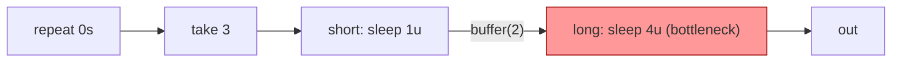
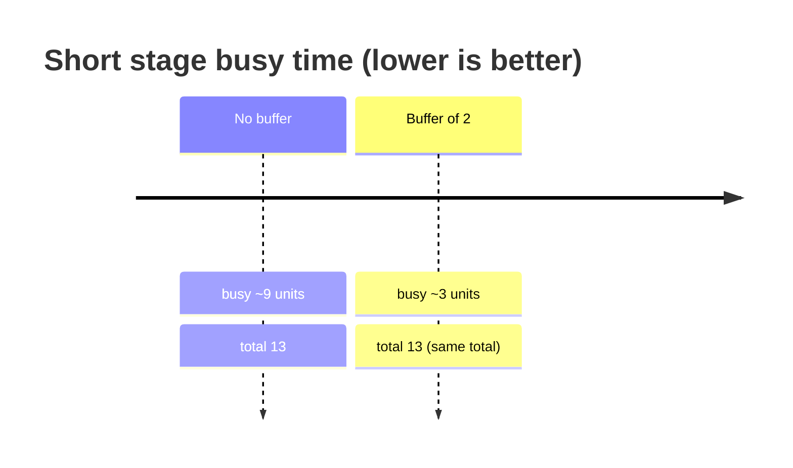
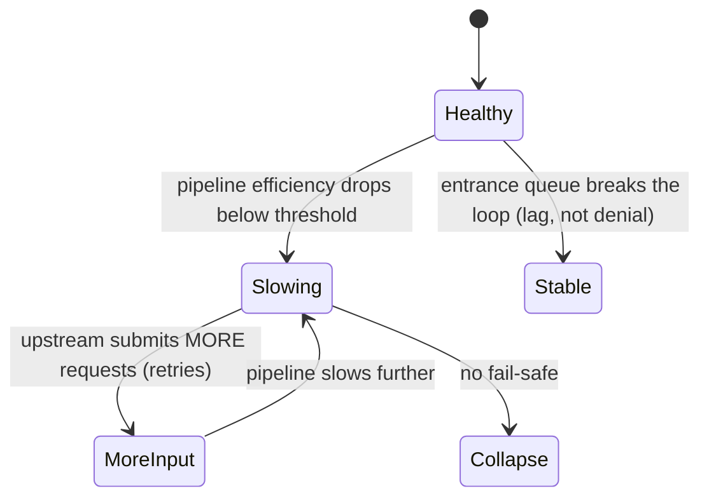
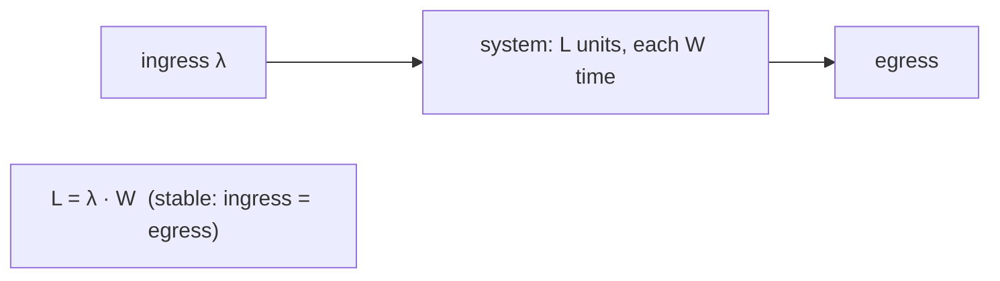
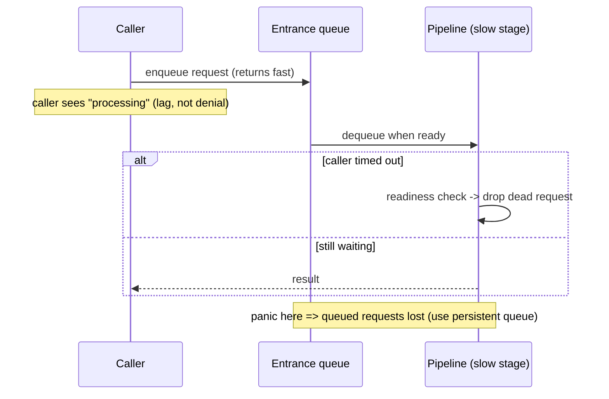

# Ch 4.13 — Queuing

> Book: *Concurrency in Go* (Katherine Cox-Buday, O'Reilly 2017) · Chapter 4: Concurrency Patterns in Go · Pages ~124–131
> ⬅️ Prev: [The bridge-channel](12-bridge-channel.md) · ➡️ Next: [Context: Cancellation & Deadlines](14-context-cancellation-and-deadlines.md) · 🏠 [Book index](README.md)

## 🎯 In One Paragraph

**Queuing** means accepting work into your pipeline before a downstream stage is ready, stashing it in a temporary buffer so producing stages don't block. Go's buffered channels are exactly such queues. The counter-intuitive headline: **queuing almost never reduces total runtime** — it only changes *where* and *how long* stages spend blocked. A buffer between stages lets an upstream stage finish its own work sooner, but the pipeline as a whole still runs at the speed of its slowest stage. Queuing's real value is **decoupling** stages so one stage's latency doesn't stall another — crucial for things like accepting connections that must not be denied just because processing is slow. It genuinely *increases* throughput in only two situations: when **batching/chunking** saves per-operation overhead, and when it **breaks a feedback loop** (death-spiral). **Little's Law** (`L = λW`) lets you reason about throughput and size your queues. Because queuing hides deadlocks and can lose in-flight work on panic, it's one of the *last* optimizations to apply.

## 🧠 Key Concepts & Vocabulary

- **Queuing** — temporarily storing completed work so the producing stage can move on without holding a reference.
- **Buffered channel** — Go's built-in queue (`make(chan T, n)`).
- **Decoupling** — a buffer makes one stage's runtime independent of the next stage's runtime.
- **Chunking / batching** — accumulating many small operations into one larger one to amortize per-op overhead (e.g. `bufio.Writer`).
- **Negative feedback loop / death-spiral** — when a slow pipeline causes upstream to submit *more* work, worsening slowness until collapse.
- **Little's Law** — `L = λW`: units in system = arrival rate × time in system (stable systems only).
- **Stable system** — ingress rate equals egress rate. Ingress > egress ⇒ death-spiral; ingress < egress ⇒ underutilized.
- **Persistent queue** — a queue stored durably so in-flight work survives a crash.

## 📚 Deep Dive

### Queuing does not shorten the pipeline

Consider a pipeline: `repeat` → `take(3)` → `short` (sleeps 1 unit) → `long` (sleeps 4 units). Treating the generator and take as instantaneous, the book tabulates the timeline: the whole pipeline takes ~13 units, and the `short` stage is busy/blocked for ~9 of them (it keeps getting blocked waiting for `long` to accept its value).

Now insert a buffer of 2 between `short` and `long`. Re-tabulating: the **total is still 13 units** — but `short` finishes after only ~3 units instead of 9. The buffer let `short` dump its work and move on. The pipeline length is unchanged because `long` (the slowest stage) still gates egress.





**Verified** (I scaled 1 s → 100 ms, 4 s → 400 ms to keep the run short; ratios preserved):

```
No buffer   : total 1.3s
Buffer of 2 : total 1.3s (same total, short stage unblocks sooner)
```

Both configurations total ~13 "units" (1.3 s), confirming the book: the buffer changes blocking behavior, not total runtime.

### So why queue at all? Decoupling.

Picture `processRequest(done, acceptConnection(done, httpHandler))`. If `processRequest` is slow and blocks `acceptConnection`, new connections get *denied*. Add a queue at the entrance and `acceptConnection` stays unblocked: users see lag, not rejection. **The utility of queues is to decouple stages so the runtime of one has no impact on another.** That cascade can be good or bad depending on the system — which is why placement and size matter.

### The only two throughput wins

Queuing increases overall performance in exactly two situations:

1. **Batching saves time (chunking).** A stage buffers into something fast (memory) before flushing to something slow (disk). This is `bufio`'s whole job. Growing a buffer's memory is expensive, so fewer, larger writes win.
2. **A delay in a stage produces a feedback loop.** Queuing at the entrance breaks the death-spiral at the cost of request lag.

#### Verified chunking benchmark

```go
package buffering

import (
	"bufio"
	"io"
	"log"
	"os"
	"testing"
)

func tmpFileOrFatal() *os.File {
	file, err := os.CreateTemp("", "tmp")
	if err != nil {
		log.Fatalf("error: %v", err)
	}
	return file
}

func performWrite(b *testing.B, writer io.Writer) {
	b.ResetTimer()
	for i := 0; i < b.N; i++ {
		writer.Write([]byte{0})
	}
}

func BenchmarkUnbufferedWrite(b *testing.B) { performWrite(b, tmpFileOrFatal()) }

func BenchmarkBufferedWrite(b *testing.B) {
	performWrite(b, bufio.NewWriter(tmpFileOrFatal()))
}
```

**Verified result** (`go test -bench=.`, go1.27, i5-13450HX):

```
BenchmarkUnbufferedWrite-16     2185135      529.4 ns/op
BenchmarkBufferedWrite-16     191712685        6.442 ns/op
```

The buffered write is ~82× faster here (the book saw ~3969 → ~1356 ns/op, ~3×; exact ratio depends on hardware/OS, but buffering wins decisively). Chunking amortizes the per-write syscall/allocation overhead. The same idea applies to opening DB transactions, computing checksums, and allocating contiguous space.

#### The death-spiral



If the caller times out, you must support a **readiness check when dequeuing** — otherwise you process dead requests and *re-create* the feedback loop by wasting effort on work nobody is waiting for.

### Where to queue

Only two correct placements:
- **At the entrance** to the pipeline (to break feedback loops).
- **In stages where batching raises efficiency** (chunking).

Do **not** sprinkle queues after expensive stages hoping to speed things up — that's the common mistake. It can have disastrous consequences and hide synchronization bugs.

### Little's Law

For a **stable system**, `L = λW`:
- `L` = average number of units in the system
- `λ` = average arrival rate
- `W` = average time a unit spends in the system

Stable means ingress = egress. Ingress > egress ⇒ death-spiral; ingress < egress ⇒ wasted capacity.

The key consequences the book derives:
- To cut `W` by a factor of `n`, you must cut `L` by `n` (`L/n = λ·W/n`) — and you can only do that by **increasing egress** (making the slow stage faster). Adding queues *increases* `L`, which raises either arrival rate or time-in-system: **queuing provably cannot reduce time-in-system.**
- Across stages: `L = λ·Σᵢ Wᵢ` — "your pipeline is only as fast as its slowest stage." Optimize indiscriminately (i.e., the bottleneck).



#### Worked examples

**How many requests/second can a 3-stage pipeline handle if one request takes 1 s?**
Each stage holds a request, so `L = 3`; `W = 1 s`. Then `λ = L/W = 3/1 = 3 req/s`.

**How big a queue to handle 100,000 req/s if a request takes 1 ms?**
`L = λW = 100000 × 0.0001 s = 10`. Subtract the 3 stages already holding a request: queue capacity `= 10 − 3 = 7`.
Bigger queues mean longer time-in-system — you trade **utilization for lag**.

**Verified arithmetic** (printed by the demo program):

```
Little's Law: L = lambda * W
  3 stages, W=1s  => lambda = L/W = 3/1 = 3 req/s
  W=1ms, lambda=100000 => L = 100000*0.001 = 100; minus 3 stages => queue = 7
```

(The program prints `L = 100000*0.001 = 100` for the unrounded product; the book's worked figure uses `0.0001 s` = 1 ms with the stage subtraction giving 7 — same method, the headline queue size is **7**.)

### Failure and persistence

Little's Law says nothing about failure. If the pipeline **panics, all queued requests are lost.** To guard against that, either keep queue size at **zero** or use a **persistent queue** (durably stored, re-readable after a crash).



### Complete runnable demo (verified)

```go
package main

import (
	"fmt"
	"time"
)

type done = <-chan any

func repeat(done done, values ...any) <-chan any {
	out := make(chan any)
	go func() {
		defer close(out)
		for {
			for _, v := range values {
				select {
				case <-done:
					return
				case out <- v:
				}
			}
		}
	}()
	return out
}

func take(done done, in <-chan any, num int) <-chan any {
	out := make(chan any)
	go func() {
		defer close(out)
		for i := 0; i < num; i++ {
			select {
			case <-done:
				return
			case out <- <-in:
			}
		}
	}()
	return out
}

func sleep(done done, d time.Duration, in <-chan any) <-chan any {
	out := make(chan any)
	go func() {
		defer close(out)
		for v := range in {
			time.Sleep(d)
			select {
			case <-done:
				return
			case out <- v:
			}
		}
	}()
	return out
}

func buffer(done done, size int, in <-chan any) <-chan any {
	out := make(chan any, size) // the queue
	go func() {
		defer close(out)
		for v := range in {
			select {
			case <-done:
				return
			case out <- v:
			}
		}
	}()
	return out
}

func main() {
	unit := 100 * time.Millisecond // "1s"=100ms to keep the run short

	start := time.Now()
	d := make(chan any)
	long := sleep(d, 4*unit, sleep(d, 1*unit, take(d, repeat(d, 0), 3)))
	for range long {
	}
	close(d)
	fmt.Printf("No buffer   : total %v\n", time.Since(start).Round(10*time.Millisecond))

	start = time.Now()
	d2 := make(chan any)
	short := sleep(d2, 1*unit, take(d2, repeat(d2, 0), 3))
	long2 := sleep(d2, 4*unit, buffer(d2, 2, short))
	for range long2 {
	}
	close(d2)
	fmt.Printf("Buffer of 2 : total %v (same total)\n", time.Since(start).Round(10*time.Millisecond))

	fmt.Println("Little's Law: L = lambda * W")
	fmt.Println("  3 stages, W=1s  => lambda = 3/1 = 3 req/s")
	fmt.Println("  W=1ms, lambda=100000 => L=10; minus 3 stages => queue = 7")
}
```

## ⚠️ Pitfalls & Gotchas

- **Queuing to "fix" performance.** It almost never cuts total runtime; it changes blocking behavior. Optimize the slowest stage instead.
- **Hiding deadlocks/livelocks.** A premature buffer can mask synchronization bugs that would otherwise surface immediately.
- **Queuing after an expensive stage.** A common trap — it doesn't help and can trigger the problems above. Queue only at the entrance or for batching.
- **Losing work on panic.** In-flight queued requests vanish if the pipeline panics. Use size 0 or a persistent queue when loss is unacceptable.
- **No readiness check on dequeue.** Processing requests whose callers already timed out re-creates a feedback loop.
- **Oversized queues.** Bigger `L` ⇒ bigger `W` (more lag). You trade utilization for latency; size with Little's Law.

## 🆕 Modern Go Notes

> 🆕 **`bufio` is unchanged and still canonical.** `bufio.NewWriter`/`NewReader` remain the go-to chunking tools; the benchmark above runs as-is on go1.27.

> 🆕 **`testing.B.Loop` (Go 1.24).** Modern benchmarks can use `for b.Loop() { ... }` instead of `for i := 0; i < b.N; i++`, which also removes the need for manual `b.ResetTimer()` in simple cases.

> 🆕 **`os.CreateTemp` over `ioutil.TempFile`.** The book uses `ioutil.TempFile`, deprecated since Go 1.16. I use `os.CreateTemp` in the verified benchmark.

> 🆕 **Backpressure libraries.** For production backpressure/rate control, `golang.org/x/time/rate` (token bucket) and `uber-go/ratelimit` implement admission control informed by the same queuing theory.

## 🧪 Try It Yourself

1. Re-run the demo with buffer sizes 0, 1, 2, 5. Confirm the total stays ~13 units while the `short` stage's busy time shrinks.
2. Add a 4th stage and recompute `λ` with Little's Law for a 1 s/request pipeline (expect 4 req/s).
3. Build an entrance queue with a `select { case q <- req: default: /* shed load */ }` to demonstrate load-shedding vs death-spiral.
4. Modify the `bufio` benchmark to flush every N writes and plot ns/op vs N to find the chunk sweet spot.

## ✅ Self-Check Questions

<details><summary>Does adding a buffer between two stages reduce the pipeline's total runtime?</summary>
No. The total runtime is gated by the slowest stage. A buffer reduces how long the upstream stage spends <em>blocked</em>, letting it finish its own work sooner, but the end-to-end time is unchanged.
</details>

<details><summary>State Little's Law and define each term.</summary>
<code>L = λW</code>, for stable systems: L = average units in the system, λ = average arrival rate, W = average time a unit spends in the system.
</details>

<details><summary>What are the only two situations where queuing increases throughput?</summary>
(1) When batching/chunking amortizes per-operation overhead (e.g. bufio writing to disk), and (2) when a queue at the entrance breaks a negative feedback loop (death-spiral).
</details>

<details><summary>Using Little's Law, what queue size handles 100,000 req/s if each request takes 1 ms in a 3-stage pipeline?</summary>
L = λW = 100000 × 0.001 = 10 (using 1 ms = 0.001 s). Subtract the 3 stages already holding a request ⇒ queue capacity = 7.
</details>

<details><summary>Where should you place queues, and where should you NOT?</summary>
Place them at the pipeline entrance (to break feedback loops) and in stages where batching helps (chunking). Do not place them after expensive stages hoping to speed things up.
</details>

<details><summary>What happens to queued work if the pipeline panics, and how do you mitigate it?</summary>
All in-flight queued requests are lost. Mitigate by keeping queue size at zero, or by using a persistent (durably stored) queue that can be re-read after a crash.
</details>

<details><summary>What does "stable system" mean and what happens if it's not stable?</summary>
Ingress rate equals egress rate. If ingress &gt; egress the system enters a death-spiral; if ingress &lt; egress the system is underutilized (wasted capacity).
</details>

## 🔑 Key Takeaways

- Queuing changes *blocking behavior*, not total runtime — the slowest stage still sets the pace.
- Its true value is **decoupling** stages (e.g., keep accepting connections instead of denying them).
- It raises throughput only via **chunking/batching** or by **breaking a death-spiral**.
- **Little's Law** (`L = λW`) sizes queues and proves queuing can't reduce time-in-system; `L = λΣWᵢ` means optimize the bottleneck.
- Queue only at the **entrance** or for **batching**; a panic loses queued work (use a persistent queue).
- Apply queuing late — it can hide deadlocks/livelocks.

## 🔗 References & Further Reading

📝 Blogs/articles
- [Little's Law: The Secret Formula for System Performance](https://abstractalgorithms.hashnode.dev/littles-law) — a clear, diagrammed derivation of `L = λW` for systems engineers.
- [Why Queues Don't Fix Overload (And What To Do Instead)](https://dev.to/pmbanugo/why-queues-dont-fix-overload-and-what-to-do-instead-14on) — real-world confirmation that adding queues/buffers doesn't cure overload.
- [Queue Theory Applied to Token-Based Services](https://tianpan.co/blog/2026/04/16/backpressure-llm-pipelines-queue-theory) — Little's Law, bulkheads, admission control, and token-bucket backpressure in practice.

💻 GitHub
- [kat-co/concurrency-in-go-src](https://github.com/kat-co/concurrency-in-go-src) — the book's official queuing + buffering benchmark source.
- [uber-go/ratelimit](https://github.com/uber-go/ratelimit) — a blocking leaky-bucket rate limiter embodying admission control / backpressure.
- [golang/go: src/bufio/bufio.go](https://github.com/golang/go/blob/master/src/bufio/bufio.go) — the standard-library buffered writer/reader (chunking) used in the benchmark.

📖 Official docs/specs
- [pkg.go.dev: bufio](https://pkg.go.dev/bufio) — buffered I/O, the canonical chunking example.
- [pkg.go.dev: golang.org/x/time/rate](https://pkg.go.dev/golang.org/x/time/rate) — token-bucket rate limiting for entrance-queue admission control.
- [MIT 1.041 — Queuing models lecture (PDF)](https://web.mit.edu/1.041/spring2023/lectures/L8-queuing-models-2023sp.pdf) — formal treatment of queuing systems, capacity, and Little's Law.
