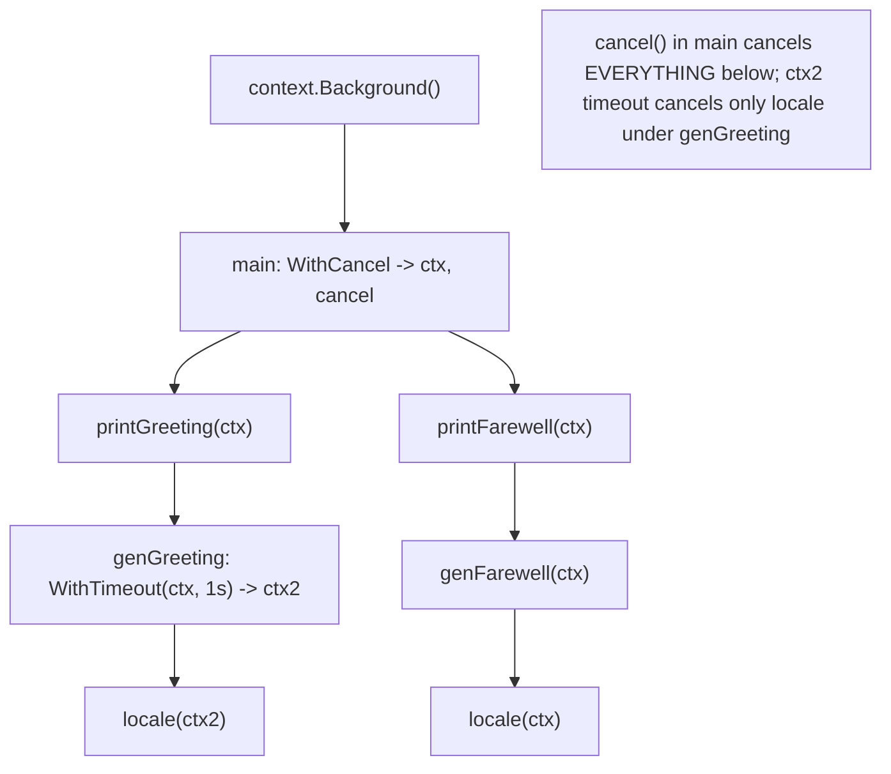
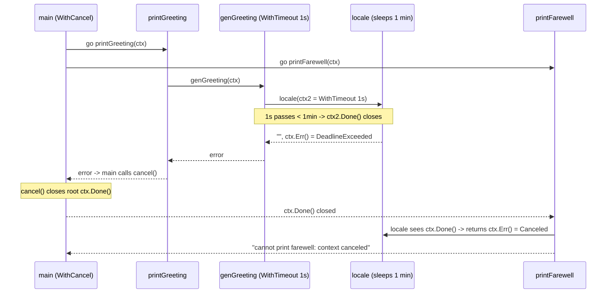
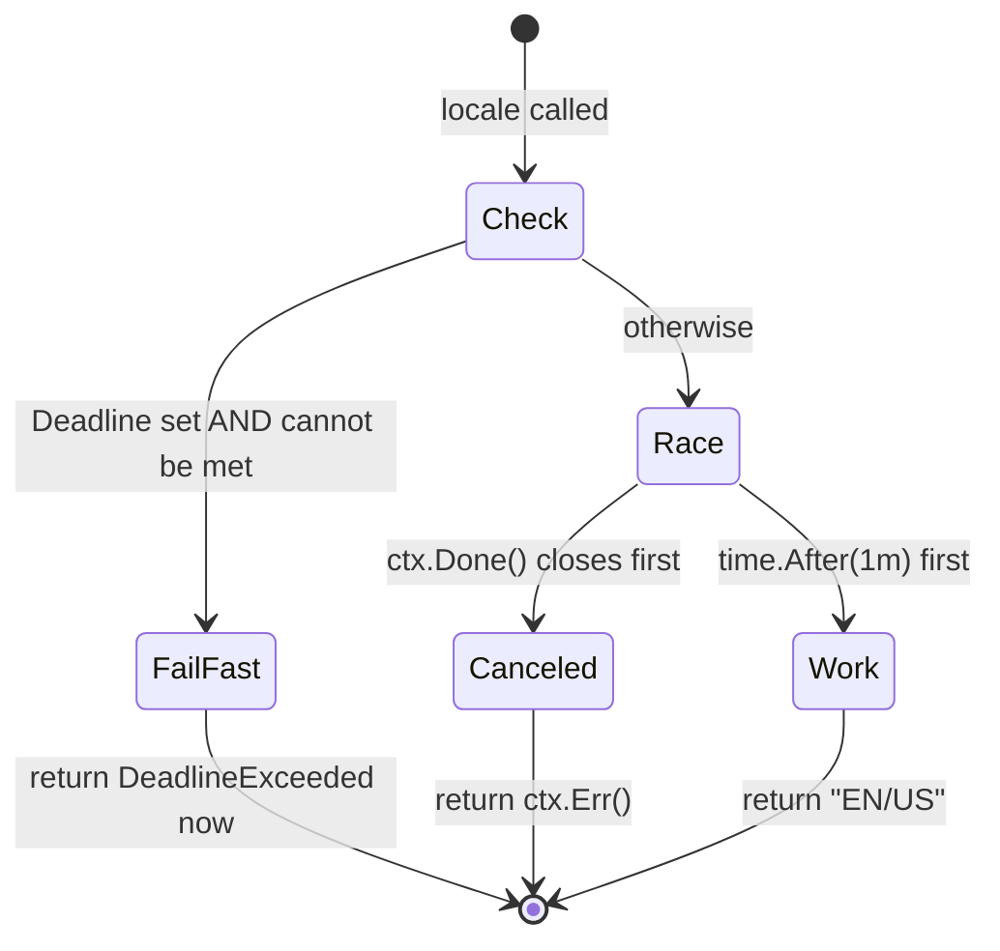

# Ch 4.14 — The context Package: Cancellation & Deadlines

> Book: *Concurrency in Go* (Katherine Cox-Buday, O'Reilly 2017) · Chapter 4: Concurrency Patterns in Go · Pages ~131–141
> ⬅️ Prev: [Queuing](13-queuing.md) · ➡️ Next: [context Values & Best Practices](15-context-values-and-best-practices.md) · 🏠 [Book index](README.md)

## 🎯 In One Paragraph

The hand-rolled `done` channel cancels blocking operations, but it can only say "stop" — not *why*, nor *by when*. The standard-library **`context`** package (promoted into the stdlib in **Go 1.7**) generalizes the `done` channel into a `Context` value that flows as the **first argument** of every function in a call-graph and carries three things: a `Done()` channel, an `Err()` explaining the cancellation, and an optional `Deadline()`. A `Context` is **immutable** — children can't cancel parents — so you derive new contexts with `WithCancel`, `WithDeadline`, and `WithTimeout`, each returning a child context plus a `cancel` function. This gives a composable, elegant way to manage the three facets of cancellation (a parent cancels a child, a goroutine cancels its children, blocking ops stay preemptable) with per-stack-frame customization that never leaks into the parent.

## 🧠 Key Concepts & Vocabulary

- **`context.Context`** — interface with `Deadline()`, `Done()`, `Err()`, `Value()`; flows like a `done` channel but richer.
- **Immutability** — nothing on `Context` mutates it; functions can't cancel the context they received. Protects ancestors.
- **`Background()`** — the empty root context; start your chain here.
- **`TODO()`** — placeholder empty context for when you don't yet know which context to use (not for production flow).
- **`WithCancel`** — child whose `Done()` closes when the returned `cancel()` is called.
- **`WithDeadline`** — child whose `Done()` closes when the clock passes a given time.
- **`WithTimeout`** — child whose `Done()` closes after a duration (sugar over `WithDeadline`).
- **`CancelFunc`** — the cancel callback; always `defer cancel()` to release resources.
- **`Canceled` / `DeadlineExceeded`** — the two sentinel errors `Err()` can return.
- **Three facets of cancellation** — parent→child, goroutine→children, and preemptable blocking ops.

## 📚 Deep Dive

### The Context interface

```go
type Context interface {
    Deadline() (deadline time.Time, ok bool) // when work should be canceled
    Done() <-chan struct{}                    // closed when work should be canceled
    Err() error                               // non-nil after Done closes (Canceled / DeadlineExceeded)
    Value(key any) any                        // request-scoped data (covered in 4.15)
}
```

`Done()` is the familiar done-channel. `Err()` tells you *why* it closed. `Deadline()` tells you *when* (if set). The package's two purposes: **(1)** an API for cancelling branches of your call-graph, and **(2)** a data-bag for request-scoped data (next chapter).

### Immutability and derivation

Because `Context` has no mutating methods and no way for a receiver to cancel it, a child can never cancel its parent — ancestors are protected. To change cancellation behavior *below* you, derive a new context:

```go
func WithCancel(parent Context) (ctx Context, cancel CancelFunc)
func WithDeadline(parent Context, d time.Time) (Context, CancelFunc)
func WithTimeout(parent Context, t time.Duration) (Context, CancelFunc)
```

Each takes a parent and returns a child configured per your needs, which you pass to your own children. If you don't need to change anything, just pass the context along unchanged.



> ⚠️ Never store a `Context` in a struct field. Instances "may change at every stack-frame"; always pass the `Context` meant for *that* call, not one captured N frames up.

### Roots: Background vs TODO

At the top of an async call-graph you won't have been handed a context. Start the chain with `context.Background()` (a real empty root). Use `context.TODO()` as a *temporary* placeholder when you haven't wired a context through yet — never in finished production flow.

### From done-channel to context (the greeting/farewell example)

The book evolves a program that concurrently prints a greeting and farewell. Goals after switching to context:
- `genGreeting` should wait **at most 1 second** for `locale` (a timeout).
- If `printGreeting` fails, **cancel `printFarewell`** too ("no goodbye if we never said hello").



### Verified program (cancellation + timeout + deadline fail-fast)

```go
package main

import (
	"context"
	"fmt"
	"sync"
	"time"
)

func main() {
	var wg sync.WaitGroup
	ctx, cancel := context.WithCancel(context.Background())
	defer cancel()

	wg.Add(1)
	go func() {
		defer wg.Done()
		if err := printGreeting(ctx); err != nil {
			fmt.Printf("cannot print greeting: %v\n", err)
			cancel() // greeting failed -> cancel the whole call-graph
		}
	}()

	wg.Add(1)
	go func() {
		defer wg.Done()
		if err := printFarewell(ctx); err != nil {
			fmt.Printf("cannot print farewell: %v\n", err)
		}
	}()

	wg.Wait()
}

func printGreeting(ctx context.Context) error {
	greeting, err := genGreeting(ctx)
	if err != nil {
		return err
	}
	fmt.Printf("%s world!\n", greeting)
	return nil
}

func printFarewell(ctx context.Context) error {
	farewell, err := genFarewell(ctx)
	if err != nil {
		return err
	}
	fmt.Printf("%s world!\n", farewell)
	return nil
}

func genGreeting(ctx context.Context) (string, error) {
	ctx, cancel := context.WithTimeout(ctx, 1*time.Second) // custom child context
	defer cancel()
	switch locale, err := locale(ctx); {
	case err != nil:
		return "", err
	case locale == "EN/US":
		return "hello", nil
	}
	return "", fmt.Errorf("unsupported locale")
}

func genFarewell(ctx context.Context) (string, error) {
	switch locale, err := locale(ctx); {
	case err != nil:
		return "", err
	case locale == "EN/US":
		return "goodbye", nil
	}
	return "", fmt.Errorf("unsupported locale")
}

func locale(ctx context.Context) (string, error) {
	// Fail fast: if a deadline exists and we can't possibly meet it, bail now.
	if deadline, ok := ctx.Deadline(); ok {
		if deadline.Sub(time.Now().Add(1*time.Minute)) <= 0 {
			return "", context.DeadlineExceeded
		}
	}
	select {
	case <-ctx.Done():
		return "", ctx.Err()
	case <-time.After(1 * time.Minute):
	}
	return "EN/US", nil
}
```

**Verified output** (`go run`, go1.27):

```
cannot print greeting: context deadline exceeded
cannot print farewell: context canceled
```

Exactly as the book predicts: `genGreeting`'s 1-second timeout fires (because `locale` takes a minute) → `printGreeting` errors with `DeadlineExceeded` → `main` calls `cancel()` → the root context closes → `printFarewell`'s `locale` returns `Canceled`.

> 📝 Note: `-race` was unavailable (no C compiler for cgo). The example *does* contain a benign race on *which* branch finishes first (the book acknowledges "we could receive our farewell before we're greeted"), but there is no shared-memory data race; the two goroutines only coordinate through the context and the WaitGroup.

### Deadline-aware fail-fast

The `locale` function checks `ctx.Deadline()`: if a deadline was set and the known work (~1 min) can't finish in time, it returns `context.DeadlineExceeded` **immediately** rather than sleeping a full minute. In programs where the next call is expensive, failing fast can save real time — the catch is you must *know* roughly how long your subordinate call-graph takes.



### Composability

`genGreeting` built its own 1-second `WithTimeout` child **without affecting its parent's context**. If it had returned successfully, `printGreeting` could make further calls with the original context, unpolluted by how `genGreeting` operated. This is the whole point: successive layers tailor cancellation to their needs, and concerns don't bleed across the call-graph.

## ⚠️ Pitfalls & Gotchas

- **Forgetting `defer cancel()`.** Every `WithCancel`/`WithTimeout`/`WithDeadline` returns a `cancel` you *must* call (even if the context finishes normally) or you leak the context's resources/timer. `go vet` flags this.
- **Storing Context in a struct.** Breaks the "pass explicitly" rule and can hand a stale context to a deeper frame. Pass it as the first arg instead.
- **Ignoring ctx.Done() in blocking ops.** Cancellation is cooperative; a blocking operation that never selects on `ctx.Done()` can't be preempted.
- **Reusing a cancelled context.** Once `Done()` is closed it stays closed. Derive a fresh context for new work.
- **Relying on fail-fast without knowing durations.** The deadline pre-check only helps if you can estimate the subordinate call's cost; otherwise it's wasted logic.
- **Wrong error after cancel.** Return `ctx.Err()` from the `<-ctx.Done()` branch so callers see `Canceled` vs `DeadlineExceeded` correctly.

## 🆕 Modern Go Notes

> 🆕 **`context.WithCancelCause` (Go 1.20).** Cancel with a *reason*: `ctx, cancel := context.WithCancelCause(parent)`, then `cancel(fmt.Errorf("db down"))`; retrieve it with `context.Cause(ctx)`. Great for debugging why a branch died.

> 🆕 **`context.WithDeadlineCause` / `WithTimeoutCause` (Go 1.21).** Attach a cause to deadline/timeout cancellations too.

> 🆕 **`context.AfterFunc` (Go 1.21).** Register a function to run (in its own goroutine) when a context is done — handy for cleanup without hand-rolling a watcher goroutine.

> 🆕 **`net/http` already carries a Context.** `http.Request.Context()` is cancelled when the client disconnects; thread it downstream instead of `context.Background()`.

> 🆕 **`signal.NotifyContext` (Go 1.16).** `ctx, stop := signal.NotifyContext(context.Background(), os.Interrupt)` gives a context cancelled on SIGINT — clean graceful-shutdown wiring.

## 🧪 Try It Yourself

1. Swap `WithTimeout` for `WithCancelCause` in `genGreeting`; cancel with a custom error and print `context.Cause(ctx)` in `locale`.
2. Make `locale` sleep only 500 ms and raise `genGreeting`'s timeout to 2 s — observe both greeting and farewell succeed.
3. Add `signal.NotifyContext` so Ctrl-C cancels the whole program cleanly.
4. Remove `defer cancel()` and run `go vet` to see the lostcancel diagnostic.

## ✅ Self-Check Questions

<details><summary>Why is a Context immutable, and what does that protect?</summary>
It has no mutating methods and the receiver can't cancel it. This protects ancestors: a child function can never cancel a parent's context. You customize behavior for children by <em>deriving</em> new contexts instead.
</details>

<details><summary>What do WithCancel, WithDeadline, and WithTimeout each return, and what must you always do?</summary>
Each returns a derived child <code>Context</code> and a <code>CancelFunc</code>. You must always call the cancel function (typically <code>defer cancel()</code>) to release resources/timers, even on the success path.
</details>

<details><summary>In the example, why does printFarewell fail with "context canceled" rather than "deadline exceeded"?</summary>
<code>genGreeting</code>'s 1s <code>WithTimeout</code> child times out, so <code>printGreeting</code> returns <code>DeadlineExceeded</code>; <code>main</code> then calls <code>cancel()</code> on the <em>root</em> context, which closes its Done channel, so <code>printFarewell</code>'s <code>locale</code> returns the root's <code>Err()</code> = <code>Canceled</code>.
</details>

<details><summary>What is the difference between Background() and TODO()?</summary>
Both return empty contexts. <code>Background()</code> is the real root to start a chain. <code>TODO()</code> is a placeholder for when you don't yet know which context to use or the upstream hasn't provided one — not for finished production code.
</details>

<details><summary>How does the Deadline() check enable fail-fast, and what's its catch?</summary>
<code>locale</code> inspects <code>ctx.Deadline()</code>; if a deadline exists and the known work can't finish before it, it returns <code>DeadlineExceeded</code> immediately instead of waiting. The catch: you must be able to estimate how long the subordinate call-graph takes.
</details>

<details><summary>What are the three facets of cancellation that context manages?</summary>
(1) A parent cancelling a child, (2) a goroutine cancelling its children, and (3) keeping blocking operations preemptable so they can observe cancellation.
</details>

## 🔑 Key Takeaways

- `context` generalizes the `done` channel with `Done()`, `Err()`, and `Deadline()` — cancel *with reason and timing*.
- A `Context` is immutable; derive children via `WithCancel`/`WithDeadline`/`WithTimeout` and pass them down as the first arg.
- Always `defer cancel()`; never store a context in a struct.
- Child contexts customize cancellation locally without affecting the parent — clean composability.
- `ctx.Deadline()` enables fail-fast when you know your subordinate's cost.
- Modern Go adds cancel *causes*, `AfterFunc`, and signal-driven contexts.

## 🔗 References & Further Reading

📝 Blogs/articles
- [Go blog: Go Concurrency Patterns: Context](https://go.dev/blog/context) — the original authors' explanation of context-based cancellation and request scoping.
- [Mastering Go's Context Package: A Practical Guide](https://dev.to/jones_charles_ad50858dbc0/mastering-gos-context-package-a-practical-guide-for-everyday-devs-1ll5) — deadlines, timeouts, and cancellation with worked examples.
- [Go Context timeouts can be harmful](https://uptrace.dev/blog/golang-context-timeout) — how naive timeouts can cause cascading connection churn (a real-world caution).
- [context.WithTimeout (AlgoMaster)](https://algomaster.io/learn/go/context-withtimeout) — focused deep-dive on timeout semantics and the cancel function.

💻 GitHub
- [golang/go: src/context/context.go](https://github.com/golang/go/blob/master/src/context/context.go) — the standard-library implementation of Context, WithCancel, WithTimeout.
- [kat-co/concurrency-in-go-src](https://github.com/kat-co/concurrency-in-go-src) — the book's greeting/farewell context examples.
- [MedUnes/go-kata: context-cancellation-concurrency](https://github.com/MedUnes/go-kata/blob/master/01-context-cancellation-concurrency/17-context-aware-channel-sender) — katas on context-aware senders and cancellation.

📖 Official docs/specs
- [pkg.go.dev: context](https://pkg.go.dev/context) — canonical API reference, including `WithCancelCause`, `WithDeadlineCause`, and `AfterFunc`.
- [pkg.go.dev: os/signal#NotifyContext](https://pkg.go.dev/os/signal#NotifyContext) — signal-cancelled contexts for graceful shutdown.
- [pkg.go.dev: net/http#Request.Context](https://pkg.go.dev/net/http#Request.Context) — the request-scoped context cancelled on client disconnect.
