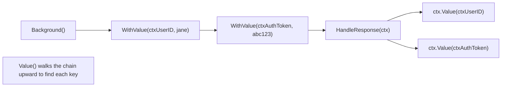
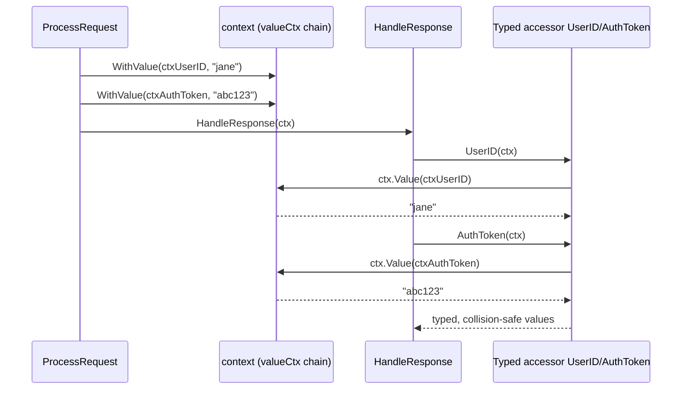
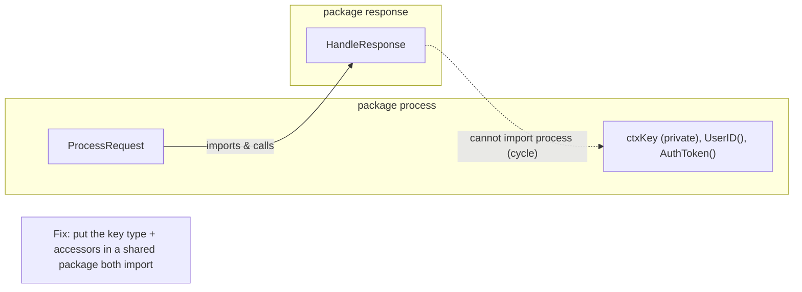
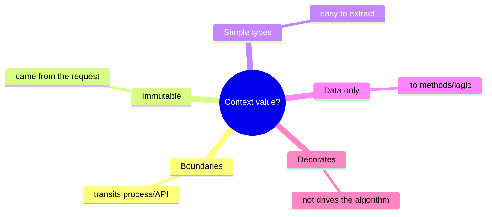

# Ch 4.15 — The context Package: Values & Best Practices

> Book: *Concurrency in Go* (Katherine Cox-Buday, O'Reilly 2017) · Chapter 4: Concurrency Patterns in Go · Pages ~141–145
> ⬅️ Prev: [context Cancellation & Deadlines](14-context-cancellation-and-deadlines.md) · ➡️ Next: [Chapter 5: Concurrency at Scale](../ch05-concurrency-at-scale/README.md) · 🏠 [Book index](README.md)

## 🎯 In One Paragraph

Beyond cancellation, `Context` doubles as a **data-bag** for *request-scoped* data via `WithValue` / `Value`. Since request-servicing goroutines often need to pass things like a request ID or auth token down the call-graph, `context.WithValue(parent, key, val)` attaches data and `ctx.Value(key)` retrieves it. The keys and values are typed `any`, so you lose type-safety: the fix is to define an **unexported custom key type** in your package (preventing cross-package collisions) and export typed accessor functions. This pattern is powerful but **controversial** — the cancellation half of `context` is widely praised, the data-bag half divides the community. The official guidance ("only for request-scoped data that transits processes and API boundaries, not for optional parameters") is vague, so the author offers **five heuristics** to decide what belongs in a context, while warning that there are no easy answers.

## 🧠 Key Concepts & Vocabulary

- **`WithValue(parent, key, val) Context`** — derive a context carrying one key/value.
- **`ctx.Value(key) any`** — walk the context chain for the first matching key.
- **Request-scoped data** — data tied to a single request that transits process/API boundaries (e.g. request ID).
- **Custom key type** — an unexported type (e.g. `type ctxKey int`) so keys can't collide with other packages' keys even if underlying values match.
- **Typed accessors** — exported `func UserID(ctx) string` wrappers that keep callers type-safe and ignorant of the private key.
- **Key comparability** — the key must support `==`/`!=`; values must be safe for concurrent access.
- **The five heuristics** — transits boundaries, immutable, simple types, data not types-with-methods, decorates not drives.
- **Circular-dependency trap** — private keys can force your architecture into shared data-type packages.

## 📚 Deep Dive

### Storing and retrieving values (naive)

```go
func ProcessRequest(userID, authToken string) {
    ctx := context.WithValue(context.Background(), "userID", userID)
    ctx = context.WithValue(ctx, "authToken", authToken)
    HandleResponse(ctx)
}

func HandleResponse(ctx context.Context) {
    fmt.Printf("handling response for %v (%v)",
        ctx.Value("userID"), ctx.Value("authToken"))
}
// -> handling response for jane (abc123)
```

Two qualifications: the key must be **comparable** (`==`/`!=` work), and values must be **safe for concurrent access**. But using plain `string` keys invites collisions — two packages both using `"userID"` would clobber each other, and both key and value are `any`, so there's no compile-time safety.



### Why an unexported typed key avoids collisions

Even identical underlying values are distinct map keys if their *types* differ:

```go
type foo int
type bar int
m := make(map[any]int)
m[foo(1)] = 1
m[bar(1)] = 2
fmt.Printf("%v", m) // map[1:1 1:2] -> two separate entries
```

The type information differentiates `foo(1)` from `bar(1)`. Define your key type unexported and no other package can produce a colliding key.

The following sequence shows a value injected at the top of a request flowing down the call-graph and being pulled out — by key — several frames later:



### The type-safe pattern (verified)

```go
package main

import (
	"context"
	"fmt"
)

type ctxKey int // unexported key type -> collision-proof

const (
	ctxUserID ctxKey = iota
	ctxAuthToken
)

func UserID(c context.Context) string { // exported typed accessor
	id, _ := c.Value(ctxUserID).(string)
	return id
}

func AuthToken(c context.Context) string {
	tok, _ := c.Value(ctxAuthToken).(string)
	return tok
}

func ProcessRequest(userID, authToken string) {
	ctx := context.WithValue(context.Background(), ctxUserID, userID)
	ctx = context.WithValue(ctx, ctxAuthToken, authToken)
	HandleResponse(ctx)
}

func HandleResponse(ctx context.Context) {
	fmt.Printf("handling response for %v (auth: %v)\n", UserID(ctx), AuthToken(ctx))
}

func main() {
	ProcessRequest("jane", "abc123")

	// Demonstrate collision-proofing of typed keys:
	type foo int
	type bar int
	m := make(map[any]int)
	m[foo(1)] = 1
	m[bar(1)] = 2
	fmt.Printf("typed-key map: %v\n", m)
}
```

**Verified output** (`go run`, go1.27):

```
handling response for jane (auth: abc123)
typed-key map: map[1:2 1:1]
```

The accessor functions give callers a static, type-safe API; they never see the private `ctxKey`. The map print shows two distinct entries for `foo(1)` and `bar(1)` (iteration order is random, hence `1:2 1:1`), proving typed keys don't collide.

> 📝 Note: `-race` not available (no C compiler for cgo). The program is single-goroutine for the value demo; no data race is possible.

### The circular-dependency trap

Say `HandleResponse` lives in package `response` and `ProcessRequest` in package `process`. `process` must import `response` to call `HandleResponse`. But `response` can't call `process`'s accessor functions to read the values, because importing `process` back would create a **circular dependency** — and the key type is private to `process`. The practical consequence: this coerces your architecture toward **packages organized around shared data types** imported from multiple places. Not inherently bad, but something to design for.



### The five heuristics for what belongs in a Context

The official comment — *"Use context values only for request-scoped data that transits processes and API boundaries, not for passing optional parameters to functions"* — is ambiguous. The author's heuristics:

1. **Transits process / API boundaries.** If it's generated in-process and never crosses an API boundary, it's probably not request-scoped.
2. **Immutable.** If it changes, by definition it didn't come from the request.
3. **Trends toward simple types.** Easier for the other side to extract without importing a complex package graph.
4. **Data, not types with methods.** Operations (logic) belong on the consumers, not in the bag.
5. **Decorates operations, not drives them.** If your algorithm *branches* on what's in the context, you've slid into "optional parameters" territory.

These are heuristics, not rules; violating all five is a strong smell.



### The author's judgment table (which data fits the heuristics)

| Data | 1 boundary | 2 immutable | 3 simple | 4 data | 5 decorates |
|---|---|---|---|---|---|
| Request ID | ✓ | ✓ | ✓ | ✓ | ✓ |
| User ID | ✓ | ✓ | ✓ | ✓ | |
| URL | ✓ | ✓ | | | |
| API Server Connection | | | | | |
| Authorization Token | ✓ | ✓ | ✓ | ✓ | |
| Request Token | ✓ | ✓ | ✓ | | |

A **Request ID** passes all five — an ideal context value. An **API server connection** fails all five — never put it in a context. An **auth token** is genuinely debatable: it's immutable and byte-ish, yet receivers may use it to *decide whether to field the request* (which looks like "driving"). What's acceptable varies by team.

### Visibility vs. invisible dependency

Another axis: how many layers does the data cross before use? If many frameworks and dozens of functions sit between where data enters and where it's used, do you want **verbose, self-documenting signatures** (pass it as a parameter) or a **`Context` with an invisible dependency**? Both have merits; it's a team decision. The parting advice: the **cancellation** functionality is unambiguously useful — don't let doubts about the data-bag deter you from using `context` at all.

## ⚠️ Pitfalls & Gotchas

- **String/exported keys.** Using `"userID"` or an exported key type invites collisions across packages. Always use an **unexported custom key type**.
- **Type-assertion panics.** `ctx.Value(k).(string)` panics if absent/wrong type. Use the comma-ok form (`v, _ := ...`) in accessors.
- **Smuggling everything through context.** Treating context as a grab-bag for all request data is the widely-criticized anti-pattern; it hides dependencies and defeats type-safety.
- **Mutable values.** Storing mutable data breaks heuristic #2 and invites data races (values must be concurrency-safe).
- **Driving logic from context.** If behavior branches on a context value, you're abusing it as optional parameters.
- **Circular deps.** Private keys can force awkward package layouts; plan a shared data-type package early.
- **Values don't carry cancellation.** `WithValue` doesn't add a Done channel; cancellation still comes from `WithCancel`/`WithTimeout`.

## 🆕 Modern Go Notes

> 🆕 **`Value(key any)` signature.** Modern stdlib uses `any` (the book shows `interface{}`). Same semantics.

> 🆕 **Structured logging with `slog` (Go 1.21).** Instead of hand-threading a request ID for logging, you can attach it to a `*slog.Logger` and even pull values from context in a custom handler — a cleaner alternative to over-using `WithValue`.

> 🆕 **`net/http` middleware pattern.** The canonical real-world use: middleware stores a request ID / trace span via `r.WithContext(context.WithValue(r.Context(), key, v))`, and handlers read it with typed accessors — exactly the pattern in this chapter.

> 🆕 **OpenTelemetry context propagation.** Trace/span context is propagated via `context.Context` across service boundaries — a modern, widely-accepted embodiment of "request-scoped data that transits process and API boundaries."

> 🆕 **`context.WithoutCancel` (Go 1.21).** Keep a context's *values* while detaching it from parent cancellation — useful when a value-carrying context must outlive the request's cancellation (e.g. background flush).

## 🧪 Try It Yourself

1. Add a `requestID` to the typed-key example and a `RequestID(ctx)` accessor; log it in `HandleResponse`.
2. Reproduce a key collision: use `string` keys `"id"` in two files with different meanings and watch one overwrite the other; then fix it with typed keys.
3. Build a tiny `net/http` middleware that injects a request ID into the context and a handler that reads it via a typed accessor.
4. Evaluate three pieces of your own app's data against the five heuristics and decide context vs. parameter.

## ✅ Self-Check Questions

<details><summary>Why define an unexported custom key type instead of using a string key?</summary>
Because keys are compared by type <em>and</em> value. An unexported type means no other package can construct the same key, eliminating collisions. String (or exported) keys with the same value would clobber each other across packages.
</details>

<details><summary>What are the two qualifications for anything stored via WithValue?</summary>
The key must satisfy Go's comparability (<code>==</code>/<code>!=</code> work correctly), and the value must be safe to access from multiple goroutines.
</details>

<details><summary>List the five heuristics for what belongs in a context value.</summary>
(1) It transits process/API boundaries, (2) it's immutable, (3) it trends toward simple types, (4) it's data not types-with-methods, and (5) it decorates operations rather than driving them.
</details>

<details><summary>Why can an auth token be a borderline context value?</summary>
It's immutable and a simple byte slice (passing heuristics 1-4), but receivers may use it to <em>decide whether to field the request</em>, which looks like "driving" the algorithm (heuristic 5) and edges toward optional-parameter territory. Teams disagree.
</details>

<details><summary>How can private context keys cause a circular-dependency problem?</summary>
If package A (with the private key + accessors) calls package B, B can't import A back to use the accessors without forming a cycle. This pushes you toward a shared data-type package that both import.
</details>

<details><summary>Which part of the context package is uncontroversial, and what's the author's final advice?</summary>
The <strong>cancellation</strong> functionality is widely accepted and very useful. The author advises not letting reservations about the data-bag deter you from using context's cancellation features.
</details>

## 🔑 Key Takeaways

- `WithValue`/`Value` make `Context` a request-scoped data-bag, but keys/values are `any` (no compile-time safety).
- Use an **unexported key type** + **exported typed accessors** to avoid collisions and restore type-safety.
- Private keys can force architecture around shared data-type packages (circular-dependency trap).
- Judge candidates with the five heuristics; a **Request ID** is the model fit, an **API connection** never belongs.
- The data-bag is controversial; the **cancellation** half is the clear, uncontroversial win.
- Modern Go pairs this with `slog`, HTTP middleware, OpenTelemetry propagation, and `WithoutCancel`.

## 🔗 References & Further Reading

📝 Blogs/articles
- [Dave Cheney: Context isn't for cancellation](https://dave.cheney.net/2017/08/20/context-isnt-for-cancellation) — a seminal critique of the data-bag and the "pass Context explicitly, don't store it" rule.
- [Pitfalls of context values and how to avoid or mitigate them](https://www.calhoun.io/pitfalls-of-context-values-and-how-to-avoid-or-mitigate-them/) — a thorough treatment of when context values are (in)appropriate and the alternatives.
- [Avoiding collisions in Go context keys](https://rednafi.com/go/avoid-context-key-collisions/) — exactly the unexported-key-type + typed-accessor pattern, with panic-safe retrieval.
- [Stop Smuggling Request Data Through context.Value](https://dev.to/gabrielanhaia/stop-smuggling-request-data-through-contextvalue-23bl) — the "context as global per-request variable" anti-pattern and how to avoid it.

💻 GitHub
- [golang/go: src/context/context.go](https://github.com/golang/go/blob/master/src/context/context.go) — the `valueCtx` implementation behind `WithValue`/`Value` (and `WithoutCancel`).
- [kat-co/concurrency-in-go-src](https://github.com/kat-co/concurrency-in-go-src) — the book's context value examples (typed keys + accessors).
- [open-telemetry/opentelemetry-go](https://github.com/open-telemetry/opentelemetry-go) — real-world request-scoped data propagation via `context.Context`.

📖 Official docs/specs
- [pkg.go.dev: context#WithValue](https://pkg.go.dev/context#WithValue) — the API and its explicit "request-scoped data only" guidance.
- [pkg.go.dev: context#WithoutCancel](https://pkg.go.dev/context#WithoutCancel) — keep values while detaching cancellation (Go 1.21).
- [pkg.go.dev: log/slog](https://pkg.go.dev/log/slog) — structured logging, a cleaner home for cross-cutting request metadata than `WithValue`.
