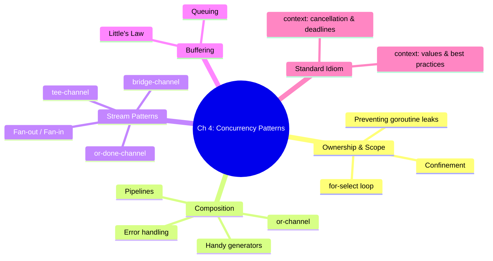
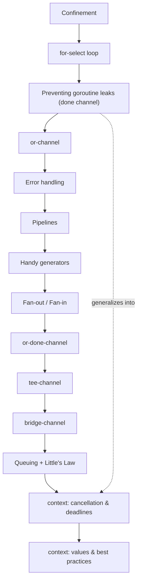

# Chapter 4 — Concurrency Patterns in Go

> Book: *Concurrency in Go* (Katherine Cox-Buday, O'Reilly 2017) · Chapter 4 · Pages ~85–145
> ⬅️ Prev chapter: [Ch 3: Go's Concurrency Building Blocks](../ch03-go-concurrency-building-blocks/README.md) · ➡️ Next chapter: [Ch 5: Concurrency at Scale](../ch05-concurrency-at-scale/README.md) · 🏠 [Book index](../README.md)

## 📖 Chapter Overview

Chapter 3 gave us the raw primitives — goroutines, channels, `select`, `sync` types. Chapter 4 composes those primitives into **reusable patterns** for writing *maintainable* concurrent code. The through-line is a philosophy the author repeats throughout: use goroutines and channels to make concurrent code **clearer**, not merely faster, and avoid premature optimization. We start with ownership and scope (**confinement**, the **for-select loop**, **preventing goroutine leaks**), move through composition and coordination (**or-channel**, **error handling**, **pipelines**, **handy generators**), then into higher-order stream patterns (**fan-out/fan-in**, **or-done**, **tee**, **bridge**), the economics of buffering (**queuing** and **Little's Law**), and finally the standardized cancellation-and-data idiom that ties it all together: the **`context` package**. Taken together these patterns are the vocabulary you'll reach for every day — and the foundation for Chapter 5's larger-scale techniques.

## 🗺️ Chapter Mind Map

## 📚 Mini-Chapters

| # | Mini-chapter | One-line summary |
|---|---|---|
| 01 | [Confinement](01-confinement.md) | Keep data safe by restricting it to a single goroutine (ad-hoc or lexical) instead of synchronizing shared access. |
| 02 | [The for-select Loop](02-for-select-loop.md) | The idiomatic `for { select { ... } }` loop for sending/receiving on channels until cancelled. |
| 03 | [Preventing Goroutine Leaks](03-preventing-goroutine-leaks.md) | Give every goroutine a cancellation path via a `done` channel so it can't block forever. |
| 04 | [The or-channel](04-or-channel.md) | Combine many `done` channels into one that closes when *any* of them closes (recursive select tree). |
| 05 | [Error Handling](05-error-handling.md) | Couple results with errors on the channel so the goroutine that has full context decides how to handle them. |
| 06 | [Pipelines: Intro](06-pipelines-intro.md) | Chain stream-processing stages connected by channels; properties of a well-formed stage. |
| 07 | [Pipeline Best Practices](07-pipeline-best-practices.md) | Generator-driven, `done`-aware, batch vs. stream pipeline design that tears down cleanly. |
| 08 | [Handy Generators](08-handy-generators.md) | Reusable `repeat`, `repeatFn`, `take`, `toInt`, etc., the building blocks for pipelines. |
| 09 | [Fan-Out, Fan-In](09-fan-out-fan-in.md) | Parallelize a slow, order-independent stage across N goroutines, then multiplex the outputs back into one. |
| 10 | [The or-done-channel](10-or-done-channel.md) | Wrap a foreign channel so you can `for range` it safely while still honouring cancellation. |
| 11 | [The tee-channel](11-tee-channel.md) | Split one channel into two identical streams (e.g. execute *and* audit). |
| 12 | [The bridge-channel](12-bridge-channel.md) | Flatten a `<-chan <-chan T` (a sequence of channels) into one unbroken stream. |
| 13 | [Queuing (incl. Little's Law)](13-queuing.md) | When buffering helps (chunking / breaking feedback loops) and how `L = λW` sizes queues. |
| 14 | [context: Cancellation & Deadlines](14-context-cancellation-and-deadlines.md) | The stdlib `context` idiom for cancelling call-graphs with reasons and deadlines. |
| 15 | [context: Values & Best Practices](15-context-values-and-best-practices.md) | Request-scoped data via `WithValue`, typed keys, and the five heuristics for what belongs in a context. |

## 🧾 Chapter Summary

This chapter combined Go's concurrency **primitives** into a toolbox of **patterns** for maintainable concurrent code:

- **Confinement, for-select, and leak prevention** establish *who owns what* and ensure every goroutine has a clean exit — the discipline all later patterns rely on.
- **or-channel, error handling, pipelines, and generators** show how to *compose* goroutines and channels into readable data-processing flows where errors travel with data and stages tear down together.
- **Fan-out/fan-in, or-done, tee, and bridge** are higher-order *stream* patterns: parallelize slow stages, safely consume foreign channels, duplicate a stream, and flatten a sequence of channels — each keeping the consumer's code simple.
- **Queuing** and **Little's Law** teach the surprising economics of buffering: queues rarely cut total runtime (the slowest stage dominates), their value is *decoupling*, and they only raise throughput via chunking or by breaking a feedback loop. `L = λW` lets you size them deliberately, trading utilization for lag.
- The **`context` package** standardizes the `done`-channel idiom, adding cancellation *reasons*, *deadlines*, and a (controversial) request-scoped *data-bag*. Its cancellation half is an unambiguous win; its value-bag demands judgment via the author's five heuristics.

A recurring lesson ties it all together: **favour clarity over premature optimization** — reach for a goroutine to make code *clearer*, measure before buffering, and let the slowest stage, not a sprinkling of queues, set your optimization target. With these patterns in hand, Chapter 5 scales up to techniques for building large concurrent systems: error propagation, heartbeats, replicated requests, rate limiting, healing unhealthy goroutines, and more.

## 🔗 Chapter-Level References

📝 Blogs/articles
- [Go blog: Go Concurrency Patterns: Pipelines and cancellation](https://go.dev/blog/pipelines/) — the canonical pipeline + fan-in + cancellation article underpinning most of this chapter.
- [Go blog: Go Concurrency Patterns: Context](https://go.dev/blog/context) — the authors' rationale for the `context` package.
- [Dave Cheney: Context isn't for cancellation](https://dave.cheney.net/2017/08/20/context-isnt-for-cancellation) — essential nuance on the controversial data-bag half of `context`.

💻 GitHub
- [kat-co/concurrency-in-go-src](https://github.com/kat-co/concurrency-in-go-src) — the book's complete, official source code for every pattern in this chapter.
- [niceyeti/channerics](https://github.com/niceyeti/channerics) — generic, tested implementations of or-done, tee, bridge, and fan-in extending the book.
- [golang/go: src/context/context.go](https://github.com/golang/go/blob/master/src/context/context.go) — the standard-library `context` implementation.

📖 Official docs/specs
- [pkg.go.dev: context](https://pkg.go.dev/context) — API reference for cancellation, deadlines, and values.
- [pkg.go.dev: golang.org/x/sync/errgroup](https://pkg.go.dev/golang.org/x/sync/errgroup) — modern fan-out with error propagation.
- [The Go Programming Language Specification — Select statements](https://go.dev/ref/spec#Select_statements) — the `select` semantics every pattern here depends on.
