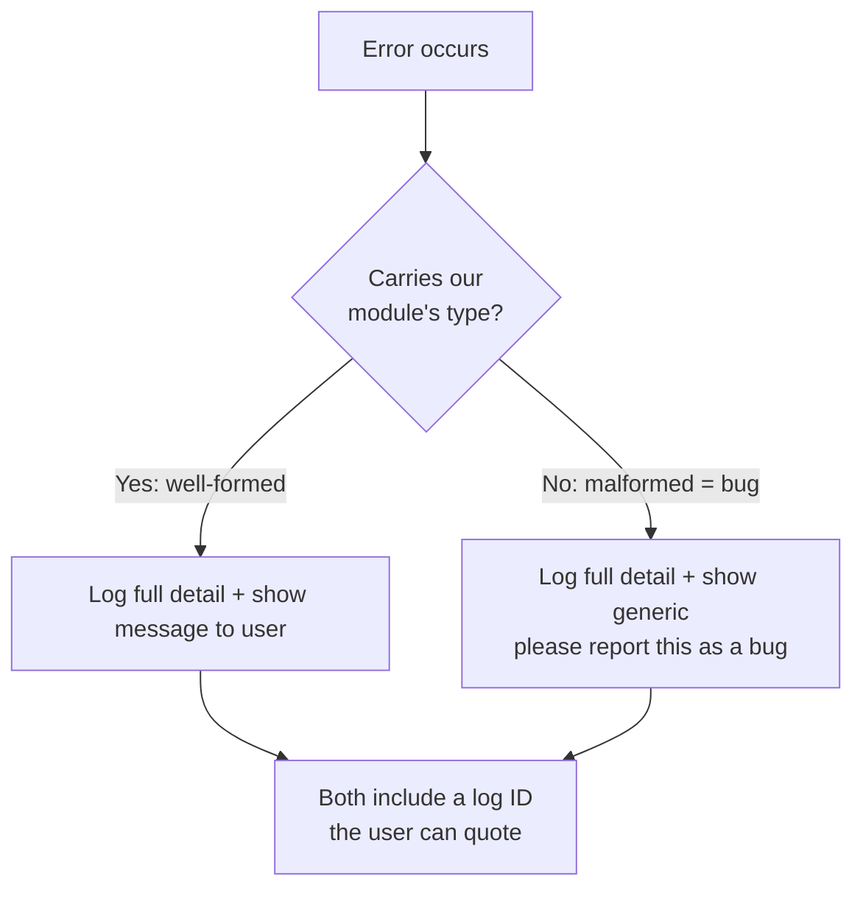
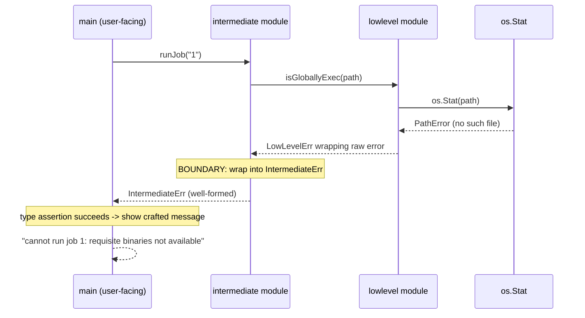

# Ch 5.1 — Error Propagation

> Book: *Concurrency in Go* (Katherine Cox-Buday, O'Reilly 2017) · Chapter 5: Concurrency at Scale · Pages ~147–155
> ⬅️ Prev: [Chapter 4 — Concurrency Patterns in Go](../ch04-concurrency-patterns-in-go/README.md) · ➡️ Next: [Timeouts and Cancellation](02-timeouts-and-cancellation.md) · 🏠 [Book index](README.md)

## 🎯 In One Paragraph

In concurrent and distributed systems it is easy for things to go wrong and hard to understand why, so errors deserve the same deliberate design as the happy-path data flow. An error exists to relay four pieces of information: **what happened**, **when and where** (full stack trace, machine identity, UTC timestamp), a **friendly one-line user message**, and **how to get more detail** (a log ID the user can quote). Any error reaching a user without this information is, by this philosophy, a **bug**. That gives us a clean binary: errors are either **well-formed** (customized for our system) or **raw/malformed** (bugs). The architectural rule that makes correctness an *emergent property* is: **at every module boundary, wrap incoming errors into that module's own error type.** Then well-formed errors can be shown to the user verbatim, while malformed ones get logged in full but shown only as "something unexpected happened; please report this." This chapter builds a concrete `MyError` type to carry all four pieces, demonstrates the boundary-wrapping rule across a `lowlevel → intermediate → main` call stack, and shows how forgetting to wrap at one boundary turns an otherwise fine message into a reported bug.

## 🧠 Key Concepts & Vocabulary

- **Error propagation as a first-class concern**: Errors should be designed, not merely "ferried up the stack" and dumped on the user. Go forces a check at every frame, but checking is not the same as *handling*.
- **The four things an error must relay**:
  1. **What happened** — e.g. "disk full", "socket closed", "credentials expired". Usually generated implicitly; you can decorate it.
  2. **When and where** — a complete stack trace (kept *accessible*, not stuffed into the user-facing message), the machine/context identity (crucial in distributed systems), and the UTC time the error was *instantiated* (not when it was logged).
  3. **A friendly user-facing message** — human-centric, ~one line, hints whether the issue is transitory.
  4. **How to get more info** — an ID the user can cross-reference to a full log entry. A hash of the stack trace helps aggregate like-issues in bug trackers.
- **Bug vs. known edge case**: The two categories every error falls into. **Bugs** = raw/uncustomized errors. **Known edge cases** = broken network, failed disk write, etc. Under this philosophy a *raw error reaching the user is always a bug*.
- **Well-formed vs. malformed error**: Well-formed = carries our module's type and crafted context. Malformed = escaped a module boundary without being wrapped → treated as a bug.
- **Module-boundary wrapping rule**: Wrap errors into your own type only at your public boundaries (exported funcs/methods) or where you can add valuable context. This keeps most internal code free of wrapping.
- **Error correctness as an emergent property**: If every module obeys the boundary rule, the whole system converges toward correct, well-typed errors organically.
- **User display policy**: Well-formed → log it *and* print its message. Malformed → log it but print a generic "please report this as a bug". Both include the log ID.

## 📚 Deep Dive

### Why errors deserve design effort

Errors signal that the system cannot fulfill an operation the user explicitly or implicitly requested. By default *no* error contains all four pieces of information above — you must put them there. The payoff is large: when a user-facing layer receives an error carrying the correct custom type, you can trust its message and show it directly; when it does not, you know you have a gap to fix and you protect the user from a confusing raw message in the meantime.



### The module-boundary wrapping rule

Imagine a layered system: **Low Level Component → Intermediary Component → user-facing code**. An error that is "well-formed" inside the low-level component may be *malformed* from the system's point of view. The rule: **at each component boundary, wrap incoming errors in a well-formed error for the component you are in.** The book's sketch (hypothetical `WrapErr`):

```go
func PostReport(id string) error {
    result, err := lowlevel.DoWork()
    if err != nil {
        if _, ok := err.(lowlevel.Error); ok {        // is it well-formed?
            err = WrapErr(err, "cannot post report with id %q", id)
        }
        return err                                     // else ferry the bug up
    }
    _ = result
    // ...
    return nil
}
```

The low-level details (goroutine, machine, stack trace) are captured once, at instantiation. At boundaries we convert to our module's type, possibly hiding low-level specifics that are not relevant to our consumers.



### A complete worked example

We build a `MyError` type that carries all four pieces, two pretend modules (`lowlevel`, `intermediate`), and a user-facing `main`. (In one program here, since a book cannot show multiple packages easily.)

```go
package main

import (
    "fmt"
    "log"
    "os"
    "os/exec"
    "runtime/debug"
)

// MyError is a well-formed error that carries everything we want to log.
type MyError struct {
    Inner      error          // the error we wrapped — always keep the lowest-level cause
    Message    string
    StackTrace string         // captured at creation time
    Misc       map[string]any // concurrent ID, stack-trace hash, machine id, ...
}

func wrapError(err error, messagef string, msgArgs ...any) MyError {
    return MyError{
        Inner:      err,
        Message:    fmt.Sprintf(messagef, msgArgs...),
        StackTrace: string(debug.Stack()),
        Misc:       make(map[string]any),
    }
}

func (err MyError) Error() string { return err.Message } // user sees Message only

// --- "lowlevel" module ---
type LowLevelErr struct{ error }

func isGloballyExec(path string) (bool, error) {
    info, err := os.Stat(path)
    if err != nil {
        // We are OK with os.Stat's message, so we do not mask it.
        return false, LowLevelErr{wrapError(err, "%s", err.Error())}
    }
    return info.Mode().Perm()&0100 == 0100, nil
}

// --- "intermediate" module ---
type IntermediateErr struct{ error }

func runJob(id string) error {
    const jobBinPath = "/bad/job/binary"
    isExecutable, err := isGloballyExec(jobBinPath)
    if err != nil {
        // BOUNDARY: wrap into our own type with a crafted message that
        // deliberately hides low-level "why".
        return IntermediateErr{wrapError(
            err, "cannot run job %q: requisite binaries not available", id,
        )}
    } else if !isExecutable {
        return wrapError(nil, "cannot run job %q: requisite binaries are not executable", id)
    }
    return exec.Command(jobBinPath, "--id="+id).Run()
}

// --- user-facing main ---
func handleError(key int, err error, message string) {
    log.SetPrefix(fmt.Sprintf("[logID: %v]: ", key))
    log.Printf("%#v", err) // full detail to the log
    fmt.Printf("[%v] %v\n", key, message)
}

func main() {
    log.SetOutput(os.Stdout)
    log.SetFlags(log.Ltime | log.LUTC)

    err := runJob("1")
    if err != nil {
        msg := "There was an unexpected issue; please report this as a bug."
        if _, ok := err.(IntermediateErr); ok { // well-formed? trust its message
            msg = err.Error()
        }
        handleError(1, err, msg)
    }
}
```

**Verified output** (`go run`, Go 1.27, trimmed): the log line is a giant `%#v` dump of `main.IntermediateErr{...MyError{Inner: main.LowLevelErr{...PathError...}, Message:"cannot run job \"1\": requisite binaries not available", StackTrace:"goroutine 1 [running]..."}}`, and stdout shows exactly:

```text
[1] cannot run job "1": requisite binaries not available
```

**The bug version.** If `runJob` had instead just returned the low-level error untouched (`return err`), the type assertion `err.(IntermediateErr)` fails, so `main` prints the generic message:

```text
[1] There was an unexpected issue; please report this as a bug.
```

Same rich log, but the *user* is protected from a message we cannot vouch for. The single missing wrap at the `intermediate` boundary is the entire difference between a trustworthy message and a reported bug.

### Growing the system organically

Because malformed errors are explicitly handled (not assumed away), you get a framework for improvement: audit your top-level handler, see which errors come through as "unexpected", and progressively make each one well-crafted. You concede imperfection up front and converge toward correctness over time.

## ⚠️ Pitfalls & Gotchas

- **Stuffing the stack trace into the user message.** Keep it *accessible* (in the error value / log), never in the one-line message shown to users.
- **Logging the time the error was logged, not when it occurred.** Record instantiation time in UTC inside the error.
- **Wrapping everywhere.** You only need to wrap at *your own* module boundaries or where you add value — not on every internal call. Over-wrapping is noise.
- **Masking vs. preserving `Inner`.** Always keep the lowest-level cause reachable (`Inner`) even when you hide its message from the user.
- **Forgetting the type assertion fallback.** If you only ever print `err.Error()`, a malformed error leaks an unvetted message to the user.
- **Assuming a bug's message is useless.** It might contain useful info, but you cannot *guarantee* it, so you must still show the generic message — the log ID lets the curious dig in.

## 🆕 Modern Go Notes

> [!note] 🆕 Error wrapping is now in the standard library (Go 1.13+)
> The book (2017) recommends `github.com/pkg/errors`. Since **Go 1.13** the standard `errors`/`fmt` packages cover most of this:
> - `fmt.Errorf("context: %w", err)` wraps an error so the chain is inspectable.
> - `errors.Is(err, target)` walks the chain for a sentinel match; `errors.As(err, &target)` finds a specific type in the chain (the modern replacement for `err.(IntermediateErr)`).
> - Implement `Unwrap() error` on your custom type to join it into the chain.
> - **Go 1.20** added `errors.Join` (multiple errors) and `fmt.Errorf` with multiple `%w`.
> - **Go 1.20** also added `context.WithCancelCause` / `context.Cause` to attach a *reason* to cancellation — relevant to the next section.

Here is the same idea expressed with modern typed-error chains (verified):

```go
package main

import (
    "errors"
    "fmt"
    "os"
)

type LowLevelErr struct{ err error }
func (e LowLevelErr) Error() string { return e.err.Error() }
func (e LowLevelErr) Unwrap() error { return e.err }

type IntermediateErr struct{ msg string; err error }
func (e IntermediateErr) Error() string { return e.msg }
func (e IntermediateErr) Unwrap() error { return e.err }

func isGloballyExec(path string) (bool, error) {
    info, err := os.Stat(path)
    if err != nil {
        return false, LowLevelErr{fmt.Errorf("stat failed: %w", err)}
    }
    return info.Mode().Perm()&0100 == 0100, nil
}

func runJob(id string) error {
    const jobBinPath = "/bad/job/binary"
    if _, err := isGloballyExec(jobBinPath); err != nil {
        return IntermediateErr{
            msg: fmt.Sprintf("cannot run job %q: requisite binaries not available", id),
            err: fmt.Errorf("runJob(%s): %w", id, err),
        }
    }
    return nil
}

func main() {
    err := runJob("1")
    if err == nil {
        return
    }
    var ie IntermediateErr
    if errors.As(err, &ie) { // modern replacement for the type assertion
        fmt.Printf("[user] %v\n", ie.Error())
    } else {
        fmt.Println("[user] There was an unexpected issue; please report this as a bug.")
    }
    var lle LowLevelErr
    if errors.As(err, &lle) {
        fmt.Printf("[log] low-level cause still reachable: %v\n", lle.Error())
    }
    if errors.Is(err, os.ErrNotExist) { // walks the whole chain to the os error
        fmt.Println("[log] root cause is os.ErrNotExist")
    }
}
```

**Verified output:**

```text
[user] cannot run job "1": requisite binaries not available
[log] low-level cause still reachable: stat failed: stat /bad/job/binary: no such file or directory
[log] root cause is os.ErrNotExist
```

## 🧪 Try It Yourself

1. Add a `Timestamp time.Time` (UTC) and an `ID string` (GUID) to `MyError`; make `handleError` print the ID and ensure the same ID appears in the log and in the user message.
2. Add a `StackHash string` to `Misc` computed as a SHA-256 of the trace, and group two deliberately different failures by hash.
3. Introduce a third module and verify that *skipping* the wrap at the middle boundary produces the generic message, while wrapping at every boundary produces a crafted one.
4. Rewrite the typed-error version to use `errors.Join` so an operation that fails for two independent reasons reports both.

## ✅ Self-Check Questions

<details><summary>What four pieces of information should a well-formed error relay?</summary>
What happened; when and where it occurred (stack trace + machine/context + UTC instantiation time); a friendly one-line user message; and how the user can get more info (a log ID, optionally a stack-trace hash).
</details>

<details><summary>In this philosophy, what makes an error a "bug" versus a "known edge case"?</summary>
A bug is a raw/uncustomized ("malformed") error — one that escaped a module boundary without being wrapped in that module's error type. A known edge case is an expected failure (broken network, failed disk write) that you have deliberately crafted into a well-formed error.
</details>

<details><summary>Where should you wrap errors, and where should you NOT bother?</summary>
Wrap only at your own module boundaries (exported functions/methods) or where you can add valuable context. Most internal code needs no wrapping; over-wrapping everywhere just adds noise.
</details>

<details><summary>Why show a generic message for a malformed error when it might contain useful text?</summary>
Because you cannot *guarantee* the text is fit for human consumption. The only guarantee is that it was not customized, so you show a safe generic message and still log the full detail plus a log ID so a curious user can investigate.
</details>

<details><summary>What is the modern (Go 1.13+) replacement for `if _, ok := err.(IntermediateErr); ok`?</summary>
`var ie IntermediateErr; if errors.As(err, &ie) { ... }`, which searches the entire wrapped chain, not just the top-level value. Use `errors.Is` for sentinel comparisons.
</details>

<details><summary>Why keep the stack trace out of the user-facing message?</summary>
The user message should be ~one line and human-centric. The trace is valuable for diagnosis but must be *accessible* via the error value / log (reachable through `Inner`/`Unwrap`), not printed to the end user.
</details>

## 🔑 Key Takeaways

- Treat errors as a designed, first-class part of the system — not an afterthought ferried up and dumped on the user.
- Every error should carry: what, when/where, a friendly message, and how to get more info (log ID).
- Classify errors as **well-formed** (your type, crafted) or **malformed/bug** (raw, escaped a boundary).
- **Wrap at module boundaries.** This makes error correctness an emergent property and lets the system grow organically.
- Well-formed → show the message; malformed → show a generic "please report this" but always log full detail with an ID.
- Modern Go gives you `%w`, `errors.Is`, `errors.As`, `Unwrap`, and `errors.Join` — use them instead of `pkg/errors` for most cases.

## 🔗 References & Further Reading

📝 Blogs/articles:
- [Don't just check errors, handle them gracefully — Dave Cheney](https://dave.cheney.net/2016/04/27/dont-just-check-errors-handle-them-gracefully) — the talk/post that shaped this chapter's "wrap at boundaries, assert behaviour not type" philosophy.
- [Stack traces and the errors package — Dave Cheney](https://dave.cheney.net/2016/06/12/stack-traces-and-the-errors-package) — why `pkg/errors` attaches stack traces, exactly the "when and where" requirement here.
- [Go error handling patterns that scale: wrapping, unwrapping, sentinels — dev.to](https://dev.to/ayinedjimi-consultants/go-error-handling-patterns-that-scale-wrapping-unwrapping-sentinels-334m) — modern `%w`/`errors.Is`/`errors.As` patterns beyond `if err != nil`.
- [Go errors: to wrap or not to wrap? — rednafi](https://rednafi.com/go/to-wrap-or-not-to-wrap/) — a nuanced take on *when* boundary wrapping helps vs. hurts.

💻 GitHub:
- [kat-co/concurrency-in-go-src](https://github.com/kat-co/concurrency-in-go-src) — the book's official source, including the error-propagation example.
- [pkg/errors (archived)](https://github.com/pkg/errors) — the library the book recommends; study `withStack`/`withMessage` to see boundary wrapping with traces.

📖 Official docs/specs:
- [errors package — pkg.go.dev](https://pkg.go.dev/errors) — `Is`, `As`, `Join`, `Unwrap` reference.
- [Working with Errors in Go 1.13 — go.dev/blog](https://go.dev/blog/go1.13-errors) — the canonical introduction to `%w`, `errors.Is`, and `errors.As`.
- [Go Wiki: Error Values FAQ](https://tip.golang.org/wiki/ErrorValueFAQ) — design rationale for the standard-library error model.
